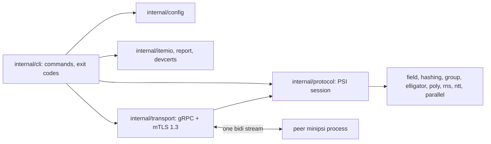

# minipsi

Production CLI for the **semi-honest polynomial-based Diffie–Hellman private set
intersection** (Rosulek–Trieu, CCS'21) over Curve25519 + Elligator2, running between two
hosts over gRPC with mutual TLS 1.3. Only the receiver learns the intersection.

How to deploy and operate it: [RUNBOOK.md](RUNBOOK.md). All flags: `minipsi <command> --help`.

## Features

- Two roles: the **receiver** learns which of its items the **sender** also holds; the sender
  learns only the receiver's padded set size.
- One-shot mode (one process and one session per party) and daemon mode (`serve` answers
  `request` sessions for named datasets, one session at a time).
- Standalone sets or batched mode (many independent instances keyed by an instance-ID column
  in CSV input).
- Optional padding on both sides to hide set sizes; SHA-256 (default) or fixed-key AES
  comparison hash; statistical security parameter `--lambda` (default 40).
- Mutual TLS 1.3 with optional peer pinning, a throw-away development PKI (`--dev`,
  `certs dev`), JSON run reports, structured logs, and fixed exit codes.

## Technology

| Area | Choice |
|---|---|
| Language | Go (module `github.com/XSpring/minipsi`, `go 1.26.0`; CI and image use Go 1.27.3) |
| CLI and config | spf13/cobra, spf13/pflag, gopkg.in/yaml.v3 |
| Transport | gRPC over HTTP/2 with mutual TLS 1.3, protobuf schema in `api/minipsi/v1` (generated with buf) |
| Cryptography | filippo.io/edwards25519, Elligator2, SHA-256 or AES from the Go standard library |
| Polynomial arithmetic | own NTT/RNS code; optional tuneinsight/lattigo v6 backend (`--ntt-backend lattigo`) |
| Packaging | static binary (`CGO_ENABLED=0`), distroless non-root container image |

There is no database, message queue or HTTP API: two processes talk to each other directly over
one gRPC stream, and all state is in files (inputs, outputs, reports, certificates).

## Build and test

Requires Go 1.26+, `make` and `git`. Docker is optional (image build); `python3` is optional
(`scripts/e2e.sh` uses it to pick free ports). Lint, vulnerability and protobuf targets need
the pinned tools from `make tools`.

```bash
make tools   # one-time: staticcheck, govulncheck, buf, protoc plugins (via go install)
make build   # → bin/minipsi (static, CGO_ENABLED=0)
make check   # gofmt, vet, staticcheck, race tests, govulncheck
make e2e     # real processes over mTLS: one-shot runs and two daemons (scripts/e2e.sh)
make fuzz-smoke
docker build -t minipsi .   # distroless image
```

CI (`.github/workflows/ci.yml`) runs these on every push to `main` and every pull request:
lint, race tests, govulncheck, generated-code check, end-to-end, fuzz smoke and the
container build.

## Quickstart on one machine

`--dev` creates throw-away test certificates on first use and only allows loopback addresses.

```bash
printf 'alice\nbob\ncarol\n' > a.txt
printf 'bob\ncarol\ndave\n'  > b.txt

# Daemon mode: "b" serves its dataset, "a" requests a session and gets the result locally.
bin/minipsi serve   --dev --name b --listen 127.0.0.1:7443 --dataset customers=b.txt &
bin/minipsi request --dev --name a --peer 127.0.0.1:7443 --dataset customers \
  --input a.txt --output out.txt
cat out.txt   # bob, carol

# One-shot mode: one process per party, one session each.
bin/minipsi sender   --dev --listen 127.0.0.1:7444 --input b.txt &
bin/minipsi receiver --dev --connect 127.0.0.1:7444 --input a.txt --output out2.txt
```

## Commands

| Command | Purpose |
|---|---|
| `receiver`, `sender` | one-shot party: run one session and exit |
| `serve` | long-lived daemon answering session requests as sender for named datasets |
| `request` | receiver that asks a peer's `serve` daemon for a session (`--mode direct`; `relay` reserved) |
| `certs dev` | create a throw-away CA and certificates for testing |
| `bench` | run both parties in one process for capacity planning |
| `version` | version, protocol and build information |

cobra also adds `help` and `completion` (shell completion scripts).

Exit codes: 0 ok, 1 usage/config, 2 input, 3 network/timeout, 4 protocol/peer
abort/interrupted, 5 internal.

## Configuration

Every party command accepts `--config FILE` (YAML; unknown keys are errors). Flags that are set
explicitly override the file, which overrides the built-in defaults. `--config` belongs to the
subcommand: `minipsi sender --config sender.yaml`. Full reference:
[docs/CONFIGURATION.md](docs/CONFIGURATION.md); annotated examples: [RUNBOOK.md](RUNBOOK.md).

| Environment variable | Effect |
|---|---|
| `MINIPSI_DEV_PKI` | directory of the shared `--dev` PKI (else `$XDG_STATE_HOME/minipsi/dev-pki`, else `~/.local/state/minipsi/dev-pki`) |
| `MINIPSI_I_UNDERSTAND_INSECURE=1` | required for `--insecure-dev` (plaintext, development only) |
| `GOMEMLIMIT` | Go memory limit, used only when `--memory-limit` / `memory_limit` is not set |

## Architecture



`internal/cli` reads the input and configuration, opens a transport session (listen or dial),
and runs `protocol.RunReceiver` or `protocol.RunSender` over it. Details:
[docs/ARCHITECTURE.md](docs/ARCHITECTURE.md).

## Documentation

| Document | Contents |
|---|---|
| [RUNBOOK.md](RUNBOOK.md) | deployment, certificates, daemon operation, troubleshooting |
| [docs/SUMMARY.md](docs/SUMMARY.md) | one-page overview of entry points and call paths |
| [docs/ARCHITECTURE.md](docs/ARCHITECTURE.md) | layers, package boundaries, concurrency, security |
| [docs/DOMAIN.md](docs/DOMAIN.md) | PSI concepts, rules, session lifecycle, error and exit codes |
| [docs/BUSINESS_FLOWS.md](docs/BUSINESS_FLOWS.md) | end-to-end workflows |
| [docs/ENTRY_POINTS.md](docs/ENTRY_POINTS.md), [docs/CALL_GRAPHS.md](docs/CALL_GRAPHS.md) | entry points and call graphs with source references |
| [docs/CONFIGURATION.md](docs/CONFIGURATION.md) | flags, YAML keys, environment variables |
| [docs/DEVELOPMENT.md](docs/DEVELOPMENT.md) | toolchain, tests, CI, debugging, pitfalls |
| [docs/INTEGRATIONS.md](docs/INTEGRATIONS.md) | gRPC, TLS/PKI, filesystem and library integrations |
| [docs/decisions/README.md](docs/decisions/README.md) | architecture decision records |
| [AGENTS.md](AGENTS.md) | rules for contributors and AI agents |

## Layout

| Path | Contents |
|---|---|
| `cmd/minipsi` | main |
| `internal/cli`, `internal/config` | commands, YAML/flag configuration, daemon loop |
| `internal/protocol` | the PSI protocol (receiver, sender, messages, errors) |
| `internal/transport` | gRPC over mutual TLS 1.3 |
| `internal/field`, `ntt`, `rns`, `poly` | prime field, NTT/RNS multiplication, polynomial interpolation/evaluation |
| `internal/group`, `elligator`, `hashing` | Curve25519 group, Elligator2 encoding, hashing |
| `internal/itemio`, `report`, `devcerts` | input/output files, JSON reports, test certificates |
| `api/minipsi/v1` | protobuf wire schema (generated code in `internal/gen`) |
| `test/e2e`, `scripts/e2e.sh` | end-to-end tests |
