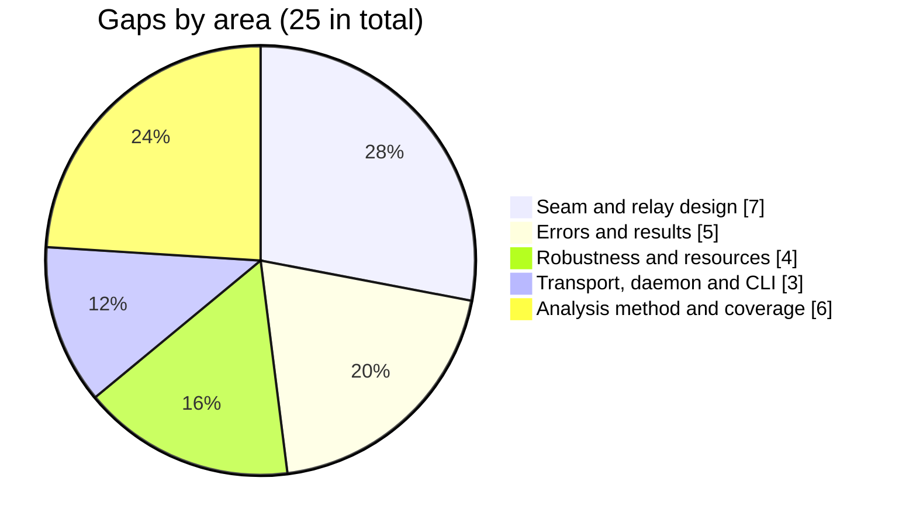

# Analysis gaps and open questions

Companion documents: [SUMMARY.md](SUMMARY.md), [ENTRY_POINTS.md](ENTRY_POINTS.md),
[CALL_GRAPHS.md](CALL_GRAPHS.md) and [BUSINESS_FLOWS.md](BUSINESS_FLOWS.md).

This file lists what the entry-point, call-graph and business-flow analysis did not settle,
what it settled only partly, and what a team designing a new API on top of the PSI core
(`internal/protocol`: `RunReceiver`, `RunSender`, `Conn`, `Frame`) should check before relying
on it.

**Scope of the analysis.** All production files under `cmd/` and `internal/`, plus `api/`,
`scripts/`, `test/e2e` and the build files (`Makefile`, `Dockerfile`, `go.mod`,
`buf.gen.yaml`, `.github/workflows/ci.yml`), were analysed statically at commit `4aa7c9f`
(module `github.com/XSpring/minipsi`). A machine call graph was built from `main` in
`cmd/minipsi` with `golang.org/x/tools/cmd/callgraph` (VTA algorithm). Eight subsystem tracers
produced the raw findings. The per-subsystem adversarial verification and the completeness
review were stopped early for time, so every item below was re-checked in the source for this
file, and anything that could not be confirmed is labelled *inferred*. There was no runtime
tracing in this analysis: no binary, test or network session was run to produce these
findings. The internals of third-party modules were not traced.

Every `path:line` below was checked mechanically against the source at commit `4aa7c9f`.
`README.md` is cited without a line number.

## Summary

| ID | Gap | Area | Impact on the new API design |
|---|---|---|---|
| [GAP-01](#gap-01) | Relay mode via the Orchestrator is not implemented; no relay or inbox/outbox `Conn` exists | Seam and relay design | high |
| [GAP-02](#gap-02) | The protocol seam is under `internal/` and cannot be imported by other modules | Seam and relay design | high |
| [GAP-03](#gap-03) | `Hello` carries no frame size, so `MaxFrame` must match by configuration | Seam and relay design | high |
| [GAP-04](#gap-04) | The wire schema has no session or routing envelope | Seam and relay design | high |
| [GAP-05](#gap-05) | Peer authentication and frame integrity live only in the transport | Seam and relay design | high |
| [GAP-06](#gap-06) | Both parties must be live at once: per-frame timeouts, no resume | Seam and relay design | high |
| [GAP-07](#gap-07) | The handshake sends everything before it receives; a blocking `Conn.Send` can deadlock | Seam and relay design | high |
| [GAP-08](#gap-08) | Pre-session errors are untyped and send no `Abort`; report and process exit codes can differ | Errors and results | high |
| [GAP-09](#gap-09) | A failed run returns no SID and no statistics | Errors and results | medium |
| [GAP-10](#gap-10) | The final `Abort` is best effort and may not reach the peer | Errors and results | medium |
| [GAP-11](#gap-11) | A cancellation during receiver matching may yield a truncated result (narrow race) | Errors and results | medium |
| [GAP-12](#gap-12) | A session with zero instances is not exercised by any test | Errors and results | low |
| [GAP-13](#gap-13) | Panics outside the protocol task group are not recovered | Robustness and resources | high |
| [GAP-14](#gap-14) | Polynomial and RNS work cannot be cancelled mid-operation | Robustness and resources | medium |
| [GAP-15](#gap-15) | Many sessions in one process: process-global caches, per-tree cache budget, lattigo concurrency | Robustness and resources | medium |
| [GAP-16](#gap-16) | Receiver padding hides the set size only in the announced count, not in the work done | Robustness and resources | low |
| [GAP-17](#gap-17) | Transport dial edge cases (unbounded single attempt, cancel race, error text after `Close`) | Transport, daemon and CLI | low |
| [GAP-18](#gap-18) | The daemon serves one session at a time, and its shutdown has an accept race | Transport, daemon and CLI | low |
| [GAP-19](#gap-19) | CLI runtime behaviour that was derived from source but never executed | Transport, daemon and CLI | low |
| [GAP-20](#gap-20) | Dynamic calls that VTA over-approximates | Analysis method and coverage | low |
| [GAP-21](#gap-21) | Framework-managed calls (cobra `RunE`, gRPC handler dispatch, `init` order) are missing from the machine graph | Analysis method and coverage | medium |
| [GAP-22](#gap-22) | Third-party implementations were not traced inside | Analysis method and coverage | medium |
| [GAP-23](#gap-23) | Test-only code is not covered by the call graph from `main` | Analysis method and coverage | low |
| [GAP-24](#gap-24) | Generated code in `internal/gen` was not reviewed beyond its registration and dispatch | Analysis method and coverage | medium |
| [GAP-25](#gap-25) | Adversarial verification and the completeness review were stopped early | Analysis method and coverage | medium |

## Seam and relay design

### GAP-01 Relay mode via the Orchestrator is not implemented; no relay or inbox/outbox Conn exists

- **Description.** `mode: relay` (and `--mode relay`) is declared, but configuration
  validation rejects it with "mode relay (via the Orchestrator) is not implemented yet".
  Nothing else in the repository refers to an Orchestrator: there is no client, no service
  definition and no message type for it. `protocol.Conn` has exactly three implementations:
  the gRPC `streamConn`, the in-memory `PipeConn` and the test-only `nopConn`. There is no
  inbox/outbox, store-and-forward or relay transport to build on.
- **Relevant file or symbol.** `validMode` at internal/config/config.go:252-260 (the
  rejection at internal/config/config.go:256-257), called from `(*Config).Validate` at
  internal/config/config.go:167 and from the daemon validation at internal/config/serve.go:165.
  Flag help at internal/cli/party.go:77 and internal/cli/serve.go:45. YAML comments at
  internal/config/config.go:23 and internal/config/serve.go:20. Operator docs at RUNBOOK.md:143
  and in the `request` row of the command table in `README.md`. `Conn` at internal/protocol/conn.go:12-15; implementations at
  internal/transport/transport.go:143, internal/protocol/conn.go:18 and
  internal/protocol/protocol_test.go:744.
- **What has been verified.** A search of the tree (outside `docs/`) for relay, Orchestrator,
  inbox and outbox finds only the places listed above. Tests assert the rejection:
  internal/config/serve_test.go:91, internal/config/serve_test.go:136,
  internal/cli/serve_test.go:247 and internal/cli/serve_test.go:254. The `Conn`
  implementations match the seam table in [ENTRY_POINTS.md](ENTRY_POINTS.md#seam).
- **What remains uncertain.** The intended meaning of relay mode: what the Orchestrator is,
  whether it only forwards frames or also terminates TLS, which party connects to it, and how
  datasets are selected. None of this is in the code or the operator docs.
- **Recommended next step.** Write the Orchestrator contract down before coding (roles,
  addressing, what the relay may see, failure semantics). Then build the new `Conn` and run it
  under the existing pair harness `runPair` (internal/protocol/protocol_test.go:62), which
  already drives both roles over `PipeConn`. Related: [EP-04](ENTRY_POINTS.md#ep-04),
  [EP-05](ENTRY_POINTS.md#ep-05), [BF-08](BUSINESS_FLOWS.md#bf-08).

### GAP-02 The protocol seam is under internal/ and cannot be imported by other modules

- **Description.** `internal/protocol`, `internal/transport` and the generated stubs in
  `internal/gen/minipsiv1` all sit under `internal/` of module `github.com/XSpring/minipsi`.
  Go only allows packages rooted at that module to import them, so a new API in another module
  cannot call `RunReceiver`/`RunSender` or implement `Conn` (which needs `protocol.Frame`).
  Two further leaks would remain even after re-exporting the package: `Config.Hash` and
  `Hello.Hash` have the type `hashing.Alg` from `internal/hashing`, and the conversion between
  `protocol.Frame` and the protobuf `Frame` (`toPB`, `fromPB`) is unexported in the transport.
- **Relevant file or symbol.** `go.mod` line 1 (`module github.com/XSpring/minipsi`);
  `RunReceiver` at internal/protocol/receiver.go:40; `RunSender` at
  internal/protocol/sender.go:28; `Config.Hash` at internal/protocol/session.go:37;
  `Hello.Hash` at internal/protocol/messages.go:45; `toPB` at internal/transport/convert.go:10
  and `fromPB` at internal/transport/convert.go:49; the protobuf Go package path at
  api/minipsi/v1/psi.proto:6 and the generator output directory at buf.gen.yaml:4.
- **What has been verified.** The module path, the package locations, the exported API of
  `internal/protocol` (listed in [ENTRY_POINTS.md](ENTRY_POINTS.md#seam)) and the lower-case
  conversion functions were read in the source.
- **What remains uncertain.** Whether the new API will live inside this module (then nothing
  needs to move) or in a separate one. There is no stated stability or versioning policy for
  `Frame`, `Config` or `Result`.
- **Recommended next step.** Decide module placement first. If the API is external, plan a
  public package that re-exports the seam together with a public `Alg` type and a public wire
  codec, and keep `internal/protocol` as the implementation.

### GAP-03 Hello carries no frame size, so MaxFrame must match by configuration

- **Description.** Each party sizes its outgoing frames from its own `Config.MaxFrame`.
  `Hello` has no frame-size field, so the parties never agree on one. The gRPC transport
  limits incoming messages to the local `MaxFrame` + 64 KiB; the protocol itself never checks
  the size of an incoming frame, and `PipeConn` has no limit at all. With different values on
  the two sides, a frame above the smaller limit ends the stream with "frame exceeds size
  limit", which surfaces as a `TransportError` (exit 3 in the CLI) and sends no `Abort`.
- **Relevant file or symbol.** `Hello` at internal/protocol/messages.go:41-50; frame sizing at
  internal/protocol/session.go:376, internal/protocol/receiver.go:234,
  internal/protocol/sender.go:111 and internal/protocol/sender.go:203 (reserve constant at
  internal/protocol/messages.go:199-202); gRPC limits at internal/transport/transport.go:118,
  internal/transport/transport.go:379-380 and internal/transport/transport.go:494; error
  mapping at internal/transport/transport.go:274-275; no `Abort` for transport failures at
  internal/protocol/errors.go:78-82; `PipeConn.Send` at internal/protocol/conn.go:36-54. The CLI
  passes one value to both layers (internal/cli/party.go:331, internal/cli/party.go:345).
- **What has been verified.** All of the above in source. The transport-level rejection of an
  oversized frame is covered by `TestFrameLimitAndCancellation`
  (internal/transport/transport_test.go:431), which sends a raw oversized frame, not a
  protocol run.
- **What remains uncertain.** The end-to-end outcome for two parties with different
  `--max-frame` values was not executed; which side fails first depends on the direction of
  the first oversized frame (inferred). A relay or inbox would add its own size limit, which
  does not exist yet.
- **Recommended next step.** Either fix `MaxFrame` per deployment and document it, or add a
  frame-size field to `Hello`. The latter is a wire change: `Hello` is part of the transcript
  digest and the protocol version is 1 (internal/version/version.go:13). In either case the new
  `Conn` should enforce an inbound size limit itself. Related: [BF-04](BUSINESS_FLOWS.md#bf-04),
  [CG-06](CALL_GRAPHS.md#cg-06).

### GAP-04 The wire schema has no session or routing envelope

- **Description.** The protobuf `Frame` is a `oneof` of protocol messages only, and the
  service carries exactly one session per bidirectional stream. The dataset name and the
  requester's identity travel as gRPC metadata headers (`minipsi-dataset`,
  `minipsi-identity`), not in any frame. The session ID is derived only after both `Hello`
  frames (from the two nonces). A relay or inbox that carries several sessions has no
  correlation ID, addressee or sequence number to route by, and must add its own envelope
  around `Frame`.
- **Relevant file or symbol.** api/minipsi/v1/psi.proto:10-24 (service and `Frame`); metadata
  keys at internal/config/serve.go:56-59; client metadata at
  internal/transport/transport.go:55-56 and internal/cli/party.go:369-377; server-side
  extraction at internal/transport/transport.go:396-405; admission at
  internal/cli/serve.go:131-137; SID derivation at internal/protocol/session.go:452-456.
- **What has been verified.** The schema, the metadata path and the SID derivation were read
  in source.
- **What remains uncertain.** How the Orchestrator would address parties and datasets, and
  whether the self-declared `minipsi-identity` (logged and reported only, never used for
  authorization) should keep that meaning.
- **Recommended next step.** Define the envelope in the new API's own schema and treat `Frame`
  as an opaque payload inside it. Map today's `Options.Admit` decision
  (internal/transport/transport.go:62) to the new API. Related: [EP-06](ENTRY_POINTS.md#ep-06),
  [BF-02](BUSINESS_FLOWS.md#bf-02), [BF-03](BUSINESS_FLOWS.md#bf-03).

### GAP-05 Peer authentication and frame integrity live only in the transport

- **Description.** The protocol layer has no notion of peer identity: `Conn` has no identity
  method and `Hello` has no identity field. Its only integrity check is an unkeyed SHA-256
  transcript per direction, compared when the peer's `Done` arrives. That detects lost,
  reordered or duplicated frames, but not an intermediary that rewrites frames and the `Done`
  digest consistently. In direct mode the guarantees come from mutual TLS 1.3 and from
  SAN-based admission in the transport. A relay that terminates TLS would see, and could
  alter, every frame.
- **Relevant file or symbol.** internal/protocol/conn.go:12-15;
  internal/protocol/messages.go:41-50 and internal/protocol/messages.go:86-89; transcript at
  internal/protocol/session.go:194, internal/protocol/session.go:276-277,
  internal/protocol/session.go:326-329 and internal/protocol/session.go:334-338; TLS 1.3
  requirement at internal/transport/transport.go:105-107; `peerSANs` at
  internal/transport/transport.go:283-298; `PeerIdentity` at
  internal/transport/transport.go:348; authorization at internal/cli/serve.go:134.
- **What has been verified.** `internal/protocol` imports only `crypto/rand` and
  `crypto/sha256` from the crypto packages and contains no MAC or signature. The transcript
  code and the TLS checks were read in source.
- **What remains uncertain.** Whether the semi-honest security argument still holds when a
  third party observes every frame (`SenderKeys`, `PolyChunk`, `OutputChunk`); this was not
  analysed. Whether the Orchestrator is trusted.
- **Recommended next step.** A cryptographic review of the relay threat model. If the relay is
  not trusted, keep an end-to-end authenticated channel between the parties (tunnelled through
  the relay) so that the new `Conn` keeps the properties `streamConn` gets from mTLS. Related:
  [CG-05](CALL_GRAPHS.md#cg-05), [ENTRY_POINTS.md seam](ENTRY_POINTS.md#seam).

### GAP-06 Both parties must be live at once: per-frame timeouts and no resume

- **Description.** A party is one blocking call (`RunReceiver` or `RunSender`) that keeps all
  session state in memory. Every receive is bounded: `HandshakeTimeout` (default 30 s) during
  the handshake and `PhaseTimeout` (default 10 min) afterwards. A timeout becomes
  `CodeTimeout`. There is no checkpoint, no way to serialise a session, and no way to resume
  it. An inbox/outbox design in which one party comes online later, or a relay with long
  queueing delays, fails unless the caller raises these timeouts. `PhaseTimeout` must also
  exceed the peer's longest computation between two frames (for example a whole interpolation
  before the first `PolyChunk`).
- **Relevant file or symbol.** Defaults at internal/protocol/session.go:82-87; `recv` at
  internal/protocol/session.go:306-317; the readers at internal/protocol/receiver.go:440 and
  internal/protocol/sender.go:324; entry points at internal/protocol/receiver.go:40 and
  internal/protocol/sender.go:28; the CLI whole-run bound at internal/cli/party.go:278-282.
- **What has been verified.** The timeout fields are exported in `Config` and are applied per
  frame; session state is held in the unexported `session`, `receiver` and `sender` structs
  and never written out.
- **What remains uncertain.** The real compute time between frames for the largest allowed
  instances (it was not measured), and therefore safe timeout values for an asynchronous
  transport.
- **Recommended next step.** Decide whether the new API needs both parties online for the
  whole session. If not, the design needs either very long timeouts with a live process on
  each side, or a protocol change. Measure inter-frame gaps with `minipsi bench` at the target
  sizes. Related: [BF-04](BUSINESS_FLOWS.md#bf-04), [CG-06](CALL_GRAPHS.md#cg-06).

### GAP-07 The handshake sends everything before it receives; a blocking Conn.Send can deadlock

- **Description.** `handshake` queues `Hello` and every `SizesChunk` before its first
  receive. The queue `s.out` holds 8 frames and `send` has no timeout; the role readers start
  only after the handshake. If `Conn.Send` blocks until the peer reads (a synchronous relay, or
  `Pipe` with a small buffer), and both parties have enough instances to fill the queue and
  the transport buffer, both sides can block in send at the same time. `HandshakeTimeout` does
  not help, because it bounds only receives.
- **Relevant file or symbol.** internal/protocol/session.go:373-389 (send loop before the
  first `recv`); queue size at internal/protocol/session.go:193; `send` at
  internal/protocol/session.go:296-303; reader start at internal/protocol/receiver.go:118 and
  internal/protocol/sender.go:84; `Pipe` at internal/protocol/conn.go:25-33; `bench` uses
  `Pipe(8)` at internal/cli/tools.go:103.
- **What has been verified.** The ordering and the buffer sizes in source. Each `SizesChunk`
  carries up to (`MaxFrame` - 1024) / 10 entries, about 419,000 at the default 4 MiB.
- **What remains uncertain.** Not executed. By count (inferred), over `Pipe(8)` the block needs
  roughly 16 or more `SizesChunk` frames per side, which is millions of instances at the
  default `MaxFrame` and about 100,000 at the 64 KiB minimum. How much gRPC buffers through
  HTTP/2 flow control was not quantified. [BF-04](BUSINESS_FLOWS.md#bf-04) lists the same
  question as an inferred risk.
- **Recommended next step.** Require the new `Conn` to accept at least the whole handshake
  without the peer reading (an unbounded or large outbound buffer), or receive concurrently
  during the handshake. Test with `RunReceiver`/`RunSender` over `Pipe(8)`,
  `Config{MaxFrame: 64 << 10}` and about 110,000 empty instances per side under a 30 s
  deadline.

## Errors and results

### GAP-08 Pre-session errors are untyped and send no Abort; report and process exit codes can differ

- **Description.** Before the session starts, `RunReceiver` and `RunSender` return plain
  errors: an invalid padding policy, `Config.validate` failures (hash, lambda, max frame) and
  an unknown NTT backend from `poly.NewArith`. Only `checkOwn` returns a typed `*Error`. None
  of these sends an `Abort`, so the peer waits for its own handshake timeout or a transport
  close. In the CLI, `cli.Run` turns an unclassified `ExitInternal` error into `ExitUsage`
  (1), while the JSON report stores `exitCode(err)` (5) directly, so the two could disagree.
  [BF-09](BUSINESS_FLOWS.md#bf-09) leaves open whether such an error can reach `cli.Run`.
- **Relevant file or symbol.** internal/protocol/receiver.go:42-44 and
  internal/protocol/receiver.go:57-63; internal/protocol/sender.go:30-43;
  `validate` at internal/protocol/session.go:105-119; `newSession` at
  internal/protocol/session.go:169-177; `rns.NewBackend` at internal/rns/rns.go:282-290; the
  downgrade rule at internal/cli/root.go:95-100; the report at internal/cli/party.go:242-246.
- **What has been verified.** The plain-error sources above are the only `fmt.Errorf` or
  `errors.New` values the protocol can return unwrapped; inside `session.run` every failure is
  an `*Error`, a `*TransportError` or a context error that `classify` converts
  (internal/protocol/session.go:255-267). For the CLI, the open question is answered from
  source (inferred, not executed): party runs call `CheckInput` first
  (internal/cli/party.go:230), which runs the same `validate` and `checkOwn`
  (internal/protocol/padding.go:99-114), and `config.Validate` rejects unknown NTT backends
  (internal/config/config.go:228-231), so a plain error should not reach `cli.Run` from
  `receiver`, `sender`, `request` or `serve`. `bench` skips both checks and maps every failure
  to exit 5 (internal/cli/tools.go:125-127).
- **What remains uncertain.** Whether a caller of the new API will run `CheckInput` first.
  Third-party failures inside `newSession` were not traced.
- **Recommended next step.** In the new API, call `protocol.CheckInput` before connecting and
  wrap any remaining plain error from `Run*` as an internal or configuration error. Consider
  sending `AbortConn` (internal/protocol/errors.go:97-101) when a run fails before its session
  starts. Related: [CG-01](CALL_GRAPHS.md#cg-01), [BF-09](BUSINESS_FLOWS.md#bf-09).

### GAP-09 A failed run returns no SID and no statistics

- **Description.** On any error `RunSender` returns `(nil, err)` and `RunReceiver` returns
  `(nil, err)`, even after the handshake has derived a session ID and frames have been
  exchanged. Callers therefore cannot log the SID, byte counts, frame counts or phase timings
  of a failed session. The daemon's failed-session reports have no `sid`, and their file names
  end in `failed`, so a failed report can only be matched to the peer's report by time and
  peer.
- **Relevant file or symbol.** internal/protocol/sender.go:45-48;
  internal/protocol/receiver.go:65-70; the daemon at internal/cli/serve.go:192-197 and
  internal/cli/serve.go:213-218; one-shot runs at internal/cli/party.go:293-308.
- **What has been verified.** The return paths and the report code in source.
- **What remains uncertain.** Whether this is intended (the stats contain no secrets, per the
  comment at internal/protocol/session.go:121).
- **Recommended next step.** Decide whether the new API needs partial statistics and the SID
  on failure (for correlation and billing). If so, the protocol must return them with the
  error, for example through a field on `*Error`.

### GAP-10 The final Abort is best effort and may not reach the peer

- **Description.** After a local failure, `session.run` sends one `Abort` directly on the
  `Conn` with a 5 s bound and ignores the result. With `streamConn`, if the writer was stuck in
  a flow-controlled gRPC send, `Send` returned the context error while `sendLoop` is still in
  the old send; the `Abort` then has to wait for the unbuffered `sendCh` and may be dropped
  after 5 s. The peer then sees a timeout or a transport error instead of the abort code.
- **Relevant file or symbol.** internal/protocol/session.go:243-249;
  internal/transport/transport.go:186-203 (`sendLoop`) and
  internal/transport/transport.go:206-221 (`Send`).
- **What has been verified.** The code paths in source. The end-to-end abort behaviour for the
  common cases is covered by the e2e suite (`TestSigtermMidRun`, test/e2e/e2e_test.go:189).
- **What remains uncertain.** Whether a grpc-go send really stays blocked that long when the
  peer stops reading (third-party behaviour, not executed).
- **Recommended next step.** A new `Conn` should let a control frame overtake a blocked data
  send, or document that the abort code may be lost. Related: [CG-05](CALL_GRAPHS.md#cg-05),
  [CG-06](CALL_GRAPHS.md#cg-06).

### GAP-11 A cancellation during receiver matching may yield a truncated result (narrow race)

- **Description.** `compareValues` and `match` discard the error of `parallel.For`, which
  stops scheduling chunks once the context is cancelled. Normally the writer goroutine sees
  the cancellation and the run fails. But if the body finishes and closes `s.out` while the
  writer is idle, the writer's `select` may pick the closed channel and return `nil`, so
  `RunReceiver` could return a partly filled `Result` with a nil error.
- **Relevant file or symbol.** internal/protocol/receiver.go:326,
  internal/protocol/receiver.go:335, internal/protocol/receiver.go:366 and
  internal/protocol/receiver.go:382; the call at internal/protocol/receiver.go:146; the body
  and writer at internal/protocol/session.go:229-235 and internal/protocol/session.go:269-275;
  early stop in internal/parallel/parallel.go:73-80.
- **What has been verified.** The discarded errors and the `select` in source.
  [BF-05](BUSINESS_FLOWS.md#bf-05) marks the same race as inferred.
- **What remains uncertain.** Not reproduced; the interleaving is narrow (inferred).
- **Recommended next step.** Check `ctx.Err()` before the receiver body returns, or propagate
  the `parallel.For` error, and add a test that cancels during matching.

### GAP-12 A session with zero instances is not exercised by any test

- **Description.** A batched CSV with only a header yields an empty instance list. The
  handshake has no explicit check for zero instances, and the receiver's reader closes its
  readiness channels at once when there are none, which suggests the session completes with an
  empty result (inferred). No test runs a full session with an empty instance list; the tests
  with empty instances use non-empty lists.
- **Relevant file or symbol.** `grouper.finish` at internal/itemio/itemio.go:215-225; the
  instance-count check at internal/protocol/session.go:410-411; the reader at
  internal/protocol/receiver.go:432-438; `TestBatched` at
  internal/protocol/protocol_test.go:150-152.
- **What has been verified.** The code paths above. [BF-07](BUSINESS_FLOWS.md#bf-07) lists the
  outcome as not determined.
- **What remains uncertain.** Whether the sender side also completes; not executed.
- **Recommended next step.** Add a protocol test with `nil` instances on both sides, and
  decide whether the new API should reject an empty request before connecting.

## Robustness and resources

### GAP-13 Panics outside the protocol task group are not recovered

- **Description.** The only `recover` in production code is in `taskGroup.Go`, and it covers
  only the task-group goroutine itself. A panic in a `parallel.For` worker, in a
  `poly.Arith.both` fork, in an RNS per-prime goroutine, in `serveSession` outside the
  protocol, or in the `Admit` callback on a gRPC goroutine ends the whole process. Two of the
  17 production `panic(` sites (outside `internal/gen`) fire when a transform exceeds
  `rns.MaxProductLen` (2^23). The default `MaxInstanceSize` of 2^22 stays below that, but
  configuration only requires the limit to be at least 1. In a long-running API server this
  turns one bad session into a crash of every session.
- **Relevant file or symbol.** internal/protocol/session.go:541-553; workers at
  internal/parallel/parallel.go:61-72; `both` at internal/poly/arith.go:44-61; per-prime
  goroutines at internal/rns/native.go:41; panics at internal/poly/arith.go:77 and
  internal/poly/arith.go:234; `MaxProductLen` at internal/rns/rns.go:24 and the length check at
  internal/rns/rns.go:293; the limit check at internal/config/config.go:219.
- **What has been verified.** A search for `recover()` outside tests finds only
  internal/protocol/session.go:546. The panic sites and the limit check were read in source.
  [BF-02](BUSINESS_FLOWS.md#bf-02) and [BF-09](BUSINESS_FLOWS.md#bf-09) note the same risk as
  inferred.
- **What remains uncertain.** Which of the 17 panic sites real inputs or peer frames can
  reach; the exact instance size that first exceeds `MaxProductLen` after padding (not
  computed).
- **Recommended next step.** Clamp `Limits.MaxInstanceSize` against `rns.MaxProductLen` in
  validation, and add `recover` in `parallel.For` workers (or in the new API's session
  goroutine). Fuzz input parsing and frame handling at large sizes. Related:
  [EP-13](ENTRY_POINTS.md#ep-13), [CG-09](CALL_GRAPHS.md#cg-09).

### GAP-14 Polynomial and RNS work cannot be cancelled mid-operation

- **Description.** `Multiplier.Lift`, `Multiplier.Reconstruct` and `Arith.forEach` pass
  `context.Background()` to `parallel.For`, and `parallel.For` never passes a context into the
  work function. Cancellation (a caller deadline, a peer abort, shutdown) is noticed only
  between protocol-level chunks. Shutdown with a session in flight can therefore take as long
  as the largest uninterrupted polynomial step, plus up to 5 s for the `Abort` and up to 5 s
  for the gRPC graceful stop.
- **Relevant file or symbol.** internal/rns/multiplier.go:60 and
  internal/rns/multiplier.go:69; internal/poly/evaluator.go:69; `parallel.For` at
  internal/parallel/parallel.go:21 (context checks only at internal/parallel/parallel.go:38-47
  and internal/parallel/parallel.go:73-80); `Abort` bound at
  internal/protocol/session.go:246; server close at internal/transport/transport.go:469-482.
- **What has been verified.** The `context.Background()` calls and the loop structure in
  source. [BF-06](BUSINESS_FLOWS.md#bf-06) marks the latency as inferred.
- **What remains uncertain.** The worst-case delay for the largest allowed instances; not
  measured.
- **Recommended next step.** Time a cancelled large interpolation and evaluation (for example
  with `minipsi bench` at 2^22 items) and set the new API's cancellation SLO from that.

### GAP-15 Many sessions in one process: process-global caches, per-tree cache budget, lattigo concurrency

- **Description.** The existing daemon runs one session at a time; an API server will
  probably run many. Several resources are not per session. The native NTT twiddle tables
  (one per prime) grow on demand and are never shrunk, and the lattigo backend caches one ring
  per transform size in a process-global map that is never cleared, building new rings while
  holding a mutex. `poly_cache` (`Arith.CacheBytes`, default 256 MiB) is a budget per
  polynomial tree, not per session or process, and the sender builds several trees per
  instance concurrently. `Workers` defaults to `GOMAXPROCS` per session, and the goroutine
  fan-out multiplies across nested parallel loops. Note also that `Config.PolyCacheBytes` 0
  means the default budget in the protocol, while the CLI maps `poly_cache: 0` to "disabled"
  (-1).
- **Relevant file or symbol.** `lattigoSingleton` at internal/rns/lattigo.go:19 and
  `Transform` at internal/rns/lattigo.go:26-42; `Prime.table` at internal/ntt/ntt.go:146-179;
  `Tree.cached` at internal/poly/tree.go:54 and its check at internal/poly/tree.go:110; the
  budget comment at internal/poly/arith.go:23; tree building at
  internal/protocol/sender.go:181-193; `Config.PolyCacheBytes` at
  internal/protocol/session.go:41-43; the CLI mapping at internal/cli/party.go:324-327.
- **What has been verified.** The data structures and their lifetimes in source. `bench` runs
  two sessions concurrently in one process (internal/cli/tools.go:113-122).
- **What remains uncertain.** Peak and retained memory per session; whether lattigo's `INTT`
  and `MulCoeffsBarrett` are safe when one ring is shared by concurrent goroutines and sessions
  (lattigo internals not traced; `TestBackendsAgree` compares results only). No test runs more
  than one pair of sessions concurrently with the lattigo backend under `-race` (inferred from
  the test list).
- **Recommended next step.** Run `go test -race` on `./internal/rns` and `./internal/poly` with
  the lattigo backend, add a concurrent multi-session protocol test, and measure heap after
  large sessions. Bound per-process concurrency and `Workers` in the new API.

### GAP-16 Receiver padding hides the set size only in the announced count, not in the work done

- **Description.** The receiver announces a padded point count, but its hashing and Elligator2
  encoding run over its distinct items only; dummy points are drawn at random afterwards and
  skip the curve work. The receiver's elliptic-curve cost, and so the time before its first
  `PolyChunk`, still scales with the true set size. Sender dummies, by contrast, go through the
  full pipeline.
- **Relevant file or symbol.** internal/protocol/receiver.go:102-103,
  internal/protocol/receiver.go:175-194 and `withDummies` at
  internal/protocol/receiver.go:267-300; the sender's comment at
  internal/protocol/sender.go:130-134.
- **What has been verified.** The loop bounds in source. [BF-05](BUSINESS_FLOWS.md#bf-05)
  records the same fact.
- **What remains uncertain.** Whether a sender can estimate the receiver's set size from
  timing in practice; not measured.
- **Recommended next step.** Document it as a limitation of the padding feature in the new
  API, or measure it with `--pad-min` and `--pad-multiple`.

## Transport, daemon and CLI

### GAP-17 Transport dial edge cases (unbounded single attempt, cancel race, error text after Close)

- **Description.** Three edge cases in `internal/transport`, relevant only if the new API
  reuses it. (1) One `Dial` attempt is not bounded by `ConnectRetry`: the deadline is checked
  only after an attempt fails, and the attempt context comes from `context.Background()`, so
  waiting for the server's headers can last until the caller's context ends or keepalive
  closes the connection. (2) If the dial context is cancelled just after the headers arrive,
  `AfterFunc` may already have cancelled the stream while `Dial` returns success (the result of
  `stop()` is ignored). (3) `Accept` after `Close` wraps a nil error with `%w`.
- **Relevant file or symbol.** internal/transport/transport.go:508-562 (the loop; attempt
  context at internal/transport/transport.go:510, `AfterFunc` at
  internal/transport/transport.go:514, `stop()` at internal/transport/transport.go:527, the
  deadline check at internal/transport/transport.go:547); `Accept` at
  internal/transport/transport.go:457-466.
- **What has been verified.** The code paths in source.
- **What remains uncertain.** The real bound from grpc's `MinConnectTimeout` and keepalive; the
  race is probably benign because `session.recv` checks the caller's context first
  (internal/protocol/session.go:311) (inferred). None was executed.
- **Recommended next step.** Unit tests against a peer that completes TLS but never answers
  the stream, and a cancellation right after `SendHeader`. Related:
  [CG-05](CALL_GRAPHS.md#cg-05).

### GAP-18 The daemon serves one session at a time, and its shutdown has an accept race

- **Description.** `serve` handles sessions strictly one after another: the transport refuses
  a second concurrent request as busy, and the accept loop is synchronous. During shutdown, a
  requester that was handed to `Server.sessions` can race with `ctx.Done` in `Accept`'s
  `select`; Go picks a ready case at random, so the daemon may accept one more session and fail
  it at once as cancelled. [BF-02](BUSINESS_FLOWS.md#bf-02) lists this as an open question.
- **Relevant file or symbol.** The busy check at internal/transport/transport.go:418-426;
  `Accept` at internal/transport/transport.go:457-466; the hand-off at
  internal/transport/transport.go:436-446; the loop at internal/cli/serve.go:155-165.
- **What has been verified.** The `select` cases and the loop in source.
- **What remains uncertain.** The outcome of the race at runtime (no test exercises it).
- **Recommended next step.** If the new API reuses the daemon pattern, check `ctx.Err()` before
  `Accept` returns a session, and design for concurrent sessions from the start (see
  [GAP-15](#gap-15)). Related: [EP-05](ENTRY_POINTS.md#ep-05), [CG-04](CALL_GRAPHS.md#cg-04).

### GAP-19 CLI runtime behaviour that was derived from source but never executed

- **Description.** Several CLI behaviours come only from reading code. Signals are not
  observed while input is read (including stdin), while the dev PKI is created or while TLS
  files load, because those steps take no context. `bench`, `certs dev` and `version` install
  no signal handler, so their exit status on SIGINT is the shell's death-by-signal status. In
  the container image (`USER nonroot`, no `HOME` or `MINIPSI_DEV_PKI` set), where `--dev`
  writes its PKI, or whether it fails, depends on the base image's home directory.
- **Relevant file or symbol.** The signal context at internal/cli/party.go:181 and
  internal/cli/serve.go:95; input, dev PKI and TLS steps at internal/cli/party.go:261 and
  internal/cli/party.go:271-277; `main` at cmd/minipsi/main.go:12; `bench` at
  internal/cli/tools.go:93; Dockerfile:17-21; `DefaultDevDir` at
  internal/devcerts/devpki.go:31-42.
- **What has been verified.** The absence of a context in those steps, the places where
  `signal.NotifyContext` is installed, and the Dockerfile contents.
- **What remains uncertain.** Observed behaviour; nothing was run.
- **Recommended next step.** Low priority for the API design. Check by hand in a sandbox if the
  CLI stays the reference client.

## Analysis method and coverage

### GAP-20 Dynamic calls that VTA over-approximates

- **Description.** The machine graph has 278 dynamic edges among module functions. Some sites
  are much wider than what runs. Every `err.Error()` site has 129 targets in the full graph
  (stdlib and third-party error types included), of which only the module's own error types
  are plausible. The flag-copy call in the party commands has 44 targets because the three
  commands are merged. `parallel.For`'s work function has 13 targets per call site, merged
  across all callers. `session.run`'s body call lists both role bodies, though only one runs
  per session. `Conn.Send` and `Conn.Recv` resolve to `PipeConn` and `streamConn`, both real.
- **Relevant file or symbol.** `err.Error()` sites at internal/cli/root.go:34,
  internal/cli/party.go:246, internal/cli/serve.go:203, internal/config/serve.go:212,
  internal/protocol/errors.go:55 and internal/protocol/errors.go:73; flag copy at
  internal/cli/party.go:169; `parallel.For` at internal/parallel/parallel.go:43 and
  internal/parallel/parallel.go:66; task-group dispatch at internal/protocol/session.go:550;
  `Conn` calls at internal/protocol/session.go:247, internal/protocol/session.go:283 and
  internal/protocol/session.go:309; the 13 serve flag closures at internal/cli/serve.go:66 (all
  real).
- **What has been verified.** The edge counts were taken from the VTA output, and the sites
  above were read in source. The call graphs in [CALL_GRAPHS.md](CALL_GRAPHS.md) draw the
  pruned, source-confirmed edges, not the raw VTA fan-out.
- **What remains uncertain.** The tracers pruned the remaining dynamic sites (for example the
  comparer dispatch in `sender.evaluate` and the RNS per-prime closures); those prunings were
  not independently re-verified because verification stopped early (see [GAP-25](#gap-25)).
- **Recommended next step.** None for the API design. Anyone reusing the TSV graphs should
  filter `Error` fan-out and pair `parallel.For` closures with their callers from source.

### GAP-21 Framework-managed calls (cobra RunE, gRPC handler dispatch, init order) are missing from the machine graph

- **Description.** The exported call-graph tables omit edges whose caller is third-party code.
  So cobra's dispatch into the `RunE` closures and gRPC's dispatch into the generated
  `_PSI_Session_Handler` do not appear, and a breadth-first search from `main` over the
  module-internal graph reaches only 59 of its 516 functions; `RunReceiver`, `RunSender`,
  `runParty`, `runServe` and the transport `Server.Session` are all unreachable in it. Package
  `init` functions run in the Go runtime's import order, which the graph does not model, and
  third-party `init` functions were not enumerated. (YAML unmarshalling into `config.Size` and
  `config.Duration` through reflection is missing for the same reason.)
- **Relevant file or symbol.** `RunE` closures at internal/cli/party.go:156,
  internal/cli/serve.go:57, internal/cli/tools.go:36 and internal/cli/tools.go:93, and the
  `Run` closure at internal/cli/root.go:117; service registration at
  internal/transport/transport.go:385 and the handler at
  internal/gen/minipsiv1/psi_grpc.pb.go:100-102; `init` functions at internal/rns/rns.go:90,
  internal/group/group.go:35, internal/group/fixedbase.go:39 and
  internal/gen/minipsiv1/psi.pb.go:960; `UnmarshalYAML` at internal/config/config.go:329 and
  internal/config/config.go:355.
- **What has been verified.** The missing edges and the 59-of-516 figure were checked against
  the TSV output. The registration code was read, and the subsystem tracers confirmed the
  framework edges in separate full VTA runs (cobra v1.10.2 `command.go` line 1015; grpc v1.84.0
  `server.go` line 1450). The documents label these edges *framework*
  ([EP-02](ENTRY_POINTS.md#ep-02), [EP-06](ENTRY_POINTS.md#ep-06),
  [EP-12](ENTRY_POINTS.md#ep-12)).
- **What remains uncertain.** The relative order of `init` functions across third-party
  packages; not needed for the current behaviour (inferred).
- **Recommended next step.** If the new API registers its own gRPC or HTTP handlers, document
  the framework entry edges by hand in the same way, or regenerate the graph with the
  framework packages included.

### GAP-22 Third-party implementations were not traced inside

- **Description.** The analysis stops at the boundary of these modules: grpc v1.84.0,
  protobuf v1.36.12, lattigo v6.2.0, filippo.io/edwards25519 v1.2.0, golang.org/x/crypto
  v0.57.0 (indirect, linked through lattigo), cobra v1.10.2, pflag v1.0.10 and yaml.v3 v3.0.1.
  Claims that depend on them come from reading selected library lines and code comments, not
  from tracing: HTTP/2 flow control and buffering, trailers-only refusals, RST_STREAM on
  cancel, when a TLS client-certificate rejection surfaces, the lattigo NTT output range and
  thread safety, and the constant-time properties of edwards25519.
- **Relevant file or symbol.** `go.mod` lines 5-31 (the require blocks); the grpc boundary in
  internal/transport/transport.go:369-389 and internal/transport/transport.go:488-563; the
  lattigo boundary in internal/rns/lattigo.go:26-61; the gRPC stream adapter comment at
  internal/transport/transport.go:139-142.
- **What has been verified.** The module versions and the call sites into each library.
- **What remains uncertain.** Everything inside the libraries, including
  [GAP-07](#gap-07) (gRPC buffering), [GAP-10](#gap-10) (blocked sends) and
  [GAP-15](#gap-15) (lattigo concurrency).
- **Recommended next step.** Run the transport tests with `GODEBUG=http2debug=2` to observe the
  wire sequence, and the `-race` runs from [GAP-15](#gap-15). Related:
  [CG-05](CALL_GRAPHS.md#cg-05), [CG-09](CALL_GRAPHS.md#cg-09).

### GAP-23 Test-only code is not covered by the call graph from main

- **Description.** The call graph is rooted at `main`, so `_test.go` files, the `e2e` build
  tag and the shell scripts are not in it. That excludes the test-only `nopConn`, the scripted
  `fakePeer`, the `runPair` harness, the six fuzz targets, the transport session harness and
  the e2e suite. Some helpers in the fuzz tests were read only around their targets.
- **Relevant file or symbol.** internal/protocol/protocol_test.go:62,
  internal/protocol/protocol_test.go:405 and internal/protocol/protocol_test.go:744; fuzz
  targets at internal/protocol/fuzz_test.go:90 and internal/protocol/fuzz_test.go:98; the e2e
  build tag at test/e2e/e2e_test.go:1 and the e2e run at Makefile:80-82.
- **What has been verified.** None of these appear in the VTA output. They are listed by hand
  in [EP-15](ENTRY_POINTS.md#ep-15).
- **What remains uncertain.** The exact coverage that the tests give the seam; no coverage run
  was made.
- **Recommended next step.** Run `go test -cover ./internal/protocol/...` and reuse
  `runPair` and `fakePeer` as the conformance harness for a new `Conn`.

### GAP-24 Generated code in internal/gen was not reviewed beyond its registration and dispatch

- **Description.** `internal/gen/minipsiv1` is generated by protoc-gen-go and
  protoc-gen-go-grpc from `api/minipsi/v1/psi.proto`. The analysis read only the parts the
  module calls (registration, the session handler, the message getters used in conversion),
  plus a declaration list. Like the rest of `internal/`, these stubs cannot be imported by
  another module ([GAP-02](#gap-02)).
- **Relevant file or symbol.** internal/gen/minipsiv1/psi.pb.go:3 and
  internal/gen/minipsiv1/psi_grpc.pb.go:3 (generated-code headers);
  internal/gen/minipsiv1/psi_grpc.pb.go:100-102; the conversion in
  internal/transport/convert.go:10-85; generation at Makefile:64-70 and the CI drift check at
  .github/workflows/ci.yml:58-68.
- **What has been verified.** The headers, the generator configuration and the drift check.
- **What remains uncertain.** Nothing behavioural is expected inside generated code (inferred).
- **Recommended next step.** If the new API defines its own wire schema, give it its own
  `buf` module and output package rather than editing `psi.proto`, so that the direct-mode wire
  protocol (version 1) stays unchanged.

### GAP-25 Adversarial verification and the completeness review were stopped early

- **Description.** Each subsystem dataset is a tracer's output that was not adversarially
  verified, and the review for missed entry points and flows was not finished. The documents
  compensate by re-reading every kept claim in source and checking every `path:line`
  mechanically, but a claim that no tracer made cannot have been checked.
- **Relevant file or symbol.** Not applicable (process gap).
- **What has been verified.** The claims kept in this file and in the other four documents
  were re-read in source, and the tracers' gap lists were merged and re-checked here; each
  claim that could not be confirmed is marked *inferred*.
- **What remains uncertain.** Entry points or flows that no tracer reported. The math core
  (polynomial trees, NTT, Elligator2) was read only far enough to name each step, not to
  verify the cryptography.
- **Recommended next step.** Before the API design is frozen, review the seam
  ([ENTRY_POINTS.md seam](ENTRY_POINTS.md#seam), [CG-06](CALL_GRAPHS.md#cg-06),
  [CG-07](CALL_GRAPHS.md#cg-07), [CG-08](CALL_GRAPHS.md#cg-08)) a second time against the
  source, and have the cryptography reviewed separately.

## Verified behaviour worth knowing

These are not gaps. Each was confirmed in source; none was executed.

1. **`request --insecure-dev` cannot reach a daemon dataset.** `transportOptions` returns at
   internal/cli/party.go:348-350, before it sets the dataset and identity metadata at
   internal/cli/party.go:369-377. The daemon's `Admit` then finds no dataset and refuses with
   "dataset not available" (internal/cli/serve.go:131-137).
2. **CSV input cannot express an empty instance.** A row with an empty item cell is skipped
   before its instance ID is registered (internal/itemio/itemio.go:160-164 versus
   internal/itemio/itemio.go:199-205), so that instance disappears and the handshake fails with
   an instance-count mismatch (internal/protocol/session.go:410-411). RUNBOOK.md:75 tells
   operators to "use empty instances where a party has no items".
3. **Standalone output rejects intersecting items with a line break only after the
   protocol.** internal/itemio/itemio.go:251-253 returns an error that `runParty` maps to exit 5
   (internal/cli/party.go:311-312); the output format follows the input mode, so there is no
   way to choose CSV output for a standalone run.
4. **No report for errors found before `runParty`.** Flag, YAML and validation errors return
   at internal/cli/party.go:178-180, before the deferred report writer at
   internal/cli/party.go:242-258. RUNBOOK.md:156 says the report is written "on success and
   failure".
5. **A dev key that does not match its certificate fails at TLS load, with exit 1.** `EnsureDev`
   checks only the certificate (internal/devcerts/devpki.go:105-116); `tls.X509KeyPair` then
   rejects the pair (internal/transport/tls.go:37-39) and `transportOptions` errors map to
   `ExitUsage` (internal/cli/party.go:274-276). This settles the case that
   [BF-10](BUSINESS_FLOWS.md#bf-10) marks as inferred.
6. **`certs dev --name ca` loses the CA certificate.** `WriteFiles` keys its file map by name,
   so the leaf `ca.crt` replaces the CA's entry (internal/devcerts/devcerts.go:128-131). Names
   are joined into paths without validation (internal/devcerts/devcerts.go:148), and the CLI
   checks neither case (internal/cli/tools.go:54-63).
7. **Padding upper bounds are enforced only in the protocol.** `config.Validate` checks lower
   bounds only (internal/config/config.go:202-207); the 2^20 caps are in
   internal/protocol/padding.go:35-41, so an over-large `--pad-*` fails through `CheckInput`
   with exit 2 (internal/cli/party.go:230-231), not the usage exit 1.
8. **`Config.PolyCacheBytes` 0 means "default", but the CLI's `poly_cache: 0` means
   "disabled".** See internal/protocol/session.go:41-43 and internal/cli/party.go:324-327.
   The CLI never sets `WaveItems` or `Rand` (internal/cli/party.go:329-340), so production uses
   2^14-item waves and `crypto/rand`.
9. **Abort messages can reveal local details.** A local `*Error`'s `Msg` is sent to the peer
   verbatim (internal/protocol/errors.go:84-88), and some messages include instance IDs, peer
   sizes and local limits. The daemon deliberately sends a generic message when a dataset
   cannot be loaded (internal/cli/serve.go:183). Any other failure is sent as "internal error"
   (internal/protocol/errors.go:90).
10. **Some `Hello` fields are not checked.** `SoftwareVersion` is digested but never compared
    (internal/protocol/session.go:397-412), and a remote abort code is not validated: unknown
    values print as `ERR_UNKNOWN(n)` (internal/protocol/errors.go:32-37).
11. **The protocol never closes the `Conn`.** The caller must (internal/protocol/receiver.go:39,
    internal/protocol/sender.go:27). The CLI closes the receiver's session before writing its
    output (internal/cli/party.go:302-304).
12. **`--identity` is self-declared; authorization uses certificate SANs.** The daemon compares
    the verified client SANs with `allowed_peers` (internal/cli/serve.go:134) and only logs and
    reports the identity (internal/cli/serve.go:174, internal/cli/serve.go:178).
13. **One daemon session at a time comes from an atomic flag, not from gRPC.** The `taken`
    compare-and-swap (internal/transport/transport.go:418-426) does the work;
    `MaxConcurrentStreams(2)` (internal/transport/transport.go:381) applies per HTTP/2
    connection. `Admit` runs before the busy check, so every busy retry re-runs it.
14. **`bench` exits 5 for any party failure, including usage mistakes such as a bad
    `--ntt-backend`.** See internal/cli/tools.go:102 (no validation) and
    internal/cli/tools.go:125-127. It runs both parties in one process over `Pipe(8)` with
    `context.Background()` and no signal handling (internal/cli/tools.go:103,
    cmd/minipsi/main.go:12).
15. **The systemd example in the runbook omits the subcommand at `4aa7c9f`.** At that commit
    RUNBOOK.md:100 reads `ExecStart=/usr/local/bin/minipsi --config ...`. `--config` is a local
    flag of the party and serve commands only (internal/cli/party.go:154,
    internal/cli/serve.go:42), so the root command would reject it. The fix is to insert the
    `sender` subcommand.
16. **`writerDone` is never read.** It is created and closed at
    internal/protocol/session.go:224-226; the "writer has exited" guarantee before the final
    `Abort` comes from `g.Wait` (internal/protocol/session.go:236).
