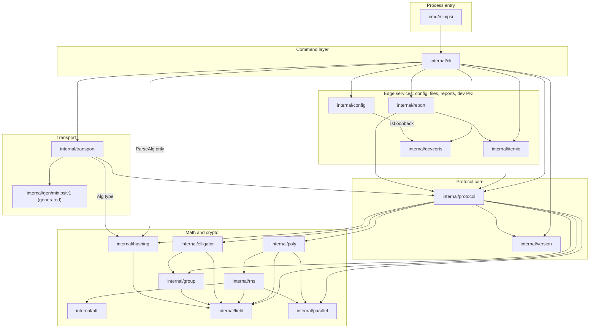

# minipsi architecture

Source references are at commit `4aa7c9f`. If lines drift, search for the symbol.

This document explains how minipsi is structured and why: the layers, the seams between
them, the dependency rules, concurrency, persistence and the security boundaries. It does
not repeat the entry point inventory, the call graphs or the step-by-step flows. For those,
see [ENTRY_POINTS.md](ENTRY_POINTS.md), [CALL_GRAPHS.md](CALL_GRAPHS.md),
[BUSINESS_FLOWS.md](BUSINESS_FLOWS.md) and the short [SUMMARY.md](SUMMARY.md).

## Overview

minipsi is one statically linked Go binary (`CGO_ENABLED=0`, `Makefile:27`) that runs one
party of a two-party, semi-honest Poly-DH private set intersection (PSI). The receiver
learns which of its items are in the intersection; the sender learns only sizes. The two
processes talk over one gRPC bidirectional stream protected by mutual TLS 1.3.

The binary has three operating shapes, all built from the same packages:

- **One-shot party** (`receiver`, `sender`): one process per party, one session, then exit.
- **Daemon** (`serve`): a long-running sender that serves named datasets, one session at a
  time, to receivers that run `request`.
- **Local tools** (`bench`, `certs dev`, `version`): no network peer. `bench` runs both
  parties in one process over an in-memory pipe.

The design separates three concerns that change for different reasons:

1. **Operations** (flags, YAML, files, reports, exit codes, dev PKI) live in `internal/cli`
   and its helper packages.
2. **Transport** (gRPC, TLS, admission, retry) lives in `internal/transport`.
3. **The cryptographic protocol** (handshake, frames, receiver and sender algorithms) lives in
   `internal/protocol` and the math packages under it. It knows nothing about files,
   sockets or certificates.

## Layered component view

Arrows are Go imports at `4aa7c9f` (from `go list`). Lower layers never import upper ones.
Unlike the collapsed view in [ENTRY_POINTS.md](ENTRY_POINTS.md#package-layering), the math
core is expanded here.

Third-party libraries enter at the edges only: `spf13/cobra` in `internal/cli`, `yaml.v3`
in `internal/config`, gRPC and protobuf in `internal/transport` and `internal/gen`,
`filippo.io/edwards25519` in the curve and field packages, and `tuneinsight/lattigo/v6` in
`internal/rns` only.

## Module responsibilities

| Package | Responsibility | Key types and functions |
|---|---|---|
| `cmd/minipsi` | Process entry; passes args and stdio to the CLI and exits with its code | `main` `cmd/minipsi/main.go:11` |
| `internal/cli` | Cobra commands, config precedence, wiring of input, transport and protocol, exit-code mapping, daemon accept loop | `Run` `internal/cli/root.go:88`, `exitCode` `internal/cli/root.go:38`, `runParty` `internal/cli/party.go:237`, `runServe` `internal/cli/serve.go:104` |
| `internal/config` | Party and daemon configuration: defaults, strict YAML, flag overlay, validation | `Config` `internal/config/config.go:21`, `Serve` `internal/config/serve.go:18` |
| `internal/itemio` | Read input sets (lines or CSV, per-instance dedup), write results atomically | `Input` `internal/itemio/itemio.go:41`, `WriteResult` `internal/itemio/itemio.go:231` |
| `internal/psi` | Port layer that business services import instead of the PSI core; interfaces and types only, standard library only (ADR-0009) | `Engine` `internal/psi/psi.go:31`, `Message` `internal/psi/message.go:18`, `Error` `internal/psi/errors.go:49` |
| `internal/psi/core` | Adapter: implements `psi.Engine` over the PSI core; runs each session on a relay connection (out through `Outbox.Post`, in through `Deliver`) and encodes frames as JSON messages | `New` `internal/psi/core/engine.go:46`, `relayConn` `internal/psi/core/conn.go:41`, `encodeFrame` `internal/psi/core/codec.go:33`, `toError` `internal/psi/core/errors.go:12` |
| `internal/orcapi` | DTOs, endpoints and validation of the HTTP API between a CC and the orchestrator in relay mode (ADR-0010); standard library only | `StartSessionRequest` `internal/orcapi/control.go:29`, `Envelope` `internal/orcapi/relay.go:13`, `StatusReport` `internal/orcapi/status.go:39` |
| `internal/report` | JSON run report with no item data | `Report` `internal/report/report.go:14` |
| `internal/devcerts` | Throw-away X.509 CA and leaves for tests, `certs dev` and `--dev` | `EnsureDev` `internal/devcerts/devpki.go:50`, `IsLoopback` `internal/devcerts/devpki.go:182` |
| `internal/version` | Build stamps and the wire compatibility constants | `ProtocolVersion` `internal/version/version.go:13` |
| `internal/transport` | gRPC bidi stream over mTLS 1.3, listen or dial, admission, busy handling, `Conn` adapter | `Options` `internal/transport/transport.go:46`, `Server` `internal/transport/transport.go:322`, `Session` `internal/transport/transport.go:335` |
| `internal/gen/minipsiv1` | Code generated from `api/minipsi/v1/psi.proto` (service `PSI`, rpc `Session`) | `Session` `api/minipsi/v1/psi.proto:11` |
| `internal/protocol` | PSI session: handshake, parameter agreement, framing, transcript digest, abort, receiver and sender algorithms, padding | `Conn` `internal/protocol/conn.go:12`, `RunReceiver` `internal/protocol/receiver.go:40`, `RunSender` `internal/protocol/sender.go:28` |
| `internal/poly` | Polynomial arithmetic over GF(2^255-19): interpolation and multipoint evaluation with subproduct trees | `Arith` `internal/poly/arith.go:21`, `Tree` `internal/poly/tree.go:50` |
| `internal/rns` | Polynomial multiplication via multi-modular NTT and CRT, pluggable transform backend | `Backend` `internal/rns/rns.go:263`, `Multiplier` `internal/rns/multiplier.go:18` |
| `internal/ntt` | Native number-theoretic transforms modulo word-sized primes | package doc `internal/ntt/ntt.go:1` |
| `internal/hashing` | Comparison hash h_b, output length, session ID derivation | `Comparer` `internal/hashing/hashing.go:83` |
| `internal/group` | edwards25519 operations: scalars, torsion, u-coordinates, key validation | package doc `internal/group/group.go:1` |
| `internal/elligator` | Elligator2 map and the receiver's uniform encoding | package doc `internal/elligator/elligator.go:1` |
| `internal/field` | GF(p) on top of `filippo.io/edwards25519/field`: canonical decoding, batch inversion, hash-to-field | package doc `internal/field/field.go:1` |
| `internal/parallel` | Bounded, cancellable parallel loops | `For` `internal/parallel/parallel.go:21` |

## Key abstractions and seams

"Dynamic" marks an interface or function value resolved at run time. Everything else is a
concrete type with static calls.

### `protocol.Conn` (dynamic)

`Conn` `internal/protocol/conn.go:12` is the only boundary between the PSI core and
anything that moves bytes: an ordered, bidirectional frame stream with `Send` and `Recv`.
Two implementations exist:

- `streamConn` `internal/transport/transport.go:143`, the gRPC stream adapter used by
  `receiver`, `sender`, `serve` and `request`.
- `PipeConn` `internal/protocol/conn.go:18`, an in-memory pair from `Pipe`, used by `bench`
  and tests.

Because of this seam, the protocol can be tested and benchmarked without a network, and a
different transport (for example the reserved relay mode) would only need a new `Conn`. The
contract and its callers are documented in
[ENTRY_POINTS.md](ENTRY_POINTS.md#library-api-surface-integration-seam).

### `protocol.Config`, `protocol.Instance`, `protocol.Result`

- `Config` `internal/protocol/session.go:36` holds per-party settings. The zero value is
  valid; `Defaults` fills it in. Some fields must match the peer (`Hash`, `Lambda`), others
  are local choices (`Workers`, `NTTBackend`, padding policies).
- `Instance` `internal/protocol/session.go:23` is one PSI instance: an ID and raw items.
  Standalone mode is one instance with ID 0; batched mode is many.
- `Result` `internal/protocol/receiver.go:22` returns match indices per instance, never
  items. Mapping indices back to records is the job of `itemio`.

### `transport.Options`, `transport.Server`, `transport.Session`

`Options` `internal/transport/transport.go:46` carries the TLS config, frame limit and
retry policy. Two fields shape the daemon:

- `Repeat` `internal/transport/transport.go:59`: serve one session at a time instead of
  exactly one. Concurrent attempts get gRPC Unavailable and the client retries.
- `Admit` `internal/transport/transport.go:62` (dynamic, a function value): vets each
  request's metadata and peer SANs before the busy check. The daemon installs a closure
  (`Admit` `internal/cli/serve.go:131`); a `Rejection` becomes FailedPrecondition.

`Server.Accept` hands out a `Session`, whose `Conn` method `internal/transport/transport.go:345`
returns the session as a `protocol.Conn`.

### `hashing.Comparer` (dynamic)

`Comparer` `internal/hashing/hashing.go:83` computes the per-instance comparison hash.
`NewComparer` `internal/hashing/hashing.go:97` picks the SHA-256 or AES implementation from
the negotiated `Alg`, so both parties must agree on the algorithm during the handshake.

### `rns.Backend` and `poly.Arith` (dynamic backend)

`Backend` `internal/rns/rns.go:263` creates NTT transforms. `NewBackend`
`internal/rns/rns.go:282` returns `native` (package `ntt`) or `lattigo`. The choice is local
(`Config.NTTBackend`) and does not affect the wire, so two parties may use different
backends. `Arith` `internal/poly/arith.go:21` wraps an `rns.Multiplier`; each session
builds one in `newSession` (`NewArith` `internal/protocol/session.go:174`).

### `config.Config` and `config.Serve`

`Config` `internal/config/config.go:21` describes one party run.
`Serve` `internal/config/serve.go:18` describes the daemon and its datasets. `SessionConfig`
`internal/config/serve.go:128` derives a per-dataset party config, so daemon sessions reuse
the one-shot code path. Configuration details belong in [CONFIGURATION.md](CONFIGURATION.md).

### `report.Report` and exit codes

`Report` `internal/report/report.go:14` is a flat JSON record of one run (versions,
parameters, counts, timings, bytes, frames, exit code). The CLI fills it as the run
progresses and writes it even on failure.

`exitCode` `internal/cli/root.go:38` maps errors to six exit codes defined at
`internal/cli/root.go:20` (`ExitOK` 0 to `ExitInternal` 5): `protocol.TransportError` ->
network (3); `protocol.Error` by `Code` (timeout -> 3, input -> 2, internal -> 5, else 4);
a peer abort (`Remote`) -> 4; cancellation -> 4. This keeps the protocol package free of
process concerns while giving operators a stable contract (see [RUNBOOK.md](../RUNBOOK.md)).

## Dependency rules

Confirmed from the import graph at `4aa7c9f`:

- **`internal/protocol` does not import `internal/transport`**, gRPC or any file or TLS
  package. It depends only on the math packages, `internal/version` and the standard library.
- **`internal/transport` depends on `internal/protocol`** and the generated package, not the
  other way round. It imports `internal/hashing` only for the `Alg` type in frame conversion.
- **`protocol.Frame` mirrors the protobuf schema by hand.** The comment on
  `Frame` `internal/protocol/messages.go:30` states this. `toPB` `internal/transport/convert.go:10` and
  `fromPB` `internal/transport/convert.go:49` translate between them, so a change to
  `api/minipsi/v1/psi.proto` needs a matching change in `messages.go` and `convert.go`.
- **`internal/gen/minipsiv1` is generated** and imported only by `internal/transport`.
- **Math packages form a DAG** with `internal/field` at the bottom. Only `internal/rns`
  imports Lattigo.

Known couplings that cross the layering in small ways:

- `internal/config` imports `internal/devcerts` only for `IsLoopback`, called in `validTLS`
  `internal/config/config.go:272` to keep dev mode on loopback addresses.
- `internal/itemio` imports `internal/protocol` because it builds `protocol.Instance` values
  and consumes `protocol.Result`.
- `internal/report` imports `internal/itemio` and `internal/protocol` to copy input stats and
  session stats.
- `internal/cli` imports `config`, `itemio`, `report`, `devcerts`, `transport`, `protocol`,
  `version` and (for `ParseAlg` only) `hashing`; it is the composition root.

## Startup and initialization

`main` calls `cli.Run`, which builds the cobra tree with
`NewRoot` `internal/cli/root.go:72`, executes it and maps the error with `exitCode`. Each command then
loads config, resolves TLS (or the dev PKI), opens a transport session and calls
`RunReceiver` or `RunSender`. Signal handling uses `signal.NotifyContext` for SIGINT and
SIGTERM in each long-running command.

Before `main` runs, package `init` functions precompute constants: CRT lift constants in
`init` `internal/rns/rns.go:90`, the cofactor scalar in `init` `internal/group/group.go:35`,
the curve constant `d2` in `init` `internal/group/fixedbase.go:39`, and protobuf descriptor
registration in the generated code. Details: [ENTRY_POINTS.md](ENTRY_POINTS.md#ep-01-process-start-main),
[EP-12](ENTRY_POINTS.md#ep-12-package-init-functions).

## Concurrency model

Each protocol session runs as a small group of goroutines under one `taskGroup`
`internal/protocol/session.go:527`, a minimal errgroup: the first error cancels the others,
and a panic becomes an internal error.

- **Writer**: started by `run` `internal/protocol/session.go:222`. `writer`
  `internal/protocol/session.go:269` drains the outgoing queue, updates the transcript digest
  and calls `Conn.Send`. Role code never sends directly, so frame order and the digest stay
  consistent.
- **Role body**: `receiver.body` `internal/protocol/receiver.go:97` or `sender.body`
  `internal/protocol/sender.go:70`, which runs the handshake and the algorithm.
- **Reader**: started by the body after the handshake (`reader`
  `internal/protocol/receiver.go:419`, `reader` `internal/protocol/sender.go:299`); it
  receives peer frames while the body computes.
- **Receiver prepare**: `prepare` `internal/protocol/receiver.go:172` encodes and interpolates
  the receiver's own items and starts before the handshake, overlapping local work with
  connection setup.

On failure `run` sends a best-effort `Abort` frame with a bounded 5 s wait after the writer
has exited.

Inside the transport, each `streamConn` owns two goroutines started in
`newStreamConn` `internal/transport/transport.go:153`: `pump` `internal/transport/transport.go:166` reads ahead
one frame, and `sendLoop` `internal/transport/transport.go:186` serializes sends. This lets
`Send` and `Recv` honour their contexts without tearing down the gRPC stream, so a final
`Abort` can still be sent after a cancelled operation.

CPU-heavy loops use `For` `internal/parallel/parallel.go:21`, bounded by
`Config.Workers` (default GOMAXPROCS). `poly.Arith` also runs independent subtrees
concurrently up to the same bound.

The daemon runs sessions **sequentially**: the accept loop in `runServe` calls
`Accept` `internal/cli/serve.go:156` and then `serveSession` inline, and `Repeat` makes the server
refuse a second concurrent stream as busy. gRPC handler goroutines only run admission and
hand the stream to `Accept`. Full timing and goroutine details:
[CALL_GRAPHS.md](CALL_GRAPHS.md#cg-06-protocol-session-run-handshake-frames-and-abort).

## Data and persistence

There is **no database** and no persistent state beyond files:

| Data | Where | Notes |
|---|---|---|
| Input sets | Path from config or flags | Read once per run or per daemon session; daemon re-reads the dataset file each session |
| Result | `--output` file or stdout | Written by `writeAtomic` `internal/itemio/itemio.go:264`: temp file, mode 0600, fsync, rename |
| Run report | `--report` file | JSON, written with `WriteFileAtomic` `internal/itemio/itemio.go:300` |
| Daemon reports | `state_dir/reports/` | One JSON per session, directory created 0700 in `runServe` `internal/cli/serve.go:118` |
| Dev PKI | `$MINIPSI_DEV_PKI` or the XDG state dir | `DefaultDevDir` `internal/devcerts/devpki.go:31`; created once, atomically, and shared by local processes |

Atomic writes mean a failed run never leaves a partial result file. File formats and
external systems are covered in [INTEGRATIONS.md](INTEGRATIONS.md).

## Security architecture

- **Mutual TLS 1.3 is mandatory.** `ServerConfig` `internal/transport/tls.go:51` requires and
  verifies client certificates, and both server and client configs set TLS 1.3 as the
  minimum. `normalize` `internal/transport/transport.go:86` rejects a missing TLS config or
  any version below 1.3.
- **Peer pinning.** `pinPeer` `internal/transport/tls.go:76` requires the verified peer leaf to
  carry a configured DNS or URI SAN, on top of CA verification. The daemon also checks the
  requester's SANs against `allowed_peers` in `Allowed` `internal/config/serve.go:114`.
- **Insecure mode is gated.** Plaintext h2c is only accepted when
  `MINIPSI_I_UNDERSTAND_INSECURE=1` is set (`InsecureEnv` `internal/transport/transport.go:40`).
- **Dev PKI is loopback only.** `--dev` is rejected for non-loopback addresses by
  `validTLS` `internal/config/config.go:263`. Package `devcerts` is documented as not for production.
- **No items or secrets in logs or reports.** `Config.Logger` is documented as never
  receiving item data or secrets (`Logger` `internal/protocol/session.go:56`), and the package
  doc of `report` says reports never contain items, field elements, scalars or protocol
  outputs (`Report` `internal/report/report.go:14`). The daemon gives the same rejection for
  unknown and not-allowed datasets so dataset existence is not revealed.
- **Constant-time claims.** The package docs of `internal/group` and `internal/elligator`
  claim constant-time operations on secret scalars, points and inputs, with the stated
  exception of rejection-sampling rounds in `EncodeUniform`. These are claims from the
  source comments; this document does not verify them. Timing side channels in the
  protocol, poly and rns layers: Unknown.
- **Threat model.** The protocol is semi-honest: it assumes both parties follow the protocol.
  Input limits (`Limits` `internal/protocol/session.go:29`) and strict frame validation bound
  what a peer can make this party process. Design rationale: [decisions/README.md](decisions/README.md).

## Constraints and limitations

- **Relay mode is reserved, not implemented.** `mode: relay` (relay via an Orchestrator) is
  rejected by `validMode` `internal/config/config.go:252`; `direct` is the only working mode.
  No Orchestrator code exists in the repository.
- **One session at a time per daemon.** A busy daemon answers Unavailable; `request` retries
  until its connect-retry deadline and then fails with `ErrBusy`
  `internal/transport/transport.go:82`.
- **Compatibility is all or nothing.** Each `Hello` carries `ProtocolVersion` and `Suite`;
  the handshake rejects any mismatch (`handshake` `internal/protocol/session.go:362`, check
  at `internal/protocol/session.go:398`). There is no version negotiation, so both parties
  must run a binary with the same protocol version and suite.
- **Library seam is internal.** `RunReceiver` and `RunSender` live under `internal/`, so only
  code inside module `github.com/XSpring/minipsi` can call them.
- **Scaling is vertical.** One process per party and one session per process or daemon slot;
  capacity comes from `Workers` and memory limits. See [RUNBOOK.md](../RUNBOOK.md).

## Related documents

- Code navigation: [ENTRY_POINTS.md](ENTRY_POINTS.md), [CALL_GRAPHS.md](CALL_GRAPHS.md),
  [BUSINESS_FLOWS.md](BUSINESS_FLOWS.md), [SUMMARY.md](SUMMARY.md)
- Domain and configuration: [DOMAIN.md](DOMAIN.md), [CONFIGURATION.md](CONFIGURATION.md)
- Interfaces and development: [INTEGRATIONS.md](INTEGRATIONS.md), [DEVELOPMENT.md](DEVELOPMENT.md)
- Decisions: [decisions/README.md](decisions/README.md)
- Operations: [README.md](../README.md), [RUNBOOK.md](../RUNBOOK.md)
