# Business Flows

minipsi lets two organisations find the items their sets have in common without either one
handing its set to the other. One host runs as the **receiver** and the other as the
**sender**. They connect over gRPC with mutual TLS 1.3 and run the semi-honest polynomial
Diffie-Hellman PSI protocol of Rosulek and Trieu (CCS'21) over Curve25519 with Elligator2.
Only the receiver learns the intersection and writes the matching items to its output file.
The sender learns the receiver's padded set sizes and the session ID, nothing about which
items match. There are two ways to run it. In **one-shot mode** both operators start
`minipsi receiver` and `minipsi sender` for a single session, and either side may be the one
that listens. In **daemon mode** a data owner runs `minipsi serve`, which acts as sender for
named datasets, and a requester runs `minipsi request`, which is a receiver that names the
dataset it wants. `--mode relay` (through an Orchestrator) is reserved and is rejected during
validation (`internal/config/config.go:257`). This document follows each business workflow
from its trigger to its final result at commit `4aa7c9f`, and shows where the PSI core in
`internal/protocol` is called and what crosses the network.

Companion documents: [ENTRY_POINTS.md](ENTRY_POINTS.md) (entry points),
[CALL_GRAPHS.md](CALL_GRAPHS.md) (call graphs) and [SUMMARY.md](SUMMARY.md) (short summary).

## Workflow map

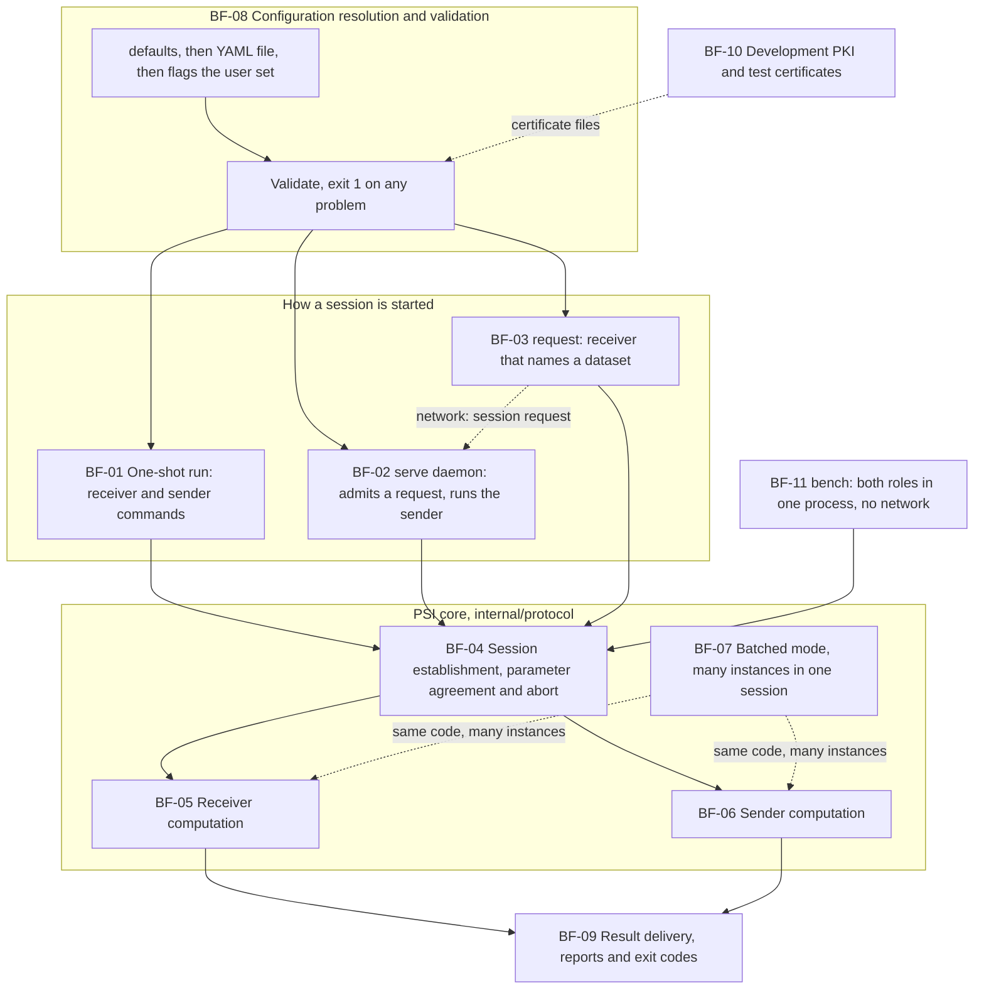

## Ranked workflows

| Rank | Workflow | Trigger | Entry point | Related graphs |
|---|---|---|---|---|
| 1 | [BF-01 One-shot PSI run between two hosts](#bf-01) | Two operators run `minipsi receiver` and `minipsi sender`, one with `--listen`, the other with `--connect` | [EP-03](ENTRY_POINTS.md#ep-03): party `RunE`, `internal/cli/party.go:156` | [CG-02](CALL_GRAPHS.md#cg-02), [CG-05](CALL_GRAPHS.md#cg-05), [CG-06](CALL_GRAPHS.md#cg-06), [CG-07](CALL_GRAPHS.md#cg-07), [CG-08](CALL_GRAPHS.md#cg-08) |
| 2 | [BF-02 Serving datasets and answering a session request](#bf-02) | `minipsi serve` is started; later a requester opens the `PSI/Session` stream | [EP-05](ENTRY_POINTS.md#ep-05): `internal/cli/serve.go:57`; [EP-06](ENTRY_POINTS.md#ep-06): `internal/transport/transport.go:396` | [CG-04](CALL_GRAPHS.md#cg-04), [CG-05](CALL_GRAPHS.md#cg-05), [CG-06](CALL_GRAPHS.md#cg-06) |
| 3 | [BF-03 Requesting an intersection from a daemon](#bf-03) | `minipsi request --peer ADDR --dataset NAME` | [EP-04](ENTRY_POINTS.md#ep-04): party `RunE` with command `request`, `internal/cli/party.go:156` | [CG-03](CALL_GRAPHS.md#cg-03) |
| 4 | [BF-04 Session establishment, parameter agreement and abort](#bf-04) | A caller passes a `protocol.Conn` to `RunReceiver` or `RunSender` | [EP-07](ENTRY_POINTS.md#ep-07): `internal/protocol/receiver.go:40`; [EP-08](ENTRY_POINTS.md#ep-08): `internal/protocol/sender.go:28` | [CG-06](CALL_GRAPHS.md#cg-06) |
| 5 | [BF-05 Receiver computation](#bf-05) | `protocol.RunReceiver` | [EP-07](ENTRY_POINTS.md#ep-07) | [CG-07](CALL_GRAPHS.md#cg-07), [CG-09](CALL_GRAPHS.md#cg-09) |
| 6 | [BF-06 Sender computation](#bf-06) | `protocol.RunSender` | [EP-08](ENTRY_POINTS.md#ep-08) | [CG-08](CALL_GRAPHS.md#cg-08), [CG-09](CALL_GRAPHS.md#cg-09) |
| 7 | [BF-07 Batched PSI over many instances](#bf-07) | CSV input with `--batched --instance-column` on both sides | [EP-03](ENTRY_POINTS.md#ep-03) or [EP-04](ENTRY_POINTS.md#ep-04), then [EP-07](ENTRY_POINTS.md#ep-07) and [EP-08](ENTRY_POINTS.md#ep-08) | [CG-07](CALL_GRAPHS.md#cg-07), [CG-08](CALL_GRAPHS.md#cg-08) |
| 8 | [BF-08 Configuration resolution and validation](#bf-08) | Every `receiver`, `sender`, `request` and `serve` command | [EP-03](ENTRY_POINTS.md#ep-03), [EP-04](ENTRY_POINTS.md#ep-04), [EP-05](ENTRY_POINTS.md#ep-05) | [CG-02](CALL_GRAPHS.md#cg-02), [CG-04](CALL_GRAPHS.md#cg-04) |
| 9 | [BF-09 Result delivery, reports and exit codes](#bf-09) | The end of every party run, successful or not | [EP-02](ENTRY_POINTS.md#ep-02): `cli.Run`, `internal/cli/root.go:88` | [CG-01](CALL_GRAPHS.md#cg-01), [CG-02](CALL_GRAPHS.md#cg-02) |
| 10 | [BF-10 Development PKI and test certificates](#bf-10) | `minipsi certs dev`, or `--dev` on a party or serve command | [EP-10](ENTRY_POINTS.md#ep-10): `internal/cli/tools.go:36`, `internal/cli/party.go:383` | [CG-11](CALL_GRAPHS.md#cg-11) |
| 11 | [BF-11 Capacity benchmark](#bf-11) | `minipsi bench` | [EP-09](ENTRY_POINTS.md#ep-09): `internal/cli/tools.go:93` | [CG-10](CALL_GRAPHS.md#cg-10) |

## Reading conventions

- **Process tags in the steps.** **[R]** receiver process, **[S]** sender process,
  **[D]** `minipsi serve` daemon, **[Q]** requester process (`minipsi request`),
  **[Both]** each party runs the step in its own process, **[Net]** bytes on the network,
  **[Test-only]** code reached only from tests or scripts.
- **Sequence diagrams.** A box is a host. A solid arrow (`->>`) is a call or hand-off inside
  one process. A dashed arrow with an open head (`--)`) is a message on the network: a gRPC
  message on the single `PSI/Session` stream, protected by mutual TLS 1.3.
- **Flowcharts.** `-->` is control flow, `==>` is a goroutine start or an asynchronous
  hand-off, `-.->` is an edge to the peer process or a dynamic edge, as its label says. A
  round node is the peer process.
- **Where the PSI core is called.** `protocol.RunReceiver` is called at
  `internal/cli/party.go:301` (receiver, request) and `internal/cli/tools.go:116` (bench).
  `protocol.RunSender` is called at `internal/cli/party.go:293` (sender),
  `internal/cli/serve.go:192` (daemon) and `internal/cli/tools.go:121` (bench). The core sees
  the network only through `protocol.Conn` (`internal/protocol/conn.go:12`), which
  `transport.streamConn` (`internal/transport/transport.go:143`) and `protocol.PipeConn`
  (`internal/protocol/conn.go:18`) implement. A new API needs only another `Conn`.
- Every `path:line` was checked against the source. Statements that the code alone does not
  confirm are marked *inferred*.

## Workflow: One-shot PSI run between two hosts

The two diagrams follow one run in which the sender listens and the receiver dials, as in the
smoke test `scripts/e2e.sh:24-27` (test-only). Either role may listen: the roles are carried in
the protocol's `Hello`, not in the gRPC direction (`api/minipsi/v1/psi.proto:8-11`).

Diagram 1: start-up and connection.

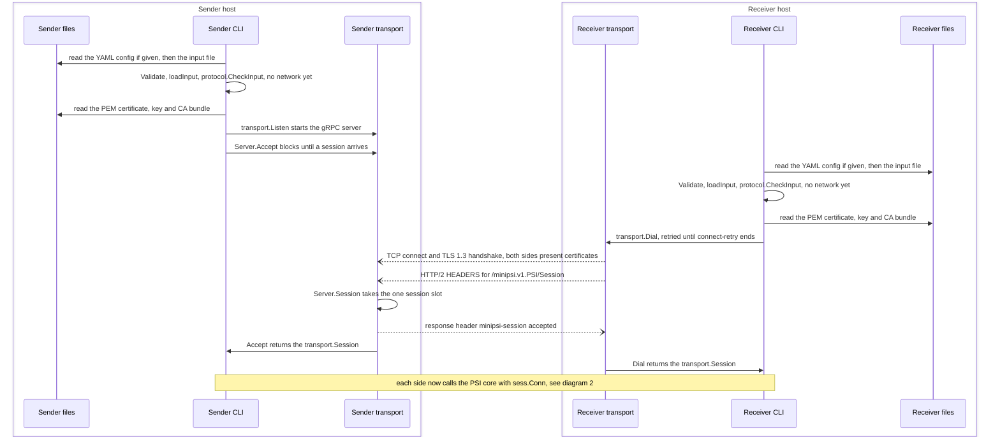

Diagram 2: the PSI core run, closing and output.

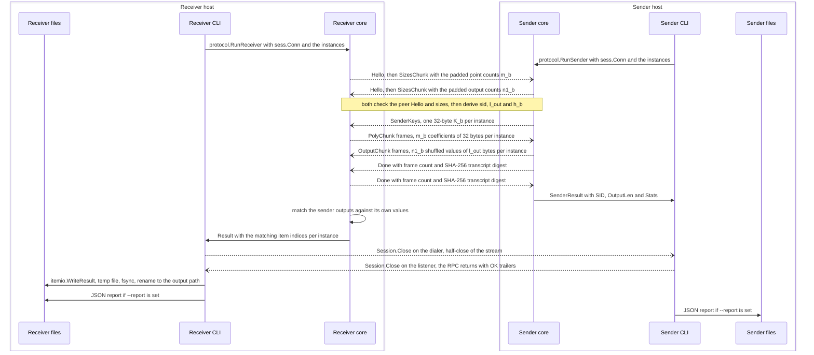

**Purpose:** compute the intersection of two hosts' item sets in one session, so that the
receiver ends up with the matching items in a file and the sender with only a run report.

**Trigger:** two operators start the binary. Example (paths and port are illustrative):
on the sender host `minipsi sender --listen 0.0.0.0:7443 --input x.txt --cert sender.crt --key
sender.key --ca ca.crt --peer-name receiver --report s.json`; on the receiver host `minipsi
receiver --connect S:7443 --connect-retry 20s --server-name sender --input y.txt --output out.txt
--cert receiver.crt --key receiver.key --ca ca.crt --peer-name sender --report r.json`.

**Entry point:** [EP-03](ENTRY_POINTS.md#ep-03), the party command `RunE` closure
(`internal/cli/party.go:156`), reached from `main` ([EP-01](ENTRY_POINTS.md#ep-01)) and
`cli.Run` ([EP-02](ENTRY_POINTS.md#ep-02)). The PSI core is entered at
[EP-07](ENTRY_POINTS.md#ep-07) and [EP-08](ENTRY_POINTS.md#ep-08).

**Execution steps:**

*Initial handling*

1. **[Both]** `main` calls `cli.Run(context.Background(), os.Args[1:], os.Stdout, os.Stderr)`
   and passes its result to `os.Exit` (`cmd/minipsi/main.go:12`).
2. **[Both]** `cli.Run` builds the command tree with `cli.NewRoot`
   (`internal/cli/root.go:89` calls `internal/cli/root.go:72`), which registers `receiver`,
   `sender` and `request` through `newPartyCmd` (`internal/cli/root.go:81`). `ExecuteContext`
   (`internal/cli/root.go:91`) lets cobra parse the flags and call the party `RunE`
   (`internal/cli/party.go:156`).

*Validation and authorization*

3. **[Both]** `RunE` resolves the configuration (details in [BF-08](#bf-08)): defaults
   (`internal/cli/party.go:157`), the optional YAML file (`internal/cli/party.go:159`), the
   role check (`internal/cli/party.go:163-166`), the flags the user set
   (`internal/cli/party.go:167-171`) and `(*config.Config).Validate`
   (`internal/cli/party.go:178`). Any problem ends the run with exit 1.
4. **[Both]** `signal.NotifyContext` turns SIGINT and SIGTERM into context cancellation
   (`internal/cli/party.go:181`), then `cli.runParty` starts (`internal/cli/party.go:183`).
5. **[Both]** `runParty` creates the stderr logger (`internal/cli/party.go:238`), applies the
   memory limit (`internal/cli/party.go:239`), starts the report (`internal/cli/party.go:241`)
   and defers the report writer (`internal/cli/party.go:242`).
6. **[Both]** `cli.loadInput` (`internal/cli/party.go:261`, defined at
   `internal/cli/party.go:206`) reads the input with `itemio.ReadFile`
   (`internal/cli/party.go:208`), maps the settings to a `protocol.Config` with
   `cli.protocolConfig` (`internal/cli/party.go:222`) and runs `protocol.CheckInput`
   (`internal/cli/party.go:230`). This checks instance IDs, padded sizes and limits before any
   network activity, so input problems end with exit 2, not with a protocol abort.
7. **[Both]** `cli.resolveDev` fills in development certificates only with `--dev`
   (`internal/cli/party.go:271`, see [BF-10](#bf-10)). `cli.transportOptions`
   (`internal/cli/party.go:274`) loads the PEM files with `transport.LoadTLSFiles`
   (`internal/cli/party.go:352`). **[S]** listens, so it gets
   `(*transport.TLSMaterial).ServerConfig` (`internal/cli/party.go:357`), which requires a
   client certificate signed by the trusted CA (`internal/transport/tls.go:55-56`).
   **[R]** dials, so it gets `ClientConfig` with the server name from `--server-name` or the
   host part of `--connect` (`internal/cli/party.go:359-367`). On both sides `--peer-name`
   pins the peer's DNS or URI SAN (`internal/transport/tls.go:76`).
8. **[Both]** `--timeout`, when set, wraps the context with an overall deadline
   (`internal/cli/party.go:278-282`).
9. **[S]** `cli.openSession` calls `transport.Listen` (`internal/cli/party.go:430`):
   `net.Listen` (`internal/transport/transport.go:361`), `grpc.NewServer` with a message
   limit of `MaxFrame` + 64 KiB (`internal/transport/transport.go:377-384`), the PSI service
   registration (`internal/transport/transport.go:385`) and the serve goroutine
   (`internal/transport/transport.go:386`). `(*transport.Server).Accept` then blocks
   (`internal/cli/party.go:435`, defined at `internal/transport/transport.go:457`).
10. **[R]** `cli.openSession` calls `transport.Dial` (`internal/cli/party.go:443`, defined at
    `internal/transport/transport.go:488`): `grpc.NewClient` (`internal/transport/transport.go:503`),
    then one `Session` RPC attempt per loop iteration (`internal/transport/transport.go:515`).
11. **[Net]** TCP connect, TLS 1.3 handshake in which both sides present and verify
    certificates, and the HTTP/2 request for `PSI/Session` (`api/minipsi/v1/psi.proto:11`).
12. **[S]** gRPC dispatches the stream to `_PSI_Session_Handler`
    (`internal/gen/minipsiv1/psi_grpc.pb.go:100`), which calls `(*transport.Server).Session`
    (`internal/transport/transport.go:396`). One-shot mode sets no `Admit`, so the only check
    is the single session slot (`internal/transport/transport.go:418`). The handler sends the
    `minipsi-session: accepted` header (`internal/transport/transport.go:428`), wraps the
    stream in a `streamConn` (`internal/transport/transport.go:432`) and hands the session to
    `Accept` (`internal/transport/transport.go:437`).
13. **[R]** `Dial` waits for the response header (`internal/transport/transport.go:521`),
    wraps the stream (`internal/transport/transport.go:529`) and returns a `Session`
    (`internal/transport/transport.go:532`). A failed attempt is retried every 250 ms
    (`internal/transport/transport.go:558-561`) until `--connect-retry` has elapsed. The
    one-shot default is 0, a single attempt, so without `--connect-retry` the listener must
    already be up.
14. **[Both]** the report records the authenticated peer identity
    (`internal/cli/party.go:288`).

*Core processing (the PSI core; details in [BF-04](#bf-04), [BF-05](#bf-05), [BF-06](#bf-06))*

15. **[S]** `protocol.RunSender(ctx, pcfg, sess.Conn(), in.Instances)`
    (`internal/cli/party.go:293`).
16. **[R]** `protocol.RunReceiver(ctx, pcfg, sess.Conn(), in.Instances)`
    (`internal/cli/party.go:301`). Its `prepare` goroutine starts hashing, encoding and
    interpolating before the handshake (`internal/protocol/receiver.go:107`).
17. **[Net]** each side sends `Hello` and `SizesChunk` frames
    (`internal/protocol/session.go:373`, `internal/protocol/session.go:384`), checks the
    peer's (`internal/protocol/session.go:397-442`) and derives the session ID, the output
    length and the comparison hash (`internal/protocol/session.go:456-458`).
18. **[S]** sends `SenderKeys` (`internal/protocol/sender.go:123`), then shuffles its items
    and builds evaluation trees (`internal/protocol/sender.go:89`).
19. **[R]** streams `PolyChunk` frames wave by wave (`internal/protocol/receiver.go:121`,
    sent at `internal/protocol/receiver.go:555`).
20. **[S]** its reader goroutine rebuilds each polynomial (`internal/protocol/sender.go:299`).
    `evaluate` streams `OutputChunk` frames (`internal/protocol/sender.go:92`, flushed at
    `internal/protocol/sender.go:252`), then the sender queues `Done`
    (`internal/protocol/sender.go:95`).
21. **[R]** its reader validates the keys and buffers the outputs
    (`internal/protocol/receiver.go:419`). `compareValues` computes the receiver's own values
    (`internal/protocol/receiver.go:129`). When all outputs are in, it sends `Done`
    (`internal/protocol/receiver.go:136`) and checks the sender's `Done`
    (`internal/protocol/receiver.go:487`).
22. **[S]** checks the receiver's `Done` (`internal/protocol/sender.go:357`) and `RunSender`
    returns a `SenderResult` (`internal/protocol/sender.go:48`).
23. **[R]** `match` intersects (`internal/protocol/receiver.go:146`) and `RunReceiver`
    returns the `Result` (`internal/protocol/receiver.go:70`).

*Persistence and external interactions*

24. **[S]** stores SID, output length and statistics in the report
    (`internal/cli/party.go:297`) and returns. The deferred `closeAll`
    (`internal/cli/party.go:287`) closes the session and the server
    (`internal/cli/party.go:441`): the RPC handler returns, gRPC sends OK trailers **[Net]**,
    and `Server.Close` stops the server within 5 s (`internal/transport/transport.go:469-482`).
25. **[R]** closes the session before writing the result (`internal/cli/party.go:304`). For
    the dialer this means half-close, wait up to 5 s for the end of the stream, then tear
    down (`internal/transport/transport.go:534-538`).
26. **[R]** records the session and the result count (`internal/cli/party.go:308-309`) and
    writes the intersection with `itemio.WriteResult` (`internal/cli/party.go:311`, defined at
    `internal/itemio/itemio.go:231`) through a temporary file that is synced and renamed
    (`internal/itemio/itemio.go:264-296`).
27. **[Both]** the deferred closure computes the exit code (`internal/cli/party.go:243`) and
    writes the JSON report with `itemio.WriteFileAtomic` (`internal/cli/party.go:251`).

*Final result*

28. **[Both]** `cli.Run` returns `ExitOK` (`internal/cli/root.go:93`) and `main` exits 0
    (`cmd/minipsi/main.go:12`). The receiver's output file holds the intersection; the sender
    holds only its report.

**Main symbols:** `cli.Run`, `cli.newPartyCmd`, `cli.runParty`, `cli.loadInput`,
`cli.transportOptions`, `cli.openSession`, `transport.Listen`, `(*transport.Server).Session`,
`(*transport.Server).Accept`, `transport.Dial`, `transport.streamConn`,
`protocol.RunReceiver`, `protocol.RunSender`, `itemio.ReadFile`, `itemio.WriteResult`,
`itemio.WriteFileAtomic`, `report.Report`.

**Data flow:**

- *Inputs.* Each side reads its own file or stdin: one item per line (the line terminator and
  one trailing CR are stripped) or one CSV column. Items are raw bytes with no normalisation,
  and exact duplicates are dropped per instance (`internal/itemio/itemio.go:199-211`).
- *Transformations.* Receiver: item, then `H(x)` (32-byte field element), then a polynomial
  of `m_b` coefficients. Sender: item, then `H(y)`, `P_b(H(y))`, an Elligator2 point,
  `k_b` times that point, its u-coordinate, then the `l_out`-byte hash. See
  [BF-05](#bf-05) and [BF-06](#bf-06).
- *What crosses the network.* Only these frames, on one gRPC stream:

| Frame | Direction | Content | Size |
|---|---|---|---|
| `Hello` | both | protocol version 1, suite `minipsi-v1-ed25519-ell2`, role, hash, lambda, 32-byte nonce, instance count, software version | about 100 bytes |
| `SizesChunk` | both | instance IDs with announced sizes: padded point counts `m_b` from the receiver, padded output counts `n1_b` from the sender | 8 bytes per instance |
| `SenderKeys` | sender to receiver | `K_b = k_b*B` | 32 bytes per instance |
| `PolyChunk` | receiver to sender | coefficients of `P_b` as canonical field elements | 32 bytes per point, `m_b` per instance |
| `OutputChunk` | sender to receiver | `h_b` values in shuffled order | `l_out` bytes per sender item, `n1_b` per instance |
| `Done` | both | number of frames sent and SHA-256 digest of them | 8 + 32 bytes |
| `Abort` | either, on failure | error code and message | small |

  `l_out = min(32, ceil((lambda + ceil(log2(max(2, sum n1_b*n2_b)))) / 8))` bytes
  (`internal/hashing/hashing.go:59`), computed from the padded sizes. With lambda = 40 and one
  instance of 2^20 items on each side, `l_out` is 10 bytes. Sizes are payload estimates
  (`internal/protocol/messages.go:172`); gRPC, HTTP/2 and TLS overhead is not counted and
  cannot be determined from the code.
- *Outputs.* Receiver: the output file and optionally a report. Sender: optionally a report.
  Neither report holds items or protocol values (`internal/report/report.go:1-2`).

**Side effects:** files read: config, input or stdin, certificate, key and CA. Files written:
the receiver's output (mode 0600, temporary file in the same directory, fsync, rename) or
stdout, and each side's report if requested. Network: the listener binds its address for this
run only; there is one TCP connection with one gRPC stream. Logs go to stderr. The memory limit
is process-wide (`internal/cli/party.go:483`). SIGINT and SIGTERM are captured. Exit code 0 on
success. There is no database or queue.

**Failure handling:** configuration errors exit 1 before any I/O. Input and limit errors exit
2 before any network activity. TLS file or dev PKI errors exit 1. `Listen` errors exit 3,
plaintext mode without its acknowledgement exits 1 (`internal/cli/party.go:450-460`). A dial
that fails until `--connect-retry` ends, including an untrusted or misnamed certificate, exits
3 (tested by `scripts/e2e.sh:57-68`, test-only). Inside the session, the side that detects a
problem sends `Abort` to the peer and both sides exit 4 for a mismatch (tested by
`scripts/e2e.sh:44-55`). A killed peer gives a transport error, exit 3
(`test/e2e/e2e_test.go:213`, test-only). SIGTERM during the run gives `ERR_CANCELLED` and exit
4 on both sides (`test/e2e/e2e_test.go:189`, test-only). The protocol itself is never retried;
the operators start a new run. `closeAll` is deferred and idempotent, so the stream and server
are closed on every path. The output file is never left half-written, because a failed write
removes the temporary file; output to stdout may be partial. Exit codes are listed in
[BF-09](#bf-09).

**Source locations:** `cmd/minipsi/main.go:11-13`, `internal/cli/root.go:88-102`,
`internal/cli/party.go:141-317`, `internal/cli/party.go:343-379`,
`internal/cli/party.go:428-448`, `internal/transport/transport.go:357-482`,
`internal/transport/transport.go:488-563`, `internal/transport/tls.go:19-95`,
`internal/protocol/receiver.go:40-153`, `internal/protocol/sender.go:28-105`,
`internal/itemio/itemio.go:47-98`, `internal/itemio/itemio.go:231-305`.

**Related call graph:** [CG-02](CALL_GRAPHS.md#cg-02), [CG-05](CALL_GRAPHS.md#cg-05),
[CG-06](CALL_GRAPHS.md#cg-06), [CG-07](CALL_GRAPHS.md#cg-07), [CG-08](CALL_GRAPHS.md#cg-08).

## Workflow: Serving datasets and answering a session request

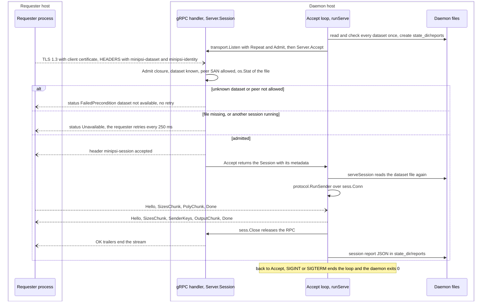

**Purpose:** let a data owner keep named datasets available and answer each authenticated
request as PSI sender, one session at a time, without ever learning the intersection.

**Trigger:** the operator starts `minipsi serve --listen ADDR --dataset NAME=PATH ... --state-dir
DIR` or uses a YAML file with `datasets` and `allowed_peers`. Each session is then triggered by a
requester ([BF-03](#bf-03)) opening the `PSI/Session` stream.

**Entry point:** [EP-05](ENTRY_POINTS.md#ep-05), the serve `RunE` closure
(`internal/cli/serve.go:57`), and [EP-06](ENTRY_POINTS.md#ep-06), the gRPC handler
`(*transport.Server).Session` (`internal/transport/transport.go:396`).

**Execution steps:**

*Initial handling (daemon start-up)*

1. **[D]** `cli.Run` dispatches to the serve `RunE` (`internal/cli/serve.go:57`).
2. **[D]** the daemon configuration is resolved (see [BF-08](#bf-08)): `config.DefaultServe`
   (`internal/cli/serve.go:58`), the optional YAML file (`internal/cli/serve.go:60`), the
   flags the user set (`internal/cli/serve.go:64-81`), each `--dataset NAME=PATH`
   (`internal/cli/serve.go:82-91`) and `(*config.Serve).Validate`
   (`internal/cli/serve.go:92`). Problems exit 1.
3. **[D]** `signal.NotifyContext` for SIGINT and SIGTERM (`internal/cli/serve.go:95`), then
   `cli.runServe` (`internal/cli/serve.go:97`, defined at `internal/cli/serve.go:104`).
4. **[D]** logger, memory limit and, with `--dev`, the development PKI for the sender role
   (`internal/cli/serve.go:105-109`).
5. **[D]** fail fast: every dataset is loaded and checked once with `cli.loadInput`
   (`internal/cli/serve.go:111-116`). A bad dataset stops the daemon with that error's exit
   code, which is 2 for input and limit errors.
6. **[D]** with a state directory, `state_dir/reports` is created with mode 0700
   (`internal/cli/serve.go:117-121`).
7. **[D]** the TLS server configuration comes from the first dataset's session settings, the
   shared part (`internal/cli/serve.go:122-129`). `Repeat` makes the server accept one session
   at a time for its whole life (`internal/cli/serve.go:130`), and the `Admit` closure is
   installed (`internal/cli/serve.go:131-142`).
8. **[D]** `transport.Listen` (`internal/cli/serve.go:143`), the `serving` log line
   (`internal/cli/serve.go:152`) and the accept loop (`internal/cli/serve.go:155-165`).

*Validation and authorization (per request)*

9. **[Q]** the requester dials with gRPC metadata `minipsi-dataset` and `minipsi-identity`
   (`internal/cli/party.go:376`, sent at `internal/transport/transport.go:511-513`).
10. **[Net]** TLS 1.3. The daemon requires a client certificate and verifies it against its CA
    bundle (`internal/transport/tls.go:55-56`).
11. **[D]** `(*transport.Server).Session` keeps the `minipsi-*` metadata, first value only
    (`internal/transport/transport.go:398-405`), and calls `Admit` with the verified
    certificate SANs (`internal/transport/transport.go:407-408`).
12. **[D]** the `Admit` closure (`internal/cli/serve.go:131`): an unknown dataset, or a peer
    whose SANs are not in `allowed_peers` (`internal/config/serve.go:114-124`), gets the same
    `Rejection` "dataset not available", so the existence of a dataset is not revealed
    (`internal/cli/serve.go:133-136`). A missing file gives a plain error
    (`internal/cli/serve.go:138-139`).
13. **[D]** a `Rejection` becomes gRPC `FailedPrecondition` (`internal/transport/transport.go:412`);
    any other `Admit` error becomes `Unavailable` "request cannot be served now"
    (`internal/transport/transport.go:415`).
14. **[D]** if a session is already running, the slot check fails and the request gets
    `Unavailable` "busy with another session" (`internal/transport/transport.go:418-420`).
    `Admit` runs before this check, on every retry.
15. **[D]** an admitted request gets the `accepted` header (`internal/transport/transport.go:428`)
    and is handed to the loop (`internal/transport/transport.go:437`), where `Accept` returns it
    (`internal/cli/serve.go:156`).

*Core processing*

16. **[D]** `cli.serveSession` (`internal/cli/serve.go:164`, defined at
    `internal/cli/serve.go:169`) reads the dataset name and the self-declared identity from the
    metadata (`internal/cli/serve.go:171-172`), builds that dataset's sender configuration
    (`internal/cli/serve.go:173`) and starts the report with dataset, requester and verified
    peer (`internal/cli/serve.go:177-178`).
17. **[D]** `cli.loadInput` reads the dataset file again for this session
    (`internal/cli/serve.go:180`). If that fails, `protocol.AbortConn` sends a generic
    `Abort` with `ERR_INPUT` "sender dataset unavailable" (`internal/cli/serve.go:183`) and the
    local reason stays in the daemon's log and report.
18. **[D]** `timeouts.session`, when set, bounds the session (`internal/cli/serve.go:187-191`).
19. **[D]** `protocol.RunSender(sctx, pcfg, sess.Conn(), in.Instances)`
    (`internal/cli/serve.go:192`). The frames are those of [BF-01](#bf-01); the computation is
    [BF-06](#bf-06).
20. **[Q]** meanwhile the requester runs `protocol.RunReceiver` (`internal/cli/party.go:301`).

*Persistence and external interactions*

21. **[D]** on success the SID, output length and statistics go into the report
    (`internal/cli/serve.go:196`). `sess.Close` releases the RPC before any report I/O
    (`internal/cli/serve.go:199`), which frees the slot (`internal/transport/transport.go:425`).
22. **[D]** exit code and wall time are recorded (`internal/cli/serve.go:200-201`) and the
    outcome is logged (`internal/cli/serve.go:202-212`).
23. **[D]** with a state directory, the report is written atomically to
    `state_dir/reports/<UTC start>-<sequence>-<SID or failed>.json`
    (`internal/cli/serve.go:213-221`).

*Final result*

24. **[D]** the loop returns to `Accept` (`internal/cli/serve.go:155`). The daemon keeps
    running whatever the session's outcome.
25. **[D]** on SIGINT or SIGTERM a running `RunSender` fails with `ERR_CANCELLED` and sends an
    `Abort` to the requester (`internal/protocol/session.go:266`,
    `internal/protocol/session.go:244-248`). Its report gets exit code 4. `Accept` then returns
    the context error, the daemon logs "shutting down" and returns nil
    (`internal/cli/serve.go:157-160`), the deferred `Server.Close` runs
    (`internal/cli/serve.go:147`), and the process exits 0.

**Main symbols:** `cli.newServeCmd`, `cli.runServe`, `cli.serveSession`,
`(*config.Serve).SessionConfig`, `(*config.Serve).Allowed`, `transport.Options.Admit`,
`transport.Rejection`, `(*transport.Server).Session`, `(*transport.Server).Accept`,
`protocol.AbortConn`, `protocol.RunSender`, `itemio.WriteFileAtomic`.

**Data flow:** the requester's metadata (dataset name, declared identity) and the verified
certificate SANs decide admission. The dataset name selects the session configuration
(`internal/config/serve.go:128-156`): the dataset's own `hash`, `lambda` and `sender_padding`,
plus the daemon's shared TLS, limits, timeouts, workers and NTT backend. The dataset file
becomes the sender's instances. A `--dataset NAME=PATH` entry is always one item per line with
default protocol settings (`internal/cli/serve.go:90`). On the wire the requester sees only
protocol frames, a gRPC status or a generic `Abort`; per-item sizes are those of
[BF-01](#bf-01). The declared identity is only logged and reported; authorization uses the
certificate SANs (`internal/cli/serve.go:134`).

**Side effects:** binds the listen address for the daemon's lifetime; reads every dataset at
start-up and again at each session; creates `state_dir/reports` (0700) and one report file per
session (0600); logs to stderr. Startup failures exit 1, 2 or 3; a clean shutdown exits 0.
There is no database or queue.

**Failure handling:** a failed session (load error, peer abort, timeout, transport error) is
logged and reported but never stops the daemon. Refusals create no session number and no
report. The `Abort` sends are bounded to 5 s and `Server.Close` waits at most 5 s before a hard
stop (`internal/transport/transport.go:476-480`). A failed session's report has no SID or
traffic numbers, because `RunSender` returns no result on error, and its file name ends in
`failed`. The only `recover` in production code is in the protocol task group
(`internal/protocol/session.go:546`), so a panic anywhere else, for example while parsing a
dataset in `serveSession`, would end the daemon (inferred from the code; not tested). Whether a
request that arrives while the daemon is shutting down can still be accepted once is a race
between the cases of `Accept`'s `select` (`internal/transport/transport.go:458-465`); the code
does not determine the outcome (open question).

**Source locations:** `internal/cli/serve.go:27-223`, `internal/config/serve.go:56-198`,
`internal/transport/transport.go:396-466`, `internal/protocol/errors.go:97-101`.

**Related call graph:** [CG-04](CALL_GRAPHS.md#cg-04), [CG-05](CALL_GRAPHS.md#cg-05),
[CG-06](CALL_GRAPHS.md#cg-06).

## Workflow: Requesting an intersection from a daemon

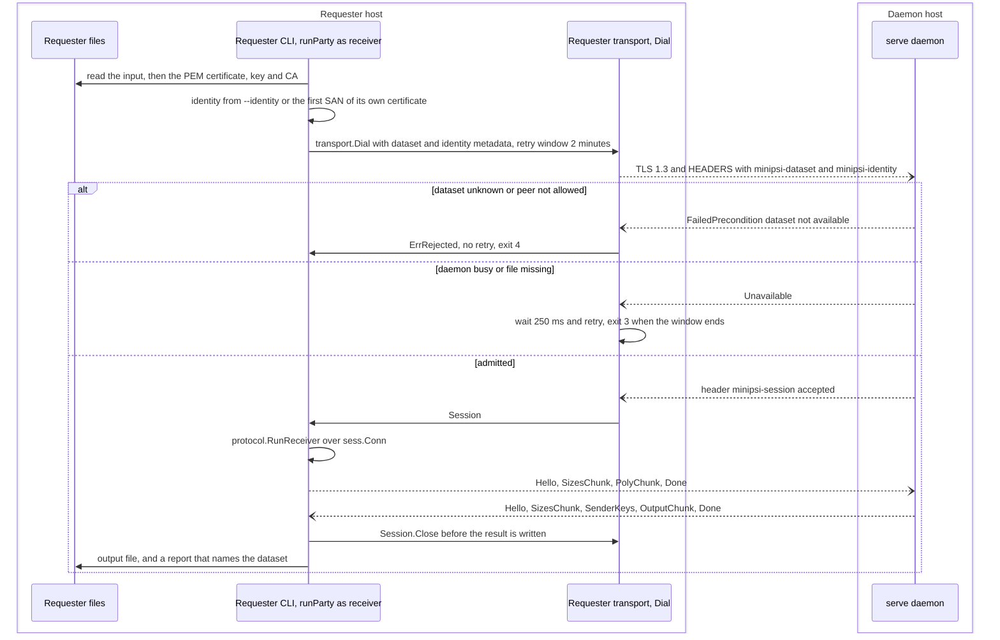

**Purpose:** obtain the intersection between the local input and a dataset that a remote
daemon serves, without the daemon learning the intersection.

**Trigger:** `minipsi request --peer ADDR --dataset NAME --input FILE --output FILE` plus TLS
flags, for example `scripts/e2e.sh:79-80` (test-only).

**Entry point:** [EP-04](ENTRY_POINTS.md#ep-04), the party `RunE` closure created for the
command `request` (`internal/cli/party.go:156`).

**Execution steps:**

*Initial handling*

1. **[Q]** `cli.Run` dispatches to `newPartyCmd("request")` (`internal/cli/root.go:82`).
   `cli.partyRole` maps `request` to the receiver role (`internal/cli/party.go:42-47`).
2. **[Q]** request-only flags: `--peer` sets the connect address, plus `--dataset`,
   `--identity` and `--mode` (`internal/cli/party.go:73-77`). There is no `--listen`.
3. **[Q]** the defaults give `request` a connect-retry window of 2 minutes, because a busy
   daemon refuses new sessions until the running one ends (`internal/cli/party.go:129-138`).

*Validation and authorization*

4. **[Q]** `--dataset` is required (`internal/cli/party.go:172-174`). `Validate` requires the
   receiver role and a connect address for `request.dataset`, and a dataset for
   `request.identity` (`internal/config/config.go:170-175`).
5. **[Q]** `runParty` reads and checks the input as in [BF-01](#bf-01)
   (`internal/cli/party.go:261`); the report records the dataset name
   (`internal/cli/party.go:200`).
6. **[Q]** `cli.transportOptions` builds the client TLS configuration
   (`internal/cli/party.go:367`) and the request metadata (`internal/cli/party.go:369-377`).
   The identity defaults to the first DNS or URI SAN of the requester's own certificate, else
   its common name (`internal/cli/party.go:372`, defined at `internal/cli/party.go:405`).
7. **[Q]** `transport.Dial` (`internal/cli/party.go:443`) attaches the metadata to every
   attempt (`internal/transport/transport.go:511-513`).
8. **[D]** the daemon authenticates and admits the request ([BF-02](#bf-02) steps 10 to 15).
9. **[Q]** outcomes of `Dial`: `FailedPrecondition` returns `ErrRejected` at once
   (`internal/transport/transport.go:543-545`), mapped to exit 4
   (`internal/cli/party.go:454-455`). `Unavailable` is retried
   (`internal/transport/transport.go:557-561`); when the window ends `Dial` returns `ErrBusy`
   for a busy daemon (`internal/transport/transport.go:552-553`) or the last error, both exit 3
   (`internal/cli/party.go:459`).

*Core processing*

10. **[Q]** `protocol.RunReceiver` (`internal/cli/party.go:301`), see [BF-05](#bf-05).
11. **[D]** `protocol.RunSender` on the requested dataset (`internal/cli/serve.go:192`), see
    [BF-06](#bf-06).

*Persistence and final result*

12. **[Q]** closes the session (`internal/cli/party.go:304`), writes the output
    (`internal/cli/party.go:311`) and the report (`internal/cli/party.go:251`), then exits 0.

**Main symbols:** `cli.partyRole`, `cli.partyDefaults`, `cli.transportOptions`,
`cli.firstSAN`, `config.MetaDataset`, `config.MetaIdentity`, `transport.Dial`,
`transport.ErrRejected`, `transport.ErrBusy`, `cli.classifyTransport`, `protocol.RunReceiver`.

**Data flow:** inputs are the local file and the dataset name; the dataset name and the
identity travel only as gRPC request headers (`internal/config/serve.go:58-59`). The
intersection stays on the requester's host. The daemon learns the requester's padded sizes,
its certificate and its declared identity. Per-item frame sizes are those of [BF-01](#bf-01).

**Side effects:** reads the input and the certificate files; writes the output and the report;
one outgoing TCP connection, re-dialled on retries; logs to stderr.

**Failure handling:** a missing `--dataset` exits 1 before any I/O. A rejection exits 4 without
retrying. A busy, shutting-down or unavailable daemon is retried every 250 ms for up to 2
minutes, then exit 3. If the daemon admits the request but cannot load the dataset, it sends
`Abort` `ERR_INPUT`; the requester's handshake receive turns that into a remote error
(`internal/protocol/session.go:322-324`), which exits 4 (`internal/cli/root.go:52-53`). With
`--insecure-dev`, `transportOptions` returns before it builds the metadata
(`internal/cli/party.go:348-351`), so the daemon sees no dataset name and rejects every request
with exit 4. The requester and the dataset must use the same `hash` and `lambda`, otherwise the
handshake fails with `ERR_PARAM_MISMATCH` and exit 4.

**Source locations:** `internal/cli/party.go:42-47`, `internal/cli/party.go:73-77`,
`internal/cli/party.go:129-139`, `internal/cli/party.go:172-177`,
`internal/cli/party.go:369-377`, `internal/cli/party.go:405-425`,
`internal/transport/transport.go:508-562`, `internal/config/config.go:170-175`.

**Related call graph:** [CG-03](CALL_GRAPHS.md#cg-03).

## Workflow: Session establishment, parameter agreement and abort

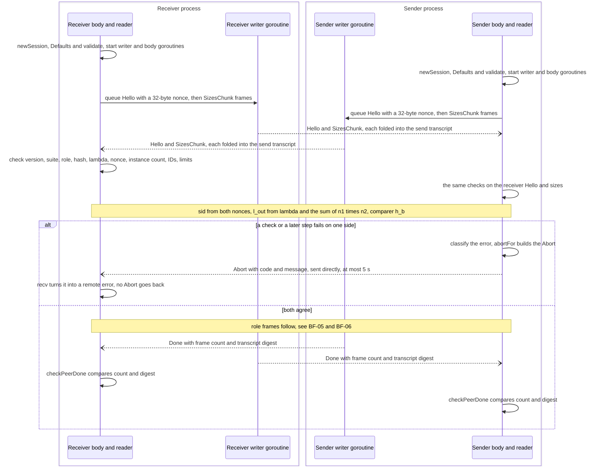

**Purpose:** make sure both parties run the same protocol with the same parameters on the same
instance list, derive shared session values, and turn any failure into a clear local error and
a notification to the peer.

**Trigger:** a caller passes a connected `protocol.Conn` to `protocol.RunReceiver` or
`protocol.RunSender`: the CLI (`internal/cli/party.go:293`, `internal/cli/party.go:301`,
`internal/cli/serve.go:192`), bench (`internal/cli/tools.go:116`, `internal/cli/tools.go:121`)
or tests.

**Entry point:** [EP-07](ENTRY_POINTS.md#ep-07) `protocol.RunReceiver`
(`internal/protocol/receiver.go:40`) and [EP-08](ENTRY_POINTS.md#ep-08) `protocol.RunSender`
(`internal/protocol/sender.go:28`).

**Execution steps:**

*Initial handling*

1. **[Both]** local checks before any frame: defaults, the padding policy, the sizes this party
   will announce and `checkOwn` (`internal/protocol/receiver.go:41-59`,
   `internal/protocol/sender.go:29-39`; `checkOwn` at `internal/protocol/session.go:475`).
2. **[Both]** `newSession` (`internal/protocol/session.go:169`): `Config.validate`
   (`internal/protocol/session.go:171`), the polynomial arithmetic and NTT backend
   (`internal/protocol/session.go:174`), the randomness source
   (`internal/protocol/session.go:184-189`), an outgoing queue of 8 frames and two SHA-256
   transcripts (`internal/protocol/session.go:190-196`).
3. **[Both]** `(*session).run` (`internal/protocol/session.go:222`) starts the writer goroutine
   (`internal/protocol/session.go:225`) and the role body (`internal/protocol/session.go:229`)
   in one task group.

*Validation and authorization (parameter agreement)*

4. **[Both]** `(*session).handshake` (`internal/protocol/session.go:362`) draws a 32-byte nonce
   (`internal/protocol/session.go:364-367`) and queues `Hello`
   (`internal/protocol/session.go:368-373`) and the own size list in `SizesChunk` frames of up
   to `(MaxFrame - 1024) / 10` entries (`internal/protocol/session.go:376-387`).
5. **[Net]** the writer digests each frame into the send transcript and sends it
   (`internal/protocol/session.go:279`, `internal/protocol/session.go:283`).
6. **[Both]** the first peer frame must be a `Hello`, received within the handshake timeout,
   30 s by default (`internal/protocol/session.go:389-396`). Version, suite, role (valid and
   opposite), hash, lambda and instance count must match, and the nonce must be 32 bytes
   (`internal/protocol/session.go:397-412`).
7. **[Both]** the peer's sizes must list the same instance IDs in the same order and stay
   within `max_instance_size` and `max_total_items` (`internal/protocol/session.go:414-442`).
8. **[Both]** shared values (`internal/protocol/session.go:444-460`): `sid` from both nonces
   (`internal/protocol/session.go:456`), `l_out` from lambda and the number of item pairs
   (`internal/protocol/session.go:457`), and the comparison hash `h_b`
   (`internal/protocol/session.go:458`).

*Core processing*

9. **[Both]** role frames ([BF-05](#bf-05), [BF-06](#bf-06)). Every later receive waits at most
   the phase timeout, 10 minutes by default (`internal/protocol/receiver.go:440`,
   `internal/protocol/sender.go:324`). Each received frame except `Done` is folded into the
   receive transcript (`internal/protocol/session.go:326-329`).
10. **[Both]** the body queues `Done` (`internal/protocol/receiver.go:136`,
    `internal/protocol/sender.go:95`) and the writer fills in the frame count and the digest
    of everything sent (`internal/protocol/session.go:276-277`).
11. **[Both]** the reader checks the peer's `Done` against what was received
    (`internal/protocol/session.go:334-339`, called at `internal/protocol/receiver.go:487` and
    `internal/protocol/sender.go:357`).

*Abort path (any step from 4 on)*

12. **[Failing side]** the first error cancels the whole task group
    (`internal/protocol/session.go:556-561`); a panic in a task becomes `ERR_INTERNAL`
    (`internal/protocol/session.go:545-549`).
13. **[Failing side]** `classify` maps context errors to `ERR_TIMEOUT` when the parent
    deadline passed, else to `ERR_CANCELLED` (`internal/protocol/session.go:255-267`).
14. **[Failing side]** `abortFor` (`internal/protocol/errors.go:78`) returns no `Abort` for a
    transport error or an abort received from the peer, and `Abort{Code, Msg}` otherwise. The
    `Abort` is sent directly on the `Conn` with a 5 s bound, even after cancellation
    (`internal/protocol/session.go:244-248`). The underlying cause is never sent.
15. **[Peer]** `recv` turns the `Abort` into an error with `Remote` set
    (`internal/protocol/session.go:322-324`), for which `abortFor` returns nothing, so no
    `Abort` echoes back (`internal/protocol/errors.go:85-87`).

*Final result*

16. **[Both]** success: the body returns nil, the outgoing queue is closed and drained
    (`internal/protocol/session.go:232`), and `Wait` returns (`internal/protocol/session.go:236`).
    Failure: `RunReceiver` or `RunSender` returns `(nil, err)`, which the CLI maps to an exit
    code (`internal/cli/root.go:38-69`).

**Main symbols:** `protocol.Conn`, `protocol.Frame`, `protocol.Hello`, `protocol.SizesChunk`,
`protocol.Done`, `protocol.Abort`, `protocol.Error`, `protocol.TransportError`,
`protocol.AbortConn`, `newSession`, `(*session).run`, `(*session).handshake`,
`(*session).writer`, `(*session).recv`, `(*session).checkPeerDone`, `classify`, `abortFor`,
`hashing.SessionID`, `hashing.OutputLen`, `hashing.NewComparer`.

**Data flow:** out: `Hello` (version 1, suite `minipsi-v1-ed25519-ell2` from
`internal/version/version.go:13-15`, role, hash, lambda, nonce, instance count, software
version) and the own announced sizes, 8 bytes per instance. In: the same from the peer. Derived:
`sid = SHA-256(lp("minipsi-v1-sid") || nonce_R || nonce_S)[0:16]`
(`internal/hashing/hashing.go:71-80`); `l_out` (`internal/hashing/hashing.go:57-69`); `h_b` as
SHA-256 or fixed-key AES keyed by `sid` and the instance ID
(`internal/hashing/hashing.go:97-115`). The transcript digest covers the canonical encoding of
every frame except `Done` and `Abort` (`internal/protocol/messages.go:108-169`). `MaxFrame` is
not part of `Hello` (`internal/protocol/messages.go:41-50`), so it is not negotiated.

**Wire error codes** (`internal/protocol/errors.go:13-23`) and the exit codes they give
(`internal/cli/root.go:38-69`):

| Code | Name | Raised for (examples) | Exit, side that detects it | Exit, peer |
|---|---|---|---|---|
| 1 | `ERR_PROTOCOL` | unexpected or empty frame, bad order, malformed chunk, transcript mismatch | 4 | 4 |
| 2 | `ERR_PARAM_MISMATCH` | version, suite, role, hash, lambda, instance count or IDs differ | 4 | 4 |
| 3 | `ERR_BAD_ENCODING` | non-canonical coefficient, bad part length | 4 | 4 |
| 4 | `ERR_BAD_POINT` | invalid `K_b` | 4 | 4 |
| 5 | `ERR_LIMIT` | peer sizes over the local limits | 4 | 4 |
| 6 | `ERR_TIMEOUT` | no frame within the handshake or phase timeout, overall deadline | 3 | 4 |
| 7 | `ERR_INTERNAL` | randomness failure, interpolation failure, panic | 5 | 4 |
| 8 | `ERR_CANCELLED` | SIGINT or SIGTERM | 4 | 4 |
| 9 | `ERR_INPUT` | duplicate point or hash collision at the receiver, daemon dataset unavailable | 2 | 4 |

A `protocol.TransportError` (the `Conn` failed) exits 3 and sends no `Abort`.

**Side effects:** network frames only; no files. Log lines "session parameters" at Info
(`internal/protocol/session.go:462`) and "session failed" at Warn
(`internal/protocol/session.go:250`).

**Failure handling:** see the abort path above. `Abort` delivery is best effort: it is skipped
when the link is gone, bounded to 5 s, and its send error is ignored. The protocol layer never
closes the `Conn`; the caller does. The handshake queues all its own frames before it receives
anything (`internal/protocol/session.go:373-389`); whether two parties with very large instance
lists can block each other there through gRPC flow control is not determined from the code
(inferred risk, not tested). Differing `MaxFrame`
values are caught only by the receiving side's gRPC message limit, which ends the stream with a
transport error (`internal/transport/transport.go:274-275`; tested in
`internal/transport/transport_test.go:431`, test-only).

**Source locations:** `internal/protocol/session.go:169-567`, `internal/protocol/errors.go:1-101`,
`internal/protocol/messages.go:28-202`, `internal/hashing/hashing.go:57-115`.

**Related call graph:** [CG-06](CALL_GRAPHS.md#cg-06).

## Workflow: Receiver computation

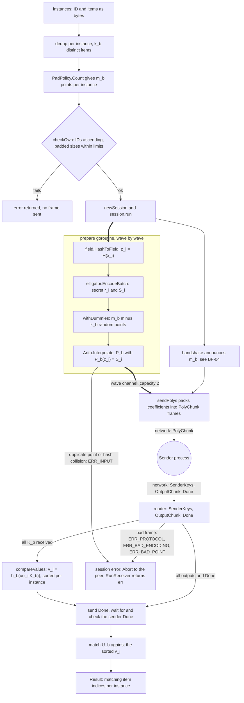

**Purpose:** encode the receiver's items into one polynomial per instance that hides them, send
it, and use the sender's answers to find which of its own items the sender also holds.

**Trigger:** `protocol.RunReceiver` is called by the receiver or request CLI
(`internal/cli/party.go:301`), by bench (`internal/cli/tools.go:116`) or by tests.

**Entry point:** [EP-07](ENTRY_POINTS.md#ep-07) `protocol.RunReceiver`
(`internal/protocol/receiver.go:40`).

**Execution steps:**

*Initial handling and validation*

1. `RunReceiver` applies the defaults and validates the padding policy
   (`internal/protocol/receiver.go:41-44`).
2. Per instance, `dedup` groups identical items (`internal/protocol/receiver.go:53`, defined
   at `internal/protocol/padding.go:69`), giving `k_b` distinct items
   (`internal/protocol/receiver.go:54`) and the announced point count
   `m_b = PadPolicy.Count(k_b)` (`internal/protocol/receiver.go:55`): `roundUp(max(k + Extra,
   Min), Multiple)`, at least 2 when `k >= 1` (`internal/protocol/padding.go:44-53`).
3. `checkOwn` checks ascending IDs and the padded sizes against the local limits
   (`internal/protocol/receiver.go:57`).
4. `newSession` and `run` (`internal/protocol/receiver.go:60-65`). The body computes IDs and
   offsets (`internal/protocol/receiver.go:98-103`) and starts `prepare` in its own goroutine
   before the handshake (`internal/protocol/receiver.go:107`).

*Core processing*

5. `prepare` (`internal/protocol/receiver.go:172`) works in waves of about `WaveItems` points
   (`internal/protocol/receiver.go:175`). In parallel chunks it hashes each distinct item to a
   field element with `field.HashToField` (`internal/protocol/receiver.go:182`) and draws
   encodings with `elligator.EncodeBatch` in batches of 256
   (`internal/protocol/receiver.go:186`), keeping the secret scalar `r_i` and the field value
   `S_i` (`internal/protocol/receiver.go:191-192`).
6. Per instance, `withDummies` rejects colliding hashes and adds `m_b - k_b` random points
   (`internal/protocol/receiver.go:204`, defined at `internal/protocol/receiver.go:267`), and
   `(*poly.Arith).Interpolate` builds `P_b` with `m_b` coefficients
   (`internal/protocol/receiver.go:208`, defined at `internal/poly/evaluator.go:59`).
7. Finished waves go to a channel of capacity 2 (`internal/protocol/receiver.go:106`,
   `internal/protocol/receiver.go:222`).
8. The handshake announces `m_b` (`internal/protocol/receiver.go:109`); see [BF-04](#bf-04).
9. The reader goroutine starts (`internal/protocol/receiver.go:118`).
10. `sendPolys` (`internal/protocol/receiver.go:121`, defined at
    `internal/protocol/receiver.go:233`) encodes each coefficient as 32 bytes
    (`internal/protocol/receiver.go:519`) and packs them into `PolyChunk` frames of about
    `MaxFrame` bytes (`internal/protocol/receiver.go:234`), flushed per wave
    (`internal/protocol/receiver.go:246`). **[Net]** `PolyChunk` frames to the sender.
11. **[S]** the sender evaluates and answers ([BF-06](#bf-06)).
12. The reader (`internal/protocol/receiver.go:419`) validates each `K_b` with
    `group.DecodeKey` (`internal/protocol/receiver.go:452`) and signals when all keys are in
    (`internal/protocol/receiver.go:459-461`). It accepts `OutputChunk` parts only after all
    keys, in instance order, with lengths that are multiples of `l_out`
    (`internal/protocol/receiver.go:462-479`), and the sender's `Done` only after all outputs
    (`internal/protocol/receiver.go:483-489`).
13. `compareValues` runs as soon as the keys are in, while the sender is still evaluating
    (`internal/protocol/receiver.go:125-130`, defined at `internal/protocol/receiver.go:311`).
    It computes `u(r_i*K_b)` with a fixed-base table for instances of at least 8 items
    (`internal/protocol/receiver.go:329`, `internal/protocol/receiver.go:345`) or plain scalar
    multiplication (`internal/protocol/receiver.go:349-351`), hashes it to `v_i` with `h_b`
    (`internal/protocol/receiver.go:353-355`) and sorts each instance's values
    (`internal/protocol/receiver.go:366-374`).
14. After all outputs, the receiver sends `Done` and waits for the sender's `Done`
    (`internal/protocol/receiver.go:131-144`). The session is finished before matching, so the
    time matching takes, which depends on the intersection size, is not visible to the sender
    as `Done` latency (`internal/protocol/receiver.go:134-135`).

*Final result*

15. `match` binary-searches each sender value among the sorted `v_i`
    (`internal/protocol/receiver.go:379-400`) and maps matches back to every copy of a
    duplicated item (`internal/protocol/receiver.go:401-409`).
16. The encoding scalars are overwritten (`internal/protocol/receiver.go:149-151`) and
    `RunReceiver` returns the `Result` with statistics (`internal/protocol/receiver.go:69-70`).

**Main symbols:** `protocol.RunReceiver`, `protocol.Result`, `protocol.InstanceResult`,
`receiver.body`, `receiver.prepare`, `receiver.withDummies`, `receiver.sendPolys`,
`receiver.reader`, `receiver.compareValues`, `receiver.match`, `packer`, `dedup`,
`PadPolicy.Count`, `field.HashToField`, `elligator.EncodeBatch`, `poly.Arith.Interpolate`,
`group.DecodeKey`, `group.NewFixedBase`, `group.UBatch`, `hashing.InstanceHasher`.

**Data flow:**

- In: `[]protocol.Instance{ID, Items}`; from the sender, one 32-byte `K_b` per instance and
  `n1_b` values of `l_out` bytes per instance.
- Per distinct item: `z_i = H(x_i)`, SHA-512 of a domain tag and the item reduced to a 32-byte
  field element (`internal/field/field.go:87-98`); a secret scalar `r_i` and a field value
  `S_i`, where `Q = r_i*B + t` (random torsion `t`) and `S_i` is a random Elligator2 preimage
  of `u(Q)` (`internal/elligator/elligator.go:164-165`).
- Per instance: `P_b` of degree below `m_b` with `P_b(z_i) = S_i` on real items and random
  values on dummy points; `m_b x 32` bytes on the wire.
- Comparison values: `v_i = h_b(u(r_i*K_b))`, `l_out` bytes per distinct item, kept in memory.
- Out: `Result.Instances[b].Matches`, ascending indices into the caller's `Items`, every copy
  of a duplicate included (`internal/protocol/receiver.go:36-39`), plus `SID`, `OutputLen` and
  `Stats`. The receiver records the phases `encode_interpolate`, `handshake`,
  `compare_values`, `match` and `total` (`internal/protocol/receiver.go:228`,
  `internal/protocol/session.go:461`, `internal/protocol/receiver.go:130`,
  `internal/protocol/receiver.go:147`, `internal/protocol/session.go:239`).

**Side effects:** CPU work on up to `Workers` goroutines (default `GOMAXPROCS`); network frames
through the `Conn`; no files. Fixed-base tables of about 61 KB each, at most 256 alive at once
(`internal/protocol/receiver.go:302-308`).

**Failure handling:** errors before the session return without a frame. In the session:
encoding failure `ERR_INTERNAL` (`internal/protocol/receiver.go:188`); colliding hashes or
duplicate points `ERR_INPUT` (`internal/protocol/receiver.go:204-210`); other interpolation
failures `ERR_INTERNAL` (`internal/protocol/receiver.go:212`); malformed sender frames
`ERR_PROTOCOL`, `ERR_BAD_ENCODING` or `ERR_BAD_POINT` (`internal/protocol/receiver.go:447-491`);
silence beyond the phase timeout `ERR_TIMEOUT`. Each of these sends an `Abort` ([BF-04](#bf-04)).
`compareValues` and `match` ignore the error of `parallel.For`
(`internal/protocol/receiver.go:326`, `internal/protocol/receiver.go:382`). A cancellation
during them is normally reported by the writer goroutine, which returns the context error
(`internal/protocol/session.go:289-290`); whether a partial result can escape in a narrow
race is not determined (inferred). Receiver padding
changes only the announced size: dummy points skip the encoding and comparison work, so the
receiver's own elliptic-curve work still scales with `k_b`
(`internal/protocol/receiver.go:264-300`).

**Source locations:** `internal/protocol/receiver.go:21-560`, `internal/protocol/padding.go:8-114`,
`internal/field/field.go:87-98`, `internal/elligator/elligator.go:164-272`,
`internal/poly/evaluator.go:57-61`, `internal/group/group.go:145-184`,
`internal/group/fixedbase.go:49`.

**Related call graph:** [CG-07](CALL_GRAPHS.md#cg-07), [CG-09](CALL_GRAPHS.md#cg-09).

## Workflow: Sender computation

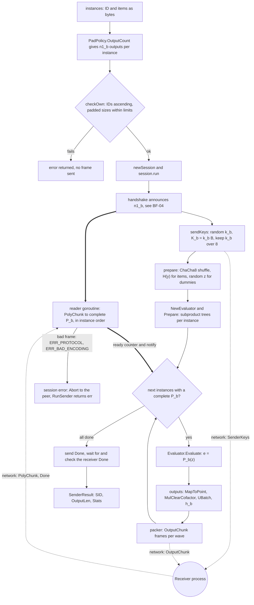

**Purpose:** answer the receiver's polynomials with one hashed Diffie-Hellman value per sender
item, in shuffled order, so that the receiver can recognise common items and the sender learns
nothing about them.

**Trigger:** `protocol.RunSender` is called by the sender CLI (`internal/cli/party.go:293`),
the serve daemon per session (`internal/cli/serve.go:192`), bench (`internal/cli/tools.go:121`)
or tests.

**Entry point:** [EP-08](ENTRY_POINTS.md#ep-08) `protocol.RunSender`
(`internal/protocol/sender.go:28`).

**Execution steps:**

*Initial handling and validation*

1. `RunSender` applies the defaults and validates the sender padding policy
   (`internal/protocol/sender.go:29-32`).
2. Per instance, the announced output count `n1_b = PadPolicy.OutputCount(n_b)`
   (`internal/protocol/sender.go:33-36`): `roundUp(max(n + Extra, Min), Multiple)` with no
   floor (`internal/protocol/padding.go:58-64`). The default adds no dummies
   (`internal/protocol/padding.go:30`).
3. `checkOwn` (`internal/protocol/sender.go:37`), `newSession` (`internal/protocol/sender.go:40`)
   and `run` (`internal/protocol/sender.go:45`).
4. The handshake announces `n1_b` (`internal/protocol/sender.go:75`); see [BF-04](#bf-04).

*Core processing*

5. The reader goroutine starts (`internal/protocol/sender.go:84`, defined at
   `internal/protocol/sender.go:299`). It accepts `PolyChunk` parts only for the current
   instance at the expected offset (`internal/protocol/sender.go:333-343`), decodes each
   32-byte coefficient and rejects non-canonical ones (`internal/protocol/sender.go:345-348`),
   and publishes each complete `P_b` through an atomic counter and a notification
   (`internal/protocol/sender.go:304-318`).
6. `sendKeys` (`internal/protocol/sender.go:86`, defined at `internal/protocol/sender.go:108`)
   draws `k_b` per instance (`internal/protocol/sender.go:116`), keeps `k_b/8`
   (`internal/protocol/sender.go:120`) and sends `K_b = k_b*B` in `SenderKeys` frames
   (`internal/protocol/sender.go:121-123`). **[Net]** `SenderKeys` to the receiver.
7. `prepare` (`internal/protocol/sender.go:89`, defined at `internal/protocol/sender.go:135`)
   seeds a ChaCha8 permutation from the session randomness
   (`internal/protocol/sender.go:137-142`) and shuffles each instance's positions, dummies
   included (`internal/protocol/sender.go:143-150`). It hashes the real items with
   `field.HashToField` (`internal/protocol/sender.go:159`), gives the dummy positions uniform
   random points (`internal/protocol/sender.go:167-180`) and builds an evaluator of subproduct
   trees per instance (`internal/protocol/sender.go:188-189`). All of this runs before the
   polynomials arrive.
8. `evaluate` (`internal/protocol/sender.go:92`, defined at `internal/protocol/sender.go:199`)
   waits until polynomials are complete (`internal/protocol/sender.go:205-214`) and takes a wave
   of ready instances of about `WaveItems` outputs (`internal/protocol/sender.go:216-220`).
9. `(*poly.Evaluator).Evaluate` computes `e = P_b(z)` at every point
   (`internal/protocol/sender.go:226`); the evaluator and the polynomial are then released
   (`internal/protocol/sender.go:228`).
10. `outputs` (`internal/protocol/sender.go:264`) maps each `e` to a point with
    `elligator.MapToPoint` (`internal/protocol/sender.go:275`), removes the torsion and
    multiplies by `k_b` with `group.MulClearCofactor` (`internal/protocol/sender.go:280`),
    takes u-coordinates in one batch (`internal/protocol/sender.go:283`) and hashes them with
    `h_b` to `l_out` bytes (`internal/protocol/sender.go:292`). A value with no curve image
    gets random bytes instead (`internal/protocol/sender.go:276-279`,
    `internal/protocol/sender.go:286-290`).
11. The packer adds each instance's outputs (`internal/protocol/sender.go:248`) and flushes
    `OutputChunk` frames per wave (`internal/protocol/sender.go:252`). **[Net]** `OutputChunk`
    to the receiver.

*Final result*

12. The sender queues `Done` (`internal/protocol/sender.go:95`), waits for the receiver's
    `Done` (`internal/protocol/sender.go:98`), overwrites `k_b/8`
    (`internal/protocol/sender.go:101-103`) and `RunSender` returns `SenderResult{SID,
    OutputLen, Stats}` (`internal/protocol/sender.go:48`). The sender has no intersection to
    return (`internal/protocol/sender.go:19`).

**Main symbols:** `protocol.RunSender`, `protocol.SenderResult`, `sender.body`,
`sender.sendKeys`, `sender.prepare`, `sender.evaluate`, `sender.outputs`, `sender.reader`,
`PadPolicy.OutputCount`, `group.RandomScalar`, `group.KeyFactor`, `field.HashToField`,
`poly.Arith.NewEvaluator`, `poly.Evaluator.Evaluate`, `elligator.MapToPoint`,
`group.MulClearCofactor`, `group.UBatch`, `hashing.InstanceHasher`.

**Data flow:**

- In: `[]protocol.Instance{ID, Items}`; from the receiver, `m_b` coefficients of 32 bytes per
  instance.
- Per instance: secret `k_b` (32-byte scalar) and public `K_b` (32 bytes on the wire).
- Per sender item or dummy: `z = H(y)` or a random point; `e = P_b(z)`; a point `Q` with
  `u(Q) = Map(e)`; `k_b*Q` with the torsion removed; its u-coordinate (32 bytes); the output
  `h_b(u)` truncated to `l_out` bytes. For a common item `e = S_i`, so this equals the
  receiver's `v_i`.
- Out: `n1_b x l_out` bytes per instance in shuffled order, then `SenderResult`. The phases
  are `handshake`, `hash_trees`, `evaluate_outputs` and `total`
  (`internal/protocol/sender.go:194`, `internal/protocol/sender.go:257`).

**Side effects:** CPU work on up to `Workers` goroutines; network frames through the `Conn`;
no files.

**Failure handling:** randomness failures `ERR_INTERNAL` (`internal/protocol/sender.go:117-118`,
`internal/protocol/sender.go:138-139`, `internal/protocol/sender.go:287-288`); malformed or
out-of-order polynomial parts `ERR_PROTOCOL` or `ERR_BAD_ENCODING`
(`internal/protocol/sender.go:330-361`); a `Done` before all polynomials `ERR_PROTOCOL`
(`internal/protocol/sender.go:354-355`); silence beyond the phase timeout `ERR_TIMEOUT`. Each
sends an `Abort` ([BF-04](#bf-04)). A value without a curve image is not an error. Sender
dummies go through the same evaluation and curve pipeline as real items, so neither their value
nor their cost marks them (`internal/protocol/sender.go:130-134`). Polynomial work cannot be
interrupted in the middle of one evaluation; cancellation is noticed between parallel chunks
and waits (inferred from `internal/parallel/parallel.go:72-80`).

**Source locations:** `internal/protocol/sender.go:19-364`, `internal/protocol/padding.go:55-64`,
`internal/poly/evaluator.go:10-55`, `internal/elligator/elligator.go:110-135`,
`internal/group/group.go:82-142`, `internal/hashing/hashing.go:117-195`.

**Related call graph:** [CG-08](CALL_GRAPHS.md#cg-08), [CG-09](CALL_GRAPHS.md#cg-09).

## Workflow: Batched PSI over many instances

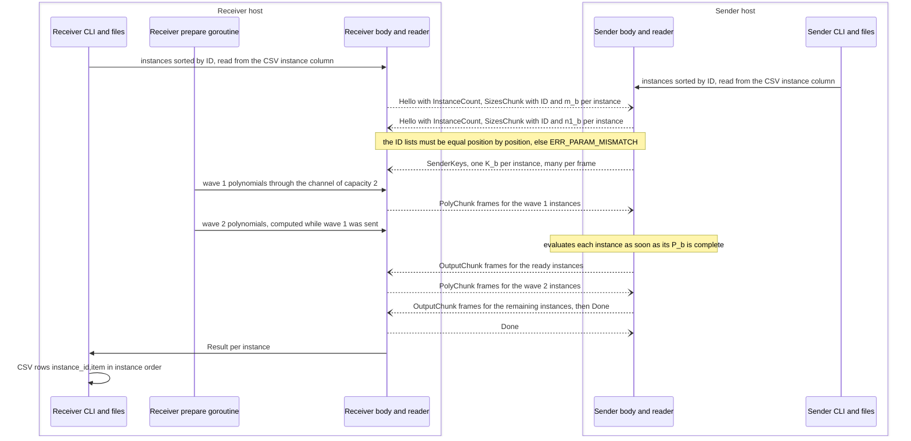

**Purpose:** run many independent PSI instances, for example one per customer segment or per
day, in one session with bounded memory and with computation and transfer overlapping.

**Trigger:** both parties read CSV input with `--format csv --batched --instance-column COL`
(and usually `--header --column COL`), for example `scripts/e2e.sh:35-39` (test-only). The
library caller passes several `protocol.Instance` values instead.

**Entry point:** [EP-03](ENTRY_POINTS.md#ep-03) or [EP-04](ENTRY_POINTS.md#ep-04) for the CLI,
then [EP-07](ENTRY_POINTS.md#ep-07) and [EP-08](ENTRY_POINTS.md#ep-08).

**Execution steps:**

*Initial handling and validation*

1. **[Both]** `Validate` requires `csv` format and an instance column for batched mode
   (`internal/config/config.go:179-187`).
2. **[Both]** `itemio.readCSV` resolves the columns (`internal/itemio/itemio.go:133-146`),
   parses each instance ID as an unsigned 32-bit number (`internal/itemio/itemio.go:165-172`)
   and groups items per instance, dropping exact duplicates
   (`internal/itemio/itemio.go:199-211`). `finish` returns the instances sorted by ID
   (`internal/itemio/itemio.go:215-225`). An instance exists only if at least one non-empty
   item names it.
3. **[Both]** `protocol.CheckInput` enforces `max_instances`, strictly increasing IDs and the
   per-instance and total limits (`internal/protocol/session.go:475-498`).
4. **[Net]** the handshake carries the instance count and every (ID, size) pair
   (`internal/protocol/session.go:368-387`). Both sides must hold exactly the same IDs in the
   same order (`internal/protocol/session.go:410-411`, `internal/protocol/session.go:430-431`).

*Core processing*

5. **[S]** one key per instance, packed into `SenderKeys` frames of up to
   `(MaxFrame - 1024) / 32` keys (`internal/protocol/sender.go:111-126`).
6. **[R]** `waves` splits the instances into runs of about `WaveItems` points, 2^14 by
   default (`internal/protocol/receiver.go:175`, `internal/protocol/session.go:510-524`,
   `internal/protocol/session.go:88-90`). The channel of capacity 2 lets wave w+1 be computed
   while wave w is sent (`internal/protocol/receiver.go:106`). Within a wave, instances are
   interpolated in parallel (`internal/protocol/receiver.go:201`).
7. **[R]** a frame may carry parts of several instances, flushed at the end of each wave
   (`internal/protocol/receiver.go:241-247`).
8. **[S]** the reader publishes complete polynomials in instance order
   (`internal/protocol/sender.go:304-318`); `evaluate` processes ready instances in waves of
   about `WaveItems` outputs and frees each evaluator after use
   (`internal/protocol/sender.go:216-228`), flushing per wave
   (`internal/protocol/sender.go:252`).
9. **[R]** the reader accepts output parts strictly in instance order
   (`internal/protocol/receiver.go:469-479`). `compareValues` keeps at most 256 fixed-base
   tables alive (`internal/protocol/receiver.go:318-325`). `h_b` is separated per instance by
   its ID (`internal/protocol/receiver.go:353`, `internal/protocol/sender.go:292`,
   `internal/hashing/hashing.go:129-135`).

*Persistence and final result*

10. **[R]** `match` runs per instance in parallel (`internal/protocol/receiver.go:382`);
    `itemio.WriteResult` writes CSV rows `instance_id,item` in instance order, then input
    order (`internal/itemio/itemio.go:234-246`).

**Main symbols:** `protocol.Instance`, `protocol.Limits`, `Config.WaveItems`, `waves`,
`offsets`, `polyWave`, `packer`, `receiver.prepare`, `sender.evaluate`, `itemio.readCSV`,
`itemio.grouper`, `itemio.WriteResult`.

**Data flow:** per instance on the wire: 8 bytes in `SizesChunk`, 32 bytes of `K_b`,
`m_b x 32` bytes of coefficients and `n1_b x l_out` bytes of outputs. `l_out` is computed once
for the session from the sum of `n1_b x m_b` over all instances
(`internal/protocol/session.go:449-457`), so it grows with the total number of item pairs. The
default limits are 2^24 instances, 2^22 items per instance and 2^24 items per side
(`internal/protocol/session.go:73-81`). The result is one `InstanceResult` per instance, in
instance order.

**Side effects:** as in [BF-01](#bf-01); the output is CSV.

**Failure handling:** there is no per-instance isolation: any instance's error aborts the whole
session. An instance present on one side only gives `ERR_PARAM_MISMATCH` (exit 4 on both
sides). A peer size over the local limits gives `ERR_LIMIT`. A CSV with only a header yields no
instances; what the session then does with zero instances is not exercised by the CLI tests and
is not determined here. The handshake flow-control question of [BF-04](#bf-04) matters most for
very large instance lists.

**Source locations:** `internal/protocol/session.go:500-524`, `internal/protocol/receiver.go:164-253`,
`internal/protocol/sender.go:198-259`, `internal/protocol/sender.go:297-364`,
`internal/itemio/itemio.go:100-226`.

**Related call graph:** [CG-07](CALL_GRAPHS.md#cg-07), [CG-08](CALL_GRAPHS.md#cg-08).

## Workflow: Configuration resolution and validation

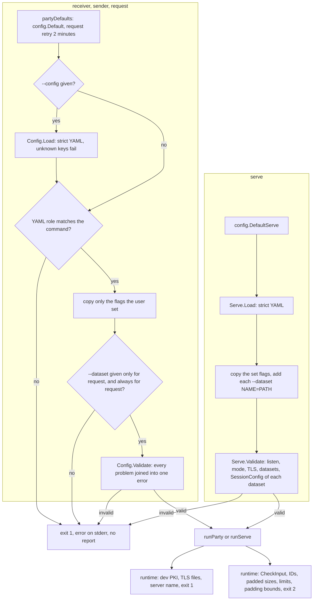

**Purpose:** turn defaults, an optional YAML file and command-line flags into one checked
configuration, and reject unsupported or unsafe combinations before any network activity.

**Trigger:** every `receiver`, `sender`, `request` and `serve` command.

**Entry point:** [EP-03](ENTRY_POINTS.md#ep-03) and [EP-04](ENTRY_POINTS.md#ep-04) (party
`RunE`, `internal/cli/party.go:156`), [EP-05](ENTRY_POINTS.md#ep-05) (serve `RunE`,
`internal/cli/serve.go:57`).

**Execution steps:**

*Initial handling*

1. `newPartyCmd` seeds the flag-backed configuration from `partyDefaults`
   (`internal/cli/party.go:143`) and registers `--config` and the role's flags
   (`internal/cli/party.go:154-155`, `internal/cli/party.go:54-127`). Size and duration flags
   parse through `Set` (`internal/config/config.go:339`, `internal/config/config.go:365`); a
   bad value is a cobra error that `cli.Run` turns into exit 1 (`internal/cli/root.go:97-99`).
2. `RunE` starts again from `partyDefaults` (`internal/cli/party.go:157`), which is
   `config.Default` (`internal/config/config.go:113-126`) plus a 2-minute connect retry for
   `request` (`internal/cli/party.go:133-139`).
3. With `--config`, `(*config.Config).Load` overlays the YAML file and rejects unknown keys
   (`internal/cli/party.go:159`, `internal/config/config.go:129-146`).

*Validation*

4. The file's `role`, if set, must match the command (`internal/cli/party.go:163-165`).
5. Only flags the user actually set override the file (`internal/cli/party.go:167-171`), so the
   precedence is defaults, then YAML, then explicit flags.
6. `request` needs `--dataset`; the other commands may not set one
   (`internal/cli/party.go:172-177`).
7. `(*config.Config).Validate` (`internal/cli/party.go:178`, defined at
   `internal/config/config.go:156`) collects every problem and joins them
   (`internal/config/config.go:249`). Its rules are listed below.
8. For `serve`: `config.DefaultServe` (`internal/cli/serve.go:58`), `(*config.Serve).Load`
   (`internal/cli/serve.go:60`, defined at `internal/config/serve.go:78`), the set flags
   (`internal/cli/serve.go:64-81`), `--dataset NAME=PATH` entries
   (`internal/cli/serve.go:82-91`) and `(*config.Serve).Validate`
   (`internal/cli/serve.go:92`, defined at `internal/config/serve.go:159`). That checks the
   listen address, mode, TLS, at least one dataset, the dataset names, that each dataset names
   a file, and each dataset's full session configuration through `SessionConfig` and
   `Config.Validate` (`internal/config/serve.go:180-196`). Repeated messages are merged
   (`internal/config/serve.go:208-223`).

*Core processing (runtime checks that use the configuration)*

9. `cli.protocolConfig` maps the configuration to `protocol.Config`
   (`internal/cli/party.go:319-341`). An unknown hash name exits 1
   (`internal/cli/party.go:222-225`). `poly_cache: 0` becomes "disabled"
   (`internal/cli/party.go:324-327`). `WaveItems` and `Rand` are not configurable from the
   CLI and keep the protocol defaults.
10. `protocol.CheckInput` (`internal/cli/party.go:230`, defined at
    `internal/protocol/padding.go:99`) applies the full protocol validation, including the
    upper bound of 2^20 on padding values (`internal/protocol/padding.go:35-41`), and exits 2.
11. `cli.applyMemoryLimit`: an explicit `memory_limit` wins, then `GOMEMLIMIT`, then the
    2 GiB default; 0 disables the limit (`internal/cli/party.go:472-485`).
12. `cli.resolveDev` and `cli.transportOptions` read the certificate material and exit 1 on
    problems (`internal/cli/party.go:271-277`).

*Final result*

13. A valid configuration reaches `runParty` (`internal/cli/party.go:183`) or `runServe`
    (`internal/cli/serve.go:97`).

**Main validation rules** (`internal/config/config.go:156-286`):

| Area | Rule |
|---|---|
| Role and address | role is `receiver` or `sender`; exactly one of `listen` and `connect` |
| Mode | only `direct`; `relay` is "not implemented yet" (`internal/config/config.go:252-260`) |
| Request | `request.dataset` needs the receiver role and a connect address; `request.identity` needs a dataset |
| Input | `lines` or `csv`; batched needs `csv` and an instance column; the item column is not empty |
| Protocol | hash `sha256` or `aes`; lambda in [40, 256]; padding values not negative, multiple at least 1; each role rejects a non-default padding policy of the other role (`internal/config/config.go:208-214`) |
| TLS | `dev` excludes TLS files and `insecure_dev` and allows only loopback addresses; `insecure_dev` excludes TLS files; otherwise cert, key and CA are all required; `name` only with `dev` (`internal/config/config.go:263-286`) |
| Limits and timeouts | `max_frame` at least 64 KiB; limits positive; handshake and phase timeouts above 0; total and connect-retry not negative |
| Other | workers not negative; NTT backend `native` or `lattigo`; sizes not negative; log format and level known; `output` only for the receiver |

**Main symbols:** `config.Config`, `config.Default`, `(*config.Config).Load`,
`(*config.Config).Validate`, `config.validMode`, `config.validTLS`, `config.Serve`,
`config.DefaultServe`, `(*config.Serve).Validate`, `(*config.Serve).SessionConfig`,
`cli.partyDefaults`, `cli.partyFlags`, `cli.flagBinding`, `cli.protocolConfig`,
`protocol.CheckInput`.

**Data flow:** command-line arguments and the YAML file become one `config.Config` (or
`config.Serve` with one derived `config.Config` per dataset). From it `protocolConfig` builds
the `protocol.Config` the core receives, and `transportOptions` builds the `transport.Options`.
Values that must match the peer are `hash` and `lambda`; padding, workers, NTT backend, limits
and timeouts are local choices.

**Side effects:** reads the YAML file only; no network, no files written. Errors go to stderr
as `minipsi: <error>`.

**Failure handling:** every configuration error is `ExitUsage` (1) and is reported before
`runParty`, so no report file is written for it. Problems that need data, such as padded sizes
over the limits, surface later as exit 2. Because `Validate` checks only the lower bounds of the
padding values, a padding value above 2^20 passes validation and fails in `CheckInput` with exit
2 after the input has been read.

**Source locations:** `internal/cli/party.go:34-186`, `internal/cli/party.go:319-341`,
`internal/cli/serve.go:25-100`, `internal/config/config.go:20-286`,
`internal/config/serve.go:16-223`.

**Related call graph:** [CG-02](CALL_GRAPHS.md#cg-02), [CG-04](CALL_GRAPHS.md#cg-04).

## Workflow: Result delivery, reports and exit codes

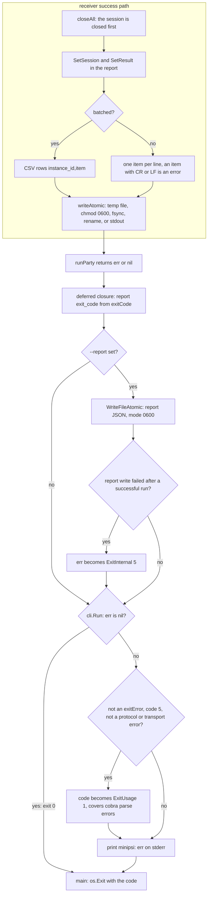

**Purpose:** deliver the intersection to the receiver's operator without partial files,
leave a machine-readable record of every run, and give scripts a stable exit code.

**Trigger:** the end of every party run (success or failure), and every return from `cli.Run`.

**Entry point:** [EP-02](ENTRY_POINTS.md#ep-02) `cli.Run` (`internal/cli/root.go:88`) and the
deferred closure of `cli.runParty` (`internal/cli/party.go:242`), reached from
[EP-03](ENTRY_POINTS.md#ep-03) and [EP-04](ENTRY_POINTS.md#ep-04).

**Execution steps:**

*Initial handling*

1. **[R]** after a successful `RunReceiver`, the session is closed before anything is written
   (`internal/cli/party.go:304`).
2. **[R]** the report gets SID, output length, statistics and the result count
   (`internal/cli/party.go:308-309`; `internal/report/report.go:74-99`).

*Core processing (writing the result)*

3. **[R]** `itemio.WriteResult` (`internal/cli/party.go:311`, defined at
   `internal/itemio/itemio.go:231`): in batched mode CSV rows `instance_id,item`
   (`internal/itemio/itemio.go:234-246`); otherwise one item per line, and an intersecting item
   that contains CR or LF is an error (`internal/itemio/itemio.go:247-257`).
4. **[R]** `writeAtomic` (`internal/itemio/itemio.go:264`): `-` or empty writes to stdout
   (`internal/itemio/itemio.go:265-266`); otherwise a temporary file in the target directory
   (`internal/itemio/itemio.go:269`), mode 0600 (`internal/itemio/itemio.go:283`), fsync
   (`internal/itemio/itemio.go:286`) and rename over the target
   (`internal/itemio/itemio.go:292`). The temporary file is removed on any failure
   (`internal/itemio/itemio.go:274-279`).

*Persistence (the report)*

5. **[Both]** the deferred closure in `runParty` sets `exit_code` from `cli.exitCode`, the
   error text and the wall time (`internal/cli/party.go:243-249`).
6. **[Both]** with `--report`, `itemio.WriteFileAtomic` writes the indented JSON
   (`internal/cli/party.go:250-251`; `internal/report/report.go:102-105`). If that fails after
   a successful run, the run becomes exit 5 (`internal/cli/party.go:252-255`).
7. **[D]** the daemon writes one report per session into `state_dir/reports`
   (`internal/cli/serve.go:213-221`); a write failure is only logged.

*Final result (exit code)*

8. **[Both]** `cli.Run` returns 0 for no error (`internal/cli/root.go:92-93`), otherwise maps
   the error with `exitCode` (`internal/cli/root.go:95`, defined at `internal/cli/root.go:38`).
   An error that is not an `exitError`, maps to 5 and is not a protocol or transport error is
   treated as a usage error, exit 1 (`internal/cli/root.go:97-99`). This catches cobra's flag
   and argument errors.
9. **[Both]** `cli.Run` prints `minipsi: <error>` to stderr (`internal/cli/root.go:101`) and
   `main` exits with the code (`cmd/minipsi/main.go:12`).

**Exit codes** (`internal/cli/root.go:19-26`, `internal/cli/root.go:38-69`,
`internal/cli/party.go:450-460`):

| Code | Meaning | Typical causes |
|---|---|---|
| 0 | OK | run complete; `serve` shut down cleanly; help printed |
| 1 | usage or configuration | flag, YAML or validation errors; TLS files or dev PKI unusable; plaintext mode without `MINIPSI_I_UNDERSTAND_INSECURE=1` |
| 2 | input data | input unreadable or malformed; `CheckInput` limits, ID order, padding bounds; local `ERR_INPUT` |
| 3 | network or timeout | `protocol.TransportError`; local `ERR_TIMEOUT`; listen or dial failure, busy daemon, deadline during accept or dial |
| 4 | protocol, peer abort or interruption | any abort received from the peer; local protocol errors; `ERR_CANCELLED`; rejected request; interrupted accept or dial |
| 5 | internal | local `ERR_INTERNAL`; output or report write failure; bench failure; certificate generation failure |

**Report fields** (`internal/report/report.go:14-39`): `version`, `commit`, `role`, `suite`,
`hash`, `lambda`, `padding`, `ntt_backend`, `peer`, `dataset`, `requester`, `sid`,
`output_len`, `instances`, `n_self`, `records_read`, `empty_skipped`, `dedup_removed`,
`result_count` (receiver only), `timings_ms` (`read_input`, the protocol phases, `write_output`,
`wall`), `bytes`, `frames`, `exit_code`, `error`. The report never contains items, field
elements, scalars or protocol outputs (`internal/report/report.go:1-2`).

**Main symbols:** `itemio.WriteResult`, `itemio.writeAtomic`, `itemio.WriteFileAtomic`,
`report.Report`, `(*report.Report).SetInput`, `(*report.Report).SetSession`,
`(*report.Report).SetResult`, `(*report.Report).JSON`, `cli.exitCode`, `cli.isRunError`,
`cli.classifyTransport`, `cli.exitError`.

**Data flow:** each `Matches[j]` of `Result.Instances[b]` indexes `in.Instances[b].Items`, so
the output lists the receiver's own items, each distinct item once, in instance order and then
first-occurrence order. Input statistics, the peer identity, session statistics and the final
error flow into the report. A failed run's report has no SID, bytes, frames or protocol phase
timings, because the protocol returns no result on error.

**Side effects:** the output file (or stdout) on the receiver; the report file on each side
that asked for one; stderr messages; the process exit status. There is no database or queue.

**Failure handling:** an output write failure exits 5 and leaves no output file, but output to
stdout may already be partly written. The output path is not checked before the run, so a bad
path is found only after the whole protocol has run, as is an item with a line break in
standalone mode. No report is written for errors found before `runParty` (flags, YAML,
validation). The report's `exit_code` comes from `exitCode` alone, while the process exit code
also goes through the downgrade rule of step 8, so for an unclassified error the report would
say 5 and the process would exit 1; whether such an error can reach `cli.Run` from a party run
is not determined (open question). A panic outside the protocol task
group ends the process with Go's status 2, which is the same number as `ExitInput` (Go runtime
behaviour, inferred).

**Source locations:** `internal/cli/root.go:19-110`, `internal/cli/party.go:236-317`,
`internal/cli/party.go:450-460`, `internal/itemio/itemio.go:228-305`,
`internal/report/report.go:1-105`.

**Related call graph:** [CG-01](CALL_GRAPHS.md#cg-01), [CG-02](CALL_GRAPHS.md#cg-02).

## Workflow: Development PKI and test certificates

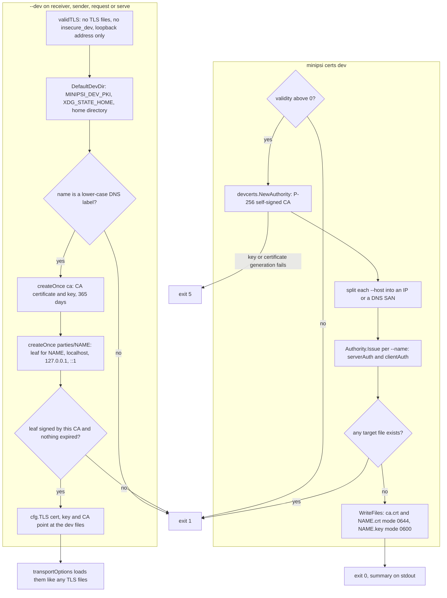

**Purpose:** give developers and tests working mutual-TLS certificates with no external PKI:
either throw-away files (`certs dev`) or a shared local CA that every `--dev` process on the
machine trusts. Neither is for production.

**Trigger:** `minipsi certs dev [--out DIR] [--name N]... [--host H]... [--validity D]`, or
`--dev [--name N]` on `receiver`, `sender`, `request` or `serve`.

**Entry point:** [EP-10](ENTRY_POINTS.md#ep-10): the `certs dev` `RunE`
(`internal/cli/tools.go:36`) and `cli.resolveDev` (`internal/cli/party.go:383`).

**Execution steps:**

*certs dev*

1. cobra calls the `certs dev` `RunE` (`internal/cli/tools.go:36`). Defaults: `--out certs`,
   `--name receiver,sender`, `--host localhost,127.0.0.1`, `--validity 720h`
   (`internal/cli/tools.go:70-73`).
2. A validity of 0 or less exits 1 (`internal/cli/tools.go:37-39`).
3. `devcerts.NewAuthority("minipsi dev CA", validity)` creates an ECDSA P-256 self-signed CA
   (`internal/cli/tools.go:40`, defined at `internal/devcerts/devcerts.go:46`).
4. Each `--host` becomes an IP SAN or a DNS SAN (`internal/cli/tools.go:45-51`).
5. `(*devcerts.Authority).Issue` creates one leaf per name with DNS SANs `[name, hosts...]`,
   valid for TLS server and client authentication (`internal/cli/tools.go:54-62`;
   `internal/devcerts/devcerts.go:78-123`, extended key usage at
   `internal/devcerts/devcerts.go:103`).
6. `devcerts.WriteFiles` refuses to overwrite any existing file
   (`internal/devcerts/devcerts.go:133-139`), creates the directory with mode 0700
   (`internal/devcerts/devcerts.go:140`) and writes `ca.crt`, `NAME.crt` (0644) and `NAME.key`
   (0600) (`internal/devcerts/devcerts.go:143-150`).
7. A summary line goes to stdout (`internal/cli/tools.go:66`); exit 0.

*--dev*

8. `validTLS` has already rejected `--dev` with TLS files, with `--insecure-dev` or with a
   non-loopback address (`internal/config/config.go:268-274`; `devcerts.IsLoopback` at
   `internal/devcerts/devpki.go:182`).
9. `cli.resolveDev` (`internal/cli/party.go:383`; the daemon passes the role `sender` at
   `internal/cli/serve.go:107`) finds the directory with `devcerts.DefaultDevDir`
   (`internal/cli/party.go:387`, defined at `internal/devcerts/devpki.go:31`) and uses
   `--name` or the role name (`internal/cli/party.go:391-394`).
10. `devcerts.EnsureDev` (`internal/cli/party.go:395`, defined at
    `internal/devcerts/devpki.go:50`) checks the name (`internal/devcerts/devpki.go:51`) and
    creates the directory with mode 0700 (`internal/devcerts/devpki.go:54`).
11. The CA is created once: a temporary directory is filled with `ca.crt` (0644) and `ca.key`
    (0600) and renamed into place, so concurrent first runs agree on one CA
    (`internal/devcerts/devpki.go:58-71`, `internal/devcerts/devpki.go:121-142`).
12. The party's leaf is created once in `parties/NAME` with SANs `NAME`, `localhost`,
    `127.0.0.1` and `::1`, valid 365 days (`internal/devcerts/devpki.go:83-96`).
13. The leaf must be signed by this CA and neither may be expired
    (`internal/devcerts/devpki.go:105-115`).
14. `resolveDev` points the TLS settings at these files (`internal/cli/party.go:399`) and logs
    a DEV MODE warning (`internal/cli/party.go:400`); `transportOptions` loads them
    (`internal/cli/party.go:352`).

*Test-only use*

15. **[Test-only]** `scripts/e2e.sh:15` and `scripts/e2e.sh:58` generate certificates with
    `certs dev`; `scripts/e2e.sh:98-106` runs `serve --dev` and `request --dev` together; the Go
    end-to-end suite calls `certs dev` in `setup` (`test/e2e/e2e_test.go:96-104`).

**Main symbols:** `cli.newCertsCmd`, `devcerts.NewAuthority`, `(*devcerts.Authority).Issue`,
`devcerts.WriteFiles`, `cli.resolveDev`, `devcerts.DefaultDevDir`, `devcerts.EnsureDev`,
`devcerts.createOnce`, `devcerts.loadAuthority`, `devcerts.IsLoopback`, `config.validTLS`.

**Data flow:** flags become `devcerts.LeafOptions`, then PEM bytes, then files. For `--dev` the
environment gives the directory (`MINIPSI_DEV_PKI`, else `$XDG_STATE_HOME/minipsi/dev-pki`,
else `~/.local/state/minipsi/dev-pki`, `internal/devcerts/devpki.go:29-43`), the party name
gives the paths `parties/NAME/cert.pem` and `parties/NAME/key.pem`, and `ca/ca.crt` is the
trust anchor.

**Side effects:** `certs dev` writes into `--out`; a new CA is created on every run and its key
is not saved. `--dev` creates and reuses `ca/` and `parties/NAME/` under the dev PKI directory.
No network.

**Failure handling:** `certs dev`: bad validity or existing or unwritable files exit 1;
key or certificate generation failures exit 5 (`internal/cli/tools.go:41-43`,
`internal/cli/tools.go:58-60`). The files are written one by one, so a failure part-way leaves
some files behind. `--dev`: any error exits 1 (`internal/cli/party.go:271-273`,
`internal/cli/serve.go:107-109`); a leaf from another CA or an expired PKI asks the user to
delete the directory. An existing but empty or partial `ca/` or `parties/NAME/` is not repaired,
and a key that does not match its certificate is not detected by `EnsureDev` (it would fail
later when the TLS files are loaded, inferred).

**Source locations:** `internal/cli/tools.go:21-76`, `internal/cli/party.go:381-402`,
`internal/devcerts/devcerts.go:23-161`, `internal/devcerts/devpki.go:16-192`,
`internal/config/config.go:262-286`.

**Related call graph:** [CG-11](CALL_GRAPHS.md#cg-11).

## Workflow: Capacity benchmark

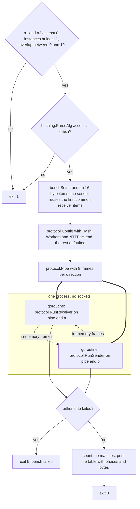

**Purpose:** measure how long a session of a given size takes and how many bytes it moves, on
one host, for capacity planning.

**Trigger:** `minipsi bench [--n1 N] [--n2 N] [--instances B] [--overlap F] [--hash H]
[--ntt-backend B] [--workers W]`.

**Entry point:** [EP-09](ENTRY_POINTS.md#ep-09), the bench `RunE` (`internal/cli/tools.go:93`).

**Execution steps:**

*Initial handling and validation*

1. cobra calls the bench `RunE` (`internal/cli/tools.go:93`). Defaults: 4096 sender and 4096
   receiver items, 1 instance, overlap 0.1, `sha256`, `native`, all CPUs
   (`internal/cli/tools.go:142-148`).
2. Out-of-range sizes or overlap exit 1 (`internal/cli/tools.go:94-96`), as does an unknown
   hash (`internal/cli/tools.go:97-100`).

*Core processing*

3. `cli.benchSets` (`internal/cli/tools.go:101`, defined at `internal/cli/tools.go:161`)
   splits both totals evenly over the instances, makes random 16-byte items
   (`internal/cli/tools.go:162-166`) and lets the sender reuse the first
   `min(overlap x receiver items, sender items)` receiver items of each instance
   (`internal/cli/tools.go:170-182`). Instance IDs are 0 to B-1
   (`internal/cli/tools.go:183`).
4. A `protocol.Config` with only hash, workers and backend set; everything else takes the
   protocol defaults (`internal/cli/tools.go:102`).
5. `protocol.Pipe(8)` creates two connected in-memory `Conn` ends
   (`internal/cli/tools.go:103`, defined at `internal/protocol/conn.go:27`).
6. Two goroutines run `protocol.RunReceiver` (`internal/cli/tools.go:116`) and
   `protocol.RunSender` (`internal/cli/tools.go:121`), each closing its end when done
   (`internal/cli/tools.go:115`, `internal/cli/tools.go:120`). The frames are passed as
   pointers; nothing is encoded or sent over a socket (`internal/protocol/conn.go:36-78`).

*Final result*

7. After both finish (`internal/cli/tools.go:123-124`), a failure of either side exits 5 with
   both errors in the message (`internal/cli/tools.go:125-127`).
8. Otherwise the matches are counted (`internal/cli/tools.go:128-131`) and a table goes to
   stdout: instances, receiver items (n2), sender items (n1), intersection, hash and backend,
   wall time, each side's phases with `total` first (`internal/cli/tools.go:152-158`) and the
   bytes sent in each direction (`internal/cli/tools.go:132-138`).

**Main symbols:** `cli.newBenchCmd`, `cli.benchSets`, `cli.printPhases`, `protocol.Pipe`,
`protocol.PipeConn`, `protocol.RunReceiver`, `protocol.RunSender`, `protocol.Stats`.

**Data flow:** flags become synthetic instance lists; both parties exchange the same frames as
in [BF-01](#bf-01), but in memory. The `Stats` of both results become the printed table. The
bytes shown are the protocol's payload estimates. Both parties share the host's CPUs, so the
wall time approximates the sum of both parties' work (`internal/cli/tools.go:89-91`); the time
a real two-host run would take, including network latency and bandwidth, cannot be determined
from this command.

**Side effects:** CPU and memory use only; output on stdout; no files, no network. The process
does not install a signal handler for bench, so SIGINT ends it with the default signal action;
the exit status in that case is not set by minipsi code.

**Failure handling:** usage problems exit 1. Every protocol failure, including an unknown NTT
backend found in `newSession` (`internal/protocol/session.go:174`), exits 5; the error chain is
flattened into the message. The deferred `Close` on each pipe end prevents one side from
waiting forever when the other fails. There is no CLI timeout; the protocol's default handshake
(30 s) and phase (10 min) timeouts bound the waits.

**Source locations:** `internal/cli/tools.go:78-195`, `internal/protocol/conn.go:17-84`.

**Related call graph:** [CG-10](CALL_GRAPHS.md#cg-10).
