# Call Graphs

Focused call graphs for the main entry points of minipsi at commit `4aa7c9f`. Each graph
starts at an entry point from [ENTRY_POINTS.md](ENTRY_POINTS.md), follows execution into the
business logic, and lists the source location of every edge it draws.

**How these were produced.** Static reading of the source, cross-checked against a
machine-built call graph (`golang.org/x/tools/cmd/callgraph` v0.51.0, VTA algorithm, rooted
at `cmd/minipsi` `main`). Every `path:line` in this file was checked against the source.
Relationships that could not be confirmed are labelled *inferred* and drawn dashed.

## How to read the graphs

| Notation | Meaning |
|---|---|
| `A --> B` | Direct call |
| `A -.-> B` | Dynamic dispatch (interface method, function value, callback), or an inferred relationship |
| `A ==> B` | Goroutine start or asynchronous continuation |
| `subgraph` | A component, package or process |
| `((peer))` node or a network subgraph | The other party's process. Edges into it are protocol messages over gRPC with mutual TLS, not local calls |
| `[( file )]` cylinder | A file on disk |

The **Kind** column of the source-reference tables uses: direct, interface-dispatch,
func-value, goroutine, deferred, framework (cobra, grpc, init), remote (crosses the network to
the peer), external-lib and stdlib-side-effect.

## Index

| Graph | Entry points | What it shows |
|---|---|---|
| [CG-01](#cg-01) Process bootstrap and command dispatch | [EP-01](ENTRY_POINTS.md#ep-01), [EP-02](ENTRY_POINTS.md#ep-02), [EP-14](ENTRY_POINTS.md#ep-14) | `main` to `cli.Run`, the cobra command tree, error to exit-code mapping |
| [CG-02](#cg-02) One-shot party run | [EP-03](ENTRY_POINTS.md#ep-03), [EP-11](ENTRY_POINTS.md#ep-11) | `receiver` / `sender`: configuration, input, transport, protocol, output, report |
| [CG-03](#cg-03) request against a serve daemon | [EP-04](ENTRY_POINTS.md#ep-04) | The receiver side of daemon mode |
| [CG-04](#cg-04) serve daemon | [EP-05](ENTRY_POINTS.md#ep-05), [EP-11](ENTRY_POINTS.md#ep-11) | Startup, request admission, per-session sender runs, reports, shutdown |
| [CG-05](#cg-05) Transport | [EP-06](ENTRY_POINTS.md#ep-06), [EP-13](ENTRY_POINTS.md#ep-13) | Listen, accept, dial with retry, the stream goroutines, TLS, the network boundary |
| [CG-06](#cg-06) Protocol session | [EP-07](ENTRY_POINTS.md#ep-07), [EP-08](ENTRY_POINTS.md#ep-08), [EP-13](ENTRY_POINTS.md#ep-13) | Session run, handshake and parameter agreement, frame I/O, timeouts, abort |
| [CG-07](#cg-07) Receiver algorithm | [EP-07](ENTRY_POINTS.md#ep-07) | Hashing, Elligator2 + DH, interpolation, matching the sender's outputs |
| [CG-08](#cg-08) Sender algorithm | [EP-08](ENTRY_POINTS.md#ep-08) | Polynomial evaluation, exponentiation, output hashing, shuffle, chunked sends |
| [CG-09](#cg-09) Math core | [EP-12](ENTRY_POINTS.md#ep-12), [EP-13](ENTRY_POINTS.md#ep-13) | Polynomial trees, NTT/RNS backends, field and group, Elligator2, hashing, workers, init |
| [CG-10](#cg-10) bench | [EP-09](ENTRY_POINTS.md#ep-09) | Both parties in one process over an in-memory pipe |
| [CG-11](#cg-11) certs dev and the --dev PKI | [EP-10](ENTRY_POINTS.md#ep-10) | Test CA and leaf certificates, the shared development PKI |


<a id="cg-01"></a>
## CG-01 Process bootstrap and command dispatch

**Entry point and trigger.** The OS starts the binary. The Go runtime runs the package
init chain, then `main` ([EP-01](ENTRY_POINTS.md#ep-01)), which hands `os.Args[1:]`,
stdout and stderr to `cli.Run` ([EP-02](ENTRY_POINTS.md#ep-02)) and passes the returned
code to `os.Exit`. `cli.Run` builds a fresh cobra command tree and lets cobra pick the
subcommand. `version`, `help` and `completion` ([EP-14](ENTRY_POINTS.md#ep-14)) finish
inside this graph. Every other command continues in its own graph.

In the tables below, an edge of kind **branch** is a control-flow outcome (an error
return or an exit code), not a call. Sites in the third-party cobra module are written as
"cobra command.go line N" (module `github.com/spf13/cobra` v1.10.2).

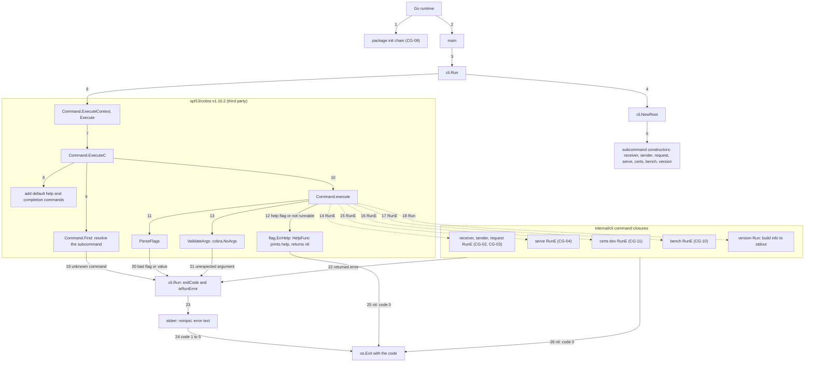

**Boundaries.** Process only: arguments in; stdout, stderr and the exit status out. Nothing
in this graph reads files or uses the network. `version` writes to stdout and help to
cobra's output (stdout, set at `internal/cli/root.go:79-80`). No signal handler is installed
here; only the party and serve commands install one (CG-02, CG-04), so `bench`, `certs dev`
and `version` keep Go's default signal behaviour.

**Source references**

| Step | Caller -> Callee | Site | Kind |
|---|---|---|---|
| 1 | Go runtime -> `cmd/minipsi` init -> `internal/cli` init -> imported package inits | no source line (compiler-generated init, before `main`) | framework (init) |
| 2 | Go runtime -> `main` | `cmd/minipsi/main.go:11` | framework |
| 3 | `main` -> `cli.Run(context.Background(), os.Args[1:], os.Stdout, os.Stderr)` | `cmd/minipsi/main.go:12` | direct |
| 4 | `cli.Run` -> `NewRoot` | `internal/cli/root.go:89` | direct |
| 5 | `NewRoot` -> `newPartyCmd` (x3), `newServeCmd`, `newCertsCmd`, `newBenchCmd`, `newVersionCmd` | `internal/cli/root.go:81-83` | direct |
| 6 | `cli.Run` -> `(*cobra.Command).ExecuteContext` (after `SetArgs` at `internal/cli/root.go:90`) | `internal/cli/root.go:91` | external-lib |
| 7 | `ExecuteContext` -> `Execute` -> `ExecuteC` | cobra command.go lines 1064, 1071 | external-lib |
| 8 | `ExecuteC` -> `InitDefaultHelpCmd`, `initCompleteCmd`, `InitDefaultCompletionCmd` | cobra command.go lines 1100, 1110, 1113 | framework (cobra) |
| 9 | `ExecuteC` -> `Find` | cobra command.go line 1123 | framework (cobra) |
| 10 | `ExecuteC` -> `(*Command).execute` | cobra command.go line 1148 | framework (cobra) |
| 11 | `execute` -> `ParseFlags` | cobra command.go line 919 | framework (cobra) |
| 12 | `execute` returns `flag.ErrHelp` (help flag: lines 934-935; command without Run: lines 955-956) | cobra command.go lines 934-956 | branch |
| 13 | `execute` -> `ValidateArgs` (`Args: cobra.NoArgs` at `internal/cli/party.go:152`, `internal/cli/serve.go:39`, `internal/cli/root.go:116`) | cobra command.go line 968 | framework (cobra) |
| 14 | `execute` -> party RunE closure (`newPartyCmd$1`, `internal/cli/party.go:156`) | cobra command.go line 1015 | framework (cobra), func-value |
| 15 | `execute` -> serve RunE closure (`newServeCmd$1`, `internal/cli/serve.go:57`) | cobra command.go line 1015 | framework (cobra), func-value |
| 16 | `execute` -> certs dev RunE (`internal/cli/tools.go:36`) | cobra command.go line 1015 | framework (cobra), func-value |
| 17 | `execute` -> bench RunE (`internal/cli/tools.go:93`) | cobra command.go line 1015 | framework (cobra), func-value |
| 18 | `execute` -> version Run closure (`internal/cli/root.go:117`), which prints at `internal/cli/root.go:118-120` | cobra command.go line 1019 | framework (cobra), func-value |
| 19 | `Find` error returned by `ExecuteC` to `cli.Run` | cobra command.go lines 1125-1134 | branch |
| 20 | `ParseFlags` error returned through `FlagErrorFunc` | cobra command.go lines 920-921 | branch |
| 21 | `ValidateArgs` error returned | cobra command.go lines 968-969 | branch |
| 22 | RunE error returned (cobra command.go lines 1015-1016, 1169) -> `exitCode`, `isRunError` | `internal/cli/root.go:95-99` | branch, direct |
| 23 | `cli.Run` -> `fmt.Fprintf(stderr, "minipsi: %v\n", err)` | `internal/cli/root.go:101` | stdlib-side-effect |
| 24 | `main` -> `os.Exit(code)` | `cmd/minipsi/main.go:12` | stdlib-side-effect |
| 25 | help path: `ExecuteC` calls `HelpFunc` and returns nil (cobra command.go lines 1152-1154) -> `ExitOK` | `internal/cli/root.go:92-93` | branch |
| 26 | RunE or Run returns nil -> `ExitOK` | `internal/cli/root.go:92-93` | branch |

**Error to exit code** (`exitCode`, `internal/cli/root.go:38-69`, then the rewrite in
`cli.Run`, `internal/cli/root.go:97-99`):

| Error that reaches `cli.Run` | Exit code | Site |
|---|---|---|
| `nil` | 0 | `internal/cli/root.go:92-93` |
| `*exitError` set by a command | its `code` | `internal/cli/root.go:42-45` |
| `*protocol.TransportError` | 3 | `internal/cli/root.go:46-49` |
| `*protocol.Error` with `Remote` set (peer abort) | 4 | `internal/cli/root.go:52-54` |
| local `*protocol.Error`, `CodeTimeout` | 3 | `internal/cli/root.go:56-57` |
| local `*protocol.Error`, `CodeInput` | 2 | `internal/cli/root.go:58-59` |
| local `*protocol.Error`, `CodeInternal` | 5 | `internal/cli/root.go:60-61` |
| local `*protocol.Error`, any other code (cancelled, limit, mismatch, ...) | 4 | `internal/cli/root.go:63` |
| `context.Canceled` | 4 | `internal/cli/root.go:65-67` |
| anything else, such as cobra parse errors or raw errors | 5 from `exitCode`, rewritten to 1 by `cli.Run` | `internal/cli/root.go:68`, `internal/cli/root.go:97-99` |

**Branches and error paths**

- `minipsi` with no arguments, `minipsi certs` and `-h` / `--help` on any command print help
  and exit 0: the root command and `certs` have no Run (`internal/cli/root.go:73-78`,
  `internal/cli/tools.go:22`), so cobra returns `flag.ErrHelp` and `ExecuteC` turns it into
  nil.
- An unknown command or flag, a bad flag value or an extra positional argument gives a
  plain error. `exitCode` returns 5 and `cli.Run` rewrites it to 1 (`internal/cli/root.go:97-99`).
  Cobra prints nothing itself because `SilenceUsage` and `SilenceErrors` are set
  (`internal/cli/root.go:76-77`). The only message is `minipsi: <error>` on stderr.
- `NewRoot` never sets `Version` (`internal/cli/root.go:73-78`), so there is no `--version`
  flag. `minipsi --version` is an unknown flag and exits 1. Use the `version` subcommand.
- The JSON run report stores `exitCode(err)` without the rewrite (`internal/cli/party.go:243`).
  A raw error (not `*exitError`, `*protocol.Error` or `*protocol.TransportError`) returned by a
  protocol run would therefore show 5 in the report and exit 1. One example is a
  configuration check in `newSession` (`internal/protocol/session.go:170-173`). The CLI
  validates the same settings first, so this is an edge case.

<a id="cg-02"></a>
## CG-02 One-shot party run

**Entry point and trigger.** `minipsi receiver` or `minipsi sender`
([EP-03](ENTRY_POINTS.md#ep-03)). Cobra calls the RunE closure built by `newPartyCmd`
([CG-01](#cg-01), step 14). The closure merges defaults, the optional YAML file and the
flags that were set, validates the result, installs the SIGINT/SIGTERM handler
([EP-11](ENTRY_POINTS.md#ep-11)) and calls `runParty`. `runParty` reads and checks the
input before any network activity, sets up mutual TLS, listens or dials for exactly one
session, runs the protocol role, then writes the result (receiver only) and the optional
JSON report. Transport and protocol internals continue in [CG-05](#cg-05) and
[CG-06](#cg-06).

**1. Configuration (RunE closure)**

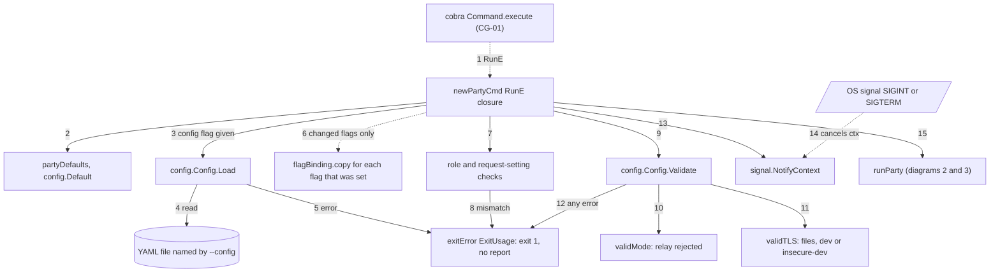

**2. runParty: input, credentials and connection**

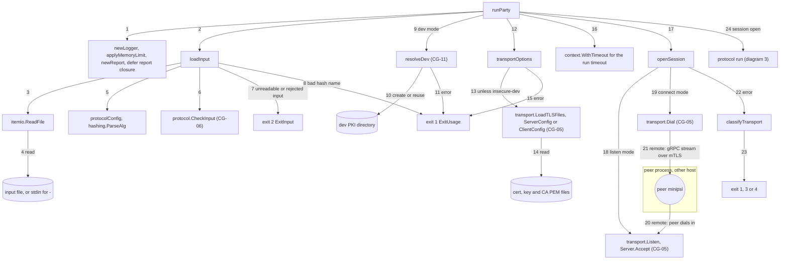

**3. runParty: protocol run, output and report**

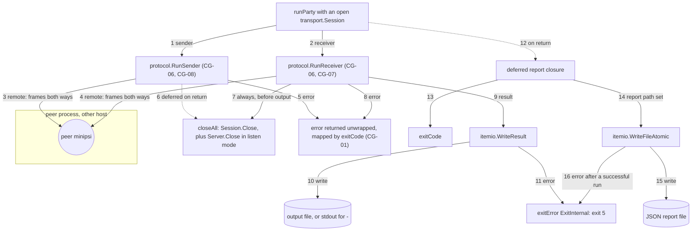

**Boundaries.**

- Filesystem: reads the YAML config (`internal/config/config.go:130`), the input file or
  stdin (`internal/itemio/itemio.go:48-51`), and the PEM files (`internal/transport/tls.go:20-28`).
  With `--dev` it creates or reuses the shared dev PKI (`internal/devcerts/devpki.go:31-56`).
  It writes the result (receiver) and the report through `writeAtomic`: a temporary file
  with mode 0600 renamed into place (`internal/itemio/itemio.go:264-292`), or plain stdout for `-`
  (`internal/itemio/itemio.go:265-266`). `runParty`'s own `stdout` parameter is not used.
- Network: one gRPC stream with mutual TLS 1.3 to the peer process. `--listen` waits for the
  peer to dial in. `--connect` dials, with retry only if `--connect-retry` is set (the
  default is a single attempt). Frames cross the boundary inside `protocol.RunSender` /
  `RunReceiver` through `transport.Session.Conn()`. They are messages, not local calls
  ([CG-05](#cg-05), [CG-06](#cg-06)).
- Signals: `signal.NotifyContext` (`internal/cli/party.go:181`) turns SIGINT/SIGTERM into
  cancellation of the run context.

**Source references**

Diagram 1:

| Step | Caller -> Callee | Site | Kind |
|---|---|---|---|
| 1 | cobra `execute` -> RunE closure (`internal/cli/party.go:156`) | cobra command.go line 1015 | framework (cobra), func-value |
| 2 | RunE -> `partyDefaults` (`internal/cli/party.go:133`) -> `config.Default` (`internal/config/config.go:113`) | `internal/cli/party.go:157` | direct |
| 3 | RunE -> `(*config.Config).Load` (`internal/config/config.go:129`) | `internal/cli/party.go:158-159` | direct |
| 4 | `Load` -> `os.ReadFile` | `internal/config/config.go:130` | stdlib-side-effect |
| 5 | `Load` error -> `ExitUsage` | `internal/cli/party.go:159-160` | branch |
| 6 | RunE -> `fb.copy` (closures registered at `internal/cli/party.go:74-125`) when `Changed` | `internal/cli/party.go:167-170` | func-value |
| 7 | RunE: file role vs command, `request` settings outside `request` | `internal/cli/party.go:163-177` | branch |
| 8 | mismatch -> `ExitUsage` | `internal/cli/party.go:163-164`, `internal/cli/party.go:175-176` | branch |
| 9 | RunE -> `(*config.Config).Validate` (`internal/config/config.go:156`) | `internal/cli/party.go:178` | direct |
| 10 | `Validate` -> `validMode` (`internal/config/config.go:252-260`) | `internal/config/config.go:167` | direct |
| 11 | `Validate` -> `validTLS` (`internal/config/config.go:263`) | `internal/config/config.go:215` | direct |
| 12 | `Validate` error -> `ExitUsage` | `internal/cli/party.go:178-180` | branch |
| 13 | RunE -> `signal.NotifyContext(ctx, os.Interrupt, syscall.SIGTERM)`, `defer stop()` | `internal/cli/party.go:181-182` | stdlib-side-effect |
| 14 | OS signal -> os/signal cancels the run context (asynchronous) | `internal/cli/party.go:181` | framework (os/signal) |
| 15 | RunE -> `runParty` (`internal/cli/party.go:237`) | `internal/cli/party.go:183` | direct |

Diagram 2:

| Step | Caller -> Callee | Site | Kind |
|---|---|---|---|
| 1 | `runParty` -> `newLogger`, `applyMemoryLimit`, `newReport`; `defer` report closure | `internal/cli/party.go:238-242` | direct, deferred |
| 2 | `runParty` -> `loadInput` (`internal/cli/party.go:206`) | `internal/cli/party.go:261` | direct |
| 3 | `loadInput` -> `itemio.ReadFile` (`internal/itemio/itemio.go:47`) | `internal/cli/party.go:208` | direct |
| 4 | `ReadFile` -> `os.Stdin` for `-`, else `os.Open` | `internal/itemio/itemio.go:48-51` | stdlib-side-effect |
| 5 | `loadInput` -> `protocolConfig` (`internal/cli/party.go:319`) -> `hashing.ParseAlg` | `internal/cli/party.go:222`, `internal/cli/party.go:320` | direct |
| 6 | `loadInput` -> `protocol.CheckInput` (`internal/protocol/padding.go:99`) | `internal/cli/party.go:230` | direct |
| 7 | read or `CheckInput` error -> `ExitInput` | `internal/cli/party.go:212-213`, `internal/cli/party.go:230-231` | branch |
| 8 | `protocolConfig` error -> `ExitUsage` | `internal/cli/party.go:223-224` | branch |
| 9 | `runParty` -> `resolveDev` (`internal/cli/party.go:383`) | `internal/cli/party.go:271` | direct |
| 10 | `resolveDev` -> `devcerts.DefaultDevDir`, `devcerts.EnsureDev` (`internal/devcerts/devpki.go:31`, `internal/devcerts/devpki.go:50`) | `internal/cli/party.go:387`, `internal/cli/party.go:395` | direct |
| 11 | `resolveDev` error -> `ExitUsage` | `internal/cli/party.go:271-272` | branch |
| 12 | `runParty` -> `transportOptions` (`internal/cli/party.go:343`) | `internal/cli/party.go:274` | direct |
| 13 | `transportOptions` -> `transport.LoadTLSFiles`, then `ServerConfig` (listen) or `ClientConfig` (connect) (`internal/transport/tls.go:19`, `internal/transport/tls.go:51`, `internal/transport/tls.go:64`) | `internal/cli/party.go:352`, `internal/cli/party.go:357`, `internal/cli/party.go:367` | direct |
| 14 | `LoadTLSFiles` -> `os.ReadFile` x3 | `internal/transport/tls.go:20-28` | stdlib-side-effect |
| 15 | `transportOptions` error -> `ExitUsage` | `internal/cli/party.go:274-276` | branch |
| 16 | `runParty` -> `context.WithTimeout` when the total timeout is > 0 | `internal/cli/party.go:278-282` | stdlib |
| 17 | `runParty` -> `openSession` (`internal/cli/party.go:428`) | `internal/cli/party.go:283` | direct |
| 18 | `openSession` -> `transport.Listen`, `(*Server).Accept` (`internal/transport/transport.go:357`, `internal/transport/transport.go:457`) | `internal/cli/party.go:430`, `internal/cli/party.go:435` | direct |
| 19 | `openSession` -> `transport.Dial` (`internal/transport/transport.go:488`) | `internal/cli/party.go:443` | direct |
| 20 | peer process dials; its stream reaches `(*transport.Server).Session` | `internal/transport/transport.go:396` | remote |
| 21 | `Dial` opens the `PSI/Session` stream to the peer | `internal/transport/transport.go:515` | remote |
| 22 | `openSession` error -> `classifyTransport` (`internal/cli/party.go:450`) | `internal/cli/party.go:432`, `internal/cli/party.go:438`, `internal/cli/party.go:445` | direct |
| 23 | `classifyTransport` -> `ExitUsage`, `ExitProtocol` or `ExitNetwork` | `internal/cli/party.go:451-459` | branch |
| 24 | `runParty` records `sess.PeerIdentity()` and continues | `internal/cli/party.go:288-292` | direct |

Diagram 3:

| Step | Caller -> Callee | Site | Kind |
|---|---|---|---|
| 1 | `runParty` -> `protocol.RunSender` (`internal/protocol/sender.go:28`) | `internal/cli/party.go:292-293` | direct |
| 2 | `runParty` -> `protocol.RunReceiver` (`internal/protocol/receiver.go:40`) | `internal/cli/party.go:301` | direct |
| 3 | protocol frames over `sess.Conn()` (`internal/transport/transport.go:345`), sender role | `internal/cli/party.go:293` | remote |
| 4 | protocol frames over `sess.Conn()`, receiver role | `internal/cli/party.go:301` | remote |
| 5 | `RunSender` error returned as is | `internal/cli/party.go:294-296` | branch |
| 6 | deferred `closeAll` (closure from `internal/cli/party.go:441` or `internal/cli/party.go:447`) | `internal/cli/party.go:287` | deferred, func-value |
| 7 | `closeAll()` before the receiver's error check and output | `internal/cli/party.go:302-304` | func-value |
| 8 | `RunReceiver` error returned as is | `internal/cli/party.go:305-307` | branch |
| 9 | `runParty` -> `itemio.WriteResult` (`internal/itemio/itemio.go:231`) | `internal/cli/party.go:311` | direct |
| 10 | `WriteResult` -> `writeAtomic` (stdout for `-`, else temp file and rename) | `internal/itemio/itemio.go:232`, `internal/itemio/itemio.go:264-292` | stdlib-side-effect |
| 11 | write error -> `ExitInternal` | `internal/cli/party.go:311-312` | branch |
| 12 | deferred report closure runs on every return from `runParty` | `internal/cli/party.go:242` | deferred |
| 13 | report closure -> `exitCode` (`internal/cli/root.go:38`) | `internal/cli/party.go:243` | direct |
| 14 | report closure -> `itemio.WriteFileAtomic` (`internal/itemio/itemio.go:300`) | `internal/cli/party.go:250-251` | direct |
| 15 | `WriteFileAtomic` -> `writeAtomic` | `internal/itemio/itemio.go:301` | stdlib-side-effect |
| 16 | report write error on a successful run -> `ExitInternal` | `internal/cli/party.go:252-255` | branch |

**Branches and error paths**

- Exit 1 (before `runParty`, so no report is written): YAML load error, a file whose `role`
  differs from the command, request-only settings (`request.dataset`) in a receiver or sender
  file, and any `Validate` failure. `mode: relay` is one of these: receiver and sender have
  no `--mode` flag (only `request` registers it, `internal/cli/party.go:77`), so the mode comes
  from YAML and `validMode` rejects `relay` (`internal/config/config.go:256-257`).
- Exit 1 inside `runParty`: unknown hash name (`internal/cli/party.go:223-224`), dev PKI
  failure, unreadable PEM files, a bad connect address (`internal/cli/party.go:361-364`), and
  `--insecure-dev` without `MINIPSI_I_UNDERSTAND_INSECURE=1` (`internal/cli/party.go:452-453`).
- Exit 2: the input cannot be read or parsed, or `protocol.CheckInput` rejects it (limits,
  IDs), before any connection is made (`internal/cli/party.go:204-205`).
- `classifyTransport` (`internal/cli/party.go:450-460`): `ErrRejected` gives 4, `context.Canceled`
  gives 4 ("interrupted"), and everything else gives 3. That includes a listen failure, a TLS
  failure, an unreachable peer, an exhausted retry window and an expired run deadline.
- Protocol errors from `RunSender` / `RunReceiver` are returned unwrapped and mapped by
  `exitCode` ([CG-01](#cg-01)): peer abort 4, local timeout 3, local input problem 2, local
  internal error 5, other local codes 4.
- The receiver closes the session before it writes the result, so the peer's shutdown does
  not wait on output size (comment at `internal/cli/party.go:302-303`). Exit 5 if the output
  cannot be written, or if the report cannot be written after an otherwise successful run.
- Listen mode accepts exactly one session. A second dialer is refused with Unavailable
  ("this process serves exactly one session", `internal/transport/transport.go:422`).
- Signals: during `Accept` or `Dial` a signal gives `context.Canceled`, so exit 4. During the
  protocol the run fails with local `CodeCancelled`, also exit 4. An expired run deadline gives
  `CodeTimeout`, exit 3 (`internal/protocol/session.go:263-266`). `loadInput`, `resolveDev` and
  `transportOptions` take no context, so a signal during input reading (including stdin) is
  only acted on at `openSession`.

<a id="cg-03"></a>
## CG-03 request against a serve daemon

**Entry point and trigger.** `minipsi request --peer HOST:PORT --dataset NAME`
([EP-04](ENTRY_POINTS.md#ep-04)) uses the same RunE closure and `runParty` as
[CG-02](#cg-02). The command name only changes the defaults, flags and checks. The role is
`receiver` (`partyRole`, `internal/cli/party.go:42-47`). `--peer` sets the connect address,
so the requester always dials. The connect-retry window defaults to 2 minutes, because a
busy daemon refuses new sessions until the running one ends. `transportOptions` attaches
the dataset name and an identity as gRPC request metadata. The daemon side is
[CG-04](#cg-04). The dial loop belongs to transport ([CG-05](#cg-05)).

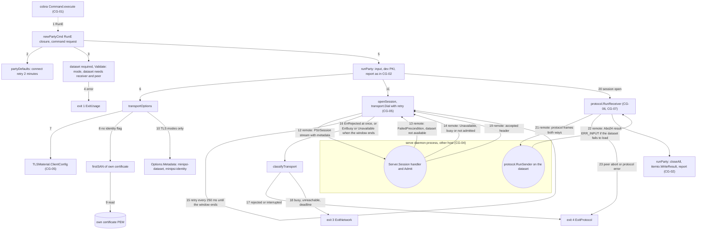

**Boundaries.**

- Network: one dial to the daemon. The request carries the gRPC metadata headers
  `minipsi-dataset` and `minipsi-identity` (`internal/config/serve.go:58-59`). The daemon
  answers with a gRPC status (refused) or the `minipsi-session` header (accepted), then
  protocol frames. Every edge into the daemon subgraph is a network message.
- Filesystem: as in [CG-02](#cg-02), plus a read of the requester's own certificate to
  derive the default identity (`internal/cli/party.go:406`).
- Signals: as in [CG-02](#cg-02). A signal during the retry loop stops it: `Dial` returns
  the context error (`internal/transport/transport.go:549-550`), which gives exit 4.

**Source references**

| Step | Caller -> Callee | Site | Kind |
|---|---|---|---|
| 1 | cobra `execute` -> RunE closure (`internal/cli/party.go:156`); role from `partyRole` | cobra command.go line 1015; `internal/cli/party.go:42-47` | framework (cobra), func-value |
| 2 | RunE -> `partyDefaults` sets `ConnectRetry` to `requestConnectRetry` (`internal/cli/party.go:131`) | `internal/cli/party.go:133-139` | direct |
| 3 | RunE: `--dataset` required; `Validate` checks the mode (`internal/config/config.go:167`) and that a dataset needs the receiver role and a connect address (`internal/config/config.go:170-171`) | `internal/cli/party.go:172-173`, `internal/cli/party.go:178` | branch, direct |
| 4 | check error -> `ExitUsage` | `internal/cli/party.go:172-180` | branch |
| 5 | RunE -> `runParty` | `internal/cli/party.go:183` | direct |
| 6 | `runParty` -> `transportOptions` | `internal/cli/party.go:274` | direct |
| 7 | `transportOptions` -> `ClientConfig(name, peerName)`; name defaults to the host of `--peer` | `internal/cli/party.go:358-367` | direct |
| 8 | `transportOptions` -> `firstSAN` (`internal/cli/party.go:405`) when `--identity` is empty | `internal/cli/party.go:370-372` | direct |
| 9 | `firstSAN` -> `os.ReadFile` of the certificate; DNS SAN, else URI SAN, else subject CN | `internal/cli/party.go:406-424` | stdlib-side-effect |
| 10 | `transportOptions` builds `Options.Metadata`; skipped by the early return for `--insecure-dev` (`internal/cli/party.go:348-351`) | `internal/cli/party.go:369-376` | direct |
| 11 | `runParty` -> `openSession` -> `transport.Dial` | `internal/cli/party.go:283`, `internal/cli/party.go:443` | direct |
| 12 | `Dial` attaches the metadata and opens the stream | `internal/transport/transport.go:511-515` | remote |
| 13 | daemon refuses with FailedPrecondition (`Rejection` from `Admit`) | `internal/transport/transport.go:410-412` | remote |
| 14 | daemon answers Unavailable: not admitted (`internal/transport/transport.go:414-415`) or busy (`internal/transport/transport.go:419-420`) | `internal/transport/transport.go:414-420` | remote |
| 15 | `Dial` retry loop: wait 250 ms, try again until `deadline` (`internal/transport/transport.go:508`) | `internal/transport/transport.go:547`, `internal/transport/transport.go:557-561` | branch |
| 16 | `Dial` returns `ErrRejected` without retrying (`internal/transport/transport.go:543-545`), the context error (`internal/transport/transport.go:549-550`), `ErrBusy` (`internal/transport/transport.go:552-553`) or the mapped status (`internal/transport/transport.go:555`); `openSession` -> `classifyTransport` | `internal/cli/party.go:445` | direct, branch |
| 17 | `classifyTransport`: `ErrRejected` or `context.Canceled` -> `ExitProtocol` | `internal/cli/party.go:454-457` | branch |
| 18 | `classifyTransport`: any other error -> `ExitNetwork` | `internal/cli/party.go:459` | branch |
| 19 | daemon sends the accepted header (`internal/transport/transport.go:428`); `Dial` checks it and returns the `Session` | `internal/transport/transport.go:521`, `internal/transport/transport.go:528-540` | remote |
| 20 | `runParty` -> `protocol.RunReceiver` (`internal/protocol/receiver.go:40`) | `internal/cli/party.go:301` | direct |
| 21 | protocol frames between the requester's `RunReceiver` and the daemon's `RunSender` (`internal/cli/serve.go:192`) | `internal/cli/party.go:301` | remote |
| 22 | daemon dataset load fails -> `protocol.AbortConn(..., CodeInput, "sender dataset unavailable")` (`internal/protocol/errors.go:97`) | `internal/cli/serve.go:183` | remote |
| 23 | remote `*protocol.Error` -> `ExitProtocol` | `internal/cli/root.go:52-54` | branch |
| 24 | `runParty`: `closeAll`, `WriteResult`, report as in [CG-02](#cg-02) | `internal/cli/party.go:304-315` | direct |

**Branches and error paths**

- Exit 1 before any network activity: `--dataset` missing (`internal/cli/party.go:172-173`),
  `--mode relay` ("not implemented yet", `internal/config/config.go:256-257`), any other mode,
  or a certificate whose SAN cannot be read for the default identity.
- Unknown dataset, or a client certificate whose SANs are not in the daemon's `allowed_peers`:
  the daemon gives the same answer to both ("dataset not available") and the requester exits
  4 at once, without retrying.
- Busy daemon (another session is running), or a dataset file that is missing at admission:
  the requester gets Unavailable and retries every 250 ms. If the window runs out it exits 3:
  `ErrBusy` for busy, the mapped gRPC status for "cannot be served now". The window is
  `--connect-retry`, default 2 minutes.
- `request --insecure-dev` sends no metadata, because `transportOptions` returns before
  building it (`internal/cli/party.go:348-351`). The daemon's `Admit` then finds no dataset
  name and refuses, so the requester exits 4.
- The identity header is self-declared. It defaults to the first SAN of the requester's own
  certificate (`internal/cli/party.go:370-375`). The daemon logs and reports it but
  authorizes only by the verified certificate SANs ([CG-04](#cg-04)).
- After acceptance: if the daemon cannot load the dataset it aborts with `ERR_INPUT` and no
  local detail, so the requester exits 4. Other protocol outcomes map as in [CG-01](#cg-01).

<a id="cg-04"></a>
## CG-04 serve daemon: startup, admission, sessions, shutdown

**Entry point and trigger.** `minipsi serve` ([EP-05](ENTRY_POINTS.md#ep-05)). Cobra calls
the RunE closure built by `newServeCmd` ([CG-01](#cg-01), step 15). It merges
`config.DefaultServe`, the optional YAML file, the flags that were set and the repeatable
`--dataset NAME=PATH`, validates the result, installs the SIGINT/SIGTERM handler
([EP-11](ENTRY_POINTS.md#ep-11)) and calls `runServe`. `runServe` checks every dataset once,
starts a gRPC listener with `Repeat` (one session at a time) and an `Admit` callback, then
loops: accept one session, run it as PSI sender in `serveSession`, write its report, repeat.
Admission runs on gRPC handler goroutines inside transport ([EP-06](ENTRY_POINTS.md#ep-06),
[CG-05](#cg-05)). The sender protocol run is [CG-06](#cg-06) and [CG-08](#cg-08).

**1. Startup**

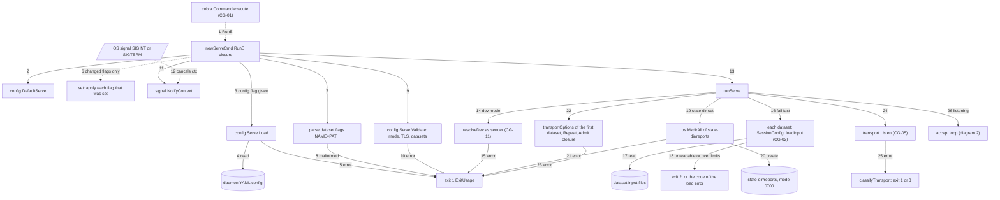

**2. Admission, sessions and shutdown**

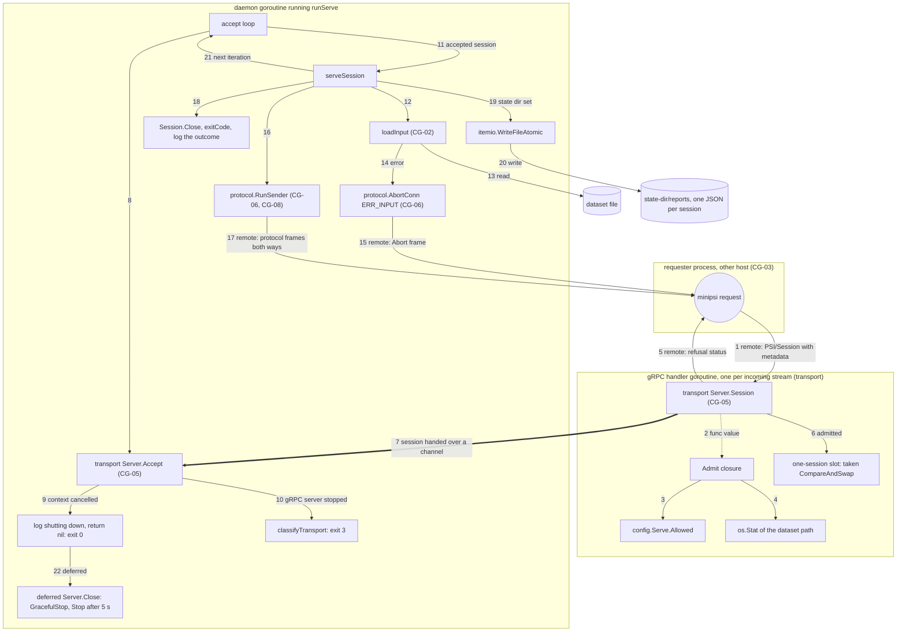

**Boundaries.**

- Filesystem: the YAML file (`internal/config/serve.go:79`). Each dataset file is read in full
  at startup (`internal/cli/serve.go:110-116`), checked with `os.Stat` at admission
  (`internal/cli/serve.go:138`) and read again for every session
  (`internal/cli/serve.go:180`), so changes to the file are picked up per session. With
  `--state-dir`, one JSON report per accepted session is written (0600 temp file renamed into
  a 0700 directory, `internal/cli/serve.go:118`, `internal/itemio/itemio.go:269-292`).
- Network: a long-lived gRPC listener on `--listen`. Each incoming stream is handled on its
  own gRPC goroutine (generated `_PSI_Session_Handler`, `internal/gen/minipsiv1/psi_grpc.pb.go:100-101`,
  called by grpc's `processRPC`). The handler admits the request or refuses it with a status.
  An admitted session goes to the daemon goroutine over a channel. Protocol frames, aborts
  and refusals are messages to the requester process, not local calls.
- Signals: `signal.NotifyContext` (`internal/cli/serve.go:95`). A signal cancels the context
  shared by `Accept` and the running session, which starts a graceful shutdown.

**Source references**

Diagram 1:

| Step | Caller -> Callee | Site | Kind |
|---|---|---|---|
| 1 | cobra `execute` -> RunE closure (`internal/cli/serve.go:57`) | cobra command.go line 1015 | framework (cobra), func-value |
| 2 | RunE -> `config.DefaultServe` (`internal/config/serve.go:68`) | `internal/cli/serve.go:58` | direct |
| 3 | RunE -> `(*config.Serve).Load` (`internal/config/serve.go:78`) | `internal/cli/serve.go:59-60` | direct |
| 4 | `Load` -> `os.ReadFile`, strict YAML decode | `internal/config/serve.go:79-91` | stdlib-side-effect |
| 5 | `Load` error -> `ExitUsage` | `internal/cli/serve.go:60-61` | branch |
| 6 | RunE -> `set(name, apply)` -> `apply()` closures for changed flags | `internal/cli/serve.go:64-81` (call at `internal/cli/serve.go:66`) | func-value |
| 7 | RunE parses each `--dataset` with `strings.Cut` | `internal/cli/serve.go:82-91` | direct |
| 8 | not `NAME=PATH` -> `ExitUsage` | `internal/cli/serve.go:84-85` | branch |
| 9 | RunE -> `(*config.Serve).Validate` (`internal/config/serve.go:159`): `validMode` (`internal/config/serve.go:165`), `validTLS` (`internal/config/serve.go:168`), per dataset `SessionConfig` + `Config.Validate` (`internal/config/serve.go:190-191`) | `internal/cli/serve.go:92` | direct |
| 10 | `Validate` error -> `ExitUsage` | `internal/cli/serve.go:92-93` | branch |
| 11 | RunE -> `signal.NotifyContext`, `defer stop()` | `internal/cli/serve.go:95-96` | stdlib-side-effect |
| 12 | OS signal -> os/signal cancels the daemon context (asynchronous) | `internal/cli/serve.go:95` | framework (os/signal) |
| 13 | RunE -> `runServe` (`internal/cli/serve.go:104`) | `internal/cli/serve.go:97` | direct |
| 14 | `runServe` -> `resolveDev(&sc.TLS, "sender", log)` | `internal/cli/serve.go:107` | direct |
| 15 | `resolveDev` error -> `ExitUsage` | `internal/cli/serve.go:107-108` | branch |
| 16 | `runServe` -> `SessionConfig` (`internal/config/serve.go:128`), `loadInput` for every dataset | `internal/cli/serve.go:111-113` | direct |
| 17 | `loadInput` -> `itemio.ReadFile` | `internal/cli/party.go:208` | stdlib-side-effect |
| 18 | load error -> `exitError{code: exitCode(err)}` (2 for input problems) | `internal/cli/serve.go:113-114` | branch |
| 19 | `runServe` -> `os.MkdirAll(state-dir/reports, 0o700)` | `internal/cli/serve.go:117-118` | stdlib-side-effect |
| 20 | directory created | `internal/cli/serve.go:118` | stdlib-side-effect |
| 21 | `MkdirAll` error -> `ExitUsage` | `internal/cli/serve.go:118-119` | branch |
| 22 | `runServe` -> `transportOptions` of the first sorted dataset; TLS clone, `Repeat = true`, `Admit` closure | `internal/cli/serve.go:122-142` | direct |
| 23 | `transportOptions` error -> `ExitUsage` | `internal/cli/serve.go:123-125` | branch |
| 24 | `runServe` -> `transport.Listen` (`internal/transport/transport.go:357`); `defer srv.Close()` | `internal/cli/serve.go:143`, `internal/cli/serve.go:147` | direct, deferred |
| 25 | `Listen` error -> `classifyTransport` (`internal/cli/party.go:450`) | `internal/cli/serve.go:144-145` | direct |
| 26 | `runServe` logs `serving` and enters the loop | `internal/cli/serve.go:152-155` | direct |

Diagram 2:

| Step | Caller -> Callee | Site | Kind |
|---|---|---|---|
| 1 | requester opens the stream; grpc -> generated `_PSI_Session_Handler` -> `(*transport.Server).Session` (`internal/transport/transport.go:396`) | `internal/gen/minipsiv1/psi_grpc.pb.go:101` | remote, framework (grpc), generated |
| 2 | `Server.Session` -> `s.opts.Admit(req)`, which is the closure at `internal/cli/serve.go:131` | `internal/transport/transport.go:406-408` | func-value |
| 3 | `Admit` -> dataset lookup and `(*config.Serve).Allowed(r.PeerSANs)` (`internal/config/serve.go:114`) | `internal/cli/serve.go:132-134` | direct |
| 4 | `Admit` -> `os.Stat(ds.Input.Path)` | `internal/cli/serve.go:138` | stdlib-side-effect |
| 5 | refusals: `Rejection` -> FailedPrecondition (`internal/transport/transport.go:410-412`); other `Admit` error -> Unavailable (`internal/transport/transport.go:414-415`); busy -> Unavailable (`internal/transport/transport.go:419-420`) | `internal/cli/serve.go:134-139` | remote, branch |
| 6 | `Server.Session` -> `taken.CompareAndSwap(false, true)` | `internal/transport/transport.go:418` | direct |
| 7 | accepted header sent (`internal/transport/transport.go:428`); `s.sessions <- sess` received by `Accept` (`internal/transport/transport.go:459`) | `internal/transport/transport.go:437` | goroutine (channel hand-off) |
| 8 | loop -> `(*transport.Server).Accept(ctx)` (`internal/transport/transport.go:457`) | `internal/cli/serve.go:155-156` | direct |
| 9 | `Accept` returns `ctx.Err()` (`internal/transport/transport.go:463-464`) -> `shutting down`, `return nil` | `internal/cli/serve.go:157-160` | branch |
| 10 | `Accept` returns the gRPC serve error (`internal/transport/transport.go:461-462`) -> `classifyTransport` | `internal/cli/serve.go:162` | branch |
| 11 | loop -> `serveSession(ctx, sc, sess, seq.Add(1), log)` (`internal/cli/serve.go:169`) | `internal/cli/serve.go:164` | direct |
| 12 | `serveSession` closure -> `loadInput` | `internal/cli/serve.go:180` | direct |
| 13 | `loadInput` -> `itemio.ReadFile` | `internal/cli/party.go:208` | stdlib-side-effect |
| 14 | load error -> `protocol.AbortConn(ctx, sess.Conn(), protocol.CodeInput, "sender dataset unavailable")` (`internal/protocol/errors.go:97`) | `internal/cli/serve.go:181-184` | direct |
| 15 | `AbortConn` sends an Abort frame, bounded to 5 s | `internal/protocol/errors.go:98-100` | remote |
| 16 | `serveSession` closure -> `protocol.RunSender` (`internal/protocol/sender.go:28`), under the per-session timeout | `internal/cli/serve.go:186-192` | direct |
| 17 | protocol frames over `sess.Conn()` | `internal/cli/serve.go:192` | remote |
| 18 | `sess.Close()`, `exitCode(err)`, log as interrupted, failed or complete | `internal/cli/serve.go:199-212` | direct |
| 19 | `serveSession` -> `itemio.WriteFileAtomic` (`internal/itemio/itemio.go:300`) | `internal/cli/serve.go:213-219` | direct |
| 20 | report file `<UTC start>-<n mod 10000>-<SID or failed>.json` | `internal/cli/serve.go:218` | stdlib-side-effect |
| 21 | `serveSession` returns and the loop accepts the next session | `internal/cli/serve.go:155-165` | branch |
| 22 | deferred `srv.Close()` -> `(*transport.Server).Close` (`internal/transport/transport.go:469-481`) | `internal/cli/serve.go:147` | deferred |

**Branches and error paths**

- Exit 1 at startup: YAML or flag errors, a malformed `--dataset`, any `Serve.Validate`
  failure (including `mode: relay`, rejected by `validMode`), dev PKI, an unwritable
  `--state-dir`, TLS files, and plaintext mode without the acknowledgement variable.
- Exit 2 at startup: a dataset that cannot be read or fails the local input checks
  (`internal/cli/serve.go:110-116`). Exit 3: the listener cannot bind, or the gRPC server
  stops while `Accept` waits (`internal/cli/serve.go:162`).
- Admission runs before the busy check. An unknown dataset and a peer whose verified
  certificate SANs are not in `allowed_peers` get the same `Rejection` ("dataset not
  available", `internal/cli/serve.go:134-136`), so the daemon does not reveal whether a dataset
  exists. A dataset file missing at admission is logged locally and reported to the peer only
  as Unavailable (`internal/cli/serve.go:138-139`). While a session runs, every other admitted
  request gets Unavailable busy (`internal/transport/transport.go:419-420`) and the requester
  retries ([CG-03](#cg-03)). Refused and busy requests produce no report.
- A failed session never stops the daemon or changes its exit code. The outcome goes only to
  the log and to the session report's `exit_code` (`internal/cli/serve.go:200`). The peer sees
  only `ERR_INPUT` "sender dataset unavailable" or a protocol abort code, never local paths
  (`internal/cli/serve.go:182-183`). A session cancelled by shutdown is logged as a warning
  (`internal/cli/serve.go:205-206`).
- Shutdown: a signal cancels `ctx`. A running `RunSender` fails with local `CodeCancelled` and
  its report is still written. The next `Accept` returns the context error, `runServe` returns
  nil (exit 0), and the deferred `Server.Close` drains with `GracefulStop`, falling back to
  `Stop` after 5 s (`internal/transport/transport.go:476-480`).
- Possible race (inferred from source, not reproduced): `Accept` selects on the session
  channel and `ctx.Done()` together (`internal/transport/transport.go:458-465`). If a request
  was admitted just before shutdown, Go may pick the session case, so one more session can
  start and fail at once with `CodeCancelled` before the daemon exits.


<a id="cg-05"></a>
## CG-05 Transport: listen, accept, dial, stream and TLS

Package `internal/transport` carries one protocol session over one gRPC bidirectional
stream (`/minipsi.v1.PSI/Session`) with mutual TLS 1.3, and hands it to the protocol layer
as a `protocol.Conn` ([CG-06](#cg-06)). Each `Server` hands out one session, or one at a
time with `Options.Repeat` (the daemon). `Dial` retries for up to `Options.ConnectRetry`.

Two extra kinds appear in the tables of this section and [CG-06](#cg-06):
*branch* is a labelled decision edge inside one function (no call), and *channel* is a
hand-off to a goroutine that is already running (drawn `==>`). That hand-off goes over a Go
channel, except in one row (6D4), where it goes through a `sync.WaitGroup`.

### Entry point and trigger

| Trigger | Caller | Transport call |
|---|---|---|
| `receiver` / `sender` with `--listen` ([EP-03](ENTRY_POINTS.md#ep-03)) | `cli.openSession` (internal/cli/party.go:428) | `transport.Listen` (internal/cli/party.go:430), then one `(*Server).Accept` (internal/cli/party.go:435) |
| `receiver` / `sender` with `--connect`, and `request` ([EP-03](ENTRY_POINTS.md#ep-03), [EP-04](ENTRY_POINTS.md#ep-04)) | `cli.openSession` | `transport.Dial` (internal/cli/party.go:443) |
| `serve` daemon ([EP-05](ENTRY_POINTS.md#ep-05)) | `cli.runServe` (internal/cli/serve.go:104) | `transport.Listen` with `Repeat` and `Admit` set (internal/cli/serve.go:130-143), then an `Accept` loop (internal/cli/serve.go:155-165) |
| A peer opens `/minipsi.v1.PSI/Session` ([EP-06](ENTRY_POINTS.md#ep-06)) | grpc-go, through the generated `_PSI_Session_Handler` (internal/gen/minipsiv1/psi_grpc.pb.go:100-102) | `(*transport.Server).Session` (internal/transport/transport.go:396) |
| Goroutines ([EP-13](ENTRY_POINTS.md#ep-13)) | `transport.Serve`, `newStreamConn`, `(*Server).Close` | Serve loop (internal/transport/transport.go:386), `pump` and `sendLoop` (internal/transport/transport.go:161-162), `GracefulStop` (internal/transport/transport.go:472-475) |

Protocol roles do not depend on gRPC roles. Either party can listen or dial
(api/minipsi/v1/psi.proto:8-9), and the roles are announced later in `Hello`
([CG-06](#cg-06)). Production code calls `transport.Listen`. Only tests call
`transport.Serve` directly, on a bufconn listener (internal/transport/transport_test.go:107).
After the session opens, the CLI passes `sess.Conn()` to the protocol
(internal/cli/party.go:293, internal/cli/party.go:301, internal/cli/serve.go:192).

### Overview: both processes and the network

Diagrams 5A to 5F below zoom into each part of this overview.

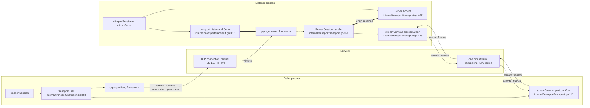

| Step | Caller -> Callee | Site | Kind |
|---|---|---|---|
| O1 | `cli.openSession` / `cli.runServe` -> `transport.Listen` | internal/cli/party.go:430, internal/cli/serve.go:143 | direct |
| O2 | `transport.Serve` -> grpc-go `Serve` loop | internal/transport/transport.go:386 | goroutine |
| O3 | `cli.openSession` -> `transport.Dial` | internal/cli/party.go:443 | direct |
| O4 | `Dial` -> grpc-go client (`NewClient`, then `Session` / `NewStream`) | internal/transport/transport.go:503, internal/transport/transport.go:515 | external-lib |
| O5 | dialer grpc-go -> network: TCP, TLS 1.3, HTTP/2 HEADERS | internal/transport/transport.go:515 | remote |
| O6 | network -> listener grpc-go: per-connection `handleRawConn` (grpc-go server.go line 992) | n/a | remote |
| O7 | grpc-go -> `Server.Session` via `_PSI_Session_Handler` | internal/gen/minipsiv1/psi_grpc.pb.go:101 | framework |
| O8 | `Server.Session` -> `Accept` via `sessions` | internal/transport/transport.go:437 | channel |
| O9 | CLI -> `Server.Accept` | internal/cli/party.go:435, internal/cli/serve.go:156 | direct |
| O10 | `Server.Session` -> `newStreamConn` | internal/transport/transport.go:432 | direct |
| O11 | `Dial` -> `newStreamConn` | internal/transport/transport.go:529 | direct |
| O12 | each `streamConn` <-> the stream: `sendLoop` sends, `pump` receives | internal/transport/transport.go:198, internal/transport/transport.go:168 | remote |

### Diagram 5A: listen and serve (listener process)

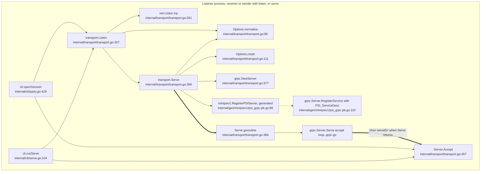

### Diagram 5B: incoming RPC, admission and hand-off to Accept (listener process)

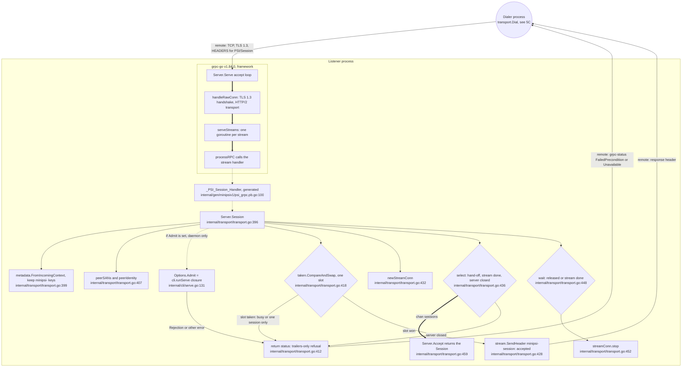

### Diagram 5C: dial with the connect-retry loop (dialer process)

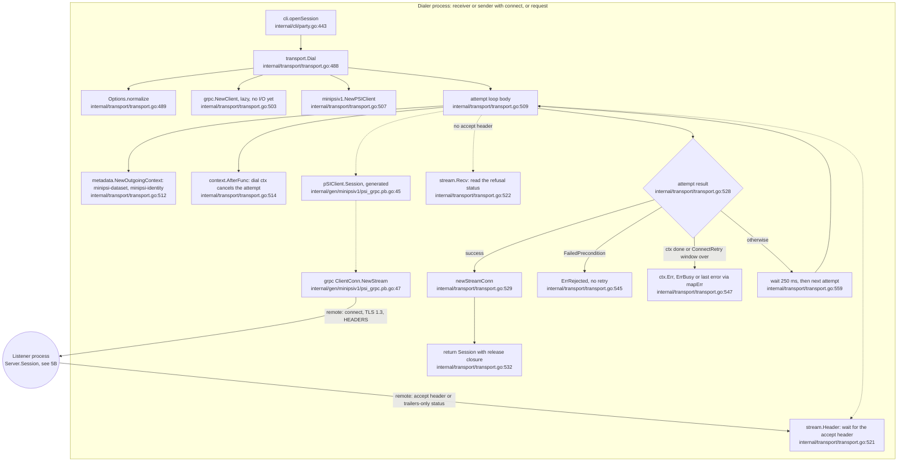

### Diagram 5D: streamConn pump and sendLoop, both processes

The same adapter runs on both sides. On the listener it wraps the server stream
(internal/transport/transport.go:432), on the dialer the client stream
(internal/transport/transport.go:529).

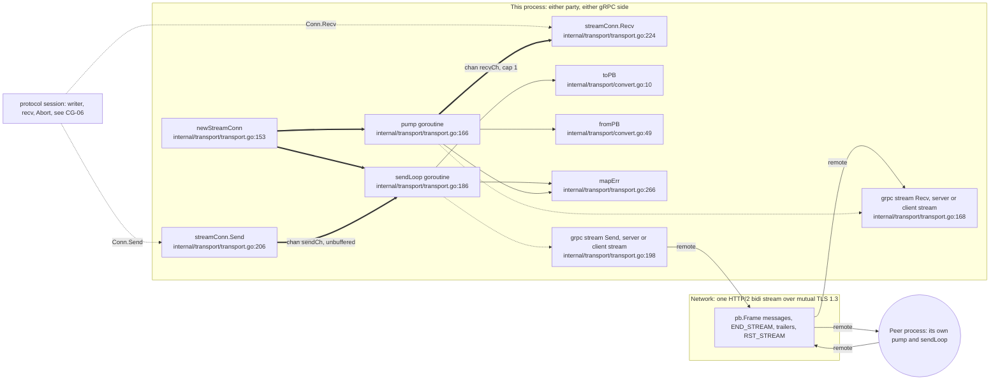

### Diagram 5E: TLS configuration, peer pinning and the insecure gate

`cli.resolveDev` (internal/cli/party.go:383) runs first. With `--dev` it points the
certificate, key and CA paths at the shared development PKI (internal/cli/party.go:399,
[CG-11](#cg-11)). The daemon clones the TLS config before it starts listening
(internal/cli/serve.go:127-129).

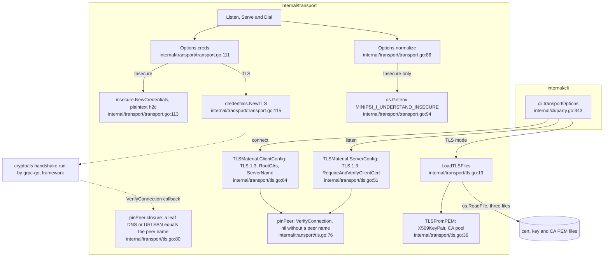

### Diagram 5F: session close and server shutdown

`Session.Close` is called by `cli.runParty` through `closeAll` (deferred at
internal/cli/party.go:287, and called early after `RunReceiver` at
internal/cli/party.go:304). `closeAll` is built in `cli.openSession`
(internal/cli/party.go:441 and internal/cli/party.go:447). `cli.serveSession` also calls it
(internal/cli/serve.go:170 deferred, internal/cli/serve.go:199). `cli.runServe` stops the
daemon with a deferred `srv.Close()` (internal/cli/serve.go:147).

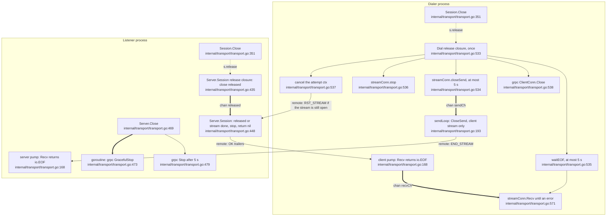

### Branches and error paths

| # | Where | Condition | Local result | What the peer sees |
|---|---|---|---|---|
| 1 | `Server.Session` | `Admit` returns a `*Rejection` (internal/transport/transport.go:409-412). The daemon returns `Rejection{"dataset not available"}` for an unknown dataset and for a peer outside `allowed_peers` alike (internal/cli/serve.go:132-136) | Logged `request rejected` | `FailedPrecondition`. `Dial` returns `ErrRejected` with no retry (internal/transport/transport.go:543-545). The CLI maps it to `ExitProtocol` (internal/cli/party.go:454-455) |
| 2 | `Server.Session` | `Admit` returns any other error, e.g. the dataset file is gone (`os.Stat`, internal/cli/serve.go:138-139) | Logged `request not admitted` (internal/transport/transport.go:414) | `Unavailable "minipsi: request cannot be served now"` (internal/transport/transport.go:415). The dialer retries until the window ends, then gets a network error |
| 3 | `Server.Session` | Slot already taken, `Repeat` (daemon) | none | `Unavailable` with `busyMsg` (internal/transport/transport.go:419-420). If still busy when the window ends, `Dial` returns `ErrBusy` (internal/transport/transport.go:552-553) |
| 4 | `Server.Session` | Slot already taken, one-shot listener | none | `Unavailable "this process serves exactly one session"` (internal/transport/transport.go:422) |
| 5 | `Server.Session` | `SendHeader` fails | Slot freed, error returned (internal/transport/transport.go:428-431) | Stream error |
| 6 | `Server.Session` | Stream ends before `Accept` takes it, e.g. a probe that disconnected | `conn.stop`, slot freed (internal/transport/transport.go:438-442) | Peer already gone |
| 7 | `Server.Session` | `Server.Close` ran before the hand-off | `conn.stop` (internal/transport/transport.go:443-445) | `Unavailable "minipsi: server shutting down"` |
| 8 | `Server.Accept` | `serveErr` fires, or ctx done | `transport: server stopped` or `ctx.Err()` (internal/transport/transport.go:461-464). `cli.openSession` then closes the server (internal/cli/party.go:436-438). `cli.runServe` returns nil when its ctx was cancelled (internal/cli/serve.go:157-160) | n/a |
| 9 | `normalize` | Insecure without `MINIPSI_I_UNDERSTAND_INSECURE=1`, TLS and Insecure both set, no TLS, or TLS below 1.3 (internal/transport/transport.go:93-107) | `ErrInsecureNotAcknowledged` maps to `ExitUsage` (internal/cli/party.go:452-453). The other errors fall through to `ExitNetwork` (internal/cli/party.go:459) | Nothing is sent |
| 10 | `Dial` | Stream opened, but no accept header and `Recv` returned no error | `transport: server did not accept the session` (internal/transport/transport.go:521-525), then retried like any failure | n/a |
| 11 | `Dial` | Dial ctx cancelled | `ctx.Err()` (internal/transport/transport.go:547-551). The CLI maps it to `ExitProtocol` "interrupted" (internal/cli/party.go:456-457) | The attempt's stream is cancelled |
| 12 | `Dial` | Any other failure inside the window | Debug log, 250 ms pause, next attempt (internal/transport/transport.go:557-561). When the window ends: `transport: connecting to ADDR: ...` with `mapErr` (internal/transport/transport.go:555), mapped to `ExitNetwork` | n/a |
| 13 | `pump` | gRPC `Recv` error | `mapErr`: `io.EOF` is kept, `Canceled` becomes "stream cancelled by peer" wrapping `io.EOF`, `ResourceExhausted` becomes "frame exceeds size limit" (internal/transport/transport.go:266-280). The pump exits after the first error (internal/transport/transport.go:180-182), and `Recv` keeps returning it (internal/transport/transport.go:225-233) | n/a |
| 14 | `streamConn` | Used after `stop` | `io.ErrClosedPipe` (internal/transport/transport.go:212-213, internal/transport/transport.go:236-237) | n/a |
| 15 | `fromPB` | Empty or unknown `oneof` body | An empty `protocol.Frame` (internal/transport/convert.go:84), which the protocol rejects as `ERR_PROTOCOL` ([CG-06](#cg-06)) | Abort `ERR_PROTOCOL` |
| 16 | TLS | No client certificate, a certificate the CA does not trust (internal/transport/tls.go:55-56), or a pin mismatch (internal/transport/tls.go:93) | The handshake fails. On the dialer, TLS errors show up while `Dial` waits for headers (comment at internal/transport/transport.go:517-519) and count as a failed attempt | Connection closed |

### Source references

Calls inside grpc-go v1.84.0 are cited as "server.go line N" of the module source
(`google.golang.org/grpc@v1.84.0`). Those files are outside the repository.

| Step | Caller -> Callee | Site | Kind |
|---|---|---|---|
| A1 | `cli.openSession` -> `transport.Listen` | internal/cli/party.go:430 | direct |
| A2 | `cli.runServe` -> `transport.Listen` | internal/cli/serve.go:143 | direct |
| A3 | `transport.Listen` -> `(*Options).normalize` | internal/transport/transport.go:358 | direct |
| A4 | `transport.Listen` -> `net.Listen("tcp", addr)` | internal/transport/transport.go:361 | stdlib-side-effect |
| A5 | `transport.Listen` -> `transport.Serve` | internal/transport/transport.go:365 | direct |
| A6 | `transport.Serve` -> `(*Options).normalize` | internal/transport/transport.go:370 | direct |
| A7 | `transport.Serve` -> `(*Options).creds` | internal/transport/transport.go:378 | direct |
| A8 | `transport.Serve` -> `grpc.NewServer` | internal/transport/transport.go:377 | external-lib |
| A9 | `transport.Serve` -> `minipsiv1.RegisterPSIServer` | internal/transport/transport.go:385 | direct (generated code) |
| A10 | `RegisterPSIServer` -> `(*grpc.Server).RegisterService(&PSI_ServiceDesc)` | internal/gen/minipsiv1/psi_grpc.pb.go:97 | interface-dispatch (external-lib) |
| A11 | `transport.Serve` -> Serve closure | internal/transport/transport.go:386 | goroutine |
| A12 | Serve closure -> `(*grpc.Server).Serve(lis)` | internal/transport/transport.go:386 | external-lib |
| A13 | `Serve` return -> `Accept` via `serveErr` (cap 1) | internal/transport/transport.go:386 to internal/transport/transport.go:461 | channel |
| A14 | `cli.openSession` -> `(*Server).Accept` | internal/cli/party.go:435 | direct |
| A15 | `cli.runServe` -> `(*Server).Accept` | internal/cli/serve.go:156 | direct |
| B1 | dialer `Dial` -> listener grpc server (TCP, TLS, HTTP/2 HEADERS) | internal/transport/transport.go:515 (dialer side) | remote |
| B2 | `(*grpc.Server).Serve` -> goroutine running `handleRawConn` | grpc-go server.go lines 991-992 | framework (goroutine) |
| B3 | `handleRawConn` -> goroutine running `serveStreams` | grpc-go server.go lines 1023-1024 | framework (goroutine) |
| B4 | `serveStreams` -> per-stream goroutine -> `handleStream` -> `processRPC` | grpc-go server.go lines 1107, 1096, 1595 | framework (goroutine) |
| B5 | `processRPC` -> `_PSI_Session_Handler` (`sd.Handler`, registered at internal/gen/minipsiv1/psi_grpc.pb.go:117) | grpc-go server.go line 1450 | framework (func-value) |
| B6 | `_PSI_Session_Handler` -> `(*transport.Server).Session` | internal/gen/minipsiv1/psi_grpc.pb.go:101 | interface-dispatch (generated code) |
| B7 | `Server.Session` -> `metadata.FromIncomingContext` | internal/transport/transport.go:399 | external-lib |
| B8 | `Server.Session` -> `peerSANs`, `peerIdentity` | internal/transport/transport.go:407 | direct |
| B9 | `Server.Session` -> `Options.Admit` = `cli.runServe` closure (internal/cli/serve.go:131) | internal/transport/transport.go:408 | func-value |
| B10 | `Admit` error -> refusal status | internal/transport/transport.go:409-415 | branch |
| B11 | `Server.Session` -> `taken.CompareAndSwap(false, true)` | internal/transport/transport.go:418 | direct (sync/atomic) |
| B12 | slot taken -> refusal status | internal/transport/transport.go:419-422 | branch |
| B13 | slot won -> `stream.SendHeader(minipsi-session: accepted)` | internal/transport/transport.go:428 | interface-dispatch (external-lib) |
| B14 | accept header -> dialer `stream.Header()` | internal/transport/transport.go:428 to internal/transport/transport.go:521 | remote |
| B15 | `Server.Session` -> `newStreamConn` | internal/transport/transport.go:432 | direct |
| B16 | `Server.Session` -> hand-off `select` | internal/transport/transport.go:436-446 | branch |
| B17 | hand-off -> `Accept` via unbuffered `sessions` | internal/transport/transport.go:437 to internal/transport/transport.go:459 | channel |
| B18 | server closed -> refusal status | internal/transport/transport.go:443-445 | branch |
| B19 | `Server.Session` -> wait for `released` or stream end | internal/transport/transport.go:448-451 | branch |
| B20 | `Server.Session` -> `(*streamConn).stop` | internal/transport/transport.go:452 | direct |
| B21 | refusal status -> dialer, trailers-only response read by `stream.Recv` | internal/transport/transport.go:412 (also :415, :420, :422, :445) to internal/transport/transport.go:522 | remote |
| C1 | `cli.openSession` -> `transport.Dial` | internal/cli/party.go:443 | direct |
| C2 | `Dial` -> `(*Options).normalize` | internal/transport/transport.go:489 | direct |
| C3 | `Dial` -> `grpc.NewClient` | internal/transport/transport.go:503 | external-lib |
| C4 | `Dial` -> `minipsiv1.NewPSIClient` | internal/transport/transport.go:507 | direct (generated code) |
| C5 | `Dial` -> attempt loop | internal/transport/transport.go:509 | branch |
| C6 | attempt -> `metadata.NewOutgoingContext` (only when `Options.Metadata` is set) | internal/transport/transport.go:511-512 | external-lib |
| C7 | attempt -> `context.AfterFunc(ctx, cancel)` | internal/transport/transport.go:514 | stdlib |
| C8 | attempt -> `(*pSIClient).Session` through `PSIClient` | internal/transport/transport.go:515 | interface-dispatch (generated code) |
| C9 | `(*pSIClient).Session` -> `cc.NewStream` on `PSI_ServiceDesc.Streams[0]` | internal/gen/minipsiv1/psi_grpc.pb.go:47 | interface-dispatch (external-lib) |
| C10 | `NewStream` -> listener: connect, TLS 1.3, HEADERS with `minipsi-*` metadata | internal/transport/transport.go:515 | remote |
| C11 | listener accept header or refusal -> `stream.Header()` | internal/transport/transport.go:428 (peer) to internal/transport/transport.go:521 | remote |
| C12 | attempt -> `stream.Header()` | internal/transport/transport.go:521 | interface-dispatch (external-lib) |
| C13 | attempt -> `stream.Recv()` when the accept header is missing | internal/transport/transport.go:522 | interface-dispatch (external-lib) |
| C14 | attempt -> result check | internal/transport/transport.go:527-528 | branch |
| C15 | success -> `newStreamConn` | internal/transport/transport.go:529 | direct |
| C16 | success -> `Session` with the release closure | internal/transport/transport.go:532-540 | direct |
| C17 | `FailedPrecondition` -> `ErrRejected` | internal/transport/transport.go:543-545 | branch |
| C18 | ctx done or window over -> `ctx.Err()`, `ErrBusy` or `mapErr(err)` | internal/transport/transport.go:547-556 | branch |
| C19 | otherwise -> 250 ms pause | internal/transport/transport.go:557-561 | branch |
| C20 | pause -> next attempt | internal/transport/transport.go:509 | branch |
| D1 | `newStreamConn` -> `(*streamConn).pump` | internal/transport/transport.go:161 | goroutine |
| D2 | `newStreamConn` -> `(*streamConn).sendLoop` | internal/transport/transport.go:162 | goroutine |
| D3 | protocol -> `(*streamConn).Send`: writer, final Abort, `AbortConn` | internal/protocol/session.go:283, internal/protocol/session.go:247, internal/protocol/errors.go:100 | interface-dispatch |
| D4 | protocol `session.recv` -> `(*streamConn).Recv` | internal/protocol/session.go:309 | interface-dispatch |
| D5 | `Send` -> `sendLoop` via `sendCh` | internal/transport/transport.go:209 to internal/transport/transport.go:189 | channel |
| D6 | `sendLoop` -> `toPB` | internal/transport/transport.go:198 | direct |
| D7 | `sendLoop` -> `grpcStream.Send` (`GenericServerStream` or `GenericClientStream`) | internal/transport/transport.go:198 | interface-dispatch (external-lib) |
| D8 | `sendLoop` -> `mapErr` | internal/transport/transport.go:198 | direct |
| D9 | gRPC `Send` -> wire: one DATA message per `pb.Frame` | internal/transport/transport.go:198 | remote |
| D10 | wire -> peer `pump` | internal/transport/transport.go:168 (peer side) | remote |
| D11 | peer `sendLoop` -> wire | internal/transport/transport.go:198 (peer side) | remote |
| D12 | wire -> local `grpcStream.Recv` | internal/transport/transport.go:168 | remote |
| D13 | `pump` -> `grpcStream.Recv` | internal/transport/transport.go:168 | interface-dispatch (external-lib) |
| D14 | `pump` -> `mapErr` | internal/transport/transport.go:171 | direct |
| D15 | `pump` -> `fromPB` | internal/transport/transport.go:173 | direct |
| D16 | `pump` -> `Recv` via `recvCh` | internal/transport/transport.go:176 to internal/transport/transport.go:229 | channel |
| E1 | `cli.transportOptions` -> `transport.LoadTLSFiles` | internal/cli/party.go:352 | direct |
| E2 | `LoadTLSFiles` -> `os.ReadFile` for the cert, key and CA | internal/transport/tls.go:20, internal/transport/tls.go:24, internal/transport/tls.go:28 | stdlib-side-effect |
| E3 | `LoadTLSFiles` -> `TLSFromPEM` | internal/transport/tls.go:32 | direct |
| E4 | `transportOptions` -> `(*TLSMaterial).ServerConfig(--peer-name)` (listen side) | internal/cli/party.go:357 | direct |
| E5 | `transportOptions` -> `(*TLSMaterial).ClientConfig(name, --peer-name)`. `name` is `--server-name` or the host of the connect address (internal/cli/party.go:359-366) | internal/cli/party.go:367 | direct |
| E6 | `ServerConfig` -> `pinPeer` | internal/transport/tls.go:57 | direct |
| E7 | `ClientConfig` -> `pinPeer` | internal/transport/tls.go:70 | direct |
| E8 | `Listen`, `Serve`, `Dial` -> `normalize` | internal/transport/transport.go:358, internal/transport/transport.go:370, internal/transport/transport.go:489 | direct |
| E9 | `normalize` -> `os.Getenv(InsecureEnv)` | internal/transport/transport.go:94 | stdlib-side-effect |
| E10 | `Serve`, `Dial` -> `creds` | internal/transport/transport.go:378, internal/transport/transport.go:493 | direct |
| E11 | `creds` -> `credentials.NewTLS(o.TLS)` | internal/transport/transport.go:115 | external-lib |
| E12 | `creds` -> `insecure.NewCredentials()` | internal/transport/transport.go:113 | external-lib |
| E13 | TLS credentials -> crypto/tls handshake (grpc-go `credentials/tls.go`, `ServerHandshake` / `ClientHandshake`) | grpc-go internals | framework |
| E14 | crypto/tls -> `pinPeer` closure as `VerifyConnection`, set in internal/transport/tls.go:57 and internal/transport/tls.go:70 | internal/transport/tls.go:80 (closure) | framework (func-value callback) |
| F1 | `(*Session).Close` -> `s.release` = `Dial` closure | internal/transport/transport.go:352 | func-value |
| F2 | release -> `(*streamConn).closeSend(5 s)` | internal/transport/transport.go:534 | direct |
| F3 | `closeSend` -> `sendLoop` via `sendCh` | internal/transport/transport.go:248 to internal/transport/transport.go:190 | channel |
| F4 | `sendLoop` `CloseSend` (client streams only) -> server `pump` gets `io.EOF` | internal/transport/transport.go:193 to internal/transport/transport.go:168 (peer) | remote |
| F5 | release -> `waitEOF(5 s)` | internal/transport/transport.go:535 | direct |
| F6 | `waitEOF` -> `(*streamConn).Recv` | internal/transport/transport.go:571 | direct |
| F7 | client `pump` -> `Recv` via `recvCh` | internal/transport/transport.go:176 | channel |
| F8 | release -> `(*streamConn).stop` | internal/transport/transport.go:536 | direct |
| F9 | release -> `cancel()` of the attempt ctx | internal/transport/transport.go:537 | stdlib |
| F10 | `cancel()` -> listener stream ctx done (RST_STREAM CANCEL if the stream is still open) | internal/transport/transport.go:537 to internal/transport/transport.go:450 (peer) | remote |
| F11 | release -> `(*grpc.ClientConn).Close` | internal/transport/transport.go:538 | external-lib |
| F12 | `(*Session).Close` -> `s.release` = `Server.Session` closure | internal/transport/transport.go:352 | func-value |
| F13 | release closure -> `Server.Session` via `released` | internal/transport/transport.go:435 to internal/transport/transport.go:449 | channel |
| F14 | `Server.Session` returns nil -> grpc writes OK trailers (grpc-go server.go line 1513) -> client `pump` | internal/transport/transport.go:453 to internal/transport/transport.go:168 (peer) | remote |
| F15 | `(*Server).Close` -> goroutine running `GracefulStop` | internal/transport/transport.go:472-473 | goroutine |
| F16 | `(*Server).Close` -> `(*grpc.Server).Stop` after 5 s | internal/transport/transport.go:478-479 | external-lib |

### Concurrency and timeouts

- **Server goroutines.** One goroutine runs `grpc.Server.Serve` (internal/transport/transport.go:386).
  Its return value goes to `serveErr` (capacity 1, internal/transport/transport.go:375). grpc-go
  starts one goroutine per connection and one per stream. The `Session` handler blocks in its
  stream goroutine until the session is released or the stream ends
  (internal/transport/transport.go:448-451).
- **One session at a time.** The atomic `taken` flag enforces this
  (internal/transport/transport.go:418). `MaxConcurrentStreams(2)`
  (internal/transport/transport.go:381) applies per HTTP/2 connection and does not enforce it.
  The `sessions` channel is unbuffered (internal/transport/transport.go:374), so the hand-off
  blocks until `Accept` runs. The daemon calls `serveSession` synchronously inside its `Accept`
  loop (internal/cli/serve.go:155-165). Requests that arrive in the meantime get "busy".
  `Admit` runs before the slot check, so every busy retry runs `Admit` again, including its
  `os.Stat` (internal/cli/serve.go:138).
- **Message size.** The limit is `MaxFrame` + 64 KiB in both directions
  (internal/transport/transport.go:118, internal/transport/transport.go:379-380,
  internal/transport/transport.go:494). `MaxFrame` defaults to 4 MiB
  (internal/transport/transport.go:87-89). Neither side negotiates it with the other.
- **Keepalive.** The server pings after 1 min idle with a 20 s timeout, and clients may ping at
  most every 15 s (internal/transport/transport.go:382-383). The client pings every 30 s with a
  20 s timeout (internal/transport/transport.go:495). `transport.Serve` keeps grpc-go's default
  server connection (TLS handshake) timeout of 120 s.
- **Connect retry.**
  - grpc backoff: 100 ms base, factor 1.6, jitter 0.2, 1 s maximum, `MinConnectTimeout` 5 s
    (internal/transport/transport.go:496-498).
  - The `ConnectRetry` window starts at internal/transport/transport.go:508. It is checked only
    after an attempt has failed (internal/transport/transport.go:547), with a 250 ms pause between
    attempts (internal/transport/transport.go:559).
  - A single attempt has no timeout of its own. Its ctx derives from `context.Background()`, and
    only the dial ctx can cancel it, through `AfterFunc` (internal/transport/transport.go:510-514).
- **streamConn.**
  - `pump` receives one frame ahead (`recvCh` capacity 1, internal/transport/transport.go:156).
  - `sendLoop` serialises `Send` and `CloseSend` (`sendCh` unbuffered,
    internal/transport/transport.go:157), because gRPC does not allow concurrent sends.
  - `Send` and `Recv` honour their ctx without tearing down the stream
    (internal/transport/transport.go:139-142), so the stream stays usable for a final Abort. A
    `Send` whose ctx expires after the hand-off returns `ctx.Err()`, but `sendLoop` may still
    deliver the frame (internal/transport/transport.go:215-220).
  - `stop` is idempotent (internal/transport/transport.go:263).
- **Close bounds.** On the dialer, the release closure waits at most 5 s for `closeSend` and at
  most 5 s for `waitEOF` (internal/transport/transport.go:534-535). `Server.Close` waits up to
  5 s for `GracefulStop` before it calls `Stop` (internal/transport/transport.go:476-480).

<a id="cg-06"></a>
## CG-06 Protocol session: run, handshake, frames and abort

`internal/protocol` is the library seam. `RunReceiver` and `RunSender` take a
`context.Context`, a `Config`, a `Conn` and the party's `[]Instance`. They return `*Result`
or `*SenderResult` together with an error that is a `*protocol.Error` or a
`*protocol.TransportError`. The role-independent machinery lives in the unexported
`session` type (internal/protocol/session.go:154). It runs the writer goroutine, the receive
helper with per-frame timeouts, the handshake, the transcript digests, the `Done` exchange
and failure-to-Abort handling. The role algorithms are in [CG-07](#cg-07) and
[CG-08](#cg-08). Neither entry point closes `conn` (internal/protocol/receiver.go:39,
internal/protocol/sender.go:27).

### Entry point and trigger

| Trigger | Caller | Session entry | Conn |
|---|---|---|---|
| `receiver`, `request` ([EP-03](ENTRY_POINTS.md#ep-03), [EP-04](ENTRY_POINTS.md#ep-04)), entry [EP-07](ENTRY_POINTS.md#ep-07) | `cli.runParty` | `protocol.RunReceiver` (internal/cli/party.go:301) | `*transport.streamConn` ([CG-05](#cg-05)) |
| `sender` ([EP-03](ENTRY_POINTS.md#ep-03)), entry [EP-08](ENTRY_POINTS.md#ep-08) | `cli.runParty` | `protocol.RunSender` (internal/cli/party.go:293) | `*transport.streamConn` |
| One daemon session ([EP-05](ENTRY_POINTS.md#ep-05)) | `cli.serveSession` closure | `protocol.RunSender` (internal/cli/serve.go:192), with an optional per-session deadline (internal/cli/serve.go:186-191). `protocol.AbortConn` (internal/cli/serve.go:183) when the dataset fails to load | `*transport.streamConn` |
| `bench` ([EP-09](ENTRY_POINTS.md#ep-09)) | bench goroutines | `RunReceiver` (internal/cli/tools.go:116), `RunSender` (internal/cli/tools.go:121) | `*protocol.PipeConn` from `protocol.Pipe(8)` (internal/cli/tools.go:103) |
| Tests (test-only) | `protocol.runPair` (internal/protocol/protocol_test.go:62), `transport.runSession` (internal/transport/transport_test.go:99) | both entry points (internal/transport/transport_test.go:124-126) | `Pipe(4)` (internal/protocol/protocol_test.go:66), or a transport session over bufconn |
| Goroutines ([EP-13](ENTRY_POINTS.md#ep-13)) | `session.run` and the role bodies | `taskGroup.Go` (internal/protocol/session.go:541) | n/a |

The CLI's ctx comes from `signal.NotifyContext` (internal/cli/party.go:181,
internal/cli/serve.go:95, [EP-11](ENTRY_POINTS.md#ep-11)). SIGINT or SIGTERM therefore cancels
the session, and the peer receives `ERR_CANCELLED`. `bench` runs on `context.Background()`
from `main` (cmd/minipsi/main.go:12) and has no signal handling.

### Diagram 6A: from RunReceiver and RunSender into session.run

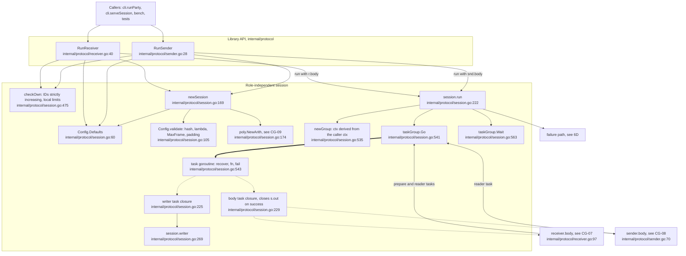

### Diagram 6B: handshake and parameter agreement

Both parties run the same handshake. Each queues its own `Hello` and all of its
`SizesChunk` frames before reading anything from the peer
(internal/protocol/session.go:373-389).

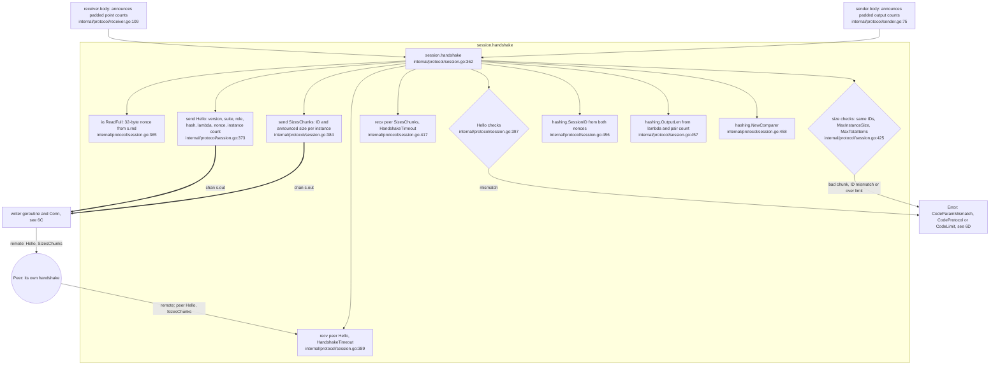

Parameter agreement:

- The peer must match exactly on protocol version, suite, opposite role, hash and lambda,
  and must have the same instance count (internal/protocol/session.go:397-412).
  `Hello.SoftwareVersion` goes into the transcript digest but is never compared.
- The peer's instance IDs must equal ours in order, and its sizes must stay within our limits
  (internal/protocol/session.go:428-441).
- The result is `params` (internal/protocol/session.go:137-143):
  - `n1` and `n2`, the sender and receiver sizes, swapped by role
    (internal/protocol/session.go:444-448);
  - `sid = SessionID(nonceR, nonceS)` (internal/protocol/session.go:452-456);
  - `outLen` from lambda and the sum of `n1*n2` over instances
    (internal/protocol/session.go:449-451, internal/protocol/session.go:457);
  - the per-session `Comparer` (internal/protocol/session.go:458).
- Each `SizesChunk` holds `(MaxFrame - 1024) / 10` entries (internal/protocol/session.go:376,
  `frameReserve` at internal/protocol/messages.go:201).

### Diagram 6C: frame I/O through Conn, and the Done exchange

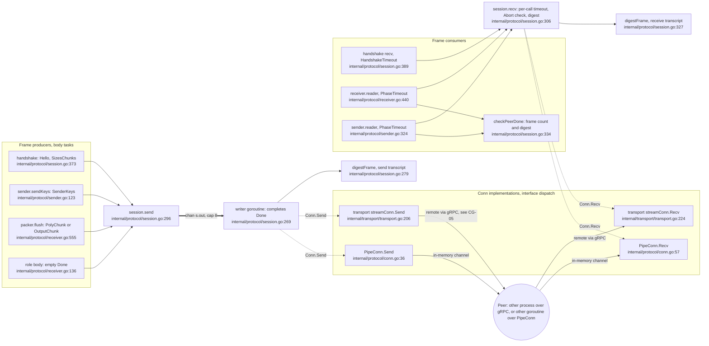

The `Done` exchange works as follows:

- Each body queues an empty `Done` after its last data frame. The receiver does this at
  internal/protocol/receiver.go:136, before matching, so that the match time is not visible to
  the sender (internal/protocol/receiver.go:134-135). The sender does it at
  internal/protocol/sender.go:95.
- The writer replaces the empty `Done` with its own frame count and SHA-256 digest
  (internal/protocol/session.go:276-277). `Done` and `Abort` frames are not digested.
- Each reader checks the peer's `Done` with `checkPeerDone` (internal/protocol/receiver.go:487,
  internal/protocol/sender.go:357). The body then waits for it (internal/protocol/receiver.go:139,
  internal/protocol/sender.go:98).
- On success the body closure closes `s.out` (internal/protocol/session.go:231-233), and the
  writer drains the queue and exits (internal/protocol/session.go:272-274).

### Diagram 6D: failure classification and the Abort sent to the peer

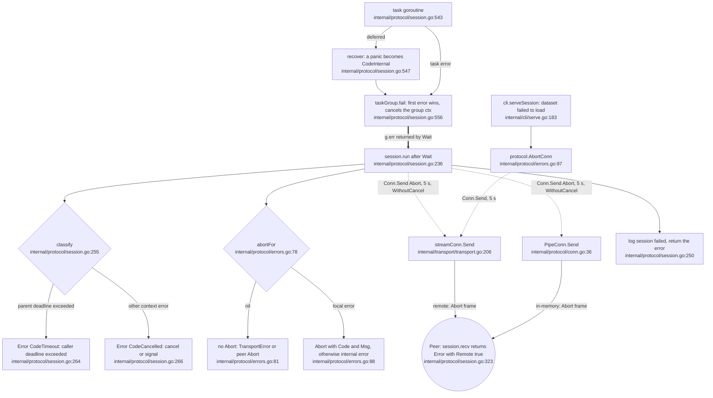

### Branches and error paths

| # | Where | Condition | Result |
|---|---|---|---|
| 1 | `RunReceiver` / `RunSender` before `run` | Invalid padding policy (internal/protocol/receiver.go:42, internal/protocol/sender.go:30). `checkOwn` fails on IDs or limits (internal/protocol/session.go:475-498). `newSession` validation or `NewArith` fails (internal/protocol/session.go:171-177) | The error is returned before any frame is sent, so no Abort goes out and the peer waits out its `HandshakeTimeout`. The CLI runs the same checks earlier, through `protocol.CheckInput`, before it connects (internal/cli/party.go:230) |
| 2 | `handshake` | Randomness failure (internal/protocol/session.go:365-367). First frame is not `Hello` (internal/protocol/session.go:393-396). Version, suite, role, hash, lambda or instance count mismatch (internal/protocol/session.go:398-411). Nonce length wrong (internal/protocol/session.go:408-409). Malformed `SizesChunk` (internal/protocol/session.go:421-427). ID mismatch (internal/protocol/session.go:430-431). Peer sizes over our limits (internal/protocol/session.go:434-439) | `CodeInternal`, `CodeProtocol`, `CodeParamMismatch` or `CodeLimit`. A local `*Error` is sent to the peer as an Abort |
| 3 | `recv` | Parent ctx done (internal/protocol/session.go:311-313) | `ctx.Err()`, which `classify` turns into `CodeTimeout` or `CodeCancelled` |
| 4 | `recv` | Per-call timeout expired (internal/protocol/session.go:314-315) | `CodeTimeout` "no frame from peer within ..." |
| 5 | `recv` | `Conn.Recv` failed, e.g. EOF or a reset (internal/protocol/session.go:317) | `*TransportError{Op: "recv"}`, no Abort |
| 6 | `recv` | Nil frame (internal/protocol/session.go:319-320), or an `Abort` from the peer (internal/protocol/session.go:322-323) | `CodeProtocol` "empty frame", or `*Error{Remote: true}` with the peer's code and message |
| 7 | `writer` | `Conn.Send` failed (internal/protocol/session.go:283-288) | `ctx.Err()` if the ctx is done, otherwise `*TransportError{Op: "send"}` |
| 8 | role readers | Ordering, length or encoding violations (internal/protocol/receiver.go:440-494, internal/protocol/sender.go:324-361) | `CodeProtocol`, `CodeBadEncoding` or `CodeBadPoint`. Details in [CG-07](#cg-07) and [CG-08](#cg-08) |
| 9 | `checkPeerDone` | Frame count or digest differs (internal/protocol/session.go:334-338) | `CodeProtocol` "transcript mismatch" |
| 10 | `taskGroup.Go` | Panic in any task (internal/protocol/session.go:545-548) | `CodeInternal` "internal error" |
| 11 | `classify` | (internal/protocol/session.go:255-267) | Non-context errors and errors that already hold an `*Error` pass through unchanged. A parent deadline becomes `CodeTimeout` "session deadline exceeded". Any other context error becomes `CodeCancelled` |
| 12 | `abortFor` | (internal/protocol/errors.go:78-91) | `*TransportError` or a remote `*Error`: no Abort. A local `*Error`: `Abort{Code, Msg}`. Anything else: `Abort{CodeInternal, "internal error"}`. `Error.Err` never leaves the process |
| 13 | CLI exit codes | `exitCode` (internal/cli/root.go:38-69) | `*TransportError` -> 3 (network). Remote abort -> 4. `CodeTimeout` -> 3. `CodeInput` -> 2. `CodeInternal` -> 5. Any other code -> 4. A bare `context.Canceled` -> 4 |

### Source references

| Step | Caller -> Callee | Site | Kind |
|---|---|---|---|
| 6A1 | `cli.runParty` -> `RunReceiver`, bench goroutine -> `RunReceiver` | internal/cli/party.go:301, internal/cli/tools.go:116 | direct |
| 6A2 | `cli.runParty` -> `RunSender`, `cli.serveSession` closure -> `RunSender`, bench goroutine -> `RunSender` | internal/cli/party.go:293, internal/cli/serve.go:192, internal/cli/tools.go:121 | direct |
| 6A3 | `RunReceiver` -> `Config.Defaults` | internal/protocol/receiver.go:41 | direct |
| 6A4 | `RunSender` -> `Config.Defaults` | internal/protocol/sender.go:29 | direct |
| 6A5 | `RunReceiver` -> `checkOwn` | internal/protocol/receiver.go:57 | direct |
| 6A6 | `RunSender` -> `checkOwn` | internal/protocol/sender.go:37 | direct |
| 6A7 | `RunReceiver` -> `newSession(cfg, RoleReceiver, conn)` | internal/protocol/receiver.go:60 | direct |
| 6A8 | `RunSender` -> `newSession(cfg, RoleSender, conn)` | internal/protocol/sender.go:40 | direct |
| 6A9 | `newSession` -> `Config.Defaults`, `Config.validate` | internal/protocol/session.go:170, internal/protocol/session.go:171 | direct |
| 6A10 | `newSession` -> `poly.NewArith` | internal/protocol/session.go:174 | direct |
| 6A11 | `RunReceiver` -> `session.run(ctx, r.body)` | internal/protocol/receiver.go:65 | direct |
| 6A12 | `RunSender` -> `session.run(ctx, snd.body)` | internal/protocol/sender.go:45 | direct |
| 6A13 | `run` -> `newGroup` | internal/protocol/session.go:223 | direct |
| 6A14 | `run` -> `taskGroup.Go`: writer task, then body task | internal/protocol/session.go:225, internal/protocol/session.go:229 | direct |
| 6A15 | `taskGroup.Go` -> task goroutine | internal/protocol/session.go:543 | goroutine |
| 6A16 | task goroutine -> `fn(g.ctx)`: writer closure or body closure | internal/protocol/session.go:550 | func-value |
| 6A17 | writer closure -> `session.writer` | internal/protocol/session.go:227 | direct |
| 6A18 | body closure -> `receiver.body` or `sender.body` | internal/protocol/session.go:230 | func-value |
| 6A19 | `receiver.body` -> `taskGroup.Go`: `prepare`, then `reader` after the handshake | internal/protocol/receiver.go:107, internal/protocol/receiver.go:118 | direct |
| 6A20 | `sender.body` -> `taskGroup.Go(s.reader)` after the handshake | internal/protocol/sender.go:84 | direct |
| 6A21 | `run` -> `taskGroup.Wait` | internal/protocol/session.go:236 | direct |
| 6A22 | `run` -> failure path (6D) | internal/protocol/session.go:240-251 | branch |
| 6B1 | `receiver.body` -> `handshake(ctx, r.ids, r.m)` | internal/protocol/receiver.go:109 | direct |
| 6B2 | `sender.body` -> `handshake(ctx, ids, s.sizes)` | internal/protocol/sender.go:75 | direct |
| 6B3 | `handshake` -> `io.ReadFull(s.rnd, nonce)` | internal/protocol/session.go:365 | stdlib-side-effect |
| 6B4 | `handshake` -> `session.send(Hello)` | internal/protocol/session.go:373 | direct |
| 6B5 | `handshake` -> `session.send(SizesChunk)` per chunk | internal/protocol/session.go:384 | direct |
| 6B6 | `send` -> writer via `s.out` | internal/protocol/session.go:298 to internal/protocol/session.go:272 | channel |
| 6B7 | writer -> peer handshake: Hello, SizesChunks | internal/protocol/session.go:283 (peer reads at internal/protocol/session.go:389, internal/protocol/session.go:417) | remote |
| 6B8 | peer writer -> our `recv` | internal/protocol/session.go:283 (peer) to internal/protocol/session.go:309 | remote |
| 6B9 | `handshake` -> `session.recv(HandshakeTimeout)` for the Hello | internal/protocol/session.go:389 | direct |
| 6B10 | `handshake` -> Hello checks | internal/protocol/session.go:393-412 | branch |
| 6B11 | `handshake` -> `session.recv(HandshakeTimeout)` per SizesChunk | internal/protocol/session.go:417 | direct |
| 6B12 | `handshake` -> size checks | internal/protocol/session.go:421-441 | branch |
| 6B13 | `handshake` -> `hashing.SessionID` | internal/protocol/session.go:456 | direct |
| 6B14 | `handshake` -> `hashing.OutputLen` | internal/protocol/session.go:457 | direct |
| 6B15 | `handshake` -> `hashing.NewComparer` | internal/protocol/session.go:458 | direct |
| 6C1 | `handshake` -> `send` | internal/protocol/session.go:373, internal/protocol/session.go:384 | direct |
| 6C2 | `sender.sendKeys` -> `send(SenderKeys)` | internal/protocol/sender.go:123 | direct |
| 6C3 | `packer.flush` -> `send(PolyChunk or OutputChunk)`; the packer is used by `receiver.sendPolys` (internal/protocol/receiver.go:234) and `sender.evaluate` (internal/protocol/sender.go:203) | internal/protocol/receiver.go:555 | direct |
| 6C4 | `receiver.body` and `sender.body` -> `send(Done)` | internal/protocol/receiver.go:136, internal/protocol/sender.go:95 | direct |
| 6C5 | `send` -> writer via `s.out` (capacity 8, internal/protocol/session.go:193) | internal/protocol/session.go:298 | channel |
| 6C6 | `writer` -> `digestFrame` | internal/protocol/session.go:279 | direct |
| 6C7 | `writer` -> `Conn.Send` = `(*transport.streamConn).Send` | internal/protocol/session.go:283 | interface-dispatch |
| 6C8 | `writer` -> `Conn.Send` = `(*protocol.PipeConn).Send` | internal/protocol/session.go:283 | interface-dispatch |
| 6C9 | `streamConn.Send` -> peer, via `sendLoop` and gRPC ([CG-05](#cg-05) 5D) | internal/transport/transport.go:198 | remote |
| 6C10 | `PipeConn.Send` -> peer end's `in` channel, same process | internal/protocol/conn.go:45 | channel |
| 6C11 | peer -> `streamConn.Recv`, via the peer's `sendLoop` and our `pump` | internal/transport/transport.go:168 | remote |
| 6C12 | peer end -> `PipeConn.Recv` | internal/protocol/conn.go:59 | channel |
| 6C13 | `recv` -> `Conn.Recv` = `(*transport.streamConn).Recv` | internal/protocol/session.go:309 | interface-dispatch |
| 6C14 | `recv` -> `Conn.Recv` = `(*protocol.PipeConn).Recv` | internal/protocol/session.go:309 | interface-dispatch |
| 6C15 | `recv` -> `digestFrame` | internal/protocol/session.go:327 | direct |
| 6C16 | `handshake` -> `recv` | internal/protocol/session.go:389, internal/protocol/session.go:417 | direct |
| 6C17 | `receiver.reader` -> `recv(PhaseTimeout)` | internal/protocol/receiver.go:440 | direct |
| 6C18 | `sender.reader` -> `recv(PhaseTimeout)` | internal/protocol/sender.go:324 | direct |
| 6C19 | `receiver.reader` -> `checkPeerDone` | internal/protocol/receiver.go:487 | direct |
| 6C20 | `sender.reader` -> `checkPeerDone` | internal/protocol/sender.go:357 | direct |
| 6D1 | task goroutine -> deferred `recover` closure | internal/protocol/session.go:545 | deferred |
| 6D2 | `recover` closure -> `taskGroup.fail(CodeInternal)` | internal/protocol/session.go:547 | direct |
| 6D3 | task goroutine -> `taskGroup.fail(err)` | internal/protocol/session.go:551 | direct |
| 6D4 | `fail` (`once`, `cancel`) -> `Wait` returns `g.err` | internal/protocol/session.go:557-560 to internal/protocol/session.go:566 | channel (WaitGroup) |
| 6D5 | `run` -> `classify` | internal/protocol/session.go:243 | direct |
| 6D6 | `classify` -> `CodeTimeout` or `CodeCancelled` | internal/protocol/session.go:263-266 | branch |
| 6D7 | `run` -> `abortFor` | internal/protocol/session.go:244 | direct |
| 6D8 | `abortFor` -> nil or `Abort` | internal/protocol/errors.go:79-90 | branch |
| 6D9 | `run` -> `Conn.Send(Abort)` = `(*transport.streamConn).Send` or `(*protocol.PipeConn).Send` | internal/protocol/session.go:247 | interface-dispatch |
| 6D10 | Abort -> peer `recv` returns `*Error{Remote: true}` | internal/protocol/session.go:247 to internal/protocol/session.go:322-323 (peer) | remote |
| 6D11 | `cli.serveSession` closure -> `protocol.AbortConn(CodeInput, "sender dataset unavailable")` | internal/cli/serve.go:183 | direct |
| 6D12 | `AbortConn` -> `Conn.Send` = `(*transport.streamConn).Send` | internal/protocol/errors.go:100 | interface-dispatch |
| 6D13 | `run` -> log and return | internal/protocol/session.go:250-251 | direct |

### Concurrency and timeouts

- **Goroutines per session.** All of them go through `taskGroup.Go`, with a `WaitGroup` and
  panic recovery (internal/protocol/session.go:541-554):
  - the writer (internal/protocol/session.go:225-228);
  - the body (internal/protocol/session.go:229-235);
  - on the receiver, `prepare`, which starts before the handshake and overlaps it
    (internal/protocol/receiver.go:107);
  - one role reader, started only after the handshake (internal/protocol/receiver.go:118,
    internal/protocol/sender.go:84).

  The math worker goroutines are in [CG-09](#cg-09).
- **Conn contract.** `Send` and `Recv` may run concurrently with each other, but each must not
  run concurrently with itself, and both must return promptly once their ctx is done
  (internal/protocol/conn.go:9-11). The session keeps this contract:
  - while a session runs, only the writer calls `Send`;
  - `Recv` is called first by the handshake in the body, then only by the reader;
  - the final Abort goes out after `g.Wait`, when no other `Send` can be running
    (internal/protocol/session.go:236-248).

  Any new `Conn`, such as one for a new API, must give the same guarantees.
- **Back-pressure.** `s.out` holds 8 frames (internal/protocol/session.go:193). When the
  writer falls behind, `send` blocks until there is room or the ctx is done
  (internal/protocol/session.go:296-303). `PipeConn` buffers `buffer` frames in each direction
  (internal/protocol/conn.go:25-27).
- **Timeouts are per frame.**
  - `HandshakeTimeout` (default 30 s, internal/protocol/session.go:82-84) bounds each handshake
    `recv`.
  - `PhaseTimeout` (default 10 min, internal/protocol/session.go:85-87) bounds each reader
    `recv`.
  - Each `recv` derives its own `context.WithTimeout` (internal/protocol/session.go:307).
  - Sends have no timeout.
  - The whole run is bounded only by the caller's ctx deadline: CLI `--timeout`
    (internal/cli/party.go:278-282) or the per-session daemon timeout
    (internal/cli/serve.go:186-191). `classify` maps that deadline to `CodeTimeout`.
- **No watchdog.** There is no separate watchdog goroutine. The first task error cancels the
  group ctx (internal/protocol/session.go:536, internal/protocol/session.go:559), and all tasks
  observe that ctx.
- **Abort delivery is best effort.**
  - The Abort is sent with a 5 s timeout on a ctx detached from parent cancellation
    (`context.WithoutCancel`, internal/protocol/session.go:246-248). `AbortConn` works the same
    way (internal/protocol/errors.go:98-100).
  - Over gRPC the Abort can be lost when the writer was blocked inside a flow-controlled stream
    `Send` that `sendLoop` is still finishing (internal/transport/transport.go:198,
    internal/transport/transport.go:215-220).
- **Handshake ordering.** Each side queues all of its handshake frames before its first `recv`
  (internal/protocol/session.go:373-389). With very large instance lists, both sides could
  block on send at the same time. This is unverified at runtime.
- **Shared state.** `Stats.Phases` is guarded by a mutex (internal/protocol/session.go:212-217).
  The transcripts are per-direction SHA-256 states (internal/protocol/session.go:194). The send
  transcript is updated only by the writer, the receive transcript only by whichever goroutine
  currently calls `recv`. An injected `Config.Rand` is wrapped in `lockedReader` for the
  concurrent encoders (internal/protocol/session.go:184-189).


<a id="cg-07"></a>
## CG-07 Receiver algorithm

### Entry point and trigger

[EP-07](ENTRY_POINTS.md#ep-07): `protocol.RunReceiver(ctx, cfg, conn, instances)` (`internal/protocol/receiver.go:40`).
It is called by:

- `cli.runParty`, for the `receiver` and `request` commands (`internal/cli/party.go:301`).
- `bench`, in a goroutine over an in-memory `protocol.Pipe` (`internal/cli/tools.go:116`).
- Tests, directly.

The receiver is the only party that learns the intersection.

The receiver logic runs inside the session machinery described in [CG-06](#cg-06):

1. `RunReceiver` builds a session with `newSession` (`internal/protocol/receiver.go:60`).
2. It passes the method value `r.body` to `session.run` (`internal/protocol/receiver.go:65`).
3. `session.run` starts two goroutines through `taskGroup.Go`: the writer (`internal/protocol/session.go:225`) and the body (`internal/protocol/session.go:229`).
4. The body goroutine calls `body` as a function value (`internal/protocol/session.go:230`).

Math-core calls are drawn as single nodes. Their internals are in [CG-09](#cg-09).

**What the receiver computes.** For each instance b with distinct items x_i:

1. z_i = H(x_i) in GF(2^255 - 19). `field.HashToField` reduces SHA-512 over a domain separator and the item (`internal/field/field.go:88`).
2. A fresh encoding (r_i, S_i) per item. Q_i = r_i*B + t_i, where t_i is a random 8-torsion point, and S_i is a uniformly chosen Elligator2 preimage of u(Q_i) (`elligator.EncodeBatch`, `internal/elligator/elligator.go:194`).
3. P_b, the polynomial of degree < m_b with P_b(z_i) = S_i. It passes through the k_b real points and m_b - k_b random dummy points (`poly.Arith.Interpolate`, `internal/poly/evaluator.go:59`).
4. Once the sender's public key K_b arrives: v_i = h_b(u(r_i*K_b)), l_out bytes long.
5. Item i is in the intersection when v_i appears in the sender's output list U_b.

**Secrets.** The receiver has no per-instance secret. Its secrets are per item:

- The scalars r_i are drawn inside `elligator.EncodeBatch` and stored in `r.r` (`internal/protocol/receiver.go:191`).
- After a successful run, they are erased on a best-effort basis (`internal/protocol/receiver.go:149-151`).

The per-instance secret k_b belongs to the sender ([CG-08](#cg-08)). The comparison hash h_b is per instance but not secret. It is keyed by the session ID and the instance ID: the comparer is built at `internal/protocol/session.go:458`, and the SHA-256 variant is `internal/hashing/hashing.go:129-147`.

### Diagram 1: run structure, goroutines and the network boundary

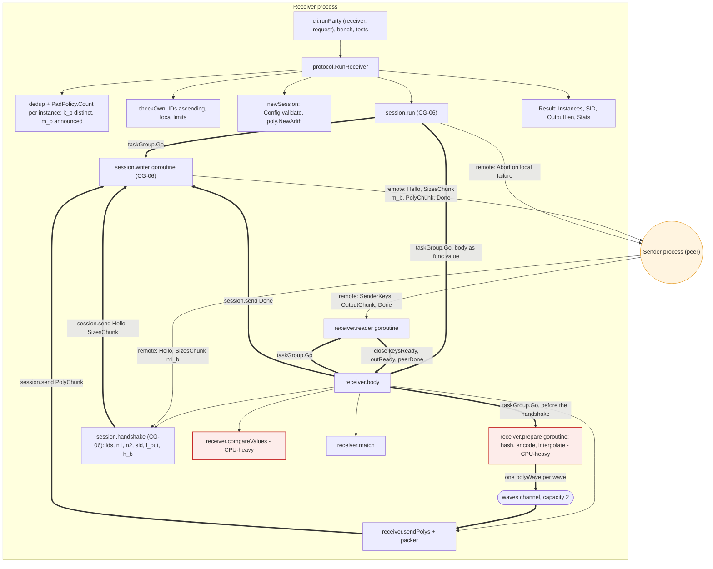

`body` runs these steps in order (`internal/protocol/receiver.go:97-153`):

1. Start `prepare`. It needs only the receiver's own items, so it overlaps with connection setup and the handshake (`internal/protocol/receiver.go:104-107`).
2. Run the handshake.
3. Start `reader`.
4. Stream the polynomials.
5. Wait for all keys, then compute the comparison values while the sender evaluates.
6. Wait for all outputs, then send Done.
7. Wait for the sender's Done, then match.

Edges into and out of the peer node are protocol frames. On the local side they go through `session.writer` and `Conn.Send` (`internal/protocol/session.go:283`, interface dispatch), and in from `Conn.Recv` (`internal/protocol/session.go:309`). The gRPC stream and TLS are in [CG-05](#cg-05).

### Diagram 2: hashing, encoding, padding, interpolation and polynomial frames

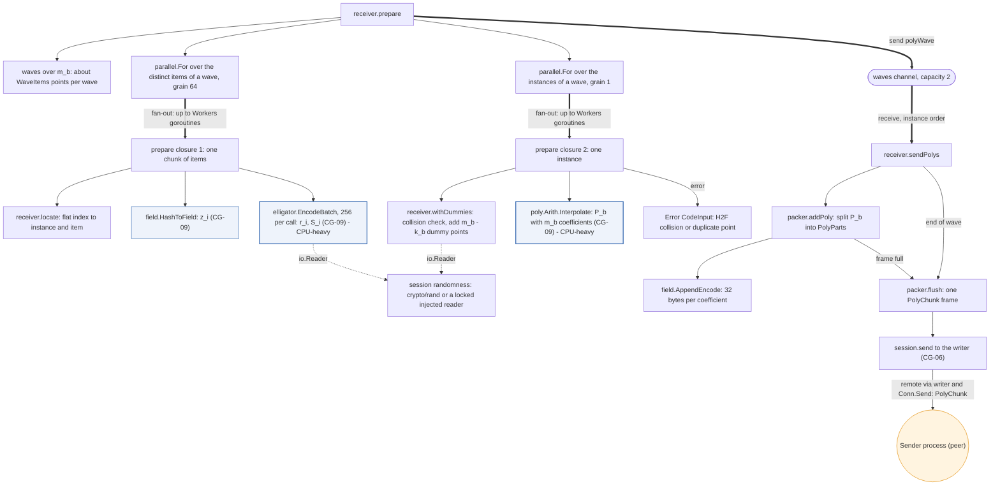

A "fan-out" edge stands for `parallel.For` (`internal/parallel/parallel.go:21`):

- With more than one worker, it starts up to `Workers` goroutines (`internal/parallel/parallel.go:63`). Each goroutine calls the loop body, a function value, once per chunk (`internal/parallel/parallel.go:66`).
- With one worker, it calls the loop body inline (`internal/parallel/parallel.go:43`).
- Chunks are at least `grain` elements and about 4 per worker. The first error cancels the remaining chunks.

The polynomial math inside `Interpolate` has its own nested parallelism; see [CG-09](#cg-09).

The two loops of a wave work on different index sets:

- The first loop hashes and encodes only the k_b distinct items (`r.off` is built from `r.k`, `internal/protocol/receiver.go:102-103`).
- The second loop adds the m_b - k_b dummy points without encoding them (`internal/protocol/receiver.go:279-298`).

A frame never spans two waves, because `sendPolys` flushes after each wave (`internal/protocol/receiver.go:246`). A polynomial can span several frames: each part carries its coefficient `Offset` (`internal/protocol/receiver.go:521`).

### Diagram 3: sender frames in, comparison values, matching

```mermaid
flowchart TD
  classDef heavy fill:#fdecea,stroke:#c62828,stroke-width:2px
  classDef core fill:#eef3fb,stroke:#3b6db3
  classDef peer fill:#fff4e0,stroke:#e08a00
  PEER(("Sender process (peer)"))
  RECV["session.recv with PhaseTimeout (CG-06)"]
  RD["receiver.reader"]
  DK["group.DecodeKey per K_b (CG-09)"]
  OUTS(["r.outputs: U_b, n1_b values of l_out bytes"])
  CPD["session.checkPeerDone: frame count and transcript digest"]
  SIG(["keysReady, outReady, peerDone"])
  BODY["receiver.body"]
  CV["receiver.compareValues - CPU-heavy"]
  PFA["parallel.For over instances, windows of at most 256 tables"]
  FB["group.NewFixedBase of K_b when k_b >= 8 (CG-09)"]
  PFB["parallel.For over distinct items, grain 64"]
  C3["compare closure: runs of items of one instance"]
  MUL["FixedBase.MulUBatch, or Point.ScalarMult + group.UBatch: u(r_i*K_b) (CG-09) - CPU-heavy"]
  HB["InstanceHasher.Append: v_i = h_b(u), l_out bytes (CG-09)"]
  PFC["parallel.For over instances: sort items by v_i"]
  DS["session.send Done"]
  MT["receiver.match"]
  PFD["parallel.For over instances"]
  BS["sort.Search of each U_b value in the sorted v_i"]
  RES["Result.Instances: instance order, ascending item indices, duplicates included"]

  PEER -->|"remote: SenderKeys, OutputChunk, Done"| RECV
  RD --> RECV
  RD --> DK
  RD -->|"append parts in order"| OUTS
  RD --> CPD
  RD ==>|"close"| SIG
  SIG ==>|"wait returns"| BODY
  BODY --> CV
  CV --> PFA
  PFA ==>|"fan-out"| FB
  CV --> PFB
  PFB ==>|"fan-out"| C3
  C3 --> MUL
  C3 -.->|"Comparer interface"| HB
  CV --> PFC
  BODY --> DS
  DS -->|"remote via writer: Done"| PEER
  BODY --> MT
  MT --> PFD
  PFD ==>|"fan-out"| BS
  MT --> RES
  class CV,MUL heavy
  class DK,FB,MUL,HB core
  class PEER peer
```

How `compareValues` (`internal/protocol/receiver.go:311-376`) and `match` (`internal/protocol/receiver.go:379-415`) work:

- **Scalar multiplication.** An instance with at least `fixedBaseMin` = 8 distinct items gets a fixed-base table for K_b. One table costs about 5 variable-base multiplications and makes each multiplication about 3.5 times cheaper (`internal/protocol/receiver.go:302-308`). Smaller instances use `edwards25519.Point.ScalarMult` per item (`internal/protocol/receiver.go:349`).
- **Hashing.** h_b is an interface call. `Comparer` is implemented by `*shaComparer` and `*aesComparer`, and the machine call graph lists exactly these two targets at `internal/protocol/receiver.go:353-355`.
- **Matching.** `match` binary-searches each sender value in the instance's sorted v_i. It marks every distinct item with that value, then expands each match to all copies of the item through `r.groups` (`internal/protocol/receiver.go:387-409`).

### Branches and error paths

**Input errors before the session starts.** These return directly from `RunReceiver`, and no Abort is sent:

- **Invalid padding policy.** Extra or Min is outside [0, 2^20], or Multiple is outside [1, 2^20] (`internal/protocol/padding.go:35-41`). Checked at `internal/protocol/receiver.go:42-44`; the error is a plain `error`, not a `*protocol.Error`.
- **Bad instance list** (`checkOwn`, `internal/protocol/session.go:475-498`, called at `internal/protocol/receiver.go:57`):
  - Instance IDs not strictly increasing: CodeInput.
  - A padded instance above `MaxInstanceSize` (default 2^22), a total above `MaxTotalItems` (default 2^24), or more than `MaxInstances` instances: CodeLimit.
- **Bad configuration** (`newSession`, `internal/protocol/session.go:169-177`): an unknown hash, lambda outside [40, 256], `MaxFrame` below 64 KiB, or an unknown NTT backend.

The CLI runs the same checks earlier, before connecting: `loadInput` calls `protocol.CheckInput` (`internal/cli/party.go:230`, `internal/protocol/padding.go:99`).

**Input errors inside the session.** The task group fails, and `session.run` sends an Abort with the code to the sender on a best-effort basis (`internal/protocol/session.go:243-248`):

- **H2F collision.** Two distinct items of one instance hash to the same z. The error is CodeInput "instance N: hash-to-field collision between distinct items" (`internal/protocol/receiver.go:270-272`, wrapped at `internal/protocol/receiver.go:204-206`). This is cryptographically negligible; the check exists because interpolation needs distinct points.
- **Exact duplicates are not an error.** `dedup` removes them first (`internal/protocol/padding.go:69-93`), and the result reports every copy.
- **Duplicate point during interpolation.** `poly.ErrDuplicatePoint` becomes CodeInput (`internal/protocol/receiver.go:209-210`). This is defensive: `withDummies` already guarantees distinct points. Any other interpolation error is CodeInternal (`internal/protocol/receiver.go:211-212`).
- **Randomness failure.** Inside `EncodeBatch` it is CodeInternal (`internal/protocol/receiver.go:186-188`). Inside `withDummies` (`internal/protocol/receiver.go:285-290`) it is wrapped as CodeInput by `internal/protocol/receiver.go:206`, which is inconsistent with the other randomness failures.

**Limit violations by the peer.** A sender-announced n1_b above `MaxInstanceSize`, or a total above `MaxTotalItems`, is CodeLimit in the handshake (`internal/protocol/session.go:434-439`; see [CG-06](#cg-06)). All later length checks in the reader are bounded by these announced sizes.

**Peer misbehaviour.** `receiver.reader` detects these. Each one fails the task group, cancels the run and sends an Abort:

- **SenderKeys out of shape.** Out of order, empty, not a multiple of 32 bytes, or more keys than instances: CodeProtocol "malformed SenderKeys" (`internal/protocol/receiver.go:447-449`).
- **Invalid key.** A key that is not a canonical, non-identity point of the prime-order subgroup: CodeBadPoint (`internal/protocol/receiver.go:452-454`; the checks are in `internal/group/group.go:145-168`).
- **OutputChunk out of order or out of shape:**
  - Sent before all keys: CodeProtocol (`internal/protocol/receiver.go:463-464`).
  - Empty: CodeProtocol (`internal/protocol/receiver.go:466-467`).
  - A part for any instance other than the current one: CodeProtocol (`internal/protocol/receiver.go:470-471`). Outputs must arrive instance by instance.
  - A part that is empty, not a multiple of l_out, or longer than n1_b*l_out: CodeBadEncoding (`internal/protocol/receiver.go:473-475`).
- **Done problems:**
  - Done before all keys and outputs: CodeProtocol (`internal/protocol/receiver.go:484-485`).
  - A frame count or SHA-256 transcript digest that differs from what was received: CodeProtocol "transcript mismatch" (`internal/protocol/session.go:335-336`, called at `internal/protocol/receiver.go:487`).
- **Unexpected frame.** Any other frame kind: CodeProtocol (`internal/protocol/receiver.go:490-491`).
- **Timeouts, aborts and transport failures** (`internal/protocol/session.go:306-324`, `internal/protocol/errors.go:78-91`):
  - No frame within `PhaseTimeout` (default 10 min): CodeTimeout.
  - An Abort from the peer: an `*Error` with `Remote = true`.
  - A `Conn` failure: a `*TransportError`, and no Abort is sent.

**Cancellation.**

- Every wait selects on ctx (`internal/protocol/receiver.go:155-162`).
- The session maps context errors to CodeCancelled or CodeTimeout (`internal/protocol/session.go:255-267`).
- `compareValues` and `match` discard the error from `parallel.For` (`internal/protocol/receiver.go:326`, `internal/protocol/receiver.go:335`, `internal/protocol/receiver.go:366`, `internal/protocol/receiver.go:382`). On cancellation they stop early, and the writer goroutine normally reports the cancellation (`internal/protocol/session.go:289-290`).
- It was not reproduced whether a cancellation that races with the end of `body` can return a partial `Result` with a nil error.

**Timing.** The receiver sends its Done before matching (`internal/protocol/receiver.go:134-136`). Matching time depends on the intersection size, so this keeps it hidden from the sender.

**Edge cases.** With zero instances, or when the sender announced n1_b = 0, the readiness channels are closed immediately (`internal/protocol/receiver.go:429-438`).

### Data flow

1. **Input.** `[]Instance{ID uint32, Items [][]byte}`, with IDs strictly increasing. Items are arbitrary byte strings.
2. **De-duplication and padding.** `dedup` returns `uniq` (the first index of each distinct item) and `groups` (all indices, or nil when there are no duplicates).
   - k_b is the number of distinct items.
   - m_b = `PadPolicy.Count(k_b)` = roundUp(max(k_b + Extra, Min), Multiple), and at least 2 when k_b >= 1 (`internal/protocol/padding.go:44-53`).
   - The default policy has Extra = 1, so m_b = k_b + 1 (`internal/protocol/padding.go:24`).
3. **Handshake** ([CG-06](#cg-06)).
   - Sends: Hello, and SizesChunk(ID, m_b).
   - Receives: the sender's n1_b.
   - Produces `params`: ids, n1 (the sender's sizes), n2 (= m_b), a 16-byte sid, l_out and the comparer (`internal/protocol/session.go:444-458`).
4. **Hash.** One 32-byte field element z_i per distinct item, from a 64-byte SHA-512 digest reduced mod p.
5. **Encode.** One 32-byte scalar r_i (kept until the end of the run) and one 32-byte S_i per distinct item. Each rejection-sampling round costs one base-point multiplication and succeeds with probability about 1/2 (`internal/elligator/elligator.go:182`).
6. **Dummies.** m_b - k_b random points (z, v), each value made from 64 random bytes and resampled on collision.
7. **Interpolate.** P_b, with m_b coefficients of 32 bytes each.
8. **Send polynomials.** PolyChunk frames of `PolyPart{InstanceID, Offset, Coeffs}` (`internal/protocol/messages.go:66`).
   - Frame payload limit: (MaxFrame - 1024) rounded down to a multiple of 32 (`internal/protocol/receiver.go:234`). With the default 4 MiB MaxFrame, that is up to 131,039 coefficients per frame.
   - Each part adds 24 bytes of overhead (`internal/protocol/messages.go:200`).
   - Wire cost: 32*m_b bytes per instance, plus framing.
9. **Receive.**
   - SenderKeys: 32 bytes per instance.
   - OutputChunks of `OutputPart{InstanceID, Values}` (`internal/protocol/messages.go:76`): n1_b*l_out bytes per instance, in instance order.
10. **Compare.**
    - One l_out-byte value v_i per distinct item (k*l_out bytes in `vals`), plus one int32 index per item.
    - Fixed-base tables of 61,440 bytes each (`internal/group/fixedbase.go:35`), at most 256 alive at once.
11. **Match.** The result is `Result{Instances []InstanceResult{ID, Matches []int}, SID, OutputLen, Stats}` (`internal/protocol/receiver.go:22-34`).
    - `Instances` follows the instance list.
    - `Matches` lists ascending indices into `Instance.Items`, including every duplicate copy (`internal/protocol/receiver.go:401-410`).

l_out = min(32, ceil((lambda + ceil(log2(max(2, sum_b n1_b*n2_b)))) / 8)) (`internal/hashing/hashing.go:59-70`). For lambda = 40 and one instance with n1 = n2 = 2^20, l_out is 10 bytes.

### Source references

| Step | Caller -> Callee | Site | Kind |
|---|---|---|---|
| Trigger | `cli.runParty` -> `protocol.RunReceiver` | `internal/cli/party.go:301` | direct |
| Trigger | bench goroutine -> `protocol.RunReceiver` | `internal/cli/tools.go:116` | direct (inside a `go` statement at `internal/cli/tools.go:113`) |
| Setup | `RunReceiver` -> `Config.Defaults` | `internal/protocol/receiver.go:41` | direct |
| Setup | `RunReceiver` -> `PadPolicy.validate` | `internal/protocol/receiver.go:42` | direct |
| Setup | `RunReceiver` -> `dedup` | `internal/protocol/receiver.go:53` | direct |
| Setup | `RunReceiver` -> `PadPolicy.Count` | `internal/protocol/receiver.go:55` | direct |
| Setup | `RunReceiver` -> `checkOwn` | `internal/protocol/receiver.go:57` | direct |
| Setup | `RunReceiver` -> `newSession` | `internal/protocol/receiver.go:60` | direct |
| Hand-off | `RunReceiver` -> `session.run` | `internal/protocol/receiver.go:65` | direct |
| Hand-off | `session.run` -> `taskGroup.Go` (writer) | `internal/protocol/session.go:225` | goroutine |
| Hand-off | `session.run` -> `taskGroup.Go` (body) | `internal/protocol/session.go:229` | goroutine |
| Hand-off | `taskGroup.Go` -> `go func` | `internal/protocol/session.go:543` | goroutine |
| Hand-off | `session.run` closure -> `receiver.body` | `internal/protocol/session.go:230` | func-value |
| Body | `body` -> `offsets` | `internal/protocol/receiver.go:102` | direct |
| Body | `body` -> `taskGroup.Go` (closure calling `prepare`) | `internal/protocol/receiver.go:107` | goroutine |
| Body | `body` -> `session.handshake` | `internal/protocol/receiver.go:109` | direct |
| Body | `body` -> `taskGroup.Go(r.reader)` | `internal/protocol/receiver.go:118` | goroutine |
| Body | `body` -> `sendPolys` | `internal/protocol/receiver.go:121` | direct |
| Body | `body` -> `wait(keysReady)` | `internal/protocol/receiver.go:125` | direct |
| Body | `body` -> `compareValues` | `internal/protocol/receiver.go:129` | direct |
| Body | `body` -> `wait(outReady)` | `internal/protocol/receiver.go:131` | direct |
| Body | `body` -> `session.send(Done)` | `internal/protocol/receiver.go:136` | direct |
| Body | `body` -> `wait(peerDone)` | `internal/protocol/receiver.go:139` | direct |
| Body | `body` -> `match` | `internal/protocol/receiver.go:146` | direct |
| Prepare | `prepare` -> `waves` | `internal/protocol/receiver.go:175` | direct |
| Prepare | `prepare` -> `parallel.For` (hash and encode, grain 64) | `internal/protocol/receiver.go:179` | direct |
| Prepare | `parallel.For` -> worker goroutines | `internal/parallel/parallel.go:63` | goroutine |
| Prepare | `parallel.For` worker -> loop body | `internal/parallel/parallel.go:66` | func-value |
| Prepare | `parallel.For` (one worker) -> loop body | `internal/parallel/parallel.go:43` | func-value |
| Prepare | closure -> `receiver.locate` | `internal/protocol/receiver.go:181` | direct |
| Prepare | closure -> `field.HashToField` | `internal/protocol/receiver.go:182` | direct |
| Prepare | closure -> `elligator.EncodeBatch` | `internal/protocol/receiver.go:186` | direct |
| Prepare | `prepare` -> `parallel.For` (per instance, grain 1) | `internal/protocol/receiver.go:201` | direct |
| Prepare | closure -> `receiver.withDummies` | `internal/protocol/receiver.go:204` | direct |
| Prepare | `withDummies` -> `io.ReadFull(r.rnd)` | `internal/protocol/receiver.go:285` | interface-dispatch (`io.Reader`) |
| Prepare | `withDummies` -> `field.Element.SetWideBytes` | `internal/protocol/receiver.go:288` | external-lib (`filippo.io/edwards25519/field`) |
| Prepare | closure -> `poly.Arith.Interpolate` | `internal/protocol/receiver.go:208` | direct |
| Prepare | `prepare` -> waves channel | `internal/protocol/receiver.go:222` | goroutine (channel hand-off) |
| Send | `sendPolys` -> `newPacker` | `internal/protocol/receiver.go:234` | direct |
| Send | `sendPolys` -> `packer.addPoly` | `internal/protocol/receiver.go:242` | direct |
| Send | `sendPolys` -> `packer.flush` | `internal/protocol/receiver.go:246` | direct |
| Send | `packer.addPoly` -> `packer.flush` (frame full) | `internal/protocol/receiver.go:511` | direct |
| Send | `packer.addPoly` -> `field.AppendEncode` | `internal/protocol/receiver.go:519` | direct |
| Send | `packer.flush` -> `session.send` (PolyChunk) | `internal/protocol/receiver.go:555` | direct |
| Send | `session.send` -> `s.out` channel -> `session.writer` | `internal/protocol/session.go:298` | goroutine (channel hand-off) |
| Send | `session.writer` -> `Conn.Send` | `internal/protocol/session.go:283` | interface-dispatch (`*transport.streamConn`, `*protocol.PipeConn`) |
| Send | receiver -> sender: Hello, SizesChunk, PolyChunk, Done | `internal/protocol/session.go:283` | remote |
| Reader | `reader` -> `session.recv` | `internal/protocol/receiver.go:440` | direct |
| Reader | `session.recv` -> `Conn.Recv` | `internal/protocol/session.go:309` | interface-dispatch |
| Reader | sender -> receiver: SenderKeys, OutputChunk, Done | `internal/protocol/session.go:309` | remote |
| Reader | `reader` -> `group.DecodeKey` | `internal/protocol/receiver.go:452` | direct |
| Reader | `reader` -> `close(keysReady)` | `internal/protocol/receiver.go:460` | goroutine (channel hand-off) |
| Reader | `reader` -> append output part | `internal/protocol/receiver.go:477` | direct |
| Reader | `reader` -> `close(outReady)` | `internal/protocol/receiver.go:481` | goroutine (channel hand-off) |
| Reader | `reader` -> `session.checkPeerDone` | `internal/protocol/receiver.go:487` | direct |
| Compare | `compareValues` -> `parallel.For` (tables) | `internal/protocol/receiver.go:326` | direct |
| Compare | closure -> `group.NewFixedBase` | `internal/protocol/receiver.go:329` | direct |
| Compare | `compareValues` -> `parallel.For` (items, grain 64) | `internal/protocol/receiver.go:335` | direct |
| Compare | closure -> `FixedBase.MulUBatch` | `internal/protocol/receiver.go:345` | direct |
| Compare | closure -> `edwards25519.Point.ScalarMult` | `internal/protocol/receiver.go:349` | external-lib |
| Compare | closure -> `group.UBatch` | `internal/protocol/receiver.go:351` | direct |
| Compare | closure -> `Comparer.Instance` | `internal/protocol/receiver.go:353` | interface-dispatch (`*shaComparer`, `*aesComparer`) |
| Compare | closure -> `InstanceHasher.Append` | `internal/protocol/receiver.go:355` | interface-dispatch (`*shaInstance`, `*aesInstance`) |
| Compare | `compareValues` -> `parallel.For` (sort by v) | `internal/protocol/receiver.go:366` | direct |
| Compare | closure -> `slices.SortFunc` | `internal/protocol/receiver.go:369` | direct (stdlib) |
| Match | `match` -> `parallel.For` | `internal/protocol/receiver.go:382` | direct |
| Match | closure -> `sort.Search` | `internal/protocol/receiver.go:389` | direct (stdlib) |
| Match | closure -> `slices.Sort` | `internal/protocol/receiver.go:409` | direct (stdlib) |
| Abort | `session.run` -> `Conn.Send(Abort)` | `internal/protocol/session.go:247` | interface-dispatch, then remote |

<a id="cg-08"></a>
## CG-08 Sender algorithm

### Entry point and trigger

[EP-08](ENTRY_POINTS.md#ep-08): `protocol.RunSender(ctx, cfg, conn, instances)` (`internal/protocol/sender.go:28`).
It is called by:

- `cli.runParty`, for the one-shot `sender` command (`internal/cli/party.go:293`).
- `cli.serveSession`, once for each admitted `serve` daemon session (`internal/cli/serve.go:192`).
- `bench`, in a goroutine over an in-memory pipe (`internal/cli/tools.go:121`).
- Tests.

The hand-off to the session is the same as for the receiver:

1. `newSession` (`internal/protocol/sender.go:40`).
2. `session.run(ctx, snd.body)` (`internal/protocol/sender.go:45`), which starts the writer goroutine and the body goroutine ([CG-06](#cg-06)).

The sender learns nothing about the intersection. `SenderResult` holds only `SID`, `OutputLen` and `Stats` (`internal/protocol/sender.go:19-24`).

**What the sender computes.** For each instance b with items y_j:

1. **Key.** A secret scalar k_b (`group.RandomScalar`), kept only as k_b*8^-1 (`group.KeyFactor`, `internal/group/group.go:131`). The public key K_b = k_b*B is sent in SenderKeys.
2. **Output order.** A random permutation of the n1_b output positions (real items plus dummy positions) for each instance. It comes from a ChaCha8 generator seeded with 32 bytes of session randomness.
3. **Evaluation points.** z = H(y_j) at real positions. At dummy positions, a uniform random field element. Dummies go through the same pipeline as real items.
4. **Evaluation.** Once P_b arrives: e = P_b(z) at every position, by multipoint evaluation over subproduct trees.
5. **Output.** h_b(u((k_b/8)*(8*Q))) with Q = `elligator.MapToPoint(e)`, l_out bytes long. When e has no Edwards image, the output is random bytes instead.

When y_j equals a receiver item x_i, then e = S_i, Q = +/-(r_i*B + t_i), and clearing the cofactor removes t_i. Because u is sign-invariant, the output equals the receiver's v_i = h_b(u(r_i*K_b)).

### Diagram 1: run structure, goroutines and the network boundary

```mermaid
flowchart TD
  classDef heavy fill:#fdecea,stroke:#c62828,stroke-width:2px
  classDef peer fill:#fff4e0,stroke:#e08a00
  subgraph SPROC["Sender process"]
    CALLER["cli.runParty (sender), cli.serveSession (serve), bench, tests"]
    RS["protocol.RunSender"]
    OC["PadPolicy.OutputCount per instance: n1_b announced"]
    CHK["checkOwn: IDs ascending, local limits"]
    NS["newSession: Config.validate, poly.NewArith"]
    RUN["session.run (CG-06)"]
    WR["session.writer goroutine (CG-06)"]
    BODY["sender.body"]
    HS["session.handshake (CG-06): ids, n1, n2, sid, l_out, h_b"]
    RD["sender.reader goroutine: PolyChunk intake"]
    SK["sender.sendKeys"]
    PR["sender.prepare: shuffle, hash, trees - CPU-heavy"]
    EV["sender.evaluate: evaluate, exponentiate, hash - CPU-heavy"]
    RES["SenderResult: SID, OutputLen, Stats"]
  end
  PEER(("Receiver process (peer)"))

  CALLER --> RS
  RS --> OC
  RS --> CHK
  RS --> NS
  RS --> RUN
  RUN ==>|"taskGroup.Go"| WR
  RUN ==>|"taskGroup.Go, body as func value"| BODY
  BODY --> HS
  HS ==>|"session.send Hello, SizesChunk"| WR
  BODY ==>|"taskGroup.Go"| RD
  BODY --> SK
  SK ==>|"session.send SenderKeys"| WR
  BODY --> PR
  BODY --> EV
  RD ==>|"polys b, ready counter, notify"| EV
  EV ==>|"session.send OutputChunk"| WR
  BODY ==>|"session.send Done"| WR
  RD ==>|"close peerDone"| BODY
  RS --> RES
  WR -->|"remote: Hello, SizesChunk n1_b, SenderKeys, OutputChunk, Done"| PEER
  PEER -->|"remote: Hello, SizesChunk m_b"| HS
  PEER -->|"remote: PolyChunk, Done"| RD
  RUN -->|"remote: Abort on local failure"| PEER
  class PR,EV heavy
  class PEER peer
```

`body` runs these steps in order (`internal/protocol/sender.go:70-105`):

1. Run the handshake.
2. Start `reader`.
3. Send the keys.
4. Run `prepare`, while the receiver's polynomials stream in and `reader` buffers them.
5. Run `evaluate`, which processes each instance as soon as its polynomial is complete.
6. Send Done.
7. Wait for the receiver's Done.
8. Erase k_b/8 (`internal/protocol/sender.go:101-103`).

### Diagram 2: keys, preparation (shuffle, hashing, dummy positions) and polynomial intake

```mermaid
flowchart TD
  classDef heavy fill:#fdecea,stroke:#c62828,stroke-width:2px
  classDef core fill:#eef3fb,stroke:#3b6db3
  classDef peer fill:#fff4e0,stroke:#e08a00
  BODY["sender.body"]
  SK["sender.sendKeys"]
  RSC["group.RandomScalar: k_b (CG-09)"]
  KF["group.KeyFactor: keep k_b/8 only (CG-09)"]
  SBM["edwards25519 ScalarBaseMult: K_b, 32 bytes"]
  PR["sender.prepare"]
  SEED["32-byte seed from session randomness, ChaCha8 generator"]
  SH["Shuffle per instance: order of the n1_b positions"]
  PF1["parallel.For over all positions, grain 256"]
  H2F["field.HashToField at real positions (CG-09)"]
  DUM["dummy positions: 64 random bytes, SetWideBytes"]
  PF2["parallel.For over instances, grain 1"]
  NE["poly.Arith.NewEvaluator + Evaluator.Prepare, chunks of n2_b points (CG-09) - CPU-heavy"]
  RD["sender.reader goroutine"]
  RECV["session.recv with PhaseTimeout (CG-06)"]
  DEC["field.Decode: canonical 32-byte coefficient (CG-09)"]
  ADV["advance: publish complete P_b, ready counter, notify"]
  CPD["session.checkPeerDone"]
  WR["session.writer (CG-06)"]
  PEER(("Receiver process (peer)"))

  BODY --> SK
  SK --> RSC
  SK --> KF
  SK --> SBM
  SK ==>|"session.send SenderKeys"| WR
  WR -->|"remote: SenderKeys"| PEER
  BODY --> PR
  PR --> SEED
  PR --> SH
  PR --> PF1
  PF1 ==>|"fan-out"| H2F
  PR --> DUM
  PR --> PF2
  PF2 ==>|"fan-out"| NE
  BODY ==>|"taskGroup.Go"| RD
  PEER -->|"remote: PolyChunk, Done"| RECV
  RD --> RECV
  RD --> DEC
  RD --> ADV
  RD --> CPD
  class NE heavy
  class RSC,KF,H2F,DEC,NE core
  class PEER peer
```

How `prepare` (`internal/protocol/sender.go:135-196`) builds the evaluation points:

- **Shuffle.** For each instance, `order` starts as the identity over the n1_b positions and is shuffled with `perm.Shuffle` (`internal/protocol/sender.go:143-150`). A position whose `order` value is at least `len(Items)` is a dummy. With the default `NoSenderPadding` there are no dummies (`internal/protocol/padding.go:30`).
- **Points.** Real positions get H(y) (`internal/protocol/sender.go:158-160`). Dummy positions get a uniform field element (`internal/protocol/sender.go:168-179`). Dummies then take the full evaluation and EC pipeline, so their cost matches a non-matching item (`internal/protocol/sender.go:130-134`).
- **No de-duplication.** The sender does not de-duplicate its items or check for H2F collisions. Duplicate items produce duplicate outputs (`TestSenderDuplicates`, `internal/protocol/protocol_test.go:195`).
- **Polynomial intake.** `reader` reassembles P_b from PolyParts in instance order. It skips instances with n2_b = 0 and publishes each complete polynomial through `s.polys[b]`, the atomic `ready` counter and a non-blocking signal on `notify` (`internal/protocol/sender.go:304-318`).

### Diagram 3: evaluation, exponentiation, output hashing and chunked sends

```mermaid
flowchart TD
  classDef heavy fill:#fdecea,stroke:#c62828,stroke-width:2px
  classDef core fill:#eef3fb,stroke:#3b6db3
  classDef peer fill:#fff4e0,stroke:#e08a00
  BODY["sender.body"]
  EV["sender.evaluate"]
  NT(["ready counter and notify channel, set by reader"])
  WAVE["wave: consecutive ready instances, about WaveItems outputs"]
  PF1["parallel.For over the instances of a wave, grain 1"]
  EVAL["Evaluator.Evaluate: e = P_b(z) (CG-09) - CPU-heavy"]
  PF2["parallel.For over the outputs of a wave, grain 64"]
  OUT["sender.outputs, batches of 256"]
  MTP["elligator.MapToPoint: Q (CG-09)"]
  EXC["no Edwards image: l_out random bytes"]
  MCC["group.MulClearCofactor: k_b/8 times 8Q (CG-09) - CPU-heavy"]
  UB["group.UBatch: u-coordinates, one shared inversion (CG-09)"]
  HB["InstanceHasher.Append: h_b(u), l_out bytes (CG-09)"]
  ADD["packer.addOutput: OutputParts per instance"]
  FL["packer.flush: one OutputChunk frame"]
  SEND["session.send to the writer (CG-06)"]
  DS["session.send Done after the last wave"]
  PEER(("Receiver process (peer)"))

  BODY --> EV
  NT ==>|"wakes when no new polynomial is ready"| EV
  EV --> WAVE
  EV --> PF1
  PF1 ==>|"fan-out"| EVAL
  EV --> PF2
  PF2 ==>|"fan-out"| OUT
  OUT --> MTP
  OUT -->|"exceptional"| EXC
  OUT --> MCC
  OUT --> UB
  OUT -.->|"Comparer interface"| HB
  EV --> ADD
  ADD -->|"frame full"| FL
  EV -->|"end of wave"| FL
  FL --> SEND
  SEND -->|"remote via writer and Conn.Send: OutputChunk"| PEER
  BODY --> DS
  DS -->|"remote via writer: Done"| PEER
  class EVAL,MCC heavy
  class EVAL,MTP,MCC,UB,HB core
  class PEER peer
```

How `evaluate` (`internal/protocol/sender.go:199-259`) and `outputs` (`internal/protocol/sender.go:264-295`) work:

- **Waves.** `evaluate` loops until every instance is done. Each wave takes the consecutive instances whose polynomials are complete, up to about `WaveItems` (default 2^14) outputs (`internal/protocol/sender.go:216-220`). It frees each evaluator and polynomial after use (`internal/protocol/sender.go:228`) and flushes the packer after every wave (`internal/protocol/sender.go:252`).
- **Output order.** Outputs leave in the shuffled order of the evaluation points. U_b therefore says nothing about which sender item produced a value.
- **Exponentiation and hashing.** `outputs` lifts each evaluated value with `MapToPoint` and multiplies by k_b/8 after multiplying by the cofactor. It computes all u-coordinates of the batch with one shared inversion, then hashes each one with h_b. `Comparer.Instance` is called once per output (`internal/protocol/sender.go:292`); the receiver calls it once per run of items of an instance.

### Branches and error paths

**Input errors before the session starts.** These return directly, and no Abort is sent:

- An invalid `SenderPadding` policy (`internal/protocol/sender.go:30-32`).
- `checkOwn`: IDs not strictly increasing is CodeInput; local size limits are CodeLimit (`internal/protocol/sender.go:37`, `internal/protocol/session.go:475-498`).
- Configuration errors in `newSession` (`internal/protocol/sender.go:40`).

**Local failures inside the session.** These are CodeInternal, and an Abort is sent:

- A randomness failure for k_b (`internal/protocol/sender.go:116-118`).
- A randomness failure for the shuffle seed (`internal/protocol/sender.go:138-139`).
- A randomness failure for dummy points (`internal/protocol/sender.go:173-174`).
- A `SetWideBytes` failure on a dummy point (`internal/protocol/sender.go:176-177`).
- A randomness failure for exceptional outputs (`internal/protocol/sender.go:287-288`).

**Exceptional encoding.** When `MapToPoint` reports no Edwards image (u = -1, or v = 0), the output is l_out random bytes instead of an error (`internal/protocol/sender.go:276-279`, `internal/protocol/sender.go:286-290`).

**Empty sides.** For n1_b = 0 or n2_b = 0, no evaluator is built (`internal/protocol/sender.go:185-187`). For n2_b = 0, the evaluation values stay zero, so those outputs do not depend on the sender's items (`internal/protocol/sender.go:222-229`).

**Limit violations by the peer.** A receiver-announced m_b above `MaxInstanceSize`, or a total above `MaxTotalItems`, is CodeLimit in the handshake (`internal/protocol/session.go:434-439`). The reader bounds each P_b by that announced n2_b.

**Peer misbehaviour.** `sender.reader` detects these:

- **Malformed PolyChunk:**
  - Empty: CodeProtocol (`internal/protocol/sender.go:330-331`).
  - A part for any instance other than the current one: CodeProtocol (`internal/protocol/sender.go:334-335`). Polynomials must arrive instance by instance.
  - A non-contiguous `Offset`: CodeProtocol (`internal/protocol/sender.go:337-338`).
  - Coefficient bytes that are empty, not a multiple of 32, or more than n2_b coefficients: CodeBadEncoding (`internal/protocol/sender.go:340-342`).
  - A non-canonical coefficient: CodeBadEncoding (`internal/protocol/sender.go:345-347`).
- **Done problems.** Done before all polynomials is CodeProtocol (`internal/protocol/sender.go:354-355`). A transcript mismatch is CodeProtocol (`internal/protocol/sender.go:357`, `internal/protocol/session.go:335-336`).
- **Unexpected frame.** Any other frame kind is CodeProtocol (`internal/protocol/sender.go:360-361`).
- **Timeouts, aborts and transport failures.** `PhaseTimeout`, peer Aborts and transport failures are handled as for the receiver (`internal/protocol/session.go:306-324`). When no new polynomial is ready, `evaluate` blocks on `notify` or ctx only (`internal/protocol/sender.go:206-214`). The reader's per-frame `PhaseTimeout` bounds that wait indirectly: a timeout fails the task group, which cancels ctx.

**Erasure.** k_b/8 is erased only on the success path (`internal/protocol/sender.go:101-103`).

### Data flow

1. **Input.** `[]Instance`, with IDs strictly increasing.
   - n1_b = `SenderPadding.OutputCount(len(Items))` = roundUp(max(n + Extra, Min), Multiple), with no floor (`internal/protocol/padding.go:58-64`).
   - The default policy adds no dummies.
2. **Handshake** ([CG-06](#cg-06)).
   - Sends: Hello, and SizesChunk(ID, n1_b).
   - Receives: m_b, which becomes n2_b.
   - Produces: sid, l_out and the comparer. The sender swaps n1 and n2 so that n1 is always the sender's size (`internal/protocol/session.go:446-448`).
3. **Keys.**
   - Per instance: k_b, a secret scalar kept as k_b/8, and K_b, 32 bytes.
   - SenderKeys frames (`internal/protocol/messages.go:60`) hold up to (MaxFrame - 1024)/32 keys (`internal/protocol/sender.go:111`): 131,040 with the defaults.
4. **Prepare.**
   - `order`: n1_b int32 values per instance.
   - `z`: 32 bytes per position.
   - One evaluator per instance, with trees over chunks of n2_b points.
5. **Intake.** P_b: n2_b coefficients of 32 bytes each on the wire, decoded into field elements.
6. **Evaluate.** Per wave: `e`, 32 bytes per position, and `out`, l_out bytes per position.
7. **Send outputs.** OutputChunk frames of up to MaxFrame - 1024 bytes of values (`internal/protocol/sender.go:203`), with 24 bytes of overhead per part. U_b is n1_b*l_out bytes per instance, in shuffled order, one instance after another.
8. **Done.** The writer adds the frame count and the SHA-256 transcript digest (`internal/protocol/session.go:276-277`).

### Source references

| Step | Caller -> Callee | Site | Kind |
|---|---|---|---|
| Trigger | `cli.runParty` -> `protocol.RunSender` | `internal/cli/party.go:293` | direct |
| Trigger | `cli.serveSession` -> `protocol.RunSender` | `internal/cli/serve.go:192` | direct |
| Trigger | bench goroutine -> `protocol.RunSender` | `internal/cli/tools.go:121` | direct (inside a `go` statement at `internal/cli/tools.go:118`) |
| Setup | `RunSender` -> `Config.Defaults` | `internal/protocol/sender.go:29` | direct |
| Setup | `RunSender` -> `PadPolicy.validate` | `internal/protocol/sender.go:30` | direct |
| Setup | `RunSender` -> `PadPolicy.OutputCount` | `internal/protocol/sender.go:35` | direct |
| Setup | `RunSender` -> `checkOwn` | `internal/protocol/sender.go:37` | direct |
| Setup | `RunSender` -> `newSession` | `internal/protocol/sender.go:40` | direct |
| Hand-off | `RunSender` -> `session.run` | `internal/protocol/sender.go:45` | direct |
| Hand-off | `session.run` closure -> `sender.body` | `internal/protocol/session.go:230` | func-value |
| Body | `body` -> `session.handshake` | `internal/protocol/sender.go:75` | direct |
| Body | `body` -> `offsets` | `internal/protocol/sender.go:80` | direct |
| Body | `body` -> `taskGroup.Go(s.reader)` | `internal/protocol/sender.go:84` | goroutine |
| Body | `body` -> `sendKeys` | `internal/protocol/sender.go:86` | direct |
| Body | `body` -> `prepare` | `internal/protocol/sender.go:89` | direct |
| Body | `body` -> `evaluate` | `internal/protocol/sender.go:92` | direct |
| Body | `body` -> `session.send(Done)` | `internal/protocol/sender.go:95` | direct |
| Body | `body` -> `wait(peerDone)` | `internal/protocol/sender.go:98` | direct |
| Keys | `sendKeys` -> `group.RandomScalar` | `internal/protocol/sender.go:116` | direct |
| Keys | `sendKeys` -> `group.KeyFactor` | `internal/protocol/sender.go:120` | direct |
| Keys | `sendKeys` -> `edwards25519.Point.ScalarBaseMult` | `internal/protocol/sender.go:121` | external-lib |
| Keys | `sendKeys` -> `session.send` (SenderKeys) | `internal/protocol/sender.go:123` | direct |
| Prepare | `prepare` -> `io.ReadFull(s.rnd)` (seed) | `internal/protocol/sender.go:138` | interface-dispatch (`io.Reader`) |
| Prepare | `prepare` -> `mrand.New(mrand.NewChaCha8)` | `internal/protocol/sender.go:141` | direct (stdlib `math/rand/v2`) |
| Prepare | `prepare` -> `perm.Shuffle` | `internal/protocol/sender.go:149` | direct (stdlib) |
| Prepare | `prepare` -> `parallel.For` (hash, grain 256) | `internal/protocol/sender.go:152` | direct |
| Prepare | closure -> `field.HashToField` | `internal/protocol/sender.go:159` | direct |
| Prepare | `prepare` -> `field.Element.SetWideBytes` (dummy) | `internal/protocol/sender.go:176` | external-lib |
| Prepare | `prepare` -> `parallel.For` (trees, grain 1) | `internal/protocol/sender.go:182` | direct |
| Prepare | closure -> `poly.Arith.NewEvaluator` | `internal/protocol/sender.go:188` | direct |
| Prepare | closure -> `poly.Evaluator.Prepare` | `internal/protocol/sender.go:189` | direct |
| Reader | `reader` -> `session.recv` | `internal/protocol/sender.go:324` | direct |
| Reader | `session.recv` -> `Conn.Recv` | `internal/protocol/session.go:309` | interface-dispatch |
| Reader | receiver -> sender: PolyChunk, Done | `internal/protocol/session.go:309` | remote |
| Reader | `reader` -> `field.Decode` | `internal/protocol/sender.go:345` | direct |
| Reader | `reader` -> `advance` closure | `internal/protocol/sender.go:351` | func-value |
| Reader | `advance` -> `ready.Store`, `notify` | `internal/protocol/sender.go:309-317` | goroutine (atomic and channel hand-off) |
| Reader | `reader` -> `session.checkPeerDone` | `internal/protocol/sender.go:357` | direct |
| Evaluate | `evaluate` -> `newPacker` | `internal/protocol/sender.go:203` | direct |
| Evaluate | `evaluate` -> `parallel.For` (per instance) | `internal/protocol/sender.go:223` | direct |
| Evaluate | closure -> `poly.Evaluator.Evaluate` | `internal/protocol/sender.go:226` | direct |
| Evaluate | `evaluate` -> `parallel.For` (outputs, grain 64) | `internal/protocol/sender.go:236` | direct |
| Evaluate | closure -> `sender.outputs` | `internal/protocol/sender.go:238` | direct |
| Outputs | `outputs` -> `elligator.MapToPoint` | `internal/protocol/sender.go:275` | direct |
| Outputs | `outputs` -> `group.MulClearCofactor` | `internal/protocol/sender.go:280` | direct |
| Outputs | `outputs` -> `group.UBatch` | `internal/protocol/sender.go:283` | direct |
| Outputs | `outputs` -> `Comparer.Instance(...).Append` | `internal/protocol/sender.go:292` | interface-dispatch (`*shaComparer`/`*shaInstance`, `*aesComparer`/`*aesInstance`) |
| Send | `evaluate` -> `packer.addOutput` | `internal/protocol/sender.go:248` | direct |
| Send | `packer.addOutput` -> `packer.flush` (frame full) | `internal/protocol/receiver.go:532` | direct |
| Send | `evaluate` -> `packer.flush` | `internal/protocol/sender.go:252` | direct |
| Send | `packer.flush` -> `session.send` (OutputChunk) | `internal/protocol/receiver.go:555` | direct |
| Send | `session.writer` -> `Conn.Send` | `internal/protocol/session.go:283` | interface-dispatch |
| Send | sender -> receiver: Hello, SizesChunk, SenderKeys, OutputChunk, Done | `internal/protocol/session.go:283` | remote |
| Abort | `session.run` -> `Conn.Send(Abort)` | `internal/protocol/session.go:247` | interface-dispatch, then remote |


<a id="cg-09"></a>
## CG-09 Math core: polynomials, NTT/RNS, workers, init

### Entry point and trigger

- [EP-12](ENTRY_POINTS.md#ep-12) Package init functions. The Go runtime runs the math-core initializers before `main` (framework, init). They precompute constants and check them; a failed check panics, so the process exits before `main` runs.
- [EP-13](ENTRY_POINTS.md#ep-13) Long-lived goroutines. The math core starts worker goroutines in three places: `parallel.For`, `(*poly.Arith).both` and `rns.perPrime`. Each one ends before the call that started it returns.
- No CLI command or network message calls these packages directly. Every call comes from `internal/protocol`: session setup ([CG-06](#cg-06)), the receiver ([CG-07](#cg-07)) and the sender ([CG-08](#cg-08)). The packages are `internal/poly`, `internal/rns`, `internal/ntt`, `internal/field`, `internal/group`, `internal/elligator`, `internal/hashing` and `internal/parallel`. They do no file, network or environment I/O. Their only side effects are reads from the `io.Reader` they are given (randomness), goroutines, and in-memory caches.

### Package initialization (EP-12)

Go initializes a package after the packages it imports. Inside a package, the package-level variables are initialized first, then the `init` functions run in file-name order. The machine call graph records this as framework edges with no source line:

- `protocol.init` triggers `poly.init`, `elligator.init`, `group.init`, `hashing.init` and `parallel.init`.
- `poly.init` triggers `rns.init`, which triggers `ntt.init` and `field.init`.
- `group.init` runs `group.init#1` (in fixedbase.go) and then `group.init#2` (in group.go).
- `cli.init` and `transport.init` also import `hashing`.

| Package | Initializer | What it precomputes | On failure |
|---|---|---|---|
| `field` | var `h2fDST` (`internal/field/field.go:27`) | Length-prefixed domain tag `minipsi-v1-H2F` for `HashToField` | none |
| `rns` | var `Primes` (`internal/rns/rns.go:28-38`): nine `ntt.MustPrime` calls into `ntt.NewPrime` (`internal/ntt/ntt.go:34-58`) | Nine NTT primes q < 2^61 with q == 1 mod 2^24. Each one gets range, `ProbablyPrime(32)` and primitive-root checks, plus Montgomery constants | `MustPrime` panics (`internal/ntt/ntt.go:63-65`) |
| `rns` | vars `bigP` (`internal/rns/rns.go:40`) and `lattigoSingleton` (`internal/rns/lattigo.go:19`) | p = 2^255 - 19 as a `big.Int`; an empty lattigo ring cache | none |
| `rns` | `func init` (`internal/rns/rns.go:90-125`) | Lift constants `liftC`; explicit-CRT constants `crtInv`, `crtC`, `qInvF`, `alphaM`. It also computes `garnerInv` and `c512`, which only the test oracle `reconstructGarner` uses (`internal/rns/rns.go:205`) | `field.MustDecode` panics |
| `group` | var `one` (`internal/group/group.go:32`); `func init` #1 (`internal/group/fixedbase.go:39-45`) | `d2` = 2d of edwards25519, used in the Niels tables built by `NewFixedBase` | none |
| `group` | `func init` #2 (`internal/group/group.go:35-49`) and `findOrder8` (`internal/group/group.go:54-73`) | `invEight` = 8^-1 mod l, used by `KeyFactor` and `DecodeKey`; `torsion[0..7]`, all of E[8], used by `Torsion` | panic (`internal/group/group.go:39-41`, `internal/group/group.go:72`) |
| `elligator` | package vars (`internal/elligator/elligator.go:24-43`) | `feA`, `feNegA`, `feOne`, `feTwo`, `feA2`; `sqrtM486664` through `mustSqrt` (`internal/elligator/elligator.go:33`); `cBranch` through a closure (`internal/elligator/elligator.go:36-42`) | panic (`internal/elligator/elligator.go:38-40`, `internal/elligator/elligator.go:47-49`) |
| `hashing` | package vars (`internal/hashing/hashing.go:51-55`) | `sidDST` and `hDST` through `field.LengthPrefixed`; `aesKey` = SHA-256(`minipsi-v1-fixed-key-aes`)[:16] | `LengthPrefixed` panics on a tag over 255 bytes (`internal/field/field.go:31-33`) |
| `poly`, `ntt`, `parallel` | constant vars only (`treeRNSMin`, `ErrDuplicatePoint`) | none | none |

NTT twiddle tables are not built at init. `(*ntt.Prime).table` builds them on first use and enlarges them when a longer transform needs it (`internal/ntt/ntt.go:146-179`).

### Diagram 1: polynomial engine (`internal/poly`)

The receiver interpolates one polynomial per instance. The sender builds subproduct trees over its hashed items, then evaluates the receiver's polynomials on them.

```mermaid
flowchart TD
    subgraph PROTO["internal/protocol callers"]
        NS["newSession"]
        RPI["receiver.prepare closure"]
        SPE["sender.prepare closure"]
        SEV["sender.evaluate closure"]
    end
    subgraph POLY["internal/poly"]
        NA["NewArith"]
        AI["Arith.Interpolate"]
        NEP["Arith.NewEvaluator, Evaluator.Prepare"]
        EE["Evaluator.Evaluate"]
        FE["Arith.forEach"]
        NT["Arith.NewTree"]
        TB["Tree.build<br/>leaf: naive product"]
        TP["Tree.Prepare"]
        TI["Tree.Interpolate"]
        TE["Tree.Evaluate<br/>leaf root: Horner"]
        TDN["Tree.down<br/>leaf: leafEval"]
        TU["Tree.up<br/>leaf: leafCombine"]
        RI["Tree.rootInverse"]
        INV["Arith.Inverse<br/>Newton, middleCoeffs"]
        ML["Arith.MulLow"]
        AM["Arith.Mul<br/>schoolbook, Karatsuba or RNS"]
        BO["Arith.both"]
        NTR["Tree.nodeTransforms"]
    end
    RNS["rns.Multiplier and rns.Transform<br/>see diagram 2"]
    PF["parallel.For<br/>see diagram 2"]
    BI["field.BatchInvert"]

    NS --> NA
    NA --> RNS
    RPI --> AI
    SPE --> NEP
    SEV --> EE
    AI --> NT
    AI --> TI
    NEP --> FE
    EE --> FE
    FE --> PF
    FE -.->|"per tree"| NT
    FE -.->|"per tree"| TP
    FE -.->|"per tree"| TE
    NT --> TB
    TB --> BO
    TDN --> BO
    TU --> BO
    BO ==>|"left child on a goroutine if a token is free"| TB
    BO ==> TDN
    BO ==> TU
    TB --> NTR
    TDN --> NTR
    TU --> NTR
    NTR --> RNS
    TB --> AM
    TDN --> AM
    TU --> AM
    TI -->|"weights: evaluate the derivative of M"| TE
    TI --> BI
    TI --> TU
    TE --> RI
    TE --> ML
    TE --> TDN
    TP --> RI
    RI --> INV
    INV --> ML
    INV --> AM
    INV --> RNS
    ML --> AM
    ML --> RNS
    AM --> RNS
    TB --> RNS
    TDN --> RNS
    TU --> RNS
```

`Arith.both` runs the two child calls of `build`, `down` or `up`. When a worker token is free, the left child runs on a new goroutine; otherwise both children run in order on the calling goroutine. Large interior nodes do their products in the transform domain (`Lift`, `Forward`, `MulPointwise`, `Inverse`, `Reconstruct`), using child transforms cached on the node by `build`.

### Diagram 2: RNS multiplication, NTT backends and worker goroutines

```mermaid
flowchart TD
    subgraph POLYC["internal/poly callers, diagram 1"]
        PNA["NewArith"]
        PAM["Arith.Mul, large operands"]
        PTD["transform-domain code<br/>Tree.build, down, up, nodeTransforms<br/>Arith.MulLow, middleCoeffs"]
        PTR["Arith.transform"]
    end
    subgraph RNSP["internal/rns"]
        NM["NewMultiplier"]
        NB["NewBackend"]
        MM["Multiplier.Mul"]
        LI["Multiplier.Lift"]
        RC["Multiplier.Reconstruct"]
        LR["LiftRange"]
        RR["ReconstructRange<br/>explicit CRT"]
        BT["Backend.Transform<br/>interface"]
        TF["Transform.Forward, Inverse, MulPointwise<br/>interface"]
        NAT["nativeBackend, nativeTransform"]
        LAT["lattigoBackend, lattigoTransform<br/>one ring per length, cached"]
        PP["perPrime"]
        PPW(["8 goroutines plus the caller, one per prime"])
    end
    subgraph NTTP["internal/ntt"]
        NF["Prime.Forward, Inverse, MulPointwise"]
        TT["Prime.table<br/>twiddles, grown on demand"]
    end
    subgraph LATP["third-party: lattigo v6 ring"]
        RN["ring.NewRing"]
        SR["SubRing.NTT, INTT, MulCoeffsBarrett"]
    end
    subgraph PARP["internal/parallel"]
        PF["parallel.For"]
        PW(["worker goroutines, at most workers"])
    end

    PNA --> NM
    NM --> NB
    NB -->|"empty or native: Native"| NAT
    NB -->|"lattigo: Lattigo"| LAT
    PAM --> MM
    PTD --> PTR
    PTD --> LI
    PTD --> RC
    PTD -.-> TF
    PTR -.-> BT
    MM -.-> BT
    MM --> LI
    MM -.-> TF
    MM --> RC
    BT -.-> NAT
    BT -.-> LAT
    TF -.-> NAT
    TF -.-> LAT
    LAT --> RN
    NAT --> PP
    LAT --> PP
    PP ==> PPW
    PPW -.->|"native closures"| NF
    PPW -.->|"lattigo closures"| SR
    NF --> TT
    LI --> PF
    RC --> PF
    PF ==> PW
    PW -.-> LR
    PW -.-> RR
```

Each session picks one backend. VTA lists both the native and the lattigo implementation at every `Backend` and `Transform` call site, but only the one chosen in `NewArith` runs. Every transform runs on all nine primes at once through `perPrime`. `parallel.For` is also used directly by the protocol with its own closures (for example `internal/protocol/receiver.go:179` and `internal/protocol/sender.go:152`). The callers in diagram 3 use it too.

### Diagram 3: field, group, Elligator2 and hashing

```mermaid
flowchart LR
    subgraph PROTO["internal/protocol callers"]
        SET["Config.validate, session.handshake"]
        RPH["receiver.prepare closure"]
        RCV["receiver.compareValues closures"]
        RRD["receiver.reader"]
        SK["sender.sendKeys"]
        SPH["sender.prepare closure"]
        SO["sender.outputs"]
        SRD["sender.reader"]
    end
    subgraph HASH["internal/hashing"]
        SID["SessionID, OutputLen"]
        NC["NewComparer"]
        SHA["shaComparer, shaInstance"]
        AES["aesComparer, aesInstance, mmo"]
    end
    subgraph ELL["internal/elligator"]
        EB["EncodeBatch, encodeBatch<br/>rejection sampling"]
        MP["MapToPoint, mapUV"]
    end
    subgraph GRP["internal/group"]
        RS["RandomScalar"]
        KF["KeyFactor, MulClearCofactor"]
        UB["UBatch"]
        FB["NewFixedBase, FixedBase.MulUBatch"]
        DK["DecodeKey"]
        TOR["Torsion"]
    end
    subgraph FLD["internal/field"]
        H2F["HashToField"]
        DEC["Decode"]
        BINV["BatchInvert"]
    end
    subgraph EXT["third-party and stdlib"]
        ED["filippo.io/edwards25519<br/>Point, Scalar, field.Element"]
        STD["crypto/sha512, crypto/sha256, crypto/aes"]
    end

    SET --> SID
    SET --> NC
    NC -->|"sha256"| SHA
    NC -->|"aes"| AES
    RCV -.->|"Comparer.Instance, Append"| SHA
    RCV -.-> AES
    SO -.->|"Comparer.Instance, Append"| SHA
    SO -.-> AES
    RPH --> H2F
    RPH --> EB
    EB --> RS
    EB --> TOR
    EB --> UB
    EB --> BINV
    RCV --> FB
    RCV --> UB
    FB --> BINV
    UB --> BINV
    RRD --> DK
    SK --> RS
    SK --> KF
    SPH --> H2F
    SO --> MP
    SO --> KF
    SO --> UB
    SRD --> DEC
    SID --> STD
    H2F --> STD
    SHA --> STD
    AES --> STD
    FLD --> ED
    GRP --> ED
    ELL --> ED
    RCV --> ED
```

`field.Element` is a type alias for the edwards25519 field element (`internal/field/field.go:18`), so all GF(p) arithmetic is third-party code. The `field` package adds canonical decoding, hash-to-field, limbs and batch inversion. Instances with at least `fixedBaseMin` = 8 distinct receiver items (`internal/protocol/receiver.go:306`) use a fixed-base table per sender key (`internal/protocol/receiver.go:328-329`). Smaller instances call edwards25519 `ScalarMult` directly (`internal/protocol/receiver.go:349`).

### Branches and error paths

- **Backend choice.** `rns.NewBackend` maps `""` and `native` to `rns.Native`, maps `lattigo` to `rns.Lattigo`, and returns an error for anything else (`internal/rns/rns.go:282-290`). The error reaches the caller through `poly.NewArith` and `protocol.newSession` (`internal/protocol/session.go:174-177`), so the run fails before the handshake. The party and serve configs accept only native or lattigo (`internal/config/config.go:229-231`). bench passes its flag through unchecked ([CG-10](#cg-10)).
- **Multiplication dispatch.** `(*poly.Arith).Mul` picks the method by operand size (`internal/poly/arith.go:68-75`):
  - schoolbook when the shorter operand has at most 32 coefficients;
  - Karatsuba up to 192 coefficients, if the operands are balanced;
  - the RNS multiplier otherwise.

  An RNS error panics (`internal/poly/arith.go:76-78`), and so does a `Backend.Transform` error in `Arith.transform` (`internal/poly/arith.go:233-235`). The code comments say callers stay within `rns.MaxProductLen` = 2^23 (`internal/rns/rns.go:24`). `Multiplier.Mul` returns an error above that length (`internal/rns/multiplier.go:39-41`), and `checkTransformLen` rejects lengths that are not a power of two in [16, 2^23] (`internal/rns/rns.go:292-297`).
- **Tree shape.** A node with at most `LeafSize` = 64 points is a leaf and uses the quadratic code (`internal/poly/tree.go:77-95`, `internal/poly/tree.go:177-181`, `internal/poly/tree.go:200-202`, `internal/poly/tree.go:276-278`). An interior node uses the RNS transform only when both children have degree >= `treeRNSMin` = 64 (`internal/poly/tree.go:130-132`); otherwise it uses `Arith.Mul`. `build` caches child transforms on the node while the per-tree budget `Arith.CacheBytes` allows (`internal/poly/tree.go:110-112`). `protocol.newSession` sets that budget from `Config.PolyCacheBytes` (`internal/protocol/session.go:178-183`).
- **Interpolation errors.**
  - `Tree.Interpolate` returns an error when the number of values differs from the number of points (`internal/poly/tree.go:254-256`).
  - It returns `ErrDuplicatePoint` when M'(z_i) = 0 (`internal/poly/tree.go:262-266`).
  - `Arith.Inverse` returns an error for a series that cannot be inverted (`internal/poly/arith.go:192-194`). `rootInverse` turns that error into a panic, which its comment calls unreachable (`internal/poly/tree.go:154-156`).
- **Concurrency.** `parallel.For` runs on the calling goroutine when one worker is enough (`internal/parallel/parallel.go:38-47`). Otherwise it starts the workers, sends chunk offsets to them over an unbuffered channel, and stops sending after the first error or cancellation (`internal/parallel/parallel.go:58-86`). The math core passes `context.Background()` (`internal/rns/multiplier.go:60`, `internal/rns/multiplier.go:69`, `internal/poly/evaluator.go:69`), so a polynomial operation cannot be cancelled once it has started. Only the protocol's own `parallel.For` loops get the session context. `Arith.both` never waits for a token: when none is free, or there is only one worker, it runs both halves in order (`internal/poly/arith.go:44-61`).
- **Panics in workers.** The only `recover` is in the protocol task group (`internal/protocol/session.go:546`), and it covers only the task group's own goroutine. A panic on a goroutine started by `parallel.For` (`internal/parallel/parallel.go:63`), `Arith.both` (`internal/poly/arith.go:49`) or `perPrime` (`internal/rns/native.go:41`) is not recovered and ends the process.
- **Elligator2, group and field.**
  - `encodeBatch` retries rejected candidates and fails after 256 rounds (`internal/elligator/elligator.go:213-217`). It returns errors from reading randomness (`internal/elligator/elligator.go:221-227`).
  - When `MapToPoint` finds no Edwards image, the sender writes random bytes for that output (`internal/protocol/sender.go:276-279`, `internal/protocol/sender.go:286-290`).
  - `group.DecodeKey` returns `ErrBadPoint` for keys that are not canonical, are the identity, or are not in the prime-order subgroup (`internal/group/group.go:145-166`).
  - `field.Decode` returns `ErrNonCanonical` for non-canonical coefficients (`internal/field/field.go:38-54`).
- **Hash choice.** `hashing.NewComparer` rejects an output length outside 1..32 and unknown algorithms (`internal/hashing/hashing.go:97-115`). `SHA256` gives a `shaComparer`. `AES` creates a fixed-key AES cipher and an MMO chain (`internal/hashing/hashing.go:102-112`). `Config.validate` calls it with a zero session ID only to check the algorithm (`internal/protocol/session.go:106-108`).
- **Process-wide caches.** The per-prime twiddle tables (`internal/ntt/ntt.go:146-179`) and the per-length lattigo rings (`internal/rns/lattigo.go:26-42`) last for the life of the process and are never freed. This matters for the long-running `serve` daemon. `lattigoBackend.Transform` holds its mutex while it builds a ring (`internal/rns/lattigo.go:31-40`).
- **Test-only code.** Only tests call `Arith.DivMod`, `elligator.Map`, `Preimages`, `EncodeUniform`, `group.U`, `group.FromU`, `(*FixedBase).Mul` and `rns.reconstructGarner`.

### Source references

| Step | Caller -> Callee | Site | Kind |
|---|---|---|---|
| 1 | `protocol.newSession` -> `poly.NewArith` | `internal/protocol/session.go:174` | direct |
| 2 | `poly.NewArith` -> `rns.NewMultiplier` | `internal/poly/arith.go:36` | direct |
| 3 | `rns.NewMultiplier` -> `rns.NewBackend` | `internal/rns/multiplier.go:25` | direct |
| 4 | `rns.NewBackend` -> `rns.Native` / `rns.Lattigo` | `internal/rns/rns.go:285`, `internal/rns/rns.go:287` | direct |
| 5 | receiver prepare closure -> `(*poly.Arith).Interpolate` | `internal/protocol/receiver.go:208` | direct |
| 6 | `(*Arith).Interpolate` -> `NewTree`, `(*Tree).Interpolate` | `internal/poly/evaluator.go:60` | direct |
| 7 | sender prepare closure -> `(*Arith).NewEvaluator`, `(*Evaluator).Prepare` | `internal/protocol/sender.go:188-189` | direct |
| 8 | sender evaluate closure -> `(*Evaluator).Evaluate` | `internal/protocol/sender.go:226` | direct |
| 9 | `NewEvaluator`, `Prepare`, `Evaluate` -> `(*Arith).forEach` | `internal/poly/evaluator.go:31`, `internal/poly/evaluator.go:43`, `internal/poly/evaluator.go:50` | direct |
| 10 | `(*Arith).forEach` -> `parallel.For`; its closure -> `fn(i)` (`NewTree`, `Tree.Prepare` or `Tree.Evaluate`) | `internal/poly/evaluator.go:69`, `internal/poly/evaluator.go:71` | direct; func-value |
| 11 | `(*Arith).NewTree` -> `(*Tree).build` | `internal/poly/tree.go:65` | direct |
| 12 | `build`, `down`, `up` -> `(*Arith).both` | `internal/poly/tree.go:98`, `internal/poly/tree.go:225`, `internal/poly/tree.go:280` | direct |
| 13 | `(*Arith).both` -> `f` on a new goroutine, `g` inline | `internal/poly/arith.go:49-53` | goroutine; func-value |
| 14 | `build` -> `nodeTransforms`, `MulPointwise`, `Inverse`, `reconstructRange` (RNS path) | `internal/poly/tree.go:105-109` | direct; interface-dispatch |
| 15 | `build` -> `(*Arith).Mul` (small children) | `internal/poly/tree.go:114` | direct |
| 16 | `nodeTransforms` -> `Arith.transform`, `Multiplier.Lift`, `Transform.Forward` | `internal/poly/tree.go:137-143` | direct; interface-dispatch |
| 17 | `(*Tree).Interpolate` -> `(*Tree).Evaluate` of the derivative | `internal/poly/tree.go:261` | direct |
| 18 | `(*Tree).Interpolate` -> `field.BatchInvert`, `(*Tree).up` | `internal/poly/tree.go:267`, `internal/poly/tree.go:271` | direct |
| 19 | `(*Tree).Evaluate` -> `rootInverse`, `MulLow`, `down` | `internal/poly/tree.go:187`, `internal/poly/tree.go:190` | direct |
| 20 | `(*Tree).Prepare` -> `rootInverse` -> `(*Arith).Inverse` | `internal/poly/tree.go:166`, `internal/poly/tree.go:153` | direct |
| 21 | `(*Arith).Inverse` -> `middleCoeffs`, `MulLow` | `internal/poly/arith.go:200-201` | direct |
| 22 | `(*Arith).Mul` -> `mulSchoolbook` / `mulKaratsuba` / `(*rns.Multiplier).Mul` | `internal/poly/arith.go:71`, `internal/poly/arith.go:73`, `internal/poly/arith.go:75` | direct |
| 23 | `(*Arith).transform` -> `Backend.Transform` | `internal/poly/arith.go:232` | interface-dispatch |
| 24 | `(*Multiplier).Mul` -> `Backend.Transform` | `internal/rns/multiplier.go:42` | interface-dispatch |
| 25 | `(*Multiplier).Mul` -> `Lift`, `Forward`, `MulPointwise`, `Inverse`, `Reconstruct` | `internal/rns/multiplier.go:46-53` | direct; interface-dispatch |
| 26 | `Lift` / `Reconstruct` -> `parallel.For` | `internal/rns/multiplier.go:60`, `internal/rns/multiplier.go:69` | direct |
| 27 | Lift / Reconstruct closures -> `LiftRange` / `ReconstructRange` | `internal/rns/multiplier.go:61`, `internal/rns/multiplier.go:70` | func-value |
| 28 | `parallel.For` -> worker goroutines; worker -> `fn` | `internal/parallel/parallel.go:63`, `internal/parallel/parallel.go:66` | goroutine; func-value |
| 29 | `parallel.For` -> `fn` on the calling goroutine (one worker) | `internal/parallel/parallel.go:43` | func-value |
| 30 | `nativeBackend.Transform` / `lattigoBackend.Transform` -> `checkTransformLen` | `internal/rns/native.go:14`, `internal/rns/lattigo.go:27` | direct |
| 31 | `lattigoBackend.Transform` -> `ring.NewRing` (under `b.mu`) | `internal/rns/lattigo.go:36` | external-lib |
| 32 | `nativeTransform` methods -> `perPrime` | `internal/rns/native.go:25`, `internal/rns/native.go:29`, `internal/rns/native.go:33` | direct |
| 33 | `lattigoTransform` methods -> `perPrime` | `internal/rns/lattigo.go:52`, `internal/rns/lattigo.go:56`, `internal/rns/lattigo.go:60` | direct |
| 34 | `perPrime` -> 8 goroutines, then `fn(0)` on the caller | `internal/rns/native.go:41-46` | goroutine; func-value |
| 35 | native closures -> `(*ntt.Prime).Forward` / `Inverse` / `MulPointwise` | `internal/rns/native.go:25`, `internal/rns/native.go:29`, `internal/rns/native.go:33` | direct |
| 36 | lattigo closures -> `SubRing.NTT` / `INTT` / `MulCoeffsBarrett` | `internal/rns/lattigo.go:52`, `internal/rns/lattigo.go:56`, `internal/rns/lattigo.go:60` | external-lib |
| 37 | `(*ntt.Prime).Forward` / `Inverse` -> `table` | `internal/ntt/ntt.go:210`, `internal/ntt/ntt.go:258` | direct |
| 38 | `rns.LiftRange` -> `(*ntt.Prime).RedcWide` | `internal/rns/rns.go:154` | direct |
| 39 | `rns.ReconstructRange` -> `(*ntt.Prime).MontMul`, `SetWideBytes` | `internal/rns/rns.go:173`, `internal/rns/rns.go:196` | direct; external-lib |
| 40 | receiver prepare closure -> `field.HashToField`, `elligator.EncodeBatch` | `internal/protocol/receiver.go:182`, `internal/protocol/receiver.go:186` | direct |
| 41 | `encodeBatch` -> `group.RandomScalar`, `ScalarBaseMult`, `group.Torsion`, `group.UBatch`, `field.BatchInvert` | `internal/elligator/elligator.go:221`, `internal/elligator/elligator.go:228`, `internal/elligator/elligator.go:230`, `internal/elligator/elligator.go:236`, `internal/elligator/elligator.go:256` | direct; external-lib |
| 42 | receiver compareValues closures -> `group.NewFixedBase`, `MulUBatch`, `ScalarMult`, `group.UBatch` | `internal/protocol/receiver.go:329`, `internal/protocol/receiver.go:345`, `internal/protocol/receiver.go:349`, `internal/protocol/receiver.go:351` | direct; external-lib |
| 43 | receiver compareValues closure -> `Comparer.Instance`, `InstanceHasher.Append` | `internal/protocol/receiver.go:353`, `internal/protocol/receiver.go:355` | interface-dispatch |
| 44 | `(*receiver).reader` -> `group.DecodeKey` | `internal/protocol/receiver.go:452` | direct |
| 45 | `(*sender).sendKeys` -> `group.RandomScalar`, `group.KeyFactor` | `internal/protocol/sender.go:116`, `internal/protocol/sender.go:120` | direct |
| 46 | sender prepare closure -> `field.HashToField` | `internal/protocol/sender.go:159` | direct |
| 47 | `(*sender).outputs` -> `elligator.MapToPoint`, `group.MulClearCofactor`, `group.UBatch` | `internal/protocol/sender.go:275`, `internal/protocol/sender.go:280`, `internal/protocol/sender.go:283` | direct |
| 48 | `(*sender).outputs` -> `Comparer.Instance(...).Append` | `internal/protocol/sender.go:292` | interface-dispatch |
| 49 | `(*sender).reader` -> `field.Decode` | `internal/protocol/sender.go:345` | direct |
| 50 | `MapToPoint` -> `mapUV`, then `SetExtendedCoordinates` | `internal/elligator/elligator.go:116`, `internal/elligator/elligator.go:130` | direct; external-lib |
| 51 | `NewFixedBase` / `MulUBatch` / `UBatch` -> `field.BatchInvert` | `internal/group/fixedbase.go:66`, `internal/group/fixedbase.go:178`, `internal/group/group.go:179` | direct |
| 52 | `(*Config).validate` -> `hashing.NewComparer` | `internal/protocol/session.go:106` | direct |
| 53 | `(*session).handshake` -> `SessionID`, `OutputLen`, `NewComparer` | `internal/protocol/session.go:456-458` | direct |
| 54 | `NewComparer` -> `aes.NewCipher`, `mmo` | `internal/hashing/hashing.go:105`, `internal/hashing/hashing.go:111` | external-lib (stdlib); direct |
| 55 | `SessionID` -> `sha256.New`; `shaInstance.Append` -> `sha256.Sum256` | `internal/hashing/hashing.go:73`, `internal/hashing/hashing.go:146` | external-lib (stdlib) |
| 56 | `aesComparer.Instance`, `aesInstance.Append` -> `mmo` -> `Block.Encrypt` | `internal/hashing/hashing.go:163`, `internal/hashing/hashing.go:173-179`, `internal/hashing/hashing.go:190` | direct; external-lib (stdlib) |
| 57 | `field.HashToField` -> `sha512.New`, `SetWideBytes` | `internal/field/field.go:89`, `internal/field/field.go:94` | external-lib (stdlib); external-lib |
| 58 | Go runtime -> package initializers (table above) | no source line | framework (init) |

<a id="cg-10"></a>
## CG-10 bench

### Entry point and trigger

[EP-09](ENTRY_POINTS.md#ep-09): `minipsi bench [--n1] [--n2] [--instances] [--overlap] [--hash] [--ntt-backend] [--workers]`. `NewRoot` registers the command (`internal/cli/root.go:83`), and cobra calls the `RunE` closure of `newBenchCmd` (`internal/cli/tools.go:93`). Both parties run inside this one process over `protocol.Pipe`. Nothing crosses a network and no file is touched; the only output is a table on stdout.

This is the smallest working use of the library seam: two goroutines call `protocol.RunReceiver` ([EP-07](ENTRY_POINTS.md#ep-07)) and `protocol.RunSender` ([EP-08](ENTRY_POINTS.md#ep-08)) over a `protocol.Conn`. Their internals are in [CG-06](#cg-06), [CG-07](#cg-07) and [CG-08](#cg-08). Note that `make bench` is something else: it runs the Go micro-benchmarks (`Makefile:61-62`).

### Call graph

```mermaid
flowchart TD
    CB["cobra Command.execute"]
    RE["bench RunE closure<br/>newBenchCmd"]
    PA["hashing.ParseAlg"]
    BS["cli.benchSets"]
    RND["crypto/rand.Read<br/>16-byte random items"]
    PIPE["protocol.Pipe(8)"]
    subgraph PROC["one minipsi process, no network"]
        subgraph G1["goroutine 1"]
            RR["protocol.RunReceiver on PipeConn a"]
            CLA["deferred a.Close"]
        end
        subgraph G2["goroutine 2"]
            RS["protocol.RunSender on PipeConn b"]
            CLB["deferred b.Close"]
        end
        CH["PipeConn channels<br/>8 frames per direction"]
    end
    WG["sync.WaitGroup.Wait"]
    ERR["exitError ExitInternal<br/>bench failed"]
    TW["text/tabwriter rows<br/>printPhases for each side"]
    OUT["stdout"]

    CB -.->|"RunE"| RE
    RE --> PA
    RE --> BS
    BS --> RND
    RE --> PIPE
    RE ==> RR
    RE ==> RS
    RR -.->|"Conn.Send, Conn.Recv"| CH
    RS -.->|"Conn.Send, Conn.Recv"| CH
    RR --> CLA
    RS --> CLB
    CLA -.->|"peer Recv gets io.EOF"| CH
    CLB -.-> CH
    RE --> WG
    WG -->|"either side failed"| ERR
    WG -->|"both succeeded"| TW
    TW --> OUT
```

### Branches and error paths

- **Flag checks.** bench needs n1, n2 >= 0, instances >= 1 and 0 <= overlap <= 1; otherwise it exits with ExitUsage (`internal/cli/tools.go:94-96`). A `hashing.ParseAlg` failure also gives ExitUsage (`internal/cli/tools.go:97-100`). `--ntt-backend` is not checked here. An unknown backend name fails inside both runs, in `protocol.newSession` through `rns.NewBackend` (`internal/protocol/session.go:174`, `internal/rns/rns.go:289`). bench then reports `bench failed` with exit 5, not exit 1.
- **Data.** `benchSets` gets n2 as the receiver total and n1 as the sender total, splits each over the instances, and gives the remainder to the first instances (`internal/cli/tools.go:168-169`). The first `min(int(overlap*nr), ns)` sender items in each instance are copies of receiver items (`internal/cli/tools.go:170-182`). Instance IDs are 0 to instances-1 (`internal/cli/tools.go:183-185`).
- **Config.** Only `Hash`, `Workers` and `NTTBackend` are set (`internal/cli/tools.go:102`). Every other field comes from `Config.Defaults` (`internal/protocol/session.go:60-103`). Both parties use the same `--workers` value on the same CPUs.
- **One side fails.** Each goroutine closes its own `PipeConn` end when its run returns (`internal/cli/tools.go:115`, `internal/cli/tools.go:120`). After that, the peer's `Send` returns `io.ErrClosedPipe`, and its `Recv` returns `io.EOF` once the queued frames are read (`internal/protocol/conn.go:36-78`). So the other run ends too, and `wg.Wait` returns. If either run returned an error, bench returns an `exitError` with ExitInternal that includes both errors (`internal/cli/tools.go:125-127`).
- **Output.**
  - The intersection count is the sum of `len(Matches)` over `res.Instances` (`internal/cli/tools.go:128-131`).
  - `printPhases` writes each side's phases, with `total` first (`internal/cli/tools.go:152-158`).
  - The last row shows each side's `Stats.BytesSent` (`internal/cli/tools.go:137`), which is filled in at the end of `session.run` (`internal/protocol/session.go:237`).
  - A `Flush` error is returned unchanged (`internal/cli/tools.go:138`).
- **Signals.** bench installs no signal handler; the party and serve commands do (`internal/cli/party.go:181`, `internal/cli/serve.go:95`). `main` passes `context.Background()` (`cmd/minipsi/main.go:12`). Ctrl-C therefore kills the process through Go's default signal handling, and no partial table is printed.
- **Test-only.** `TestToolCommands` runs bench with `--n1 300 --n2 200 --instances 3 --overlap 0.5`, checks the intersection row, and checks two usage failures (`internal/cli/cli_test.go:296-310`).

### Source references

| Step | Caller -> Callee | Site | Kind |
|---|---|---|---|
| 1 | `cli.NewRoot` -> `newBenchCmd` | `internal/cli/root.go:83` | direct |
| 2 | cobra `Command.execute` -> bench `RunE` closure | `internal/cli/tools.go:93` | framework (cobra) |
| 3 | RunE -> `hashing.ParseAlg` | `internal/cli/tools.go:97` | direct |
| 4 | RunE -> `cli.benchSets` | `internal/cli/tools.go:101` | direct |
| 5 | `benchSets` item closure -> `crypto/rand.Read` | `internal/cli/tools.go:164` | external-lib (stdlib) |
| 6 | RunE -> `protocol.Pipe(8)` | `internal/cli/tools.go:103` | direct |
| 7 | RunE -> receiver goroutine | `internal/cli/tools.go:113` | goroutine |
| 8 | receiver goroutine -> `protocol.RunReceiver(cmd.Context(), cfg, a, rinst)` | `internal/cli/tools.go:116` | direct |
| 9 | receiver goroutine -> `(*PipeConn).Close` | `internal/cli/tools.go:115` | deferred |
| 10 | RunE -> sender goroutine | `internal/cli/tools.go:118` | goroutine |
| 11 | sender goroutine -> `protocol.RunSender(cmd.Context(), cfg, b, sinst)` | `internal/cli/tools.go:121` | direct |
| 12 | sender goroutine -> `(*PipeConn).Close` | `internal/cli/tools.go:120` | deferred |
| 13 | `(*session).writer` -> `Conn.Send`, here `(*PipeConn).Send` | `internal/protocol/session.go:283` | interface-dispatch |
| 14 | `(*session).recv` -> `Conn.Recv`, here `(*PipeConn).Recv` | `internal/protocol/session.go:309` | interface-dispatch |
| 15 | RunE -> `sync.WaitGroup.Wait` | `internal/cli/tools.go:123` | direct |
| 16 | RunE -> `printPhases` for the receiver and the sender | `internal/cli/tools.go:135-136` | direct |
| 17 | RunE -> `(*tabwriter.Writer).Flush` to stdout | `internal/cli/tools.go:138` | stdlib-side-effect |

<a id="cg-11"></a>
## CG-11 certs dev and the --dev PKI

### Entry point and trigger

[EP-10](ENTRY_POINTS.md#ep-10) covers two paths. Both use `internal/devcerts`, but they share nothing else. Both are for testing only.

1. `minipsi certs dev [--out certs] [--name receiver,sender] [--host localhost,127.0.0.1] [--validity 720h]`. `NewRoot` registers the command (`internal/cli/root.go:83`), and cobra calls the `RunE` closure of `newCertsCmd` (`internal/cli/tools.go:36`). Every run creates a new CA and leaf files in `--out`.
2. `--dev` (or `tls.dev`) on receiver, sender, request or serve. `cli.resolveDev` (`internal/cli/party.go:383`) is called by `runParty` (`internal/cli/party.go:271`) and `runServe` (`internal/cli/serve.go:107`) before the transport is set up. It uses one shared CA per PKI directory and creates it on first use.

### Diagram 1: certs dev

```mermaid
flowchart TD
    CB["cobra Command.execute"]
    RE["certs dev RunE closure<br/>newCertsCmd"]
    NA["devcerts.NewAuthority<br/>P-256 self-signed CA"]
    IS["Authority.Issue<br/>one leaf per --name"]
    SN["serialNumber"]
    PB["pemBlock"]
    X5["crypto/ecdsa, crypto/x509, crypto/rand"]
    WF["devcerts.WriteFiles<br/>os.Stat check, then os.WriteFile"]
    OUT["stdout summary line"]
    subgraph DISK["--out directory, created 0700"]
        CAF[("ca.crt 0644")]
        CRT[("name.crt 0644")]
        KEY[("name.key 0600")]
    end

    CB -.->|"RunE"| RE
    RE --> NA
    RE --> IS
    RE --> WF
    RE --> OUT
    NA --> SN
    NA --> PB
    NA --> X5
    IS --> SN
    IS --> PB
    IS --> X5
    WF --> CAF
    WF --> CRT
    WF --> KEY
```

### Diagram 2: the shared --dev PKI

```mermaid
flowchart TD
    RP["cli.runParty<br/>receiver, sender, request"]
    RS["cli.runServe"]
    RD["cli.resolveDev"]
    DN["cli.defaultDevName"]
    DD["devcerts.DefaultDevDir"]
    ENV["os.Getenv MINIPSI_DEV_PKI, XDG_STATE_HOME<br/>os.UserHomeDir"]
    ED["devcerts.EnsureDev"]
    CO1["createOnce for dir/ca"]
    F1["fill closure 1<br/>NewAuthority, write ca.crt and ca.key"]
    LA["loadAuthority"]
    CO2["createOnce for dir/parties/name"]
    F2["fill closure 2<br/>Authority.Issue, write cert.pem and key.pem"]
    CK["readCert, CheckSignatureFrom, NotAfter checks"]
    TO["cli.transportOptions<br/>transport.LoadTLSFiles"]
    subgraph PKI["dev PKI directory, created 0700"]
        TMP[("temporary .tmp- directory")]
        CAD[("ca/ca.crt 0644, ca/ca.key 0600")]
        PAD[("parties/name/cert.pem 0644, key.pem 0600")]
    end

    RP --> RD
    RS --> RD
    RD -->|"only when TLS.Dev is set"| DD
    DD --> ENV
    RD -->|"no --name"| DN
    RD --> ED
    ED --> CO1
    CO1 -.->|"fill tmp"| F1
    F1 --> TMP
    CO1 -->|"os.Rename tmp to ca"| CAD
    ED --> LA
    LA --> CAD
    ED --> CO2
    CO2 -.->|"fill tmp"| F2
    F2 --> TMP
    CO2 -->|"os.Rename tmp to parties/name"| PAD
    ED --> CK
    CK --> PAD
    RP -->|"after resolveDev"| TO
    RS -->|"after resolveDev"| TO
    TO --> PAD
    TO --> CAD
```

### Branches and error paths

**certs dev**

- **Exit codes.** `--validity` <= 0 gives ExitUsage (`internal/cli/tools.go:37-39`). Key or certificate generation errors give ExitInternal (`internal/cli/tools.go:41-43`, `internal/cli/tools.go:58-60`). Any `WriteFiles` error gives ExitUsage (`internal/cli/tools.go:63-65`).
- **SANs.** A `--host` value goes to the IP SANs if `net.ParseIP` accepts it, and to the DNS SANs otherwise. Every leaf gets the DNS SANs [name, hosts...] (`internal/cli/tools.go:45-56`). Leaves are valid for both server and client authentication (`internal/devcerts/devcerts.go:102-103`), because either party can be the gRPC server.
- **Writing.** `WriteFiles` first checks with `os.Stat` that no target exists, and fails with `already exists` if one does (`internal/devcerts/devcerts.go:133-139`). It then creates the directory with mode 0700 and writes `.key` files with 0600 and the other files with 0644 (`internal/devcerts/devcerts.go:140-151`). The check and the writes are separate steps: `os.WriteFile` truncates and does not use `O_EXCL`. There is no rollback, so a failure part-way leaves some files behind, and the next run then fails with `already exists`.
- **No CA key.** The CA private key is never written (`internal/devcerts/devcerts.go:128`), so these files cannot be used to issue more leaves later.
- **`--name` is not validated.** `--name ca` replaces the CA certificate in the file map with that leaf's certificate (`internal/devcerts/devcerts.go:128-131`). A name containing path separators goes into the file path unchanged (`internal/devcerts/devcerts.go:148`).

**--dev PKI**

- **Checked earlier.** Config validation has already rejected `dev` combined with TLS files or `insecure_dev`, and any listen or connect address that is not loopback (`internal/config/config.go:268-274`, using `devcerts.IsLoopback`, `internal/devcerts/devpki.go:182-192`).
- **Directory and name.** `resolveDev` returns at once unless `TLS.Dev` is set (`internal/cli/party.go:384-386`).
  - The directory is `$MINIPSI_DEV_PKI`, else `$XDG_STATE_HOME/minipsi/dev-pki`, else `~/.local/state/minipsi/dev-pki` (`internal/devcerts/devpki.go:31-43`).
  - The party name is `--name`, or else the role (`internal/cli/party.go:391-394`). The role is `receiver` for both receiver and request (`internal/cli/party.go:42-47`), and `sender` for sender and serve (`internal/cli/serve.go:107`).
  - `EnsureDev` rejects a name that is not a lower-case DNS label (`internal/devcerts/devpki.go:27`, `internal/devcerts/devpki.go:51-53`).
- **Creating the files.** `createOnce` does nothing if the final directory already exists (`internal/devcerts/devpki.go:122-126`). Otherwise it fills a `.tmp-` directory in the parent and renames it into place. If the rename fails because another process has already created the directory, it uses that process's files (`internal/devcerts/devpki.go:127-141`). This way, processes that start at the same time end up with the same CA. Because `createOnce` treats an existing directory as finished, it does not repair an empty or partial `ca/` or `parties/<name>/`.
- **Checks.** After creation, `EnsureDev` checks that the CA signed the party certificate and that neither certificate has expired. Both failures tell the user to delete the directory (`internal/devcerts/devpki.go:105-115`). `key.pem` is not read here; `transport.LoadTLSFiles` loads it later (`internal/cli/party.go:352`).
- **Result.** On success, `resolveDev` sets `TLS.Cert`, `TLS.Key` and `TLS.CA` to the file paths and logs a DEV MODE warning (`internal/cli/party.go:399-400`). Any error gives ExitUsage (`internal/cli/party.go:271-273`, `internal/cli/serve.go:107-109`).
- **Test-only.** `TestEnsureDev` (`internal/devcerts/devpki_test.go:12`) and `TestToolCommands` (`internal/cli/cli_test.go:275`) exercise these paths.

### Source references

| Step | Caller -> Callee | Site | Kind |
|---|---|---|---|
| 1 | `cli.NewRoot` -> `newCertsCmd` | `internal/cli/root.go:83` | direct |
| 2 | cobra `Command.execute` -> certs dev `RunE` closure | `internal/cli/tools.go:36` | framework (cobra) |
| 3 | RunE -> `devcerts.NewAuthority("minipsi dev CA", validity)` | `internal/cli/tools.go:40` | direct |
| 4 | RunE -> `(*Authority).Issue(n, lo)`, once per name | `internal/cli/tools.go:57` | direct |
| 5 | RunE -> `devcerts.WriteFiles(out, ca, leaves)` | `internal/cli/tools.go:63` | direct |
| 6 | `NewAuthority` -> `ecdsa.GenerateKey`, `serialNumber`, `x509.CreateCertificate`, `pemBlock` | `internal/devcerts/devcerts.go:47`, `internal/devcerts/devcerts.go:51`, `internal/devcerts/devcerts.go:66`, `internal/devcerts/devcerts.go:74` | external-lib (stdlib); direct |
| 7 | `Issue` -> `serialNumber`, `x509.CreateCertificate`, `x509.MarshalPKCS8PrivateKey`, `pemBlock` | `internal/devcerts/devcerts.go:83`, `internal/devcerts/devcerts.go:114`, `internal/devcerts/devcerts.go:118`, `internal/devcerts/devcerts.go:122` | direct; external-lib (stdlib) |
| 8 | `WriteFiles` -> `os.Stat`, `os.MkdirAll`, `os.WriteFile` | `internal/devcerts/devcerts.go:134`, `internal/devcerts/devcerts.go:140`, `internal/devcerts/devcerts.go:148` | stdlib-side-effect |
| 9 | `runParty` -> `resolveDev(&cfg.TLS, cfg.Role, log)` | `internal/cli/party.go:271` | direct |
| 10 | `runServe` -> `resolveDev(&sc.TLS, "sender", log)` | `internal/cli/serve.go:107` | direct |
| 11 | `resolveDev` -> `devcerts.DefaultDevDir` | `internal/cli/party.go:387` | direct |
| 12 | `DefaultDevDir` -> `os.Getenv`, `os.UserHomeDir` | `internal/devcerts/devpki.go:32`, `internal/devcerts/devpki.go:35`, `internal/devcerts/devpki.go:38` | stdlib-side-effect |
| 13 | `resolveDev` -> `defaultDevName` | `internal/cli/party.go:393` | direct |
| 14 | `resolveDev` -> `devcerts.EnsureDev(dir, name)` | `internal/cli/party.go:395` | direct |
| 15 | `EnsureDev` -> `os.MkdirAll(dir, 0o700)` | `internal/devcerts/devpki.go:54` | stdlib-side-effect |
| 16 | `EnsureDev` -> `createOnce(dir, caDir, fill)` | `internal/devcerts/devpki.go:58` | direct |
| 17 | `createOnce` -> `os.Stat`, `os.MkdirTemp`, deferred `os.RemoveAll`, `fill(tmp)`, `os.Rename` | `internal/devcerts/devpki.go:122`, `internal/devcerts/devpki.go:127`, `internal/devcerts/devpki.go:131`, `internal/devcerts/devpki.go:132`, `internal/devcerts/devpki.go:135` | stdlib-side-effect; deferred; func-value |
| 18 | CA fill closure -> `NewAuthority`, then `os.WriteFile` for ca.crt and ca.key | `internal/devcerts/devpki.go:59`, `internal/devcerts/devpki.go:67`, `internal/devcerts/devpki.go:70` | direct; stdlib-side-effect |
| 19 | `EnsureDev` -> `loadAuthority(caDir)` -> `readCert`, `os.ReadFile` | `internal/devcerts/devpki.go:75`, `internal/devcerts/devpki.go:145`, `internal/devcerts/devpki.go:149` | direct |
| 20 | `EnsureDev` -> `createOnce(parties, partyDir, fill)` | `internal/devcerts/devpki.go:83` | direct |
| 21 | party fill closure -> `(*Authority).Issue`, then `os.WriteFile` for cert.pem and key.pem | `internal/devcerts/devpki.go:84`, `internal/devcerts/devpki.go:92`, `internal/devcerts/devpki.go:95` | direct; stdlib-side-effect |
| 22 | `EnsureDev` -> `readCert`, `CheckSignatureFrom` | `internal/devcerts/devpki.go:105`, `internal/devcerts/devpki.go:109` | direct; external-lib (stdlib) |
| 23 | `runParty` / `runServe` -> `transportOptions` -> `transport.LoadTLSFiles` | `internal/cli/party.go:274`, `internal/cli/serve.go:123`, `internal/cli/party.go:352` | direct |
| 24 | `config.validTLS` -> `devcerts.IsLoopback` | `internal/config/config.go:272` | direct |

