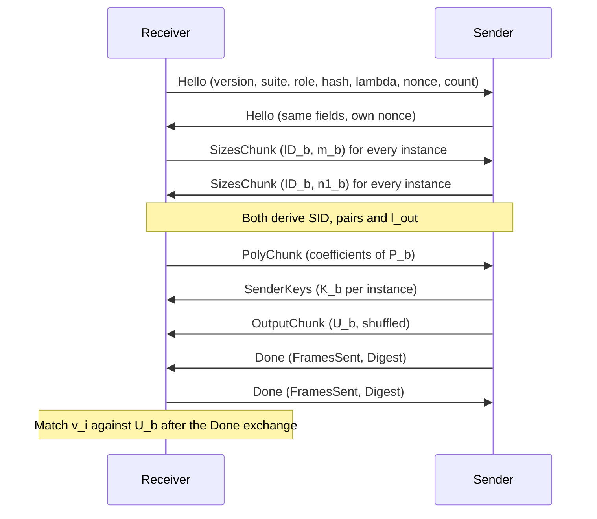
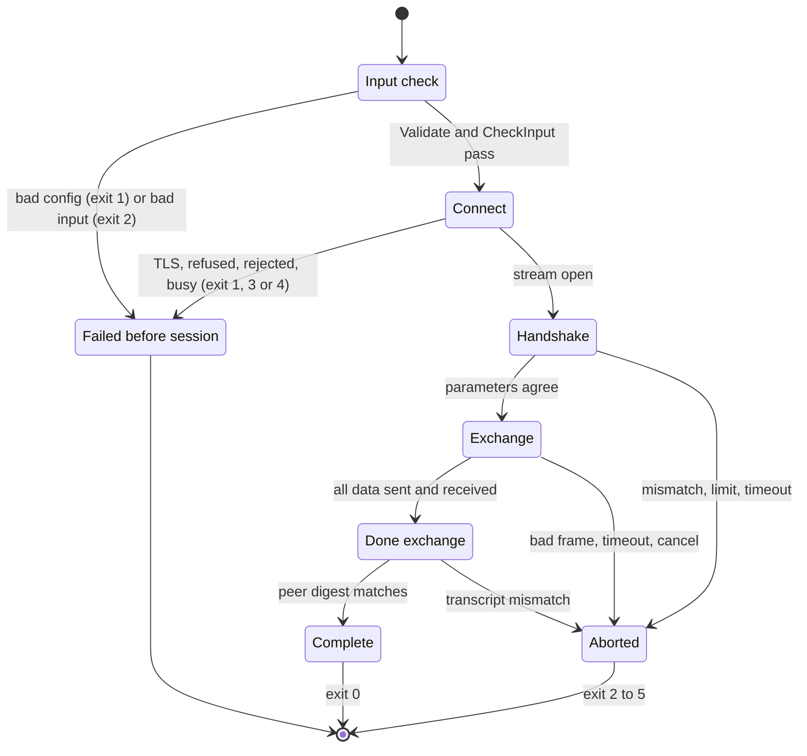
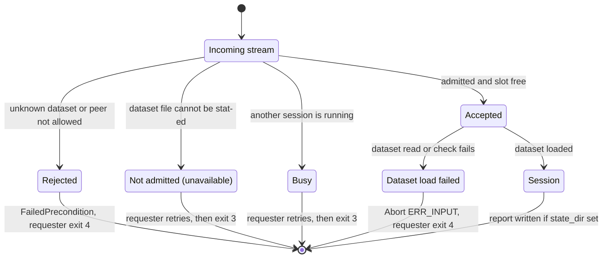

# Domain model and rules

Source references are at commit `4aa7c9f`. If line numbers drift, search for the symbol named next to the reference.

minipsi runs the semi-honest polynomial Diffie-Hellman private set intersection of Rosulek and Trieu (CCS'21) between two hosts. It works over Curve25519 with Elligator2, and the hosts talk gRPC over mutual TLS 1.3. One party is the **receiver** and the other the **sender**. Only the receiver learns the intersection.

This file is the glossary and the rule book: what the words mean, what each party computes and learns, and which invariants the code enforces. It does not repeat execution flows or call graphs. For those, see:

| Topic | Document |
|---|---|
| Step-by-step workflows (one-shot, daemon, batched, results) | [BUSINESS_FLOWS.md](BUSINESS_FLOWS.md) |
| Call graphs per entry point | [CALL_GRAPHS.md](CALL_GRAPHS.md) |
| Entry points and the library seam | [ENTRY_POINTS.md](ENTRY_POINTS.md) |
| One-page overview | [SUMMARY.md](SUMMARY.md) |
| Every configuration key, default and flag | [CONFIGURATION.md](CONFIGURATION.md) |
| Install, run, certificates, exit codes for operators | [README.md](../README.md), [RUNBOOK.md](../RUNBOOK.md) |

## Glossary

| Term | Meaning in this codebase | Source |
|---|---|---|
| Party, role | One side of a session. `RoleSender` = 1, `RoleReceiver` = 2 on the wire. The CLI commands `receiver` and `request` run the receiver; `sender` and each `serve` session run the sender. Either role may listen or dial. | `internal/protocol/messages.go:11` `Role` |
| Receiver | Builds and sends the polynomials, receives the sender's outputs, computes the intersection. The only party that gets a `Result`. | `internal/protocol/receiver.go:40` `RunReceiver` |
| Sender | Sends one key per instance and one output per (padded) item. Its `SenderResult` holds no intersection data. | `internal/protocol/sender.go:28` `RunSender` |
| Item | An opaque byte string. Lines input strips one trailing `\n` and then one `\r`, and skips empty lines. CSV input follows `encoding/csv` quoting. There is no trimming, case folding or Unicode normalisation: `A` and `a` are different items. | `internal/itemio/itemio.go:73` `readLines` |
| Instance | One independent PSI problem: an `ID` (uint32) and the party's items. Matching only happens between items of the same instance ID. | `internal/protocol/session.go:23` `Instance` |
| Standalone mode | A single instance with ID 0 (the default). | `internal/protocol/session.go:22` `Instance` |
| Batched mode | Many instances in one session. Needs `input.batched` with CSV and an `instance_column`; each row's instance ID is a uint32. | `internal/itemio/itemio.go:167` `ParseUint` |
| Dataset | A named sender input file served by the `serve` daemon. A requester picks it by name through the `minipsi-dataset` request header. | `internal/config/serve.go:58` `MetaDataset` |
| Session | One protocol run over one `Conn` (one gRPC stream): handshake, exchange, Done exchange. The daemon runs one session at a time. | `internal/protocol/session.go:222` `run` |
| Nonce | 32 random bytes each party puts in its `Hello`. | `internal/protocol/session.go:364` `nonce` |
| SID | 16-byte session ID: the first 16 bytes of SHA-256 over `lp("minipsi-v1-sid")`, the receiver nonce and the sender nonce, concatenated in that order. Both sides derive the same value; it keys `h_b` and appears in reports. | `internal/hashing/hashing.go:72` `SessionID` |
| Frame | One protocol message. Exactly one body field is set. | `internal/protocol/messages.go:30` `Frame` |
| Hello | First frame from each side: protocol version, suite, role, hash, lambda, nonce, instance count, software version. | `internal/protocol/messages.go:41` `Hello` |
| SizesChunk | A run of `(instance ID, announced size)` pairs. Each side announces its own sizes, ascending by ID. | `internal/protocol/messages.go:54` `SizesChunk` |
| SenderKeys | Sender public keys `K_b` (32 bytes each), with `FirstIndex` = index of the first key in the sorted instance list. | `internal/protocol/messages.go:60` `SenderKeys` |
| PolyChunk | Parts of receiver polynomials: `(InstanceID, Offset, Coeffs)`, 32-byte field elements. | `internal/protocol/messages.go:73` `PolyChunk` |
| OutputChunk | Parts of sender outputs: `(InstanceID, Values)`, `l_out` bytes per output, in shuffled order. | `internal/protocol/messages.go:82` `OutputChunk` |
| Done | Last frame of a successful side: `FramesSent` and a SHA-256 `Digest` over every frame it sent before Done. | `internal/protocol/messages.go:86` `Done` |
| Abort | Terminal frame with a `Code` and a short message. Sent at most once per party. | `internal/protocol/messages.go:92` `Abort` |
| Transcript digest | One SHA-256 per direction over a canonical encoding of every frame except Done and Abort. Checked against the peer's `Done`. Independent of the hash algorithm setting. | `internal/protocol/session.go:334` `checkPeerDone` |
| Receiver padding policy | `PadPolicy{Extra, Min, Multiple}` for the receiver. Default `{1,0,1}` (`DefaultPadPolicy`). Sets `m_b`, the number of points per polynomial. | `internal/protocol/padding.go:24` `DefaultPadPolicy` |
| Sender padding policy | Same struct for the sender. Default `{0,0,1}` (`NoSenderPadding`). Sets `n1_b`, the number of outputs per instance. | `internal/protocol/padding.go:30` `NoSenderPadding` |
| Hash algorithm | Instantiation of `h_b`. `sha256` (value 1, default) or `aes` (value 2, fixed-key AES in MMO mode, commented "experimental" in code). | `internal/hashing/hashing.go:21` `AES` |
| lambda | Statistical security parameter in bits, range 40..256, default 40. | `internal/protocol/session.go:109` `Lambda` |
| l_out | Output length in bytes: `min(32, ceil((lambda + ceil(log2(max(2, pairs)))) / 8))` with `pairs = sum over b of n1_b * m_b`. Example: lambda 40 and 2^20 pairs give 8. | `internal/hashing/hashing.go:59` `OutputLen` |
| Limits | `MaxInstanceSize` (default 2^22), `MaxTotalItems` (2^24), `MaxInstances` (2^24): bounds on what this party processes, for its own input and for what the peer announces. | `internal/protocol/session.go:29` `Limits` |
| max_frame | Largest outgoing frame (default 4 MiB, minimum 64 KiB). The gRPC transport accepts `MaxFrame + 64 KiB`. | `internal/transport/transport.go:118` `msgLimit` |
| Report | Optional JSON run summary (`--report`, or one file per daemon session under `state_dir/reports`). It has no item data. | `internal/report/report.go:14` `Report` |
| Exit code | Process result 0..5, derived from the error type (see [Error model](#error-model)). | `internal/cli/root.go:19` `ExitOK` |

## Protocol at a conceptual level

Notation follows the code. `b` is an instance, `k_b` the receiver's distinct item count, `m_b` its padded point count, `n1_b` the sender's announced output count, and `B` the edwards25519 base point. `H` is hash-to-field and `u(.)` the Montgomery u-coordinate.

**Receiver, per instance `b`** (`internal/protocol/receiver.go:172` `prepare`):

1. Deduplicate its items, then hash each distinct item to the field: `z_i = H(x_i) = SetWideBytes(SHA-512(lp("minipsi-v1-H2F") || x_i))` (`internal/field/field.go:88` `HashToField`).
2. Draw `r_i` and a field element `s_i` such that Elligator2 `Map(s_i) = u(r_i*B + t)` for a random torsion point `t`. `s_i` is uniform in the field (`internal/elligator/elligator.go:194` `EncodeBatch`).
3. Add `m_b - k_b` dummy points with random abscissa and value, then interpolate `P_b` through all `m_b` points `(z_i, s_i)`. `P_b` has `m_b` coefficients.
4. Send the coefficients of `P_b` (PolyChunk).

**Sender, per instance `b`** (`internal/protocol/sender.go:108` `sendKeys`):

1. Draw a fresh scalar `k_b` and send `K_b = k_b*B` (SenderKeys).
2. Shuffle its items together with `n1_b - |X_b|` dummy slots. Real slots get `H(y)`; dummy slots get a random field element (`internal/protocol/sender.go:149` `Shuffle`).
3. For each slot evaluate `e = P_b(z)`, map it to a point `Q` with `MapToPoint`, and compute `k_b * Q` with the cofactor cleared (`internal/group/group.go:138` `MulClearCofactor`).
4. Output `h_b(u(k_b*Q))`, `l_out` bytes each, in shuffled order (OutputChunk). If `MapToPoint` fails (the code's "exceptional" case), the output is random bytes (`internal/protocol/sender.go:276` `exceptional`).

**Receiver, comparison and matching** (`internal/protocol/receiver.go:311` `compareValues`):

1. For each distinct item compute `v_i = h_b(u(r_i*K_b))` (`internal/protocol/receiver.go:353` `cmp`).
2. `U_b` is the set of the sender's outputs for instance `b`. A receiver item is in the intersection when `v_i` equals some value in `U_b`.

`h_b` with `sha256` is `SHA-256(lp("minipsi-v1-h") || sid || be32(b) || u)[0:l_out]`, where `b` is the instance **ID**, not its index (`internal/hashing/hashing.go:142` `Append`). For a sender item `y` equal to `x_i`, `P_b(H(y)) = s_i`, so `u(k_b*Q) = u(r_i*K_b)` and the hashes agree.

### Message order

Both sides send `Hello` and their sizes before reading the peer's, so the handshake is symmetric. For execution detail (goroutines, waves, packing) see [BUSINESS_FLOWS.md](BUSINESS_FLOWS.md).

The arrows within one direction are ordered. The two directions overlap in time: the sender starts evaluating an instance as soon as its `P_b` is complete, and neither side waits for the peer's Done before sending its own. The receiver sends Done before it matches, so the matching time is not visible to the sender (`internal/protocol/receiver.go:134` `Done`).

## What each party learns

The trust model is **semi-honest**. The repository states this in three places:

- `README.md:3`
- `cmd/minipsi/main.go:1`
- `internal/cli/root.go:75` `Short`

The code validates frame structure, ordering, field encodings and keys, and it checks the transcript digest. It does not claim or implement security against a malicious peer. For example, nothing lets the sender check that `P_b` was built honestly.

| Party | Learns from the wire | Does not learn |
|---|---|---|
| Sender | The receiver's `Hello` (including its software version string), instance IDs, `m_b = Count(k_b)` per instance, the `m_b` coefficients of each `P_b`, the receiver's Done, and the text of any Abort | Which items match; the intersection size (the receiver sends Done before matching) |
| Receiver | The sender's `Hello`, `n1_b = OutputCount(n_b)` per instance, `K_b`, `n1_b` shuffled outputs per instance, and the intersection | Sender items outside the intersection |

Notes from the code:

- With the default receiver policy `{1,0,1}`, `m_b = k_b + 1`, so the sender learns `k_b` exactly, including an empty set (`m = 1`) (`internal/protocol/padding.go:22` `DefaultPadPolicy`).
- With the default sender policy, `n1_b` is the exact sender item count (`internal/protocol/padding.go:58` `OutputCount`).
- Abort messages carry only `Msg`, not the wrapped cause (`internal/protocol/errors.go:88` `Abort`). Some messages include local limit values, such as `instance 0: peer size 11 exceeds limit 7`.
- The daemon gives the same answer for an unknown dataset and a requester that is not allowed (`internal/cli/serve.go:135` `Same`). When a dataset fails to load after admission, the requester gets only `sender dataset unavailable` (`internal/cli/serve.go:183` `AbortConn`).

## Business rules and invariants

### Parameter agreement (handshake)

Checked in this order on the peer's `Hello`. Every mismatch is `ERR_PARAM_MISMATCH` unless noted.

| Rule | Source |
|---|---|
| The first frame must be a `Hello` (else `ERR_PROTOCOL`) | `internal/protocol/session.go:395` `Hello` |
| Protocol version must equal 1 | `internal/protocol/session.go:398` `ProtocolVersion` |
| Suite must equal `minipsi-v1-ed25519-ell2` | `internal/protocol/session.go:400` `Suite` |
| The peer must have the other role (two receivers fail) | `internal/protocol/session.go:402` `Role` |
| Hash algorithm must match | `internal/protocol/session.go:404` `Hash` |
| lambda must match | `internal/protocol/session.go:406` `Lambda` |
| Nonce must be 32 bytes (else `ERR_PROTOCOL`) | `internal/protocol/session.go:408` `Nonce` |
| Instance counts must match | `internal/protocol/session.go:410` `InstanceCount` |
| Peer instance IDs must equal ours, position by position | `internal/protocol/session.go:430` `ids` |
| `SoftwareVersion` is not checked; it is only included in the transcript | `internal/protocol/session.go:371` `SoftwareVersion` |

`MaxFrame`, limits, timeouts, worker count and NTT backend are local settings and are not negotiated.

### Instances and limits

| Rule | Source |
|---|---|
| Own instance IDs must be strictly increasing (`ERR_INPUT`) | `internal/protocol/session.go:483` `CodeInput` |
| Own instance count <= `max_instances` (`ERR_LIMIT`) | `internal/protocol/session.go:477` `MaxInstances` |
| Own size per instance <= `max_instance_size`, using `max(raw count, announced count)` (`ERR_LIMIT`) | `internal/protocol/session.go:489` `MaxInstanceSize` |
| Own total <= `max_total_items` (`ERR_LIMIT`) | `internal/protocol/session.go:494` `MaxTotalItems` |
| Each peer-announced size <= `max_instance_size` (`ERR_LIMIT`) | `internal/protocol/session.go:434` `MaxInstanceSize` |
| Running total of peer sizes <= `max_total_items` (`ERR_LIMIT`) | `internal/protocol/session.go:437` `MaxTotalItems` |
| `max_frame` >= 64 KiB | `internal/protocol/session.go:112` `MaxFrame` |
| Config limits must be positive | `internal/config/config.go:219` `limits` |

The CLI runs the own-side checks offline through `CheckInput` before it connects, and maps a failure to exit 2 (`internal/cli/party.go:230` `CheckInput`).

### Padding

| Rule | Source |
|---|---|
| Receiver: `m = roundUp(max(k + Extra, Min), Multiple)`, then `m >= 2` whenever `k >= 1`. `k = 0` can give `m = 0`. The floor exists because `m = 1` gives a constant polynomial that every sender item would match. | `internal/protocol/padding.go:44` `Count` |
| Sender: `n1 = roundUp(max(n + Extra, Min), Multiple)`, no floor; `n` is the raw item count handed to the protocol | `internal/protocol/padding.go:58` `OutputCount` |
| Protocol bounds: `Extra`, `Min` in [0, 2^20], `Multiple` in [1, 2^20] | `internal/protocol/padding.go:35` `validate` |
| Config bounds: `extra >= 0`, `min >= 0`, `multiple >= 1` | `internal/config/config.go:202` `Padding` |
| A sender config must keep `padding` at its default | `internal/config/config.go:209` `Padding` |
| A receiver config must keep `sender_padding` at its default | `internal/config/config.go:212` `SenderPadding` |

### Duplicates and collisions

| Rule | Source |
|---|---|
| The CLI input reader drops exact-byte duplicates within one instance (counted as `dedup_removed`) | `internal/itemio/itemio.go:206` `dup` |
| At the library level the receiver deduplicates internally and reports every copy of a matching item | `internal/protocol/receiver.go:404` `groups` |
| The sender accepts duplicates; equal items give equal outputs | `internal/protocol/sender.go:158` `HashToField` |
| Two distinct receiver items with the same `H` value are rejected with `ERR_INPUT` | `internal/protocol/receiver.go:206` `withDummies` |

### Frame ordering and encoding

| Rule | Source |
|---|---|
| Handshake: `Hello`, then exactly enough `SizesChunk` entries; anything else is `ERR_PROTOCOL` | `internal/protocol/session.go:423` `SizesChunk` |
| Receiver reads: `SenderKeys` in index order until complete, then `OutputChunk`, then `Done` | `internal/protocol/receiver.go:464` `OutputChunk` |
| Each `OutputChunk` part must belong to the current instance | `internal/protocol/receiver.go:471` `InstanceID` |
| Output part length must be a positive multiple of `l_out` within `n1_b * l_out` (`ERR_BAD_ENCODING`) | `internal/protocol/receiver.go:475` `CodeBadEncoding` |
| Sender keys must be canonical, not the identity, and in the prime-order subgroup (`ERR_BAD_POINT`) | `internal/group/group.go:145` `DecodeKey` |
| Sender reads: `PolyChunk` parts in instance order with contiguous offsets from 0, then `Done` | `internal/protocol/sender.go:338` `Offset` |
| Coefficient part length must be a positive multiple of 32 within `m_b` (`ERR_BAD_ENCODING`) | `internal/protocol/sender.go:342` `CodeBadEncoding` |
| Each coefficient must be a canonical field element: 32 bytes, top bit clear, value < p | `internal/field/field.go:38` `Decode` |
| `Done` before all data is `ERR_PROTOCOL` | `internal/protocol/sender.go:355` `Done` |
| A frame of an unexpected type is `ERR_PROTOCOL` | `internal/protocol/receiver.go:491` `unexpected` |
| An `Abort` is accepted at any read point and ends the session as a remote error | `internal/protocol/session.go:323` `Remote` |

### Transcript and Done

- The writer replaces each queued `Done` with the real `FramesSent` and `Digest` (`internal/protocol/session.go:277` `Done`).
- A peer `Done` whose frame count or digest differs from what was received fails with `ERR_PROTOCOL` "transcript mismatch" (`internal/protocol/session.go:336` `checkPeerDone`).
- A side finishes successfully only after it has sent its own Done and checked the peer's.

### Daemon rules

| Rule | Source |
|---|---|
| Dataset names match `^[A-Za-z0-9][A-Za-z0-9._-]{0,63}$` | `internal/config/serve.go:62` `datasetName` |
| A dataset must name a file (not empty, not `-`) | `internal/config/serve.go:186` `path` |
| Empty `allowed_peers` admits every peer. Otherwise a DNS or URI SAN of the client certificate must equal an entry (exact, case-sensitive, CN not used) | `internal/config/serve.go:114` `Allowed` |
| `allowed_peers` entries must not be blank | `internal/config/serve.go:175` `allowed_peers` |
| Unknown dataset and not-allowed peer get the same `Rejection` "dataset not available" | `internal/cli/serve.go:136` `Rejection` |
| The self-declared `minipsi-identity` header is only logged and reported, never used to authorize | `internal/cli/serve.go:178` `MetaIdentity` |
| Admission runs before the busy check; one session at a time | `internal/transport/transport.go:418` `taken` |

## Lifecycle

### Session (one-shot party or daemon session)

On failure the party sends at most one `Abort`, after all its goroutines have stopped, with a 5 second bound (`internal/protocol/session.go:244` `abortFor`). Frames still queued at that point may be lost, and which side reports a mismatch as local and which as remote depends on timing. The receiver closes the transport before it writes its output file (`internal/cli/party.go:304` `closeAll`).

### Daemon admission

| Outcome | gRPC status / frame | Source |
|---|---|---|
| Rejected | `FailedPrecondition` with the rejection message | `internal/transport/transport.go:412` `FailedPrecondition` |
| Not admitted | `Unavailable` "minipsi: request cannot be served now"; logged locally with the real cause | `internal/transport/transport.go:415` `Unavailable` |
| Busy | `Unavailable` "minipsi: busy with another session" | `internal/transport/transport.go:420` `busyMsg` |
| Accepted, dataset fails to load | `Abort{ERR_INPUT, "sender dataset unavailable"}` | `internal/cli/serve.go:183` `AbortConn` |

A failed session never stops the daemon. The dataset is re-read for every session.

## Validation summary

Configuration is validated before any file other than the YAML is read. Every problem is collected and reported together, and all of them exit with code 1. The full key table is in [CONFIGURATION.md](CONFIGURATION.md). The domain-relevant rules are:

| Rule | Source |
|---|---|
| `hash` is `sha256` or `aes` (case-sensitive) | `internal/config/config.go:194` `Hash` |
| `lambda` in [40, 256] | `internal/config/config.go:199` `Lambda` |
| `mode` must be `direct`; `relay` is rejected as not implemented | `internal/config/config.go:252` `validMode` |
| Exactly one of `listen` or `connect` (party commands) | `internal/config/config.go:164` `Listen` |
| `max_frame` >= 64 KiB | `internal/config/config.go:216` `MaxFrame` |
| Daemon: `listen` required, at least one dataset | `internal/config/serve.go:162` `Listen` |

Input files are read after validation. Unreadable input or own-side limit failures exit 2.

## Error model

### Protocol codes

`Code` values travel in `Abort` frames. An `Error` prints as `<local|peer> abort <NAME>: <msg>[: <cause>]` (`internal/protocol/errors.go:48` `Error`). Unknown values print as `ERR_UNKNOWN(n)`.

| Value | Name | Meaning (code comment) | Raised at (example) |
|---|---|---|---|
| 1 | `ERR_PROTOCOL` | Unexpected frame, ordering or length mismatch | `internal/protocol/session.go:336` `CodeProtocol` |
| 2 | `ERR_PARAM_MISMATCH` | Negotiation failure | `internal/protocol/session.go:399` `CodeParamMismatch` |
| 3 | `ERR_BAD_ENCODING` | Non-canonical field element or bad lengths | `internal/protocol/sender.go:347` `CodeBadEncoding` |
| 4 | `ERR_BAD_POINT` | Invalid `K_b` | `internal/protocol/receiver.go:454` `CodeBadPoint` |
| 5 | `ERR_LIMIT` | Size limits exceeded | `internal/protocol/session.go:435` `CodeLimit` |
| 6 | `ERR_TIMEOUT` | No frame within the handshake or phase timeout, or the session deadline passed | `internal/protocol/session.go:315` `CodeTimeout` |
| 7 | `ERR_INTERNAL` | Local failure (randomness, interpolation, recovered panic) | `internal/protocol/session.go:366` `CodeInternal` |
| 8 | `ERR_CANCELLED` | Operator interrupt | `internal/protocol/session.go:266` `CodeCancelled` |
| 9 | `ERR_INPUT` | Local input rejected: non-increasing IDs, hash-to-field collision, daemon dataset unavailable | `internal/protocol/session.go:483` `CodeInput` |

The codes are defined at `internal/protocol/errors.go:13` `CodeProtocol`. The `ERR_INPUT` comment still says "duplicate item", but duplicates are no longer rejected.

### Local, remote and transport failures

| Kind | How it arises | Abort sent? | Source |
|---|---|---|---|
| Local `*Error` | This party detected the problem | Yes, with its code and `Msg`, once the session has started. A `checkOwn` failure (`ERR_LIMIT`, `ERR_INPUT`) is a local `*Error` returned before the session starts and sends nothing | `internal/protocol/errors.go:88` `Abort`, `internal/protocol/receiver.go:57` `checkOwn` |
| Remote `*Error` | The peer sent an `Abort`; `Remote` is true | No | `internal/protocol/session.go:323` `Remote` |
| `TransportError` | The `Conn` failed: peer gone, stream closed | No | `internal/protocol/errors.go:68` `TransportError` |
| Plain error | Anything else on a session goroutine | Yes, as `ERR_INTERNAL` "internal error" | `internal/protocol/errors.go:90` `CodeInternal` |
| Context error | Cancel becomes `ERR_CANCELLED`; parent deadline becomes `ERR_TIMEOUT` | Yes | `internal/protocol/session.go:255` `classify` |

### Exit codes

| Code | Name | Typical causes | Source |
|---|---|---|---|
| 0 | `ExitOK` | Success; daemon shut down by signal | `internal/cli/root.go:20` `ExitOK` |
| 1 | `ExitUsage` | Flags, YAML, validation, TLS files, dev PKI, insecure mode not acknowledged | `internal/cli/root.go:21` `ExitUsage` |
| 2 | `ExitInput` | Unreadable input, own-side limits, local `ERR_INPUT` | `internal/cli/root.go:22` `ExitInput` |
| 3 | `ExitNetwork` | `TransportError`, local `ERR_TIMEOUT`, connect failure, peer busy until retry ran out | `internal/cli/root.go:23` `ExitNetwork` |
| 4 | `ExitProtocol` | Any remote abort, local protocol, mismatch, encoding, point, limit or cancel codes, request rejected, interrupted | `internal/cli/root.go:24` `ExitProtocol` |
| 5 | `ExitInternal` | Local `ERR_INTERNAL`, output or report write failure after success | `internal/cli/root.go:25` `ExitInternal` |

Mapping rules, in order of precedence:

1. An explicit `exitError` code wins (`internal/cli/root.go:43` `exitError`).
2. `TransportError` -> 3 (`internal/cli/root.go:47` `TransportError`).
3. Remote `*Error` -> 4; local `CodeTimeout` -> 3, `CodeInput` -> 2, `CodeInternal` -> 5, any other local code -> 4 (`internal/cli/root.go:55` `CodeTimeout`).
4. `context.Canceled` -> 4; anything else -> 5 (`internal/cli/root.go:65` `Canceled`).
5. `Run` turns a remaining 5 into 1 for cobra usage errors (`internal/cli/root.go:97` `isRunError`).
6. Transport setup errors: insecure not acknowledged -> 1, rejected -> 4, interrupted -> 4, all others -> 3 (`internal/cli/party.go:450` `classifyTransport`).

So a party that times out exits 3, while its peer, which receives `Abort(ERR_TIMEOUT)`, exits 4.

## Confirmed vs uncertain

| Item | Status |
|---|---|
| Relay mode via an "Orchestrator" | Only a reserved name. `mode: relay` is rejected during validation with "not implemented yet" (`internal/config/config.go:257` `relay`). What the Orchestrator would be is **Unknown**. |
| `old_plan/` | A local folder listed in the working-tree `.gitignore`. It is not part of the product, and this document does not describe it. |
| AES hash | Confirmed to work and be tested. It is labelled "experimental" in a code comment only; the reason and the plan for it are **Unknown**. |
| Purpose of the transcript digest | The check is confirmed. The threat it guards against beyond what TLS gives is not stated anywhere: **Unknown**. |
| Timing beyond `m_b` | Receiver work before Done partly scales with the distinct count `k_b`, not only `m_b`. Whether this was considered acceptable is **Unknown**. |
| Security against a malicious peer | Not claimed anywhere in the repository. The documented model is semi-honest. |
