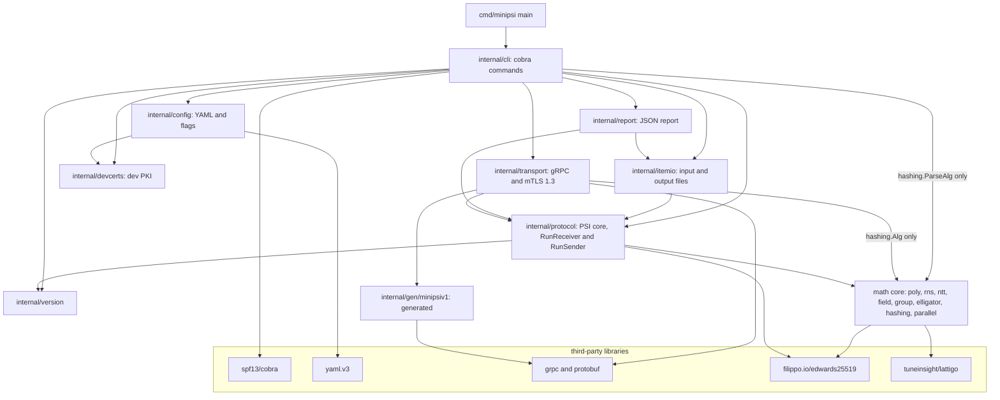
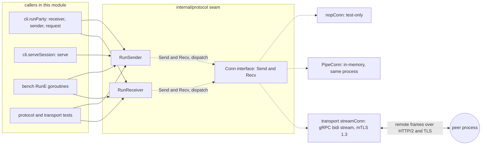

# minipsi: entry points

Companion document: [CALL_GRAPHS.md](CALL_GRAPHS.md) (call graphs CG-01 to CG-11).

**How this was produced.** This is static analysis of commit `4aa7c9f` (module `github.com/XSpring/minipsi`). A machine call graph was built from the `main` of `cmd/minipsi` with `golang.org/x/tools/cmd/callgraph` (VTA, plus a static graph). One tracer agent per subsystem (CLI bootstrap, party commands, serve, transport, protocol session, protocol roles, math core, I/O + PKI + tests) proposed entry points. Their output was not adversarially verified, so every item kept here was re-read in the source. Every `path:line` in this file was then checked mechanically against the tree. VTA does not see calls that a framework makes into our code (cobra into `RunE`, gRPC into the service handler, the Go runtime into `init`). Those edges are labelled *framework* and confirmed by reading the registration code. The help and completion behaviour was also observed by running `bin/minipsi`, whose `version` output reports commit `4aa7c9f`.

**Call kinds used in this document**

| Kind | Meaning |
|---|---|
| direct | a static Go call |
| dispatch | a call through an interface method or a func value (VTA marks it `dynamic`) |
| goroutine | a `go` statement |
| framework | cobra, gRPC, crypto/tls or the Go runtime calls our code |
| remote | a message that crosses the network to the peer process; never a local call |
| generated | code in `internal/gen/minipsiv1`, generated from `api/minipsi/v1/psi.proto` |
| test-only | reached only from `_test.go` files, the `e2e` build tag or scripts |

<a id="overview"></a>
## Repository overview

### Languages and frameworks

| Area | What is used | Where it shows |
|---|---|---|
| Language | Go. `go.mod` declares `go 1.26.0`. CI and the Docker build use Go 1.27.2 | .github/workflows/ci.yml:20, Dockerfile:6 |
| CLI | `github.com/spf13/cobra` v1.10.2 with `spf13/pflag` | internal/cli/root.go:73 |
| RPC | `google.golang.org/grpc` v1.84.0 and `google.golang.org/protobuf` v1.36.12. The schema is api/minipsi/v1/psi.proto:10. The generated code lives in `internal/gen/minipsiv1` and is regenerated with buf (`make proto`) | Makefile:64-66 |
| Transport security | `crypto/tls`: TLS 1.3 with client certificates on both sides | internal/transport/tls.go:52, internal/transport/tls.go:65 |
| Configuration | `gopkg.in/yaml.v3`. Unknown keys are rejected | internal/config/config.go:134-135 |
| Curve and field | `filippo.io/edwards25519` v1.2.0 (Edwards25519 and GF(2^255-19)) | internal/field/field.go:1 |
| NTT backend | `github.com/tuneinsight/lattigo/v6` v6.2.0, used only with `--ntt-backend lattigo` (the default is `native`) | internal/rns/lattigo.go:8 |
| Logging | `log/slog`, text or JSON, written to stderr | internal/cli/party.go:462 |

### Application type and execution model

- **One static binary**, `minipsi`, built with `CGO_ENABLED=0` (Makefile:27, Dockerfile:13-15). The container image runs it as ENTRYPOINT on a distroless non-root base (Dockerfile:17-21).
- **A two-party network protocol.** It implements semi-honest polynomial Diffie-Hellman PSI (Rosulek-Trieu, CCS'21) over Curve25519 with Elligator2. Two processes, normally on two hosts, exchange one bidirectional gRPC stream over mutual TLS 1.3. Only the receiver learns the intersection. `SenderResult` carries only the session ID, the output length and statistics (internal/protocol/sender.go:19-24).
- **Two process shapes:**
  1. **One-shot party process.** `receiver`, `sender` and `request` read their input, run one session and exit with a code from 0 to 5 (internal/cli/root.go:19-26).
  2. **Daemon.** `serve` listens, admits requests for named datasets and runs them as sender one at a time until SIGINT or SIGTERM.
- **Network role and PSI role are independent.** In one-shot mode, either party can `--listen` or `--connect` (internal/cli/party.go:79-80). The roles are announced in `Hello` (api/minipsi/v1/psi.proto:8-9). With `serve` and `request`, the daemon is always the gRPC server and the PSI sender. The requester is the gRPC client and the receiver.
- **Relay mode is reserved.** `--mode relay` or `mode: relay` (relay via an Orchestrator) is rejected by configuration validation (internal/config/config.go:256-257). `direct` is the only working mode.
- **`bench`** runs both parties in one process over an in-memory pipe. It uses no network.

### Modules

| Package | Responsibility | Key files |
|---|---|---|
| `cmd/minipsi` | Process entry. Forwards to `cli.Run` and exits with its code | `main.go` |
| `internal/cli` | The cobra command tree, exit-code mapping, and orchestration of one-shot runs, the daemon, bench and certs | `root.go`, `party.go`, `serve.go`, `tools.go` |
| `internal/config` | The party and daemon configuration model (YAML plus flags), defaults and validation, including the relay rejection | `config.go`, `serve.go` |
| `internal/itemio` | Reads the input (lines or CSV, file or stdin, batched instances), writes the result, writes files atomically | `itemio.go` |
| `internal/report` | The JSON run report | `report.go` |
| `internal/devcerts` | The throw-away CA and leaf certificates (`certs dev`) and the shared dev PKI behind `--dev` | `devcerts.go`, `devpki.go` |
| `internal/transport` | The gRPC server and client, the mTLS 1.3 configuration, the stream adapter to `protocol.Conn`, and Frame/protobuf conversion | `transport.go`, `tls.go`, `convert.go` |
| `internal/gen/minipsiv1` | Generated protobuf and gRPC code for service `minipsi.v1.PSI` | `psi.pb.go`, `psi_grpc.pb.go` |
| `internal/protocol` | **The PSI core and library seam**: `RunReceiver`, `RunSender`, `Conn`, `Frame`, `Config`, `Instance`, results, errors, padding | `session.go`, `receiver.go`, `sender.go`, `conn.go`, `messages.go`, `errors.go`, `padding.go` |
| `internal/poly` | Polynomial arithmetic: interpolation, subproduct trees, multipoint evaluation | `arith.go`, `tree.go`, `evaluator.go` |
| `internal/rns`, `internal/ntt` | RNS/CRT polynomial multiplication with the native or lattigo NTT backend | `rns.go`, `native.go`, `lattigo.go`, `multiplier.go`, `ntt.go` |
| `internal/field`, `internal/group`, `internal/elligator` | GF(2^255-19), Edwards25519 helpers (key validation, fixed-base tables), the Elligator2 map | `field.go`, `group.go`, `fixedbase.go`, `elligator.go` |
| `internal/hashing` | Hash algorithm selection (SHA-256 or AES), the session ID, the comparison hash | `hashing.go` |
| `internal/parallel` | A bounded, cancellable parallel loop | `parallel.go` |
| `internal/version` | Build stamps (set by `-ldflags`), the protocol version and the suite name | `version.go` |
| `test/e2e`, `scripts` | Process-level tests (build tag `e2e`) and a shell smoke test | `e2e_test.go`, `e2e.sh` |

### Package layering

Arrows are Go imports, taken from `go list` on the module. The math core is collapsed into one node.



### Startup mechanism

1. **Package initialization (framework, Go runtime).** Imported packages initialize first, including the `func init` bodies in internal/rns/rns.go:90, internal/group/group.go:35, internal/group/fixedbase.go:39 and the generated internal/gen/minipsiv1/psi.pb.go:960. See [EP-12](#ep-12).
2. **`main.main`** (cmd/minipsi/main.go:11) calls `cli.Run(context.Background(), os.Args[1:], os.Stdout, os.Stderr)` (cmd/minipsi/main.go:12).
3. **`cli.Run`** (internal/cli/root.go:88) builds the command tree with `NewRoot` (internal/cli/root.go:89), sets the arguments and calls cobra's `ExecuteContext` (internal/cli/root.go:91).
4. **cobra** parses the flags and calls the selected command's `RunE` or `Run` (framework).
5. **`RunE`** loads and validates the configuration. The party and serve commands then install a SIGINT/SIGTERM context ([EP-11](#ep-11)) and start the run.
6. The returned error is mapped to an exit code (internal/cli/root.go:95-101), and `main` passes it to `os.Exit` (cmd/minipsi/main.go:12).

### Configuration and environment

- **Flags.** Each command has its own flags (internal/cli/party.go:54, internal/cli/serve.go:42-56).
- **YAML file.** `--config FILE` is optional. The party form is loaded at internal/cli/party.go:159 and the daemon form at internal/cli/serve.go:60.
- **Precedence.** A flag that is explicitly set overrides the file, and unset flags do not (internal/cli/party.go:167-171, internal/cli/serve.go:64-81).
- **Defaults.** Party defaults are at internal/config/config.go:113 and daemon defaults at internal/config/serve.go:68. For example: input `-` (stdin) in `lines` format, output `-` (stdout), hash `sha256`, lambda 40, `max_frame` 4 MiB, handshake timeout 30 s, phase timeout 10 min, memory limit 2 GiB.
- **Build-time stamps.** `-ldflags -X` sets `version.Version`, `Commit` and `Date` (Makefile:7-8, internal/version/version.go:5-9).

| Environment variable | Read at | Effect |
|---|---|---|
| `MINIPSI_I_UNDERSTAND_INSECURE` | internal/transport/transport.go:40, internal/transport/transport.go:94 | Must be `1` for `--insecure-dev` (plaintext h2c). Otherwise the transport returns `ErrInsecureNotAcknowledged`, which exits with 1 (internal/cli/party.go:452-453) |
| `GOMEMLIMIT` | internal/cli/party.go:475 | If it is set and no memory limit was given explicitly, the CLI leaves the Go runtime's own limit in place. Otherwise the CLI calls `debug.SetMemoryLimit` (internal/cli/party.go:483) |
| `MINIPSI_DEV_PKI` | internal/devcerts/devpki.go:17, internal/devcerts/devpki.go:32 | Sets the directory of the shared dev PKI used by `--dev` |
| `XDG_STATE_HOME` | internal/devcerts/devpki.go:35 | Dev PKI fallback: `$XDG_STATE_HOME/minipsi/dev-pki` |
| `HOME` (through `os.UserHomeDir`) | internal/devcerts/devpki.go:38 | Last fallback: `~/.local/state/minipsi/dev-pki` |
| `GOMAXPROCS` (Go runtime) | internal/parallel/parallel.go:13 | `--workers 0` means `runtime.GOMAXPROCS(0)` |

### Integrations

- **No database, cache or message queue.** `go.mod` lists no such module, and `go list -deps ./cmd/minipsi` contains none.
- **Network.** gRPC over TCP between the two parties:
  - Server side: `net.Listen` (internal/transport/transport.go:361), `grpc.NewServer` (internal/transport/transport.go:377), `pb.RegisterPSIServer` (internal/transport/transport.go:385).
  - Client side: `grpc.NewClient` (internal/transport/transport.go:503), `pb.NewPSIClient` (internal/transport/transport.go:507).
  - Mutual TLS 1.3 is mandatory unless `--insecure-dev` is used with the environment variable above (internal/transport/transport.go:86-109).
  - Headers: request metadata `minipsi-dataset` and `minipsi-identity` (internal/config/serve.go:58-59), and the server's `minipsi-session` accept header (internal/transport/transport.go:37).
  - There are no other outbound services and no HTTP endpoints.
- **Filesystem.**
  - Input files or stdin (internal/itemio/itemio.go:47).
  - The result file or stdout, written atomically (internal/itemio/itemio.go:231).
  - JSON reports: `--report`, and `serve --state-dir` writes `reports/` (internal/itemio/itemio.go:300).
  - PEM certificate, key and CA files (internal/transport/tls.go:19).
  - The dev PKI directory (internal/devcerts/devpki.go:50) and the `certs dev --out` directory (internal/devcerts/devcerts.go:127).

<a id="inventory"></a>
## Entry point inventory

Each row is one execution path or trigger. Paths that several tracers reported were merged into one row: for example, `certs dev` (CLI bootstrap and PKI tracers), `RunReceiver`/`RunSender` (session and roles tracers), the `streamConn` goroutines (transport and session tracers) and `scripts/e2e.sh` (four tracers). The tracers also labelled internal helpers as library API: `itemio.ReadFile`/`WriteResult`/`WriteFileAtomic`, `devcerts.EnsureDev`, and the functions in poly, rns, elligator, group and hashing. These helpers run only beneath the rows below, so they are described in the EP section that calls them and in [CALL_GRAPHS.md](CALL_GRAPHS.md), not as rows of their own.

| Entry Point | Category | Trigger | File and Line | Confidence | Details |
|---|---|---|---|---|---|
| **Application and CLI** | | | | | |
| `main.main` | application | exec of the binary (`bin/minipsi`, or the container ENTRYPOINT) | cmd/minipsi/main.go:11 | confirmed | [EP-01](#ep-01), [CG-01](CALL_GRAPHS.md#cg-01) |
| `cli.Run` and the root command (`cli.NewRoot`) | CLI dispatch | called by `main`, and by CLI tests | internal/cli/root.go:88, internal/cli/root.go:72 | confirmed | [EP-02](#ep-02), [CG-01](CALL_GRAPHS.md#cg-01) |
| `minipsi receiver` | CLI command (cobra `RunE`) | operator, one-shot | internal/cli/party.go:141, internal/cli/party.go:156 | confirmed | [EP-03](#ep-03), [CG-02](CALL_GRAPHS.md#cg-02) |
| `minipsi sender` | CLI command (cobra `RunE`) | operator, one-shot | internal/cli/party.go:141, internal/cli/party.go:156 | confirmed | [EP-03](#ep-03), [CG-02](CALL_GRAPHS.md#cg-02) |
| `minipsi request` | CLI command (cobra `RunE`) | operator, one-shot receiver against a daemon | internal/cli/party.go:141, internal/cli/party.go:73-77 | confirmed | [EP-04](#ep-04), [CG-03](CALL_GRAPHS.md#cg-03) |
| `minipsi serve` | CLI command, daemon | operator or service manager | internal/cli/serve.go:27, internal/cli/serve.go:57 | confirmed | [EP-05](#ep-05), [CG-04](CALL_GRAPHS.md#cg-04) |
| `minipsi bench` | CLI command | operator, local capacity planning | internal/cli/tools.go:80, internal/cli/tools.go:93 | confirmed | [EP-09](#ep-09), [CG-10](CALL_GRAPHS.md#cg-10) |
| `minipsi certs dev` | CLI command | operator or test scripts | internal/cli/tools.go:29, internal/cli/tools.go:36 | confirmed | [EP-10](#ep-10), [CG-11](CALL_GRAPHS.md#cg-11) |
| `minipsi certs` (group with no `Run`; prints help) | CLI command group | operator | internal/cli/tools.go:22 | confirmed | [EP-10](#ep-10), [EP-14](#ep-14) |
| `minipsi version` | CLI command (`Run`) | operator, CI docker smoke test | internal/cli/root.go:112 | confirmed | [EP-14](#ep-14), [CG-01](CALL_GRAPHS.md#cg-01) |
| `minipsi help`, `-h`, `--help`, and `minipsi` with no arguments | cobra built-in (framework) | operator | internal/cli/root.go:73 (the root has no `Run`) | confirmed (code, and observed in the binary) | [EP-14](#ep-14), [CG-01](CALL_GRAPHS.md#cg-01) |
| `minipsi completion bash/zsh/fish/powershell` and hidden `__complete` | cobra built-in (framework) | shell completion | added by cobra to the root at internal/cli/root.go:73 | confirmed (observed in the binary) | [EP-14](#ep-14) |
| `--mode relay` / `mode: relay` (relay via an Orchestrator) | reserved, **rejected** | `request` and `serve` flag, or the YAML `mode` key | internal/config/config.go:256-257 | confirmed | [EP-04](#ep-04), [EP-05](#ep-05) |
| **Network handler** | | | | | |
| gRPC `minipsi.v1.PSI/Session`, implemented by `(*transport.Server).Session` | RPC handler (framework, generated) | the peer process opens the bidi stream (remote) | internal/transport/transport.go:396, internal/gen/minipsiv1/psi_grpc.pb.go:100 | confirmed | [EP-06](#ep-06), [CG-05](CALL_GRAPHS.md#cg-05) |
| Daemon admission callback (`Options.Admit` closure in `runServe`) | callback (dispatch) | each incoming `Session` RPC on `serve` | internal/cli/serve.go:131, invoked at internal/transport/transport.go:408 | confirmed | [EP-05](#ep-05), [EP-06](#ep-06), [CG-04](CALL_GRAPHS.md#cg-04) |
| TLS `VerifyConnection` peer-name pin (`pinPeer`) | callback (framework: crypto/tls) | TLS handshake, when `--peer-name` is set | internal/transport/tls.go:76 | confirmed | [EP-06](#ep-06), [CG-05](CALL_GRAPHS.md#cg-05) |
| **Library API** (all under `internal/`, so importable only from inside this module) | | | | | |
| `protocol.RunReceiver` | library API | Go call | internal/protocol/receiver.go:40 | confirmed | [EP-07](#ep-07), [CG-06](CALL_GRAPHS.md#cg-06), [CG-07](CALL_GRAPHS.md#cg-07) |
| `protocol.RunSender` | library API | Go call | internal/protocol/sender.go:28 | confirmed | [EP-08](#ep-08), [CG-06](CALL_GRAPHS.md#cg-06), [CG-08](CALL_GRAPHS.md#cg-08) |
| `protocol.CheckInput` | library API (no network) | Go call before connecting | internal/protocol/padding.go:99 | confirmed | [EP-07](#ep-07), [seam](#seam) |
| `protocol.AbortConn` | library API | Go call on a session that never started | internal/protocol/errors.go:97 | confirmed | [EP-05](#ep-05), [seam](#seam) |
| `protocol.Pipe` / `*protocol.PipeConn` | library API (in-memory `Conn`) | Go call | internal/protocol/conn.go:27 | confirmed | [EP-09](#ep-09), [seam](#seam) |
| `transport.Listen` / `Serve` / `Dial`, plus `(*Server).Accept`/`Close` and `(*Session).Conn`/`Close` | library API (network) | Go call from `internal/cli` and the transport tests | internal/transport/transport.go:357, internal/transport/transport.go:369, internal/transport/transport.go:488 | confirmed | [EP-06](#ep-06), [CG-05](CALL_GRAPHS.md#cg-05) |
| **Background goroutines and signals** | | | | | |
| SIGINT/SIGTERM for `receiver`, `sender` and `request` | signal handler (`signal.NotifyContext`) | OS signal | internal/cli/party.go:181 | confirmed | [EP-11](#ep-11), [CG-02](CALL_GRAPHS.md#cg-02) |
| SIGINT/SIGTERM for `serve` | signal handler (`signal.NotifyContext`) | OS signal | internal/cli/serve.go:95 | confirmed | [EP-11](#ep-11), [CG-04](CALL_GRAPHS.md#cg-04) |
| gRPC serve loop | goroutine | `transport.Serve` | internal/transport/transport.go:386 | confirmed | [EP-13](#ep-13), [CG-05](CALL_GRAPHS.md#cg-05) |
| `streamConn.pump` and `streamConn.sendLoop` | goroutines (2 per stream) | `newStreamConn` on accept or dial | internal/transport/transport.go:161-162 | confirmed | [EP-13](#ep-13), [CG-05](CALL_GRAPHS.md#cg-05) |
| `Server.Close` graceful-stop helper | goroutine (short-lived, at most 5 s) | `(*Server).Close` | internal/transport/transport.go:472 | confirmed | [EP-13](#ep-13), [CG-05](CALL_GRAPHS.md#cg-05) |
| Protocol session goroutines (`taskGroup.Go`): writer, role body, receiver prepare, receiver reader, sender reader | goroutines | `RunReceiver` or `RunSender` | internal/protocol/session.go:543 | confirmed | [EP-13](#ep-13), [CG-06](CALL_GRAPHS.md#cg-06) |
| Math worker goroutines (`parallel.For`, `rns.perPrime`, `poly.Arith.both`) | goroutines (per call) | protocol computation | internal/parallel/parallel.go:63, internal/rns/native.go:41, internal/poly/arith.go:49 | confirmed | [EP-13](#ep-13), [CG-09](CALL_GRAPHS.md#cg-09) |
| bench receiver and sender goroutines | goroutines | `bench` `RunE` | internal/cli/tools.go:113, internal/cli/tools.go:118 | confirmed | [EP-09](#ep-09), [CG-10](CALL_GRAPHS.md#cg-10) |
| gRPC-internal goroutines (HTTP/2 readers, keepalive, and others) | goroutines (third-party) | `grpc.NewServer` / `grpc.NewClient` | not enumerated (inside the grpc module) | likely | [EP-13](#ep-13) |
| **Init** | | | | | |
| `internal/rns` `init`: CRT/Garner constants | package init (framework) | process start | internal/rns/rns.go:90 | confirmed | [EP-12](#ep-12), [CG-09](CALL_GRAPHS.md#cg-09) |
| `internal/group` `init`: 8^-1 mod l and the 8-torsion table | package init (framework) | process start | internal/group/group.go:35 | confirmed | [EP-12](#ep-12), [CG-09](CALL_GRAPHS.md#cg-09) |
| `internal/group` `init`: Edwards constant 2d | package init (framework) | process start | internal/group/fixedbase.go:39 | confirmed | [EP-12](#ep-12), [CG-09](CALL_GRAPHS.md#cg-09) |
| `internal/gen/minipsiv1` `init`: protobuf descriptor registration | package init (generated) | process start | internal/gen/minipsiv1/psi.pb.go:960 | confirmed | [EP-12](#ep-12) |
| Package-level variable initializers (regexps, hash domain separators, AES key, Elligator constants, NTT primes) | package init (framework) | process start | internal/config/serve.go:62, internal/devcerts/devpki.go:27, internal/hashing/hashing.go:51-54, internal/elligator/elligator.go:24, internal/rns/rns.go:28 | confirmed | [EP-12](#ep-12) |
| Third-party package `init` (cobra, grpc, protobuf, lattigo and others) | package init (third-party) | process start | not enumerated | likely | [EP-12](#ep-12) |
| **Test-only** | | | | | |
| e2e `TestMain` and the process tests (build tag `e2e`) | test-only | `go test -tags e2e ./test/e2e` (`make e2e`) | test/e2e/e2e_test.go:27 | confirmed | [EP-15](#ep-15) |
| `scripts/e2e.sh` smoke test | test-only | `make e2e`, CI | scripts/e2e.sh:15 | confirmed | [EP-15](#ep-15) |
| Fuzz targets (6) | test-only | `go test -fuzz` (`make fuzz-smoke`) | internal/protocol/fuzz_test.go:90, internal/protocol/fuzz_test.go:98 (four more in [EP-15](#ep-15)) | confirmed | [EP-15](#ep-15) |
| Go benchmarks (48 `Benchmark*` functions in the tests of field, group, elligator, hashing, ntt, rns, poly and protocol) | test-only | `go test -bench` (`make bench`; not the `minipsi bench` command) | Makefile:61-62, internal/protocol/protocol_test.go:856 | confirmed | [DEVELOPMENT.md](DEVELOPMENT.md#benchmarks) |
| In-process test harnesses (CLI `Run`, protocol `runPair` and `fakePeer`, transport sessions) | test-only | `go test ./...` | internal/cli/cli_test.go:68, internal/protocol/protocol_test.go:62, internal/transport/transport_test.go:124 | confirmed | [EP-15](#ep-15) |
| **Build and deploy** | | | | | |
| Makefile targets (`build`, `e2e`, `fuzz-smoke`, `proto`, `check`, and others) | build/deploy | developer, CI | Makefile:26, Makefile:80 | confirmed | [EP-15](#ep-15) |
| Container `ENTRYPOINT ["/usr/local/bin/minipsi"]` | build/deploy | `docker run` | Dockerfile:21 | confirmed | [EP-01](#ep-01), [EP-15](#ep-15) |
| GitHub Actions CI (lint, test, vuln, proto, e2e, fuzz, docker) | build/deploy | push to `main`, pull request, manual dispatch | .github/workflows/ci.yml:6-10 | confirmed | [EP-15](#ep-15) |

**Totals: 45 rows. 43 confirmed, 2 likely, 0 unresolved.** Group label rows are not counted. The two *likely* rows are third-party internals that exist but were not enumerated.

<a id="ep-01"></a>
### EP-01 Process start: main

- **Symbol:** `main.main` (package `main`, `cmd/minipsi`), at cmd/minipsi/main.go:11.
- **Trigger and input:** The binary is executed, either `bin/minipsi` from `make build` (Makefile:26-27) or the image's `ENTRYPOINT` (Dockerfile:21). The input is `os.Args[1:]`, `os.Stdout`, `os.Stderr` and `context.Background()` as the root context.
- **Validation:** None in `main`.
- **Orchestration:** One line: `os.Exit(cli.Run(...))` (cmd/minipsi/main.go:12).
- **Downstream:** `cli.Run` is called directly at cmd/minipsi/main.go:12 and is the only VTA edge from `main` into a module function. `context.Background` and `os.Exit` are called on the same line.
- **Outputs and side effects:** The process exit status is the value `cli.Run` returns. The codes are 0 OK, 1 usage or configuration, 2 input, 3 network, 4 protocol, abort or interrupt, and 5 internal (internal/cli/root.go:19-26). `main` registers no deferred work, and an unrecovered panic ends the process with the Go runtime's status 2. The protocol task group recovers panics only on its own goroutines (internal/protocol/session.go:546) and turns them into `CodeInternal` (exit 5). A panic in a `parallel.For` worker (internal/parallel/parallel.go:63) or a `poly.Arith` fork (internal/poly/arith.go:49) is not recovered.
- **Call graph:** [CG-01](CALL_GRAPHS.md#cg-01).

<a id="ep-02"></a>
### EP-02 CLI dispatch: cli.Run and the root command

- **Symbols:**
  - `cli.Run(ctx, args, stdout, stderr) int` at internal/cli/root.go:88.
  - `cli.NewRoot(stdout, stderr) *cobra.Command` at internal/cli/root.go:72.
  - The root `cobra.Command{Use: "minipsi"}` at internal/cli/root.go:73.
- **Trigger and input:** It is called by `main` (cmd/minipsi/main.go:12) and by the CLI tests (internal/cli/cli_test.go:68) with an argument vector.
- **Validation:**
  - cobra parses the flags and resolves the subcommand. Unknown commands, unknown flags and bad flag values come back as errors.
  - `SilenceUsage` and `SilenceErrors` are set (internal/cli/root.go:76-77), so `Run` prints the single line `minipsi: <error>` itself (internal/cli/root.go:101).
- **Orchestration:**
  1. Registers the subcommands with `root.AddCommand` (internal/cli/root.go:81-83): `receiver`, `sender` and `request` (all from `newPartyCmd`), then `serve`, `certs`, `bench` and `version`. cobra adds `help` and `completion` itself.
  2. `SetArgs` (internal/cli/root.go:90).
  3. `ExecuteContext(ctx)` (internal/cli/root.go:91). cobra then calls the selected `RunE` or `Run` (framework; VTA has no edge for this).
- **Exit-code mapping:** `exitCode` (internal/cli/root.go:38-69) maps errors as follows:

  | Error | Exit code |
  |---|---|
  | `*exitError` | its own code |
  | `*protocol.TransportError` | 3 |
  | remote `*protocol.Error` | 4 |
  | local `*protocol.Error` with `CodeTimeout` | 3 |
  | local `*protocol.Error` with `CodeInput` | 2 |
  | local `*protocol.Error` with `CodeInternal` | 5 |
  | any other local `*protocol.Error` | 4 |
  | `context.Canceled` | 4 |
  | anything else | 5 |

  `Run` then turns an unclassified error that is not a run error into 1 (usage), using `isRunError` (internal/cli/root.go:95-99, internal/cli/root.go:106).
- **Downstream (direct):**
  - `NewRoot` at internal/cli/root.go:89.
  - `exitCode` at internal/cli/root.go:95.
  - `isRunError` at internal/cli/root.go:97.
  - The constructors `newPartyCmd`, `newServeCmd`, `newCertsCmd`, `newBenchCmd` and `newVersionCmd` at internal/cli/root.go:81-83.
- **Outputs:** The exit code, and one error line on stderr.
- **Call graph:** [CG-01](CALL_GRAPHS.md#cg-01).

<a id="ep-03"></a>
### EP-03 One-shot party commands: receiver and sender

- **Symbols:**
  - `cli.newPartyCmd(cmdName, ...)` at internal/cli/party.go:141, called with `"receiver"` and `"sender"` (internal/cli/root.go:81).
  - The cobra command at internal/cli/party.go:145.
  - The `RunE` closure at internal/cli/party.go:156.
  - The run itself, `cli.runParty`, at internal/cli/party.go:237.
- **Trigger and input:** `minipsi receiver` or `minipsi sender`, with the flags from `partyFlags` (internal/cli/party.go:54) and an optional `--config` YAML file (internal/cli/party.go:154).
  - Network flags: exactly one of `--listen ADDR` or `--connect ADDR` (internal/cli/party.go:79-80).
  - Input: `--input` (`-` means stdin), `--format lines/csv`, `--batched`.
  - TLS material: `--cert/--key/--ca`, `--dev` or `--insecure-dev`.
  - Receiver only: `--output`.
- **Validation and authorization:**
  1. YAML load with unknown keys rejected (internal/cli/party.go:159). The role in the file must match the command (internal/cli/party.go:163-165).
  2. Explicit flags are copied over the file values (internal/cli/party.go:167-171). `request` settings are refused for these commands (internal/cli/party.go:175-177).
  3. `Config.Validate` (internal/cli/party.go:178, internal/config/config.go:156) checks:
     - exactly one of listen or connect (internal/config/config.go:164);
     - the mode, where relay is rejected (internal/config/config.go:167);
     - the input format, hash, lambda, padding, limits, timeouts and log settings;
     - TLS (internal/config/config.go:215). `--dev` is loopback only (internal/config/config.go:272-273).
  4. The run then checks the input before any network activity: `itemio.ReadFile` (internal/cli/party.go:208) and `protocol.CheckInput` (internal/cli/party.go:230). Problems exit with 2.
  5. Authorization is peer authentication by mTLS 1.3:
     - A listening party requires and verifies the client certificate (internal/transport/tls.go:55-56).
     - A connecting party verifies the server against the CA and the server name (internal/transport/tls.go:68-69).
     - `--peer-name` pins a DNS or URI SAN (internal/transport/tls.go:76).
- **Orchestration (`runParty`):**
  1. Logger and memory limit (internal/cli/party.go:238-239). Report setup, plus a deferred writer that always writes `--report` (internal/cli/party.go:241-258).
  2. Input: `loadInput` (internal/cli/party.go:261).
  3. `--dev` resolution: `resolveDev` (internal/cli/party.go:271).
  4. TLS and transport options: `transportOptions` (internal/cli/party.go:274).
  5. Optional overall `--timeout` (internal/cli/party.go:278-282).
  6. `openSession` (internal/cli/party.go:283). It either listens and accepts exactly one session (internal/cli/party.go:430, internal/cli/party.go:435) or dials with optional `--connect-retry` (internal/cli/party.go:443).
  7. The protocol run:
     - sender: `protocol.RunSender` (internal/cli/party.go:293);
     - receiver: `protocol.RunReceiver` (internal/cli/party.go:301), then the session is closed before the result is written (internal/cli/party.go:304), then `itemio.WriteResult` (internal/cli/party.go:311).
- **Downstream (direct):** `loadInput`, `resolveDev`, `transportOptions`, `openSession`, `protocol.RunSender`, `protocol.RunReceiver` and `itemio.WriteResult` at the lines above. Transport errors are mapped by `classifyTransport` (internal/cli/party.go:450-460): rejected and interrupted give 4, insecure-not-acknowledged gives 1, anything else gives 3.
- **Outputs and side effects:**
  - Network: a TCP listen or dial.
  - Receiver: the intersection goes to `--output` or stdout. Lines in standalone mode; `instance_id,item` CSV rows in batched mode (internal/itemio/itemio.go:228-231).
  - Report: the optional JSON `--report` (internal/cli/party.go:250-251).
  - Logs on stderr, and the exit code.
  - The dev PKI is created on first `--dev` use ([EP-10](#ep-10)).
- **Call graph:** [CG-02](CALL_GRAPHS.md#cg-02). Signals: [EP-11](#ep-11).

<a id="ep-04"></a>
### EP-04 request: receiver against a serve daemon

- **Symbol:** The same `newPartyCmd`/`runParty` code path as EP-03, created with `"request"` (internal/cli/root.go:82). `partyRole` maps `request` to the PSI role `receiver` (internal/cli/party.go:42-47).
- **Trigger and input:** `minipsi request --peer ADDR --dataset NAME [--identity ID] [--mode direct]` (internal/cli/party.go:73-77), plus the receiver's input, output and TLS flags. The default `--connect-retry` is 2 minutes, because a busy daemon refuses new sessions until its running one ends (internal/cli/party.go:129-139).
- **Validation:**
  - `--dataset` is required (internal/cli/party.go:172-174). `request.dataset` needs the receiver role and a connect address (internal/config/config.go:170-172).
  - `--mode relay` fails in `validMode` (internal/config/config.go:256-257). This is the reserved Orchestrator path, and it is not implemented.
  - The rest is as in EP-03.
- **Orchestration specific to request:**
  1. `transportOptions` attaches gRPC metadata `minipsi-dataset` and `minipsi-identity` (internal/cli/party.go:369-377). The identity defaults to the first DNS or URI SAN of `--cert`, or to its subject Common Name if it has no such SAN (`firstSAN`, internal/cli/party.go:405-424).
  2. `transport.Dial` sends that metadata with the stream (internal/transport/transport.go:512) and retries until the deadline (internal/transport/transport.go:508-562).
  3. If the daemon's admission check rejects the request, the server answers `FailedPrecondition`. `Dial` turns that into `ErrRejected` and stops retrying (internal/transport/transport.go:543-545), and the process exits with 4 (internal/cli/party.go:454-455).
  4. If the daemon stays busy until the window ends, the error is `ErrBusy` (internal/transport/transport.go:552-553) and the exit code is 3.
  5. The rest is the receiver run of EP-03: `RunReceiver` (internal/cli/party.go:301) and `WriteResult` (internal/cli/party.go:311).
- **Observation (from reading the code):** With `--insecure-dev`, `transportOptions` returns early (internal/cli/party.go:348-351), before the metadata block. No dataset header is sent, so a daemon's admission check answers "dataset not available" (internal/cli/serve.go:132-136).
- **Outputs and side effects:** As for the receiver in EP-03. The report also records the dataset (internal/cli/party.go:200).
- **Call graph:** [CG-03](CALL_GRAPHS.md#cg-03).

<a id="ep-05"></a>
### EP-05 serve: the dataset daemon

- **Symbols:**
  - `cli.newServeCmd` at internal/cli/serve.go:27. The cobra command is at internal/cli/serve.go:33 and its `RunE` at internal/cli/serve.go:57.
  - `cli.runServe` at internal/cli/serve.go:104.
  - `cli.serveSession` at internal/cli/serve.go:169.
- **Trigger and input:** `minipsi serve --listen ADDR --dataset NAME=PATH ... [--config daemon.yaml] [--state-dir DIR]` (internal/cli/serve.go:42-56). Datasets come from the YAML `datasets` map or from repeated `--dataset NAME=PATH` flags (internal/cli/serve.go:82-91).
- **Validation (at startup):**
  - `Serve.Validate` (internal/cli/serve.go:92, internal/config/serve.go:159) checks:
    - `listen` is required;
    - the mode, where relay is rejected (internal/config/serve.go:165);
    - TLS;
    - at least one dataset, with names matching the regexp at internal/config/serve.go:62;
    - each dataset's derived sender `Config` (`SessionConfig`, internal/config/serve.go:128).
  - Fail fast: every dataset is loaded and checked once with `loadInput` before listening (internal/cli/serve.go:111-116).
- **Authorization (per request):** The `Admit` closure (internal/cli/serve.go:131-142) runs inside the gRPC handler through a func value (internal/transport/transport.go:408).
  - An unknown dataset, or a peer whose verified SANs are not in `allowed_peers` (`Serve.Allowed`, internal/config/serve.go:114), gets the same `Rejection` "dataset not available" (internal/cli/serve.go:136).
  - A missing dataset file is a plain error (internal/cli/serve.go:138-139). The peer then sees `Unavailable` (internal/transport/transport.go:415).
- **Orchestration:**
  1. Logger, memory limit and `--dev` resolution as `sender` (internal/cli/serve.go:105-107).
  2. Creates `state-dir/reports` (internal/cli/serve.go:117-121).
  3. Takes TLS settings from the first dataset's config (internal/cli/serve.go:122-129) and sets `Repeat` to true, which means one session at a time (internal/cli/serve.go:130).
  4. `transport.Listen` (internal/cli/serve.go:143), with a deferred `srv.Close` (internal/cli/serve.go:147).
  5. The accept loop (internal/cli/serve.go:155-165): `srv.Accept` (internal/cli/serve.go:156), then `serveSession`, run synchronously (internal/cli/serve.go:164).
  6. `serveSession`:
     - reads the request metadata (internal/cli/serve.go:171) and loads the dataset (internal/cli/serve.go:180);
     - if loading fails, sends `protocol.AbortConn(..., CodeInput, "sender dataset unavailable")` (internal/cli/serve.go:183) so the requester fails promptly;
     - applies the optional session timeout (internal/cli/serve.go:187-191);
     - runs `protocol.RunSender` (internal/cli/serve.go:192) and closes the session (internal/cli/serve.go:199).
- **Downstream (direct):** `resolveDev`, `loadInput`, `transportOptions`, `transport.Listen`, `(*Server).Accept`, `serveSession`, `protocol.AbortConn` and `protocol.RunSender` at the lines above.
- **Outputs and side effects:**
  - A long-lived TCP listener.
  - Only when `--state-dir` is set (the default is empty, which means no reports): one JSON report per session at `<state-dir>/reports/<UTC time>-<seq>-<sid or failed>.json` (internal/cli/serve.go:213-221).
  - Logs. There is no result output, because the sender learns nothing.
  - Failed sessions are logged and reported but never stop the daemon (internal/cli/serve.go:102-103). A clean shutdown returns exit code 0 (internal/cli/serve.go:158-160).
- **Call graph:** [CG-04](CALL_GRAPHS.md#cg-04). Shutdown: [EP-11](#ep-11).

<a id="ep-06"></a>
### EP-06 gRPC handler PSI/Session

- **Symbols:**
  - The service is declared at api/minipsi/v1/psi.proto:10-12: `rpc Session(stream Frame) returns (stream Frame)`.
  - Generated code: registration `RegisterPSIServer` at internal/gen/minipsiv1/psi_grpc.pb.go:89, and the handler `_PSI_Session_Handler` at internal/gen/minipsiv1/psi_grpc.pb.go:100, which dispatches to `srv.(PSIServer).Session` at internal/gen/minipsiv1/psi_grpc.pb.go:101.
  - The implementation is `(*transport.Server).Session` at internal/transport/transport.go:396. It is registered by `transport.Serve` at internal/transport/transport.go:385.
- **Trigger (remote):** The peer process opens the stream: `transport.Dial`, then `client.Session(callCtx)` (internal/transport/transport.go:515), then the generated client `Session` (internal/gen/minipsiv1/psi_grpc.pb.go:45), then HTTP/2 over TLS. The gRPC server calls the handler on one of its own goroutines (framework).
- **Input:** The bidi stream, incoming metadata (only keys prefixed `minipsi-`, internal/transport/transport.go:398-405) and the peer's TLS state.
- **Validation and authorization:**
  1. **TLS 1.3 handshake** (crypto/tls, before the handler). A client certificate is required and verified against the configured CA (internal/transport/tls.go:55-56). The optional peer-name pin `pinPeer` runs as `VerifyConnection` (internal/transport/tls.go:57). `normalize` refuses configurations below TLS 1.3 (internal/transport/transport.go:105-106).
  2. **Admission hook**, if set, which only the daemon sets (internal/transport/transport.go:406-417). A `*Rejection` maps to `FailedPrecondition`, and the client does not retry. Any other error maps to `Unavailable`, and the client retries.
  3. **Single-session slot** (internal/transport/transport.go:418-427). With `Repeat` (daemon), a stream that arrives while a session runs gets `Unavailable` "busy", and the slot is freed when the handler returns. Without `Repeat`, once a session has been handed out, every later stream gets `Unavailable` "this process serves exactly one session". The gRPC server also allows at most 2 concurrent streams per HTTP/2 connection (internal/transport/transport.go:381).
- **Orchestration:**
  1. Sends the `minipsi-session: accepted` header (internal/transport/transport.go:428).
  2. Wraps the stream with `newStreamConn` (internal/transport/transport.go:432). This starts the pump and send-loop goroutines ([EP-13](#ep-13)).
  3. Hands the `Session` to `Accept` through a channel (internal/transport/transport.go:437, internal/transport/transport.go:457). If the stream ends first, the handler frees the slot and returns the context error. If the server is closing, it returns `Unavailable` "server shutting down" (internal/transport/transport.go:438-446).
  4. Blocks until the local owner calls `Session.Close` or the stream context ends (internal/transport/transport.go:448-451).
  5. Stops the adapter and returns `nil`, which gives OK trailers (internal/transport/transport.go:452-453).
- **Frame mapping:** `protocol.Frame` and `pb.Frame` are converted by `toPB` and `fromPB` (internal/transport/convert.go:10, internal/transport/convert.go:49) inside the send loop and the pump.
- **Outputs:** A `*transport.Session` whose `Conn()` is a `protocol.Conn` (internal/transport/transport.go:345). The CLI then runs `RunReceiver` or `RunSender` on it ([EP-03](#ep-03), [EP-05](#ep-05)).
- **Call graph:** [CG-05](CALL_GRAPHS.md#cg-05).

<a id="ep-07"></a>
### EP-07 Library API: protocol.RunReceiver

- **Symbol:** `func RunReceiver(ctx context.Context, cfg Config, conn Conn, instances []Instance) (*Result, error)` at internal/protocol/receiver.go:40.
- **Trigger and input:** A Go call. The callers are `cli.runParty` (internal/cli/party.go:301), `bench` (internal/cli/tools.go:116) and tests ([seam](#seam)). The input is a context, a per-party `Config`, any `Conn`, and the receiver's instances (ID plus items).
- **Validation:**
  1. `cfg.Defaults()` (internal/protocol/receiver.go:41), then the padding policy check (internal/protocol/receiver.go:42).
  2. Per-instance de-duplication and the padded point count (internal/protocol/receiver.go:52-56).
  3. `checkOwn` (internal/protocol/receiver.go:57, internal/protocol/session.go:475): the instance count, strictly increasing IDs, and sizes within `Limits`.
  4. `newSession` (internal/protocol/receiver.go:60): `Config.validate` (internal/protocol/session.go:171) and the arithmetic engine `poly.NewArith` (internal/protocol/session.go:174).
  5. The same checks, except the NTT backend check done by `poly.NewArith`, are available without a network as `CheckInput` (internal/protocol/padding.go:99-114), which the CLI calls first (internal/cli/party.go:230).
- **Orchestration:** `s.run(ctx, r.body)` (internal/protocol/receiver.go:65).
  - `session.run` (internal/protocol/session.go:222) starts the writer and the role body as task-group goroutines (internal/protocol/session.go:225, internal/protocol/session.go:229).
  - `receiver.body` (internal/protocol/receiver.go:97):
    1. the `prepare` goroutine: encode and interpolate (internal/protocol/receiver.go:107);
    2. the handshake (internal/protocol/receiver.go:109);
    3. the reader goroutine (internal/protocol/receiver.go:118);
    4. stream the polynomials with `sendPolys` (internal/protocol/receiver.go:121);
    5. `compareValues` (internal/protocol/receiver.go:129);
    6. send `Done` (internal/protocol/receiver.go:136) and wait for the peer's `Done` (internal/protocol/receiver.go:139);
    7. `match` (internal/protocol/receiver.go:146).
  - On failure, the error is classified and a best-effort `Abort` frame goes to the peer (internal/protocol/session.go:243-249).
- **Outputs:**
  - `*Result` (internal/protocol/receiver.go:22). For each instance it holds the indices of the receiver's items that are in the intersection (`InstanceResult`, internal/protocol/receiver.go:31), plus the SID, the output length and `Stats`.
  - Errors from the session are `*Error` (with `Remote` set if the peer aborted) or `*TransportError`. Configuration errors found before the session starts are plain errors, not `*Error`: the padding policy (internal/protocol/padding.go:38), `Config.validate` (internal/protocol/session.go:105-118) and an unknown NTT backend (internal/rns/rns.go:289). `checkOwn` problems are `*Error` (`CodeInput` or `CodeLimit`). In all of these cases nothing is sent on `conn`, not even an `Abort`, so the peer waits until its `HandshakeTimeout` ([GAP-08](ANALYSIS_GAPS.md#gap-08)).
  - `conn` is not closed (internal/protocol/receiver.go:39). The only side effects are frames on `conn` and CPU work.
- **Call graph:** [CG-06](CALL_GRAPHS.md#cg-06) (session), [CG-07](CALL_GRAPHS.md#cg-07) (algorithm).

<a id="ep-08"></a>
### EP-08 Library API: protocol.RunSender

- **Symbol:** `func RunSender(ctx context.Context, cfg Config, conn Conn, instances []Instance) (*SenderResult, error)` at internal/protocol/sender.go:28.
- **Trigger and input:** A Go call. The callers are `cli.runParty` (internal/cli/party.go:293), `cli.serveSession` (internal/cli/serve.go:192), `bench` (internal/cli/tools.go:121) and tests.
- **Validation:**
  1. `cfg.Defaults()` and the sender padding check (internal/protocol/sender.go:29-32).
  2. The announced output counts (internal/protocol/sender.go:33-36).
  3. `checkOwn` (internal/protocol/sender.go:37).
  4. `newSession` (internal/protocol/sender.go:40).
- **Orchestration:** `s.run(ctx, snd.body)` (internal/protocol/sender.go:45). `sender.body` (internal/protocol/sender.go:70) does the following:
  1. the handshake (internal/protocol/sender.go:75);
  2. the reader goroutine for `PolyChunk` and `Done` (internal/protocol/sender.go:84);
  3. `sendKeys`, which sends K_b (internal/protocol/sender.go:86);
  4. `prepare`, which shuffles, hashes and builds the trees (internal/protocol/sender.go:89);
  5. `evaluate`, which evaluates and streams the outputs (internal/protocol/sender.go:92);
  6. send `Done` (internal/protocol/sender.go:95) and wait for the peer's `Done` (internal/protocol/sender.go:98).
- **Outputs:** `*SenderResult` (internal/protocol/sender.go:20) with the SID, the output length and `Stats`, and nothing about the intersection. `conn` is not closed (internal/protocol/sender.go:27).
- **Call graph:** [CG-06](CALL_GRAPHS.md#cg-06) (session), [CG-08](CALL_GRAPHS.md#cg-08) (algorithm).

<a id="ep-09"></a>
### EP-09 bench

- **Symbol:** `cli.newBenchCmd` at internal/cli/tools.go:80. The cobra command is at internal/cli/tools.go:86 and its `RunE` at internal/cli/tools.go:93.
- **Trigger and input:** `minipsi bench [--n1 N] [--n2 N] [--instances B] [--overlap F] [--hash sha256/aes] [--ntt-backend native/lattigo] [--workers W]`.
- **Validation:** Range checks (internal/cli/tools.go:94-96) and `hashing.ParseAlg` (internal/cli/tools.go:97).
- **Orchestration:**
  1. Builds random sets with `benchSets` (internal/cli/tools.go:101), using `crypto/rand` items.
  2. Builds a `protocol.Config` (internal/cli/tools.go:102) and an in-memory `protocol.Pipe(8)` (internal/cli/tools.go:103).
  3. Starts two goroutines: `RunReceiver` on one end (internal/cli/tools.go:113, internal/cli/tools.go:116) and `RunSender` on the other (internal/cli/tools.go:118, internal/cli/tools.go:121). Each closes its own end when it returns.
  4. Waits for both (internal/cli/tools.go:123).
  5. Prints a table and the per-phase timings to stdout (internal/cli/tools.go:132-138).
- **Outputs and side effects:** stdout only. There is no network, no file and no signal handler. A rejected flag value (range check or `--hash`) exits with 1 (internal/cli/tools.go:95, internal/cli/tools.go:99); a failed run of either party, including an unknown `--ntt-backend`, exits with 5 (internal/cli/tools.go:125-126).
- **Call graph:** [CG-10](CALL_GRAPHS.md#cg-10).

<a id="ep-10"></a>
### EP-10 certs dev and the --dev PKI

- **`certs` group:** `cobra.Command{Use: "certs"}` at internal/cli/tools.go:22. It has no `Run`, so cobra prints help.
- **`certs dev`:** The command is at internal/cli/tools.go:29 and its `RunE` at internal/cli/tools.go:36.
  - **Input:** `--out DIR` (default `certs`), `--name` (default `receiver,sender`), `--host` (default `localhost,127.0.0.1`) and `--validity` (internal/cli/tools.go:70-73).
  - **Validation:** The validity must be positive (internal/cli/tools.go:37-39).
  - **Calls:**
    1. `devcerts.NewAuthority` (internal/cli/tools.go:40, internal/devcerts/devcerts.go:46);
    2. `(*Authority).Issue` for each name (internal/cli/tools.go:57, internal/devcerts/devcerts.go:78);
    3. `devcerts.WriteFiles` (internal/cli/tools.go:63, internal/devcerts/devcerts.go:127).
  - **Output:** `ca.crt` plus `<name>.crt` and `<name>.key` files. Existing files are never overwritten (internal/cli/tools.go:32-34). One line is printed on stdout. This is for testing only.
- **`--dev` flag** (party commands and serve, not a command of its own): `resolveDev` (internal/cli/party.go:383) is called from `runParty` (internal/cli/party.go:271) and `runServe` (internal/cli/serve.go:107).
  - It locates the directory with `devcerts.DefaultDevDir` (internal/devcerts/devpki.go:31): `MINIPSI_DEV_PKI`, then `XDG_STATE_HOME`, then `~/.local/state`.
  - It calls `devcerts.EnsureDev` (internal/devcerts/devpki.go:50). The party name must be a lower-case DNS label (internal/devcerts/devpki.go:51). The function creates the shared CA once, atomically (internal/devcerts/devpki.go:57-71), and then the party certificate.
  - Configuration validation allows `--dev` only on loopback addresses and not together with TLS files (internal/config/config.go:268-274).
- **Call graph:** [CG-11](CALL_GRAPHS.md#cg-11).

<a id="ep-11"></a>
### EP-11 Signal handlers

| Handler | Location | Process | Effect |
|---|---|---|---|
| `signal.NotifyContext(cmd.Context(), os.Interrupt, syscall.SIGTERM)` | internal/cli/party.go:181 | `receiver`, `sender`, `request` | Cancels the run context. See the party notes below |
| `signal.NotifyContext(cmd.Context(), os.Interrupt, syscall.SIGTERM)` | internal/cli/serve.go:95 | `serve` | Cancels the daemon context. See the serve notes below |

**Party commands**

- A cancel during `Accept` or `Dial` becomes "interrupted", which exits with 4 (internal/cli/party.go:456-457).
- A cancel during a run becomes `CodeCancelled` (internal/protocol/session.go:266). A best-effort `Abort` is sent to the peer (internal/protocol/session.go:244-248), and the exit code is 4.
- The deferred report is still written (internal/cli/party.go:242-258).
- The handler is installed before `runParty`, but `itemio.ReadFile` takes no context (internal/itemio/itemio.go:47). A signal that arrives while the input is being read therefore takes effect only after reading ends.

**serve**

- `Accept` returns, the daemon logs "shutting down" and returns `nil`, which exits with 0 (internal/cli/serve.go:156-160).
- The deferred `srv.Close` (internal/cli/serve.go:147) calls `GracefulStop` and falls back to `Stop` after 5 s (internal/transport/transport.go:469-482).
- A session that is still running gets `CodeCancelled` and is logged as "session interrupted by shutdown" (internal/cli/serve.go:204-206).

`bench`, `certs dev` and `version` install no handler, so Go's default signal behaviour applies.

Call graphs: [CG-02](CALL_GRAPHS.md#cg-02), [CG-04](CALL_GRAPHS.md#cg-04).

<a id="ep-12"></a>
### EP-12 Package init functions

All of these run before `main` (framework: the Go runtime), dependencies first. VTA shows `cmd/minipsi.init` calling `internal/cli.init`, which reaches the rest through imports.

| Initializer | Location | What it computes | Notes |
|---|---|---|---|
| `func init` (rns) | internal/rns/rns.go:90 | CRT lift constants, Garner inverses and the 2^512 mod p constant for the RNS primes | The primes come from the package variable `Primes`, built with `ntt.MustPrime` (internal/rns/rns.go:28), which panics on bad constants |
| `func init` (group) | internal/group/group.go:35 | 8^-1 mod l and the 8-torsion table E[8] | Panics if the scalar encoding fails |
| `func init` (group, fixed base) | internal/group/fixedbase.go:39 | The Edwards constant 2d | Used by the fixed-base comparison tables |
| `func init` (generated) | internal/gen/minipsiv1/psi.pb.go:960 | Registers the protobuf file descriptor for `minipsi/v1/psi.proto` | generated |
| Package variables (hashing) | internal/hashing/hashing.go:51-54 | Domain separators for the session ID and h, and the fixed AES key, which is SHA-256 of a label | |
| Package variables (elligator) | internal/elligator/elligator.go:24 | Elligator2 field constants | |
| Package variable `datasetName` | internal/config/serve.go:62 | The regexp for daemon dataset names | |
| Package variable `devName` | internal/devcerts/devpki.go:27 | The regexp for dev party names | |
| Third-party `init` (cobra, grpc, protobuf, lattigo and others) | not enumerated | Library registration | likely, not analysed |

Call graph: [CG-09](CALL_GRAPHS.md#cg-09).

<a id="ep-13"></a>
### EP-13 Long-lived goroutines

The table also lists the short-lived worker goroutines, so that every `go` statement outside tests is accounted for. There are 10 such statements.

| Goroutine | `go` statement | Started from | Ends when | Notes |
|---|---|---|---|---|
| gRPC serve loop: `s.gs.Serve(lis)` | internal/transport/transport.go:386 | `transport.Serve` (internal/transport/transport.go:369) | `Stop`/`GracefulStop`. The result goes to `serveErr`, which `Accept` returns (internal/transport/transport.go:461-462) | Lives as long as the `Server`, which for `serve` is the daemon's lifetime |
| `streamConn.pump` | internal/transport/transport.go:161 | `newStreamConn`, server side (internal/transport/transport.go:432) or client side (internal/transport/transport.go:529) | A `Recv` error or EOF, or `conn.stop()` | Receives one frame ahead, so `Recv` can honour its context (internal/transport/transport.go:139-142) |
| `streamConn.sendLoop` | internal/transport/transport.go:162 | `newStreamConn` | `conn.stop()` | Serializes gRPC `Send` and `CloseSend` (internal/transport/transport.go:186-203) |
| Graceful-stop helper | internal/transport/transport.go:472 | `(*Server).Close` | `GracefulStop` returns, or at most 5 s (internal/transport/transport.go:476-480) | Short-lived |
| `taskGroup.Go` wrapper | internal/protocol/session.go:543 | see the next five rows | `fn` returns. The first error cancels the group (internal/protocol/session.go:556-561) | Recovers panics into `CodeInternal` (internal/protocol/session.go:545-549) |
| Session writer | via internal/protocol/session.go:225 | `session.run` | `s.out` is closed after the body succeeds (internal/protocol/session.go:232), or the context is done | The only caller of `Conn.Send` during a run (internal/protocol/session.go:283) |
| Role body | via internal/protocol/session.go:229 | `session.run` | `receiver.body` or `sender.body` returns | Dispatch to the role's `body` |
| Receiver prepare | via internal/protocol/receiver.go:107 | `receiver.body` | All polynomial waves are produced | Overlaps with the handshake |
| Receiver reader | via internal/protocol/receiver.go:118 | `receiver.body` | The peer's `Done` arrives, or an error | Receives `SenderKeys`, `OutputChunk` and `Done` (internal/protocol/receiver.go:419) |
| Sender reader | via internal/protocol/sender.go:84 | `sender.body` | The peer's `Done` arrives, or an error | Receives `PolyChunk` and `Done` (internal/protocol/sender.go:299) |
| `parallel.For` workers | internal/parallel/parallel.go:63 | `parallel.For` (internal/parallel/parallel.go:21) | The chunk feed is drained, or the first error | Short-lived. Panics are not recovered |
| RNS per-prime workers | internal/rns/native.go:41 | `perPrime` (native NTT backend) | `fn(j)` returns | Short-lived, K-1 goroutines per call |
| Polynomial fork | internal/poly/arith.go:49 | `(*Arith).both` | `f()` returns | Short-lived. Bounded by a worker semaphore (internal/poly/arith.go:40) |
| bench receiver and sender | internal/cli/tools.go:113, internal/cli/tools.go:118 | `bench` `RunE` | `RunReceiver`/`RunSender` return | One process plays both parties |
| gRPC internals | not enumerated | grpc server and client | grpc-managed | third-party, likely |
| e2e child-process waiter | test/e2e/e2e_test.go:76 | e2e helper | The child process exits | test-only |

Call graphs: [CG-05](CALL_GRAPHS.md#cg-05), [CG-06](CALL_GRAPHS.md#cg-06), [CG-09](CALL_GRAPHS.md#cg-09).

<a id="ep-14"></a>
### EP-14 version, help and completion

- **`version`** (`newVersionCmd`, internal/cli/root.go:112-123):
  - Takes no arguments (`cobra.NoArgs`).
  - Prints `version.Version`, `Commit` and `Date` (internal/version/version.go:5-9, stamped by Makefile:7-8, or by Dockerfile:14 for `Version` and `Commit` only, so `Date` stays `unknown` in the image), then the protocol version `1` and the suite `minipsi-v1-ed25519-ell2` (internal/version/version.go:11-16), then the Go version and the OS/architecture.
  - CI runs it as the docker smoke test (.github/workflows/ci.yml:99).
- **`help`, `-h` and `--help`** are cobra built-ins (framework). The root command has no `Run` (internal/cli/root.go:73-78), so `minipsi` without arguments prints the help and exits with 0. The same applies to `minipsi certs` (internal/cli/tools.go:22). Both were observed with `bin/minipsi`.
- **`completion bash/zsh/fish/powershell`** and the hidden `__complete` are added by cobra to the root at execution time (framework). They were observed in `bin/minipsi help` and `bin/minipsi __complete`. No repository code is involved.
- **Call graph:** [CG-01](CALL_GRAPHS.md#cg-01).

<a id="ep-15"></a>
### EP-15 Test-only and build/deploy entry points

| Entry point | Label | Location | What it starts or exercises |
|---|---|---|---|
| e2e `TestMain` | test-only (build tag `e2e`, test/e2e/e2e_test.go:1) | test/e2e/e2e_test.go:27 | Builds the binary with `go build` (test/e2e/e2e_test.go:33), runs the suite, removes the temporary directory |
| `TestMatrix`, `TestSigtermMidRun`, `TestPeerKilled` | test-only (e2e) | test/e2e/e2e_test.go:151, test/e2e/e2e_test.go:189, test/e2e/e2e_test.go:213 | Real processes over mTLS: the option matrix, SIGTERM mid-run (test/e2e/e2e_test.go:198) and a killed peer (test/e2e/e2e_test.go:222) |
| `scripts/e2e.sh` | test-only (shell) | scripts/e2e.sh:15 | `certs dev`, one-shot receiver and sender runs (scripts/e2e.sh:26, scripts/e2e.sh:38), two `serve` daemons (scripts/e2e.sh:73, scripts/e2e.sh:76), `request` both ways (scripts/e2e.sh:79, scripts/e2e.sh:81), and `--dev` serve/request (scripts/e2e.sh:100, scripts/e2e.sh:102) |
| `FuzzDecode` | test-only (fuzz) | internal/field/field_test.go:203 | Field element decoding |
| `FuzzDecodeKey` | test-only (fuzz) | internal/group/group_test.go:278 | Public key validation |
| `FuzzSenderFrames` | test-only (fuzz) | internal/protocol/fuzz_test.go:90 | A real sender against scripted peer frames |
| `FuzzReceiverFrames` | test-only (fuzz) | internal/protocol/fuzz_test.go:98 | A real receiver against scripted peer frames |
| `FuzzRead` | test-only (fuzz) | internal/itemio/itemio_test.go:142 | The lines and CSV input parsers |
| `FuzzMapPreimages` | test-only (fuzz) | internal/elligator/elligator_test.go:481 | The Elligator2 inverse |
| Go benchmarks (`Benchmark*`), `make bench` | test-only (benchmark) | Makefile:61-62, internal/protocol/protocol_test.go:856-861 | `go test -bench` over every package; the protocol benchmarks run both parties over `Pipe` through `runPair` |
| CLI test harness | test-only | internal/cli/cli_test.go:68 | Calls `cli.Run` in-process (for example `TestExitCodes` at internal/cli/cli_test.go:189, `TestInterruptWritesReport` at internal/cli/cli_test.go:239). Serve tests: internal/cli/serve_test.go:57 |
| Protocol pair harness | test-only | internal/protocol/protocol_test.go:62 | Both parties over `Pipe` (internal/protocol/protocol_test.go:66). The scripted `fakePeer` is at internal/protocol/protocol_test.go:405 |
| Transport session harness | test-only | internal/transport/transport_test.go:124, internal/transport/transport_test.go:126 | `RunReceiver`/`RunSender` over real gRPC and mTLS, including bufconn. Daemon semantics: `TestRepeatServer` (internal/transport/transport_test.go:588) |
| `make build` | build/deploy | Makefile:26-27 | A static binary with version stamps |
| `make test`, `race`, `fuzz-smoke`, `e2e` | build/deploy, runs tests | Makefile:29, Makefile:34, Makefile:54, Makefile:80-82 | `go test ./...`, `-race -short`, every `Fuzz*` target for `FUZZTIME`, then `e2e.sh` followed by the e2e suite |
| `make check`, `proto`, `proto-check` | build/deploy | Makefile:51, Makefile:64, Makefile:69-70 | Lint, race and vuln. buf generation. A diff check on `internal/gen` |
| Dockerfile | build/deploy | Dockerfile:13-15, Dockerfile:21 | Builds a static binary. `ENTRYPOINT ["/usr/local/bin/minipsi"]` as `nonroot` |
| GitHub Actions | build/deploy | .github/workflows/ci.yml:6-10 | Jobs `lint` (.github/workflows/ci.yml:23), `test` (.github/workflows/ci.yml:35), `vuln` (.github/workflows/ci.yml:46), `proto` (.github/workflows/ci.yml:58), `e2e` (.github/workflows/ci.yml:70), `fuzz` (.github/workflows/ci.yml:81) and `docker` (.github/workflows/ci.yml:92) |

<a id="seam"></a>
## Library API surface (integration seam)

`internal/protocol` is the boundary between the PSI core and everything that moves bytes. A party is one call, `RunReceiver` or `RunSender`, over a `Conn`. It knows nothing about gRPC, TLS, files or daemons. **This is the seam a new API would plug into, for example an inbox/outbox or relay transport: it would supply a `Conn` and call these functions.** This section describes the seam as it exists at `4aa7c9f`. It does not propose a design. Because the package is under `internal/`, only packages inside module `github.com/XSpring/minipsi` can import it today.

Exported API, from `go doc -all` (comments shortened; the locations are the declarations):

```go
package protocol // import "github.com/XSpring/minipsi/internal/protocol"

// Runs: internal/protocol/receiver.go:40, internal/protocol/sender.go:28
func RunReceiver(ctx context.Context, cfg Config, conn Conn, instances []Instance) (*Result, error)
func RunSender(ctx context.Context, cfg Config, conn Conn, instances []Instance) (*SenderResult, error)

// Pre-flight and pre-session helpers: internal/protocol/padding.go:99, internal/protocol/errors.go:97
func CheckInput(cfg Config, role Role, instances []Instance) error
func AbortConn(ctx context.Context, conn Conn, code Code, msg string) error

// Connection contract: internal/protocol/conn.go:12
// Bidirectional, ordered frame stream. Send and Recv may run concurrently with each
// other, not with themselves; both return promptly once ctx is done; Recv returns
// io.EOF after the peer closed its side.
type Conn interface {
	Send(ctx context.Context, f *Frame) error
	Recv(ctx context.Context) (*Frame, error)
}

// In-memory Conn pair: internal/protocol/conn.go:18, internal/protocol/conn.go:27
type PipeConn struct{ /* unexported fields */ }
func Pipe(buffer int) (*PipeConn, *PipeConn)
func (c *PipeConn) Send(ctx context.Context, f *Frame) error
func (c *PipeConn) Recv(ctx context.Context) (*Frame, error) // queued frames before io.EOF
func (c *PipeConn) Close() error

// Per-party configuration: internal/protocol/session.go:36 (zero value valid)
type Config struct {
	Hash             hashing.Alg   // must match the peer; default SHA-256
	Lambda           int           // must match; default 40, range [40, 256]
	Workers          int           // <= 0 means GOMAXPROCS
	NTTBackend       string        // "native" (default) or "lattigo"; local choice
	PolyCacheBytes   int64         // 0 = default, negative = disabled
	MaxFrame         int           // default 4 MiB
	Limits           Limits
	HandshakeTimeout time.Duration // default 30 s
	PhaseTimeout     time.Duration // per peer frame; default 10 min
	WaveItems        int           // default 2^14
	Padding          *PadPolicy    // receiver-local; nil = DefaultPadPolicy
	SenderPadding    *PadPolicy    // sender-local; nil = NoSenderPadding
	Rand             io.Reader     // nil = crypto/rand
	Logger           *slog.Logger  // nil = discard
}
func (c Config) Defaults() Config

// internal/protocol/session.go:29
type Limits struct {
	MaxInstanceSize int // items per instance, either side
	MaxTotalItems   int // items over all instances, per side
	MaxInstances    int
}

// internal/protocol/padding.go:16, internal/protocol/padding.go:24-30
type PadPolicy struct {
	Extra    int // dummy points always added (>= 0)
	Min      int // minimum point count (>= 0)
	Multiple int // round up to a multiple of this (>= 1)
}
func (pp PadPolicy) Count(k int) int       // receiver: m = roundUp(max(k+Extra, Min), Multiple), m >= 2 if k >= 1
func (pp PadPolicy) OutputCount(n int) int // sender: roundUp(max(n+Extra, Min), Multiple)
var DefaultPadPolicy = PadPolicy{Extra: 1, Min: 0, Multiple: 1}
var MinimalPadPolicy = PadPolicy{Extra: 0, Min: 0, Multiple: 1}
var NoSenderPadding = PadPolicy{Extra: 0, Min: 0, Multiple: 1}

// Input and results: internal/protocol/session.go:23, internal/protocol/receiver.go:22,
// internal/protocol/receiver.go:31, internal/protocol/sender.go:20, internal/protocol/session.go:122
type Instance struct {
	ID    uint32   // unique, strictly increasing across the list; standalone = one instance, ID 0
	Items [][]byte
}
type Result struct {
	Instances []InstanceResult // in instance order
	SID       [16]byte
	OutputLen int
	Stats     Stats
}
type InstanceResult struct {
	ID      uint32
	Matches []int // ascending indices into Instance.Items
}
type SenderResult struct {
	SID       [16]byte
	OutputLen int
	Stats     Stats
}
type Stats struct {
	Phases         []Phase
	FramesSent     uint64
	FramesReceived uint64
	BytesSent      int64
	BytesReceived  int64
}
type Phase struct {
	Name     string
	Duration time.Duration
}

// Wire messages: internal/protocol/messages.go:30 (exactly one field set)
type Frame struct {
	Hello  *Hello
	Sizes  *SizesChunk
	Keys   *SenderKeys
	Poly   *PolyChunk
	Output *OutputChunk
	Done   *Done
	Abort  *Abort
}
type Hello struct {
	ProtocolVersion uint32
	Suite           string
	Role            Role
	Hash            hashing.Alg
	Lambda          uint32
	Nonce           []byte // 32 bytes
	InstanceCount   uint32
	SoftwareVersion string
}
type SizesChunk struct {
	IDs   []uint32
	Sizes []uint32
}
type SenderKeys struct {
	FirstIndex uint32
	Keys       []byte // K_b for instances FirstIndex, FirstIndex+1, ... (32 bytes each)
}
type PolyPart struct {
	InstanceID uint32
	Offset     uint32
	Coeffs     []byte
}
type PolyChunk struct{ Parts []PolyPart }
type OutputPart struct {
	InstanceID uint32
	Values     []byte
}
type OutputChunk struct{ Parts []OutputPart }
type Done struct {
	FramesSent uint64
	Digest     []byte
}
type Abort struct {
	Code    uint32
	Message string
}

// Roles: internal/protocol/messages.go:11
type Role uint32
const (
	RoleSender   Role = 1
	RoleReceiver Role = 2
)
func (r Role) String() string

// Errors: internal/protocol/errors.go:11, internal/protocol/errors.go:41, internal/protocol/errors.go:68
type Code uint32
const (
	CodeProtocol      Code = 1 // unexpected frame / ordering / length mismatch
	CodeParamMismatch Code = 2 // negotiation failure
	CodeBadEncoding   Code = 3 // non-canonical field element / bad lengths
	CodeBadPoint      Code = 4 // invalid K_b
	CodeLimit         Code = 5 // size limits exceeded
	CodeTimeout       Code = 6 // phase deadline exceeded
	CodeInternal      Code = 7 // local failure
	CodeCancelled     Code = 8 // operator interrupt
	CodeInput         Code = 9 // local input rejected
)
func (c Code) String() string
type Error struct {
	Code   Code
	Msg    string
	Remote bool  // true when the peer sent the Abort
	Err    error // underlying cause, if any
}
func (e *Error) Error() string
func (e *Error) Unwrap() error
type TransportError struct {
	Op  string // "send" or "recv"
	Err error
}
func (e *TransportError) Error() string
func (e *TransportError) Unwrap() error
```

### Who implements `Conn` today

| Implementation | Location | Used by | Notes |
|---|---|---|---|
| `*transport.streamConn` (unexported, returned as `protocol.Conn` by `(*transport.Session).Conn`) | internal/transport/transport.go:143. `Send` internal/transport/transport.go:206, `Recv` internal/transport/transport.go:224, accessor internal/transport/transport.go:345 | `receiver`/`sender`/`request` (internal/cli/party.go:293, internal/cli/party.go:301), `serve` (internal/cli/serve.go:192), transport tests | One gRPC bidi stream over mTLS. Frames cross the network to the peer process. Two helper goroutines per stream ([EP-13](#ep-13)) |
| `*protocol.PipeConn` | internal/protocol/conn.go:18 | `bench` (internal/cli/tools.go:103), protocol tests (internal/protocol/protocol_test.go:66), fuzz (internal/protocol/fuzz_test.go:60) | In-memory buffered channels in one process, with back-pressure through `buffer` |
| `nopConn` | internal/protocol/protocol_test.go:744 | test-only (internal/protocol/protocol_test.go:739) | `Send` is a no-op and `Recv` blocks until the context is done |
| `fakePeer` (drives the far end of a `PipeConn` by hand; not a `Conn` itself) | internal/protocol/protocol_test.go:405 | test-only, including fuzz (internal/protocol/fuzz_test.go:61) | Scripted peer frames |

### Who calls the seam

| Caller | Function | Call site | `Conn` passed |
|---|---|---|---|
| `receiver`, `request` | `cli.runParty` | `RunReceiver` at internal/cli/party.go:301 | `sess.Conn()` from transport |
| `sender` | `cli.runParty` | `RunSender` at internal/cli/party.go:293 | `sess.Conn()` from transport |
| `receiver`, `sender`, `request` and `serve`, pre-flight | `cli.loadInput`, called from `cli.runParty` (internal/cli/party.go:261), from `cli.runServe` for every dataset at startup (internal/cli/serve.go:113) and from `cli.serveSession` per session (internal/cli/serve.go:180) | `CheckInput` at internal/cli/party.go:230 | none |
| `serve` | `cli.serveSession` | `RunSender` at internal/cli/serve.go:192, `AbortConn` at internal/cli/serve.go:183 | `sess.Conn()` from transport |
| `bench` | `RunE` goroutines | internal/cli/tools.go:116, internal/cli/tools.go:121 | `PipeConn` pair |
| protocol tests (test-only) | `runPair` and others | internal/protocol/protocol_test.go:73, internal/protocol/protocol_test.go:78 | `PipeConn` |
| protocol fuzz (test-only) | `fuzzParty` | internal/protocol/fuzz_test.go:68, internal/protocol/fuzz_test.go:70 | `PipeConn` against `fakePeer` |
| transport tests (test-only) | session harness | internal/transport/transport_test.go:124, internal/transport/transport_test.go:126 | real gRPC/mTLS `Session` |



### Contract facts a new `Conn` must satisfy

These facts are taken from the code. They are not recommendations.

1. **Who calls `Send`.**
   - During a run, only the session writer goroutine calls `Send` (internal/protocol/session.go:283).
   - After the writer has exited, the session sends one final best-effort `Abort` for a local failure (not for a remote `Abort` or a `*TransportError`, internal/protocol/errors.go:78-91), with a 5 s bound (internal/protocol/session.go:244-248). The context is detached from the caller's cancellation (`context.WithoutCancel`, internal/protocol/session.go:246), so a `Conn` must still accept this `Send` after the run context was cancelled and after earlier calls returned a context error; the gRPC `streamConn` is built for this (internal/transport/transport.go:139-142).
   - `AbortConn` sends one `Abort` on a session that never started (internal/protocol/errors.go:97-100).
2. **Who calls `Recv`.** All receives go through `session.recv` (internal/protocol/session.go:309). The role body receives during the handshake (internal/protocol/session.go:389, internal/protocol/session.go:417). After that, only the reader goroutine receives (internal/protocol/receiver.go:440, internal/protocol/sender.go:324). `Recv` therefore never runs concurrently with itself.
3. **Timeouts.**
   - Each `Recv` is bounded by `HandshakeTimeout` during the handshake and by `PhaseTimeout` afterwards (defaults at internal/protocol/session.go:82-87).
   - A `Recv` timeout becomes `CodeTimeout` (internal/protocol/session.go:314-315). If the run context itself is done, the `Recv` or `Send` error is replaced by the context error (internal/protocol/session.go:311-312, internal/protocol/session.go:284-285), which `classify` turns into `CodeCancelled`, or `CodeTimeout` for a parent deadline (internal/protocol/session.go:255-266). Any other `Recv` failure becomes `*TransportError` (internal/protocol/session.go:317), and any other failed `Send` becomes `*TransportError` too (internal/protocol/session.go:287). If a `Conn` error itself wraps `context.Canceled` or `context.DeadlineExceeded` while the run context is still live (for example an HTTP client timeout inside a relay `Conn`), `classify` turns it into a local `*Error` with `CodeCancelled` that wraps the `*TransportError`, and no `Abort` is sent because `abortFor` finds the `*TransportError` (internal/protocol/errors.go:79-82). `Send` has no per-call timeout: during a run it is bounded only by the run context (internal/protocol/session.go:283).
4. **Order and integrity.** Each side digests every frame except `Done` and `Abort`, and checks the count and the digest when the peer's `Done` arrives (internal/protocol/session.go:276-281, internal/protocol/session.go:326-329, internal/protocol/session.go:334-338). A reordered, lost or duplicated frame other than `Done` therefore fails the run by the `Done` check at the latest, usually with `CodeProtocol`; a part that overflows its instance fails with `CodeBadEncoding` instead (internal/protocol/receiver.go:473-475, internal/protocol/sender.go:340-342). A lost `Done` is not covered by the digest: the peer waits for `PhaseTimeout` and fails with `CodeTimeout` (internal/protocol/session.go:314-315). A lost frame after which the peer only waits (for example the last `PolyChunk`) is likewise caught only by that timeout, and the side that sent a lost `Done` may already have returned success (internal/protocol/sender.go:95-104). `RunReceiver` and `RunSender` return once every `Send` has returned, not once the peer has read the frames (internal/protocol/session.go:236), so a `Conn` must not drop frames it has accepted when the caller closes it.
5. **Frame size.**
   - Both roles build frames that fit `MaxFrame` minus a 1024-byte reserve (internal/protocol/messages.go:201, internal/protocol/session.go:376, internal/protocol/sender.go:111).
   - The gRPC transport accepts messages up to `MaxFrame` + 64 KiB (internal/transport/transport.go:118).
   - `Hello` carries no frame-size field (internal/protocol/messages.go:41-50), so the two parties must be configured compatibly.
6. **Closing.** The runs never close `conn` (internal/protocol/receiver.go:39, internal/protocol/sender.go:27); the caller does. For example, the CLI closes the session before writing the receiver's output (internal/cli/party.go:302-304), and `bench` closes each pipe end (internal/cli/tools.go:115, internal/cli/tools.go:120).
7. **Identity is outside the seam.** `Conn` has no peer-identity method. Peer authentication and identity live in the transport (`(*transport.Session).PeerIdentity`, internal/transport/transport.go:348). Daemon admission also lives there (`Options.Admit`, internal/transport/transport.go:62).
8. **Wire mapping.** `protocol.Frame` mirrors the protobuf `Frame` field by field (internal/protocol/messages.go:28-38, api/minipsi/v1/psi.proto:14-24). The gRPC transport converts with `toPB` and `fromPB` (internal/transport/convert.go:10, internal/transport/convert.go:49).
9. **Error to exit-code mapping.** The CLI consumes `*protocol.Error` and `*protocol.TransportError` in `exitCode` (internal/cli/root.go:38-69). Any new caller gets the same typed errors.
