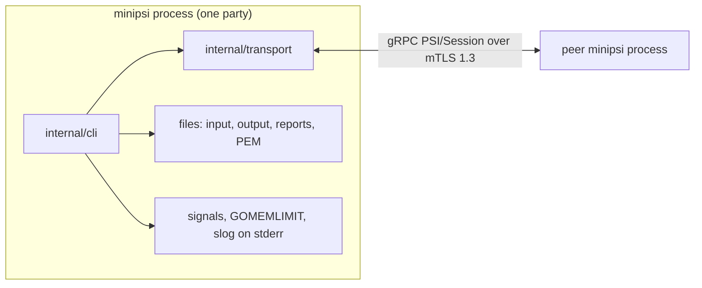

# Integrations

Source references are at commit `4aa7c9f`; if lines drift, search for the symbol.

minipsi talks to exactly one external system at run time: the peer minipsi process, over one
gRPC stream protected by mutual TLS 1.3. Everything else is local: files, OS signals, the Go
runtime and a handful of Go libraries. This page lists each integration with its call sites,
settings, timeouts, retries and failure behaviour.

Related documents:

- [ENTRY_POINTS.md](ENTRY_POINTS.md#integrations) has the short integration summary and the
  [library API seam](ENTRY_POINTS.md#library-api-surface-integration-seam) (`protocol.Conn`).
- [CALL_GRAPHS.md](CALL_GRAPHS.md#cg-05-transport-listen-accept-dial-stream-and-tls) (CG-05)
  draws the transport call paths. [BUSINESS_FLOWS.md](BUSINESS_FLOWS.md) covers the workflows.
- [ARCHITECTURE.md](ARCHITECTURE.md), [DOMAIN.md](DOMAIN.md),
  [CONFIGURATION.md](CONFIGURATION.md) (every flag and YAML key) and
  [DEVELOPMENT.md](DEVELOPMENT.md) (toolchain, tests, CI).
- Operators: [README.md](../README.md) and [RUNBOOK.md](../RUNBOOK.md).
- Design decisions: [decisions/README.md](decisions/README.md).

## Overview

| Integration | Kind | Initialised at | Settings |
|---|---|---|---|
| Peer minipsi process | gRPC over HTTP/2, one bidi stream | `internal/transport/transport.go:377` (`grpc.NewServer`), `internal/transport/transport.go:503` (`grpc.NewClient`) | `--listen`, `--connect`, `--peer`, `--max-frame`, `--connect-retry` |
| Protobuf schema | code generation (buf) | `buf.gen.yaml:2` (`protoc-gen-go`) | `make proto`, `make proto-check` |
| TLS / PKI | PEM files, TLS 1.3 | `internal/transport/tls.go:19` (`LoadTLSFiles`) | `--cert`, `--key`, `--ca`, `--peer-name`, `--server-name`, `--dev`, `--insecure-dev` |
| Filesystem | inputs, outputs, reports, dev PKI | `internal/itemio/itemio.go:47` (`ReadFile`), `internal/itemio/itemio.go:264` (`writeAtomic`) | `--input`, `--output`, `--report`, `state_dir` |
| OS and Go runtime | signals, memory limit, logs | `internal/cli/party.go:181` (`NotifyContext`), `internal/cli/party.go:474` (`applyMemoryLimit`) | `GOMEMLIMIT`, `--memory-limit`, `--log-format`, `--log-level` |
| Container and CI | distroless image, GitHub Actions | `Dockerfile:17` (`distroless`), `.github/workflows/ci.yml:4` (`name: CI`) | build args `VERSION`, `COMMIT` |

## Peer-to-peer gRPC

The service is `PSI` with a single bidirectional RPC `Session(stream Frame) returns (stream Frame)`
(`api/minipsi/v1/psi.proto:10`, `PSI`). Roles travel in the `Hello` frame, so either role can be
the gRPC client or the gRPC server: `--listen` makes the process a server and `--connect` (or
`--peer` for `request`) makes it a client, independent of role (`internal/cli/party.go:356`, `Listen`).
The stream is adapted to `protocol.Conn` by a receive pump and a send loop
(`internal/transport/transport.go:143`, `streamConn`).

### Server side

- `Listen` opens a TCP listener (`internal/transport/transport.go:361`, `net.Listen`), then `Serve`
  builds the gRPC server (`internal/transport/transport.go:377`, `grpc.NewServer`) and registers the
  handler (`internal/transport/transport.go:385`, `RegisterPSIServer`).
- Message size limit, both directions: `MaxFrame + 64 KiB` (`internal/transport/transport.go:118`, `msgLimit`).
  `MaxFrame` defaults to 4 MiB (`internal/transport/transport.go:88`, `MaxFrame`); set it with
  `--max-frame` or `limits.max_frame` (`internal/cli/party.go:115`, `max-frame`).
- `MaxConcurrentStreams(2)` per connection (`internal/transport/transport.go:381`, `MaxConcurrentStreams`).
- Keepalive: clients may ping at most every 15 s; the server pings an idle connection after 1 min
  and drops it after 20 s without an answer (`internal/transport/transport.go:382-383`, `KeepaliveParams`).
- Admission, in order (`internal/transport/transport.go:396`, `Session`): copy `minipsi-*` request
  metadata, call the optional `Admit` hook, then take the single session slot with a compare-and-swap
  (`internal/transport/transport.go:418`, `CompareAndSwap`). On success the server sends the header
  `minipsi-session: accepted` (`internal/transport/transport.go:428`, `acceptedHeader`).
- One-shot commands accept exactly one session; later streams get `Unavailable`
  ("serves exactly one session"). `serve` sets `Repeat`, so it accepts one session at a time and
  answers concurrent streams with `Unavailable` "busy" (`internal/transport/transport.go:419-422`, `busyMsg`).
- Shutdown: `Close` runs `GracefulStop` and falls back to `Stop` after 5 s
  (`internal/transport/transport.go:469-480`, `GracefulStop`).

### Client side

- `Dial` creates the channel with `grpc.NewClient` (`internal/transport/transport.go:503`, `NewClient`).
- Connection backoff: base 100 ms, multiplier 1.6, jitter 0.2, max 1 s, `MinConnectTimeout` 5 s;
  keepalive ping every 30 s idle, 20 s timeout (`internal/transport/transport.go:495-498`, `MinConnectTimeout`).
- Each attempt opens the stream and waits for the response headers, which surfaces TLS errors and
  refusals before the protocol starts (`internal/transport/transport.go:521`, `acceptedHeader`).
- Retry loop: attempts repeat every 250 ms until `ConnectRetry` has elapsed
  (`internal/transport/transport.go:559`, `After`). The window is `--connect-retry` /
  `timeouts.connect_retry`: 0 (one attempt) for `receiver` and `sender`, 2 minutes for `request`
  (`internal/cli/party.go:131`, `requestConnectRetry`).
- Close: half-close and wait up to 5 s for the server's end of stream, then tear down
  (`internal/transport/transport.go:534-535`, `waitEOF`).

### Request metadata

`request` sends two gRPC metadata keys (`internal/config/serve.go:58-59`, `MetaDataset`):
`minipsi-dataset` (from `--dataset`) and `minipsi-identity` (from `--identity`, default the first SAN of
the own certificate) (`internal/cli/party.go:369-376`, `firstSAN`). The daemon's `Admit` hook looks up the
dataset and the `allowed_peers` list (`internal/cli/serve.go:131`, `Admit`).

### Timeouts, retries and failure behaviour

| Situation | gRPC status / error | Client behaviour | Exit code |
|---|---|---|---|
| Unknown dataset or peer not in `allowed_peers` | `FailedPrecondition` "dataset not available" (`internal/cli/serve.go:136`, `Rejection`) | fail at once, no retry (`internal/transport/transport.go:543`, `FailedPrecondition`) | 4 (`internal/cli/party.go:454`, `ErrRejected`) |
| Daemon busy with another session | `Unavailable` busy | retry until the window ends, then `ErrBusy` (`internal/transport/transport.go:552`, `ErrBusy`) | 3 |
| Dataset file missing at admission | `Unavailable` "cannot be served now" (`internal/transport/transport.go:415`, `Unavailable`) | retry, then fail | 3 |
| Peer not listening, TLS or pinning failure | connection error | retry, then fail (`internal/transport/transport.go:555`, `mapErr`) | 3 (`internal/cli/party.go:459`, `ExitNetwork`) |
| Plaintext without acknowledgement | `ErrInsecureNotAcknowledged` | no network activity | 1 (`internal/cli/party.go:452`, `ErrInsecureNotAcknowledged`) |
| Frame over the size limit | `ResourceExhausted` mapped to "frame exceeds size limit" (`internal/transport/transport.go:274`, `ResourceExhausted`) | the run fails as a transport error (`internal/protocol/session.go:317`, `TransportError`) | 3 |

Protocol-level timeouts sit above the transport: `--handshake-timeout` (30 s per handshake frame),
`--phase-timeout` (10 min per frame after the handshake) and `--timeout` (whole run, default none)
(`internal/config/config.go:120`, `Timeouts`). An Abort frame is sent with a 5 s bound on failure
(`internal/protocol/session.go:246`, `WithTimeout`). Exit codes are listed in
[RUNBOOK.md](../RUNBOOK.md#5-exit-codes-and-troubleshooting).

## Protobuf schema and code generation

- Schema: `api/minipsi/v1/psi.proto`, package `minipsi.v1`, protocol version 1
  (`api/minipsi/v1/psi.proto:4`, `package`). Frame types: `Hello`, `SizesChunk`, `SenderKeys`,
  `PolyChunk`, `OutputChunk`, `Done`, `Abort` (`api/minipsi/v1/psi.proto:14-24`, `Frame`).
- Lint: buf `STANDARD` with the request/response naming rules disabled for the single symmetric
  stream (`buf.yaml:7-14`, `RPC_REQUEST_STANDARD_NAME`); breaking-change rule set `FILE`.
- Generation: `buf generate` with local `protoc-gen-go` and `protoc-gen-go-grpc` plugins into
  `internal/gen` (`buf.gen.yaml:2-8`, `protoc-gen-go-grpc`).
- Tool pins: buf v1.73.0, protoc-gen-go v1.36.12, protoc-gen-go-grpc v1.6.2
  (`Makefile:13-15`, `PROTOC_GEN_GO_GRPC`). `make proto-check` regenerates and fails on any diff
  (`Makefile:69-70`, `proto-check`).
- Conversion between generated types and protocol frames is field by field
  (`internal/transport/convert.go:10`, `toPB`); an empty or unknown body becomes an empty frame,
  which the protocol rejects (`internal/transport/convert.go:47-49`, `fromPB`).

## TLS and PKI

- Files: PEM certificate chain, private key and CA bundle, read by `LoadTLSFiles`
  (`internal/transport/tls.go:19`, `LoadTLSFiles`). Flags `--cert`, `--key`, `--ca`; YAML `tls.cert`,
  `tls.key`, `tls.ca`. Errors on reading them exit 1 (`internal/cli/party.go:352`, `LoadTLSFiles`).
- Server config: TLS 1.3 minimum, client certificate required and verified against the CA, ALPN `h2`
  (`internal/transport/tls.go:51-59`, `RequireAndVerifyClientCert`).
- Client config: TLS 1.3, server verified against the CA and the server name
  (`internal/transport/tls.go:64-72`, `ClientConfig`). The name is `--server-name`, default the host
  part of `--connect` (`internal/cli/party.go:359-365`, `ServerName`).
- Pinning: `--peer-name` requires a DNS or URI SAN equal to the name on the peer's leaf certificate,
  on both sides (`internal/transport/tls.go:76`, `pinPeer`).
- `normalize` rejects a missing TLS config or a minimum below TLS 1.3
  (`internal/transport/transport.go:86-107`, `normalize`).
- Plaintext (h2c) only with `--insecure-dev` plus `MINIPSI_I_UNDERSTAND_INSECURE=1`
  (`internal/transport/transport.go:40`, `InsecureEnv`); it logs a warning
  (`internal/cli/party.go:349`, `PLAINTEXT`).

### Development PKI

- `--dev` uses a shared PKI directory: `MINIPSI_DEV_PKI`, else `$XDG_STATE_HOME/minipsi/dev-pki`,
  else `~/.local/state/minipsi/dev-pki` (`internal/devcerts/devpki.go:31`, `DefaultDevDir`).
- `EnsureDev` creates an ECDSA P-256 CA and one certificate per party name on first use, valid
  365 days, with SANs `<name>`, `localhost`, `127.0.0.1`, `::1`; creation is an atomic directory
  rename (`internal/devcerts/devpki.go:50`, `EnsureDev`).
- Config validation allows `--dev` only with loopback addresses and never with TLS files
  (`internal/config/config.go:268-274`, `IsLoopback`).
- `minipsi certs dev` writes `ca.crt` and `<name>.crt` / `<name>.key` (keys 0600) to `--out`
  and never overwrites files (`internal/devcerts/devcerts.go:127`, `WriteFiles`). Defaults: names
  `receiver,sender`, hosts `localhost,127.0.0.1`, validity 30 days (`internal/cli/tools.go:70-73`, `validity`).
- Flow details: [BUSINESS_FLOWS.md](BUSINESS_FLOWS.md#workflow-development-pki-and-test-certificates).

## Filesystem

| Use | Call site | Notes |
|---|---|---|
| Input items | `internal/itemio/itemio.go:47` (`ReadFile`) | path or `-` for stdin; lines or CSV |
| Receiver result | `internal/itemio/itemio.go:231` (`WriteResult`) | path or `-` for stdout |
| Atomic write | `internal/itemio/itemio.go:264` (`writeAtomic`) | temp file in the target directory, mode 0600, fsync, rename |
| JSON run report | `internal/cli/party.go:251` (`WriteFileAtomic`) | `--report FILE`; written on success and failure |
| Daemon state directory | `internal/cli/serve.go:118` (`MkdirAll`) | `state_dir`/`--state-dir`; creates `reports/` (0700) |
| Per-session daemon report | `internal/cli/serve.go:218-219` (`WriteFileAtomic`) | `<UTC time>-<seq>-<sid or failed>.json` |
| Daemon datasets | `internal/cli/serve.go:113` (`loadInput`) | loaded at start (fail fast), stat at admission, re-read per session (`internal/cli/serve.go:180`, `loadInput`) |
| YAML config | `internal/config/config.go:130` (`ReadFile`) | `--config FILE` |

## Operating system and Go runtime

- Signals: SIGINT and SIGTERM cancel the run context in party commands and in `serve`
  (`internal/cli/party.go:181`, `NotifyContext`; `internal/cli/serve.go:95`, `NotifyContext`). A cancelled
  daemon finishes with exit 0 after `GracefulStop` (`internal/cli/serve.go:158-160`, `shutting`).
- Memory limit: an explicit `--memory-limit` / `memory_limit` wins, then `GOMEMLIMIT`, then the default
  2 GiB; 0 disables it (`internal/cli/party.go:474-484`, `SetMemoryLimit`).
- Logging: `log/slog` to stderr, text or JSON, level debug to error
  (`internal/cli/party.go:462-470`, `newLogger`). Results go to stdout only when `--output -`.
- CPU: `--workers` (0 = `GOMAXPROCS`) (`internal/cli/party.go:108`, `workers`).

## Go libraries

| Module | Version | Used for | Import site |
|---|---|---|---|
| `filippo.io/edwards25519` | v1.2.0 (`go.mod:6`, `edwards25519`) | group and field arithmetic | `internal/group/group.go:15` (`edwards25519`) |
| `github.com/tuneinsight/lattigo/v6` | v6.2.0 (`go.mod:27`, `lattigo`) | optional NTT backend | `internal/rns/lattigo.go:8` (`lattigo`) |
| `github.com/spf13/cobra` | v1.10.2 (`go.mod:7`, `cobra`) | command tree | `internal/cli/root.go:12` (`cobra`) |
| `github.com/spf13/pflag` | v1.0.10 (`go.mod:8`, `pflag`) | flag binding | `internal/cli/party.go:22` (`pflag`) |
| `gopkg.in/yaml.v3` | v3.0.1 (`go.mod:31`, `yaml`) | config files | `internal/config/config.go:15` (`yaml`) |
| `google.golang.org/grpc` | v1.84.0 (`go.mod:10`, `grpc`) | transport | `internal/transport/transport.go:22` (`grpc`) |
| `google.golang.org/protobuf` | v1.36.12 (`go.mod:11`, `protobuf`) | generated messages | `internal/gen/minipsiv1/psi.pb.go` |
| `golang.org/x/text` | v0.42.0 (`go.mod:9`, `text`) | Unicode NFC of the relay prep step `nfc` | `internal/service/prep.go:9` (`norm`) |

The NTT backend is a local choice (`--ntt-backend native|lattigo`, default `native`); peers may use
different backends (`internal/rns/rns.go:282`, `NewBackend`). Indirect modules and their provenance
are covered in [DEVELOPMENT.md](DEVELOPMENT.md).

## Packaging and CI

- Image: static `CGO_ENABLED=0` build on a digest-pinned `golang` image, copied into
  `gcr.io/distroless/static-debian12:nonroot`, run as `nonroot:nonroot` with workdir `/work`
  (`Dockerfile:13`, `CGO_ENABLED`; `Dockerfile:17-21`, `nonroot`). Build args `VERSION` and `COMMIT`
  are stamped with ldflags. Mount and memory guidance: [RUNBOOK.md](../RUNBOOK.md#container).
- CI: GitHub Actions on push to `main`, pull requests and manual dispatch, with read-only
  permissions; jobs lint, race tests, govulncheck, proto-check, e2e over mTLS, fuzz smoke and a
  container build (`.github/workflows/ci.yml:6-10`, `push`). Actions are pinned by commit SHA
  (`.github/workflows/ci.yml:3`, `pinned`). Details: [DEVELOPMENT.md](DEVELOPMENT.md).

## Not present

| Integration | Status | Evidence |
|---|---|---|
| Database | none | no driver in `go.mod`; all state is in files |
| Message queue / event bus | none | no client module in `go.mod` |
| Cache service | none | the only cache is the in-process `--poly-cache` (`internal/cli/party.go:114`, `PolyCache`) |
| External auth provider | none | peers authenticate only by mTLS certificates and `allowed_peers` (`internal/config/serve.go:114`, `Allowed`) |
| HTTP / REST API | none | the only listener is the gRPC server; no `net/http` handler |
| Metrics, tracing | none | logs on stderr and JSON reports only |
| Scheduler | none | runs are started by cron, systemd or a Job ([RUNBOOK.md](../RUNBOOK.md#scheduling)) |
| Relay via an "Orchestrator" | reserved name only | `mode: relay` is rejected by validation (`internal/config/config.go:256-257`, `Orchestrator`) |
