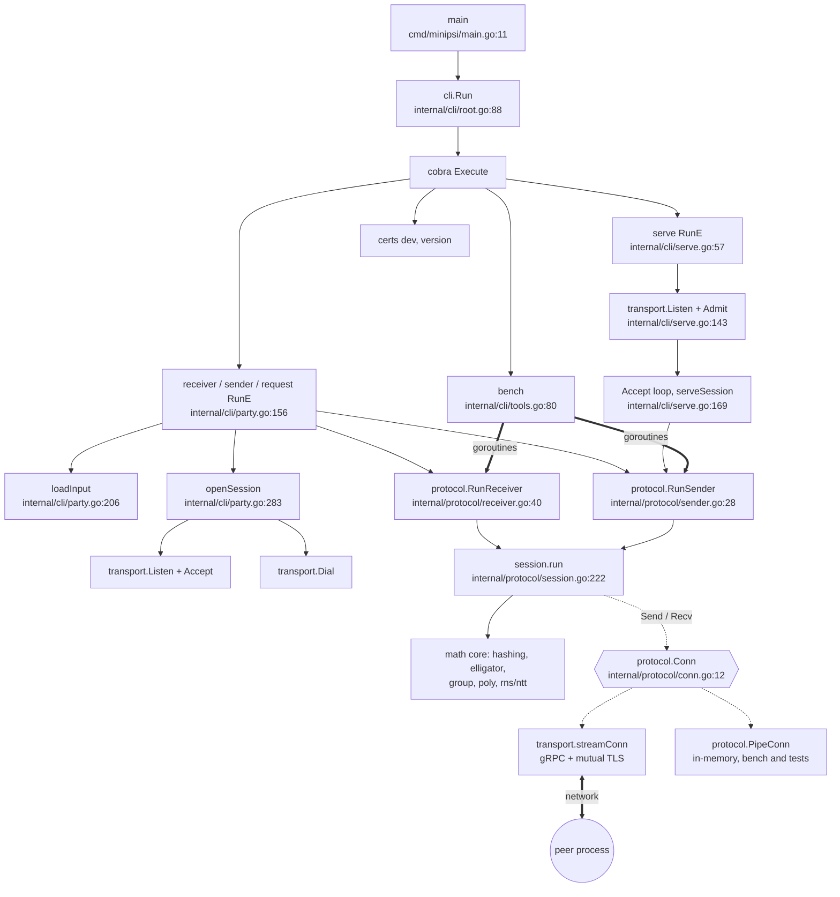
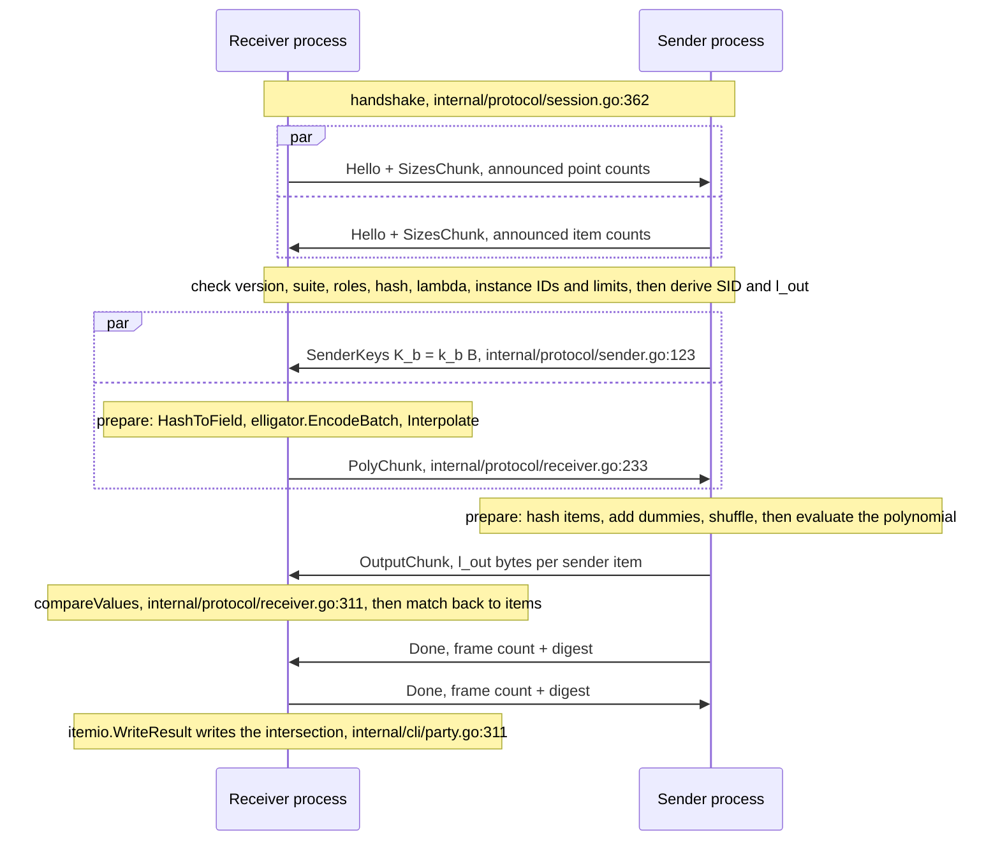

# Quick summary: entry points and call graph

A short overview of how minipsi runs, at commit `4aa7c9f`. Every `file:line` below was checked
against the source. The full versions, with Mermaid diagrams and a source table for every call
edge, are [ENTRY_POINTS.md](ENTRY_POINTS.md) and [CALL_GRAPHS.md](CALL_GRAPHS.md).

## Entry points

| Entry point | Trigger | Location |
|---|---|---|
| `main` -> `cli.Run` | Running the binary | `cmd/minipsi/main.go:11`, `internal/cli/root.go:88` |
| `receiver` / `sender` / `request` | CLI command (one shared RunE) | `internal/cli/party.go:156` |
| `serve` (daemon) | CLI command | `internal/cli/serve.go:57` |
| `PSI/Session` RPC (server side) | A peer connects | `internal/transport/transport.go:396` |
| `protocol.RunReceiver` / `protocol.RunSender` | Library call that runs one complete PSI session | `internal/protocol/receiver.go:40`, `internal/protocol/sender.go:28` |
| `bench` | CLI command | `internal/cli/tools.go:80` |
| `certs dev` | CLI command | `internal/cli/tools.go:29` |
| `version` | CLI command | `internal/cli/root.go:112` |
| SIGINT and SIGTERM handling | Operating system signal | `internal/cli/party.go:181`, `internal/cli/serve.go:95` |
| `init()` precomputation | Before `main` | `internal/rns/rns.go:90`, `internal/group/group.go:35`, `internal/group/fixedbase.go:39` |

## Overview diagram

Solid lines are direct calls, dashed lines go through an interface, and thick lines start a
goroutine or cross the network.



## Main call graphs

### One-shot run (`receiver` / `sender`) and `request`

```text
main (cmd/minipsi/main.go:11)
`-- cli.Run (internal/cli/root.go:88) -> cobra -> RunE (internal/cli/party.go:156)
    |-- signal.NotifyContext SIGINT/SIGTERM (internal/cli/party.go:181)
    |-- loadInput: read input + protocol.CheckInput (internal/cli/party.go:206)
    |-- openSession (internal/cli/party.go:283)
    |   |-- listen:  transport.Listen (internal/cli/party.go:430) -> srv.Accept (internal/cli/party.go:435)
    |   `-- connect: transport.Dial (internal/cli/party.go:443), request also sends dataset + identity
    |-- sender:   protocol.RunSender(ctx, cfg, sess.Conn(), instances)   (internal/cli/party.go:293)
    |-- receiver: protocol.RunReceiver(ctx, cfg, sess.Conn(), instances) (internal/cli/party.go:301)
    |             -> itemio.WriteResult (internal/cli/party.go:311)
    `-- JSON report + exitCode (internal/cli/root.go:38) -> os.Exit (cmd/minipsi/main.go:12)
```

### Daemon `serve`

```text
RunE (internal/cli/serve.go:57)
|-- signal.NotifyContext (internal/cli/serve.go:95)
|-- transport.Listen (internal/cli/serve.go:143)
|   with Admit = check dataset + allowed_peers (internal/cli/serve.go:131)
`-- loop: srv.Accept (internal/cli/serve.go:156) -> serveSession (internal/cli/serve.go:169)
    `-- re-read the dataset -> protocol.RunSender (internal/cli/serve.go:192) -> report in state_dir
```

### Transport (gRPC + mutual TLS)

```text
transport.Listen (internal/transport/transport.go:357)
|-- net.Listen (internal/transport/transport.go:361)
|-- grpc.NewServer (internal/transport/transport.go:377)
|-- RegisterPSIServer (internal/transport/transport.go:385 -> internal/gen/minipsiv1/psi_grpc.pb.go:89)
`-- go Serve (internal/transport/transport.go:386)
      the peer calls RPC PSI/Session -> (*Server).Session (internal/transport/transport.go:396)
      |-- Admit, one session at a time (internal/transport/transport.go:418)
      `-- hand-off to (*Server).Accept (internal/transport/transport.go:457)

transport.Dial (internal/transport/transport.go:488)
`-- grpc.NewClient (internal/transport/transport.go:503), retried until --connect-retry runs out

streamConn implements Conn over gRPC with 2 goroutines:
pump (internal/transport/transport.go:166) and sendLoop (internal/transport/transport.go:186)
```

### PSI core

```text
protocol.RunReceiver / protocol.RunSender
`-- newSession (internal/protocol/session.go:169) -> session.run (internal/protocol/session.go:222)
    |-- writer goroutine: sends frames with Conn.Send (internal/protocol/session.go:269)
    `-- body: handshake, Hello + sizes (internal/protocol/session.go:362)
        |-- receiver: prepare (internal/protocol/receiver.go:172)
        |     HashToField (internal/protocol/receiver.go:182)
        |     -> elligator.EncodeBatch (internal/protocol/receiver.go:186)
        |     -> Interpolate (internal/protocol/receiver.go:208)
        |   -> sendPolys (internal/protocol/receiver.go:233)       PolyChunk   -> peer
        |   reader (internal/protocol/receiver.go:419)            OutputChunk <- peer, then match -> Result
        `-- sender: reader (internal/protocol/sender.go:299) receives the polynomials
              -> Evaluate (internal/poly/evaluator.go:47) -> DH exponentiation -> output hash
              -> shuffle (internal/protocol/sender.go:149)        OutputChunk -> peer
```

## One PSI session between two processes

The frames travel on one gRPC stream `PSI/Session` over mutual TLS 1.3. Each message is a
`Frame` (`Hello`, `Sizes`, `Keys`, `Poly`, `Output`, `Done`, `Abort`).



On an error, the side that detects it sends `Abort` (`internal/protocol/session.go:247`) and
both sides stop.

## Where a new API plugs in

The PSI core does not depend on the network. It only needs an ordered, two-way stream of
`Frame` values:

```go
// internal/protocol/receiver.go:40 and internal/protocol/sender.go:28
func RunReceiver(ctx context.Context, cfg Config, conn Conn, instances []Instance) (*Result, error)
func RunSender(ctx context.Context, cfg Config, conn Conn, instances []Instance) (*SenderResult, error)

// internal/protocol/conn.go:12
type Conn interface {
	Send(ctx context.Context, f *Frame) error
	Recv(ctx context.Context) (*Frame, error)
}
```

- **Conn implementations today:** `transport.streamConn` (gRPC, `internal/transport/transport.go`)
  and `protocol.PipeConn` (in-memory, `internal/protocol/conn.go`).
- **Callers of RunReceiver and RunSender today:** `internal/cli/party.go:293`,
  `internal/cli/party.go:301`, `internal/cli/serve.go:192`, and `bench`
  (`internal/cli/tools.go:113`, `internal/cli/tools.go:118`).
- **What this means for a new API:** it needs a new `Conn` implementation (for example an
  inbox/outbox, or a relay through the Orchestrator) that calls `RunReceiver` or `RunSender`.
  The cryptography and polynomial code does not have to change.
