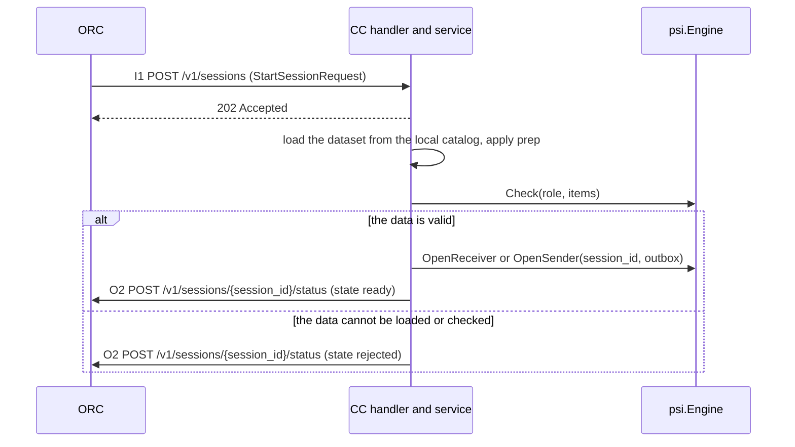
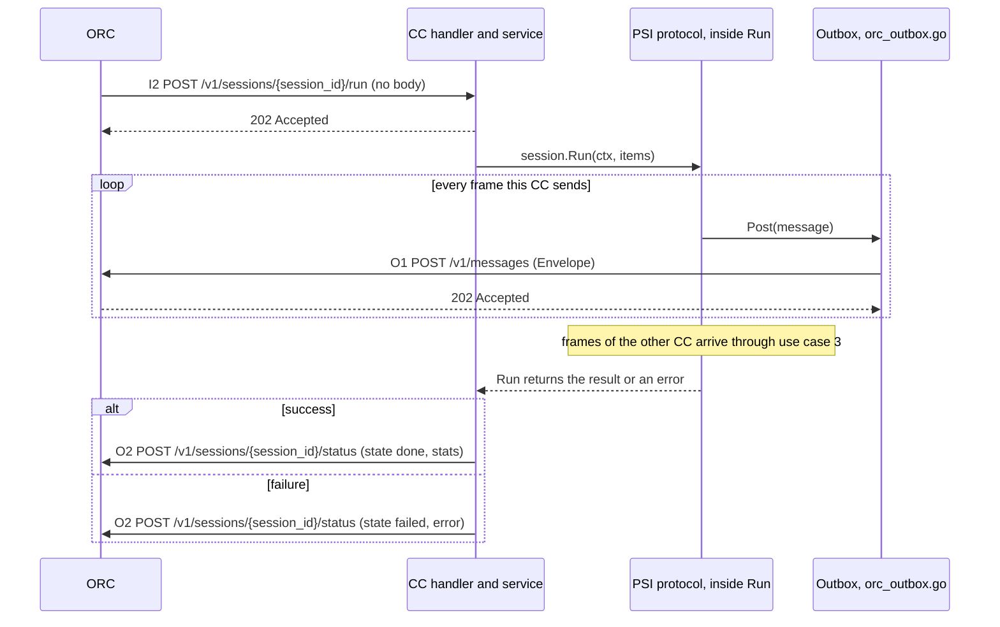
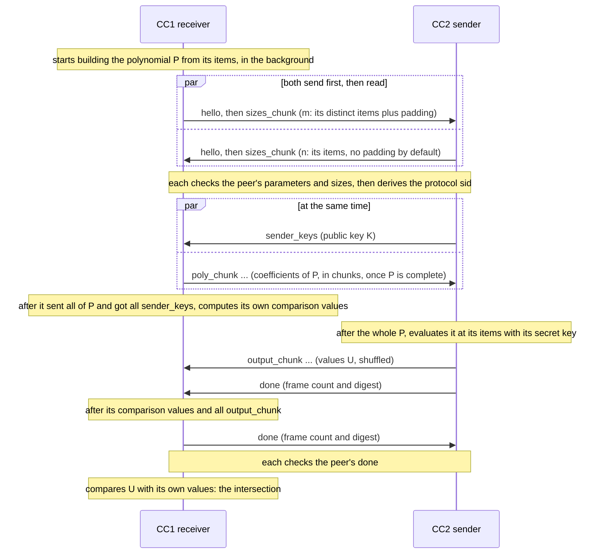
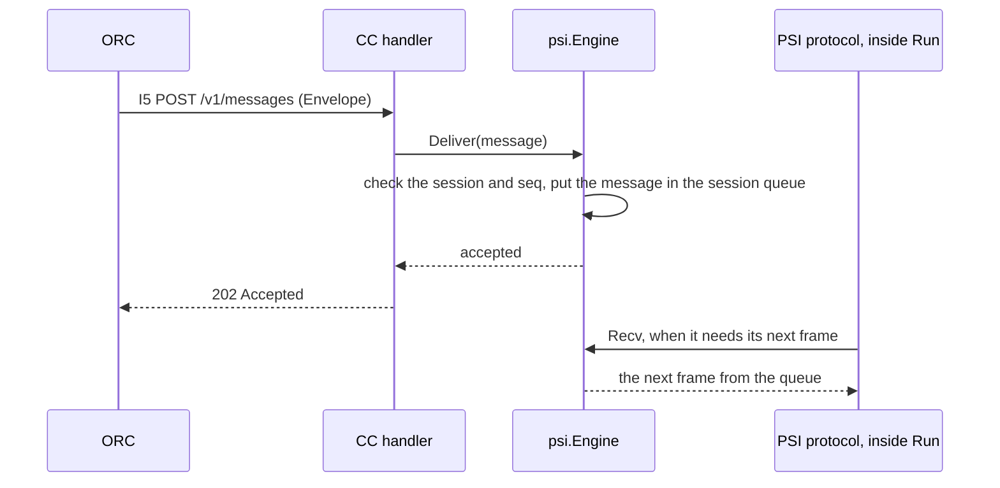
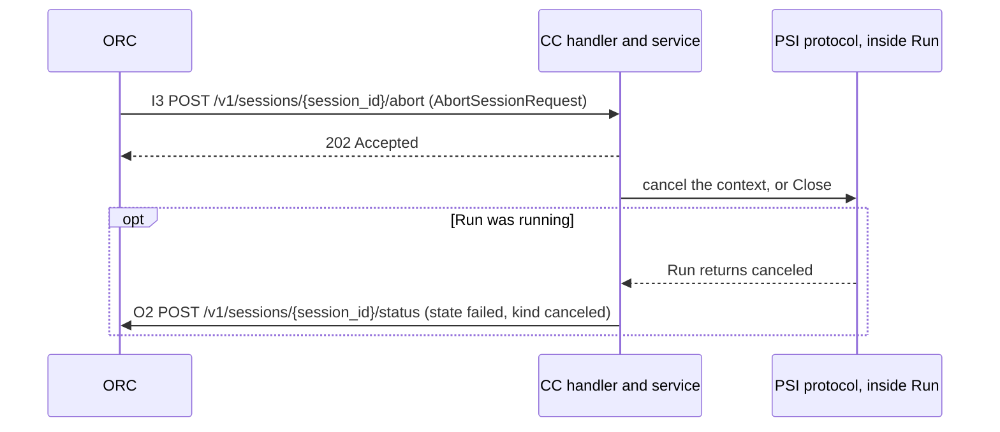
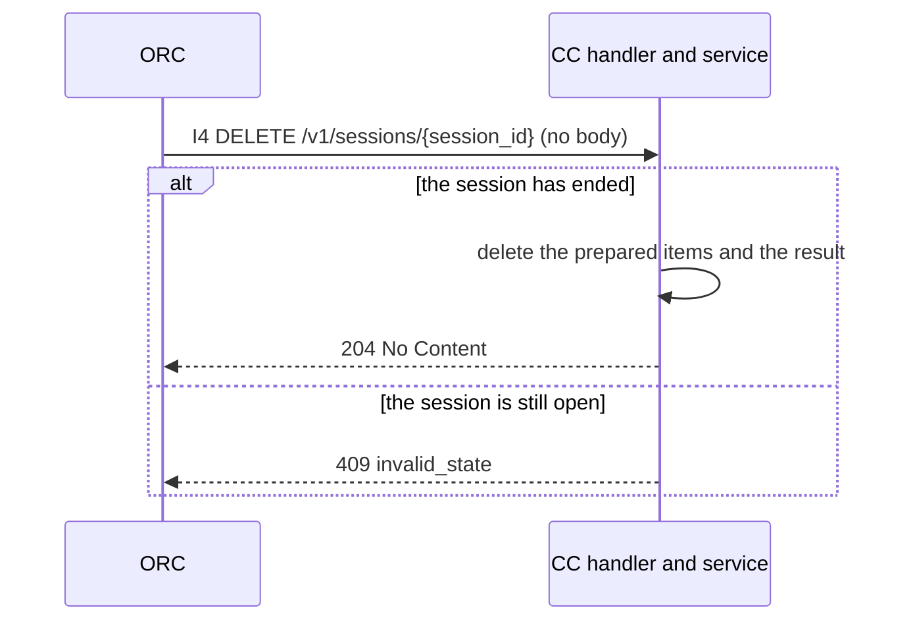
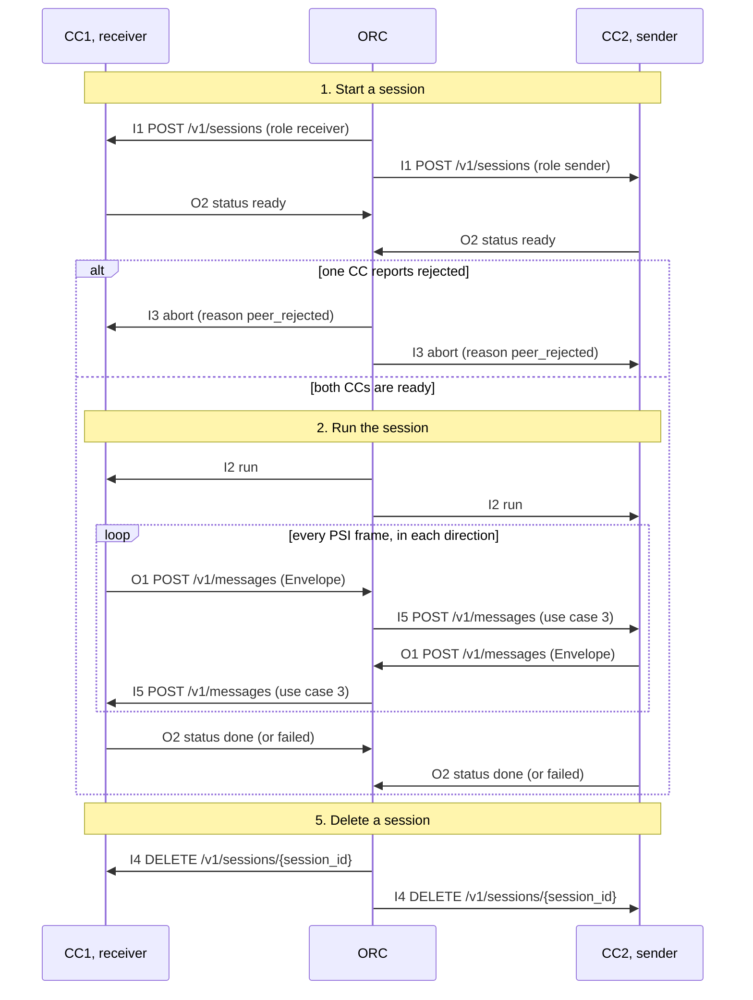

# internal/orcapi: the CC and ORC API

This package defines every message between a compute cluster (CC) and the orchestrator (ORC)
in relay mode: the JSON of each message, the HTTP endpoints, and the rules both sides check.
The decision is recorded in [ADR-0010](../../docs/decisions/0010-orc-cc-http-api.md). The
files in [testdata](testdata) are example messages.

## APIs

Every CC has the same APIs; only the role differs. Inbound APIs are served by the CC's handler
(`internal/handler`) and called by the ORC. Outbound APIs are served by the ORC and called by
the CC.

| ID | Direction | API | Body | Use case |
|---|---|---|---|---|
| I1 | inbound | `POST /v1/sessions` | `StartSessionRequest` | 1. Start a session |
| I2 | inbound | `POST /v1/sessions/{session_id}/run` | none | 2. Run the session |
| I5 | inbound | `POST /v1/messages` | `Envelope` | 3. Receive a PSI frame (the protocol's inbound frames) |
| I3 | inbound | `POST /v1/sessions/{session_id}/abort` | `AbortSessionRequest` | 4. Abort a session |
| I4 | inbound | `DELETE /v1/sessions/{session_id}` | none | 5. Delete a session |
| O1 | outbound | `POST {orc}/v1/messages` | `Envelope` | 2. Run the session (the protocol's outbound frames) |
| O2 | outbound | `POST {orc}/v1/sessions/{session_id}/status` | `StatusReport` | 1 and 2 |

Bodies are JSON with snake_case names. Success is 202, or 204 for I4 and O2. Errors carry a
`Problem` (see [Errors](#errors)).

## 1. Start a session (I1, then O2)

The ORC asks the CC to take part in a session and tells it which data to use and how to
prepare it. The CC prepares the data, checks it, opens the session and reports whether it is
ready.



Request body of I1, `StartSessionRequest`:

| Field | Type | Required | Meaning |
|---|---|---|---|
| `session_id` | string | yes | Session ID assigned by the ORC; used by every later call. 1 to 128 ASCII letters, digits, `-`, `_`, `.` or `:`, starting with a letter or digit. |
| `cc_id` | string | yes | ID of the CC that receives this request. Same rule as `session_id`. |
| `peer_cc_id` | string | yes | ID of the other CC of the session; the CC puts it in `receiver_cc_id` of its envelopes. |
| `role` | string | yes | `receiver` (learns the intersection) or `sender`. The two CCs get opposite roles. |
| `contract_ref` | string | yes | The contract between the data owners; opaque to the CC. |
| `dataset` | string | yes | Which data to use: a name in the CC's local catalog, which maps it to a file, format and column. Rule of the catalog: 1 to 64 letters, digits, `.`, `_` or `-`. |
| `prep` | array of string | yes | How to prepare every value, in order: `trim` (remove leading and trailing white space), `nfc` (Unicode normalization form C), `lower` (lower case). `[]` keeps the values as they are. Both CCs must get the same list, because items match only when their bytes are equal. |

```json
POST /v1/sessions
{"session_id":"s-20261020-0001","cc_id":"cc1","peer_cc_id":"cc2","role":"receiver",
 "contract_ref":"urn:contract:42","dataset":"customers","prep":["trim","nfc","lower"]}
```

Request body of O2, `StatusReport`:

| Field | Type | Required | Meaning |
|---|---|---|---|
| `cc_id` | string | yes | ID of the reporting CC. |
| `state` | string | yes | `ready`: data prepared and checked, session open, waiting for run. `rejected`: the session was not opened. `done` and `failed`: see use case 2. |
| `error` | object | for `rejected` and `failed` only | Why the session did not work. |
| `error.kind` | string | yes | `input`, `mismatch`, `protocol`, `peer_aborted`, `timeout`, `delivery`, `canceled` or `internal` (the session errors of `internal/psi`). |
| `error.code` | string | no | The PSI abort code, such as `ERR_TIMEOUT`, when there is one. |
| `error.remote` | boolean | yes | `true` when the other CC ended the session. |
| `stats` | object | for `done` only | See use case 2. |

```json
POST {orc}/v1/sessions/s-20261020-0001/status
{"cc_id":"cc1","state":"ready"}
```

```json
POST {orc}/v1/sessions/s-20261020-0001/status
{"cc_id":"cc1","state":"rejected","error":{"kind":"input","remote":false}}
```

## 2. Run the session (I2, then O1 and O2)

When both CCs reported `ready`, the ORC starts the session on both. The PSI protocol then runs
inside `Run`: each frame it sends goes to the ORC through the Outbox, and each frame of the
other CC comes back through use case 3. At the end the CC reports the outcome.



I2 has no body. The CC answers 202, or 409 `invalid_state` when the session is not ready.

Request body of O1, `Envelope`:

| Field | Type | Required | Meaning |
|---|---|---|---|
| `session_id` | string | yes | The session the frame belongs to. |
| `sender_cc_id` | string | yes | ID of the CC that sends the frame. |
| `receiver_cc_id` | string | yes | ID of the CC the ORC must deliver it to. |
| `seq` | integer | yes | Numbers the frames one CC sends in a session: 1, 2, 3, ... without gaps. |
| `kind` | string | yes | Frame type: `hello`, `sizes_chunk`, `sender_keys`, `poly_chunk`, `output_chunk`, `done` or `abort`. The receiving engine needs it to decode `payload`. |
| `payload` | object | yes | The fields of the PSI frame. Only the engines read it; the ORC forwards it unchanged and nobody logs it. |

Frames each role sends and receives (a chunk kind may be several messages):

| Role | Sends (O1) | Receives (I5) |
|---|---|---|
| receiver | `hello`, `sizes_chunk`, `poly_chunk`, `done` | `hello`, `sizes_chunk`, `sender_keys`, `output_chunk`, `done` |
| sender | `hello`, `sizes_chunk`, `sender_keys`, `output_chunk`, `done` | `hello`, `sizes_chunk`, `poly_chunk`, `done` |
| either, on an error | `abort` | `abort` |

Order of the frames inside `Run`. Each arrow is one or more envelopes: O1 from the sending CC
to the ORC, then I5 from the ORC to the other CC.



- Both CCs send `hello` and `sizes_chunk` before they read the peer's, so neither blocks the
  other. By default each waits at most 30 s for each frame of the peer's handshake, and 10 min
  for each frame after it. The 10 min also cover the sender's wait from its last `poly_chunk`
  to the receiver's `done`: its evaluation and the delivery of all `output_chunk`.
- The order is enforced: a frame out of this order ends the session with `ERR_PROTOCOL`, for
  example an `output_chunk` before all `sender_keys`, or a `done` before the peer sent all its
  data frames.
- The receiver sends its `done` once it has its comparison values and all `output_chunk`, but
  before it matches U against them: the matching time depends on the size of the
  intersection, so the sender cannot learn it from the timing. Neither CC waits for the peer's
  `done` before sending its own, so the two `done` frames may cross on the way.
- A CC that fails sends `abort` (best effort), and the peer's `Run` fails when it reads it. A CC
  stops reading after the peer's `done`, so a later `abort` is not seen: one CC can then report
  `done` while the other reports `failed`.
- The fields of each frame and every step of the protocol are described in
  [docs/BUSINESS_FLOWS.md](../../docs/BUSINESS_FLOWS.md).

```json
POST {orc}/v1/messages
{"session_id":"s-20261020-0001","sender_cc_id":"cc1","receiver_cc_id":"cc2","seq":3,
 "kind":"poly_chunk","payload":{"parts":[{"instance_id":0,"offset":0,"coeffs":"AQIDBA=="}]}}
```

The `stats` object of a `done` report (O2):

| Field | Type | Required | Meaning |
|---|---|---|---|
| `stats.protocol_sid` | string | yes | Hex session ID derived in the PSI handshake; both CCs report the same value. It is not the ORC's `session_id`. |
| `stats.messages.sent` | integer | yes | Number of PSI messages this CC sent. |
| `stats.messages.recv` | integer | yes | Number of PSI messages this CC received. |
| `stats.duration_ms` | integer | yes | Duration of the session in milliseconds. |

```json
POST {orc}/v1/sessions/s-20261020-0001/status
{"cc_id":"cc1","state":"done","stats":{"protocol_sid":"9f86d081884c7d659a2feaa0c55ad015",
 "messages":{"sent":12,"recv":11},"duration_ms":5321}}
```

```json
POST {orc}/v1/sessions/s-20261020-0001/status
{"cc_id":"cc1","state":"failed","error":{"kind":"peer_aborted","code":"ERR_TIMEOUT","remote":true}}
```

The receiver's matching items stay on the CC; they are never sent to the ORC.

## 3. Receive a PSI frame (I5)

The ORC forwards every frame of the other CC. The CC hands it to the engine, which keeps it in
the session's queue until the protocol asks for its next frame.



The body is an `Envelope` (fields in use case 2). Here `sender_cc_id` is the other CC and
`receiver_cc_id` is this CC.

```json
POST /v1/messages
{"session_id":"s-20261020-0001","sender_cc_id":"cc2","receiver_cc_id":"cc1","seq":1,
 "kind":"hello","payload":{"protocol_version":1,"suite":"minipsi-v1-ed25519-ell2",
 "role":"sender","hash":"sha256","lambda":40,"nonce":"AAECAwQFBgcICQoLDA0ODxAREhMUFRYXGBkaGxwdHh8=",
 "instance_count":1,"software_version":"v0.1.0"}}
```

The CC answers 202, or 400 `malformed`, 404 `unknown_session`, 413 `too_large`, 422
`misrouted`, 500 `internal` or 503 `unavailable` with a `Problem`.

## 4. Abort a session (I3)

The ORC stops a session, for example because the other CC was rejected or a deadline passed.



Request body of I3, `AbortSessionRequest`:

| Field | Type | Required | Meaning |
|---|---|---|---|
| `reason` | string | yes | Why the ORC aborts: `peer_rejected` (the other CC was rejected), `peer_failed` (the other CC failed), `deadline` (the session took too long) or `operator` (stopped by a person). |

```json
POST /v1/sessions/s-20261020-0001/abort
{"reason":"peer_rejected"}
```

## 5. Delete a session (I4)

After the session ended, the ORC asks the CC to remove what it kept for the session.



I4 has no body.

## A whole session

How the use cases combine in one session between CC1 (receiver) and CC2 (sender):



## Errors

Every error response, on both sides, has a `Problem` body (RFC 9457,
`application/problem+json`):

| Field | Type | Required | Meaning |
|---|---|---|---|
| `title` | string | yes | Text of the HTTP status, such as `Not Found`. |
| `status` | integer | yes | The HTTP status code. |
| `code` | string | yes | `malformed` (400), `unknown_session` (404), `invalid_state` (409), `too_large` (413), `misrouted` (422), `internal` (500) or `unavailable` (503). |
| `detail` | string | no | Fixed text only, never message values. |

```json
{"title":"Not Found","status":404,"code":"unknown_session"}
```

## Rules

- `Decode` refuses invalid UTF-8, null, unknown fields, wrong types, invalid base64 and
  trailing data. Every error wraps `ErrInvalid` and never contains message values.
- `state` must match `error` and `stats` as in the tables above.
- Reports never carry items, match counts, item counts or free text.
- Body limits: 64 KiB for control requests and reports, 8 MiB + 4 KiB for an envelope.
