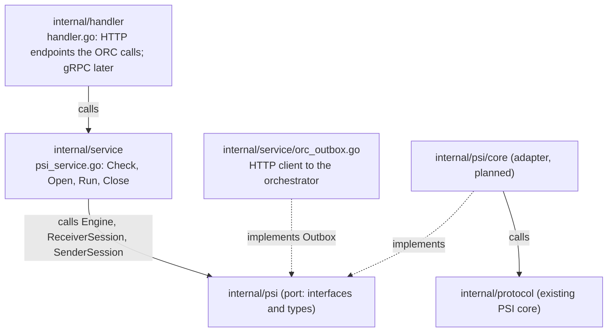
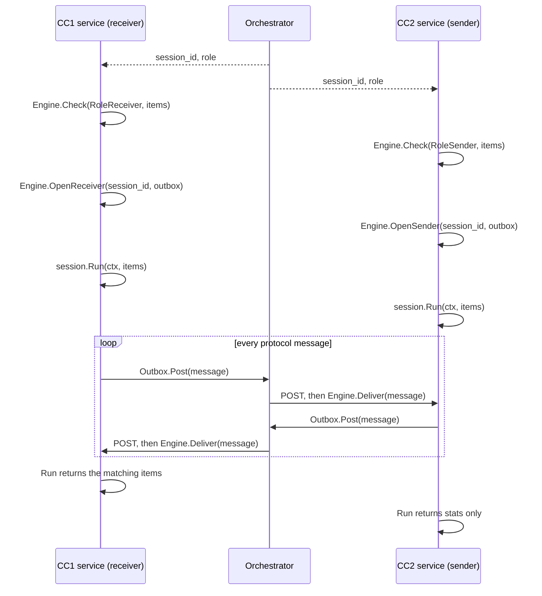

# internal/psi: the PSI port layer

This folder is the only part of the PSI code that business services should import. It describes
*what* a service can ask for (run a PSI session, get the result) without saying *how* the PSI is
computed. The decision behind it is recorded in
[ADR-0009](../../docs/decisions/0009-psi-port-layer.md).

Status: this package contains interfaces and types only. The first implementation, the adapter
`internal/psi/core` over the existing PSI core (`internal/protocol`), is planned and not written
yet.

## In one minute

- `internal/psi` is the **port**: a set of Go interfaces and types, the contract between services
  and any PSI implementation.
- `internal/psi/core` will be the **adapter**: it implements those interfaces by calling the
  existing PSI core in `internal/protocol`.
- Services depend only on the port. To use another PSI implementation later, write another
  adapter; the services do not change.

## The layers



Where the code goes. `internal/handler` and `internal/service` exist; the adapter
`internal/psi/core` is added in its own branch:

```
internal/
  handler/          HTTP endpoints the ORC calls (gRPC later)
    handler.go      NewHandler(svc) http.Handler: POST /v1/messages
  service/          business logic
    psi_service.go  PSIService: the handler's Service; Check, Open, Run, Close; Deliver
    orc_outbox.go   Outbox implementation and status reports: HTTP POST to the ORC
    registry.go     session states, kept in memory with a TTL
    prep.go         prep steps (trim, nfc, lower) applied to the dataset values
    env.go          MINIPSI_CC_ID and MINIPSI_ORC_URL
  psi/              port: interfaces and types
  psi/core/         adapter over internal/protocol
```

Read the arrows like this:

- The handler receives HTTP requests, calls the service and turns its errors into HTTP status
  codes. It holds no PSI logic.
- The service calls the interfaces of the port. It never sees the adapter or the core.
- The adapter implements those interfaces and calls the core.
- The service also implements one interface of the port, `Outbox`, because the PSI needs a way
  to send messages out and only the service knows how to reach the orchestrator.

The same idea in a more familiar shape:

| Usual app | PSI |
|---|---|
| `UserController` | `internal/handler/handler.go` (in Go it is called a handler) |
| `UserService` | `internal/service/psi_service.go` |
| `UserRepository` (interface) | `internal/psi` (port) |
| `PostgresUserRepository` (implementation) | `internal/psi/core` (adapter) |

## Files in this folder

| File | What it holds |
|---|---|
| `psi.go` | What a service calls: the interfaces `Engine`, `ReceiverSession` and `SenderSession`; `Role` |
| `message.go` | How messages travel to and from the orchestrator: the `Message` struct, the `Outbox` interface the service implements, `ValidSessionID` and the size limits |
| `errors.go` | The error values a service checks with `errors.Is`, and the `Error` type |
| `result.go` | What `Run` returns: `ReceiverResult`, `SenderResult`, `Stats` |
| `doc.go` | The package documentation (`go doc ./internal/psi`) |
| `psi_test.go` | Tests for the types, and a test that this package imports only the standard library |

Go imports a package, not a file: `import "github.com/XSpring/minipsi/internal/psi"` gives a
service everything listed above.

## What a service uses

| Name | Kind | Who implements it | What it is for |
|---|---|---|---|
| `Engine` | interface | the adapter | `Check` the items, `OpenReceiver` or `OpenSender` a session, `Deliver` an inbound message |
| `ReceiverSession`, `SenderSession` | interface | the adapter | `Run` the session once and get the result; `Close` it |
| `Outbox` | interface | the service | `Post` one outbound message to the orchestrator |
| `Message` | struct | - | one protocol message: `session_id`, `seq`, `kind`, `payload` (JSON) |
| `ReceiverResult`, `SenderResult`, `Stats` | struct | - | the result of `Run` |
| `ErrTimeout`, `ErrBusy`, ... and `Error` | errors | - | what went wrong |

## How a session runs

The two parties (CC1 and CC2) never talk to each other directly. Every message goes through the
orchestrator (ORC) over plain HTTP: the ORC POSTs inbound messages to a CC, and the CC POSTs its
outbound messages to the ORC.



Steps for one party:

1. The ORC starts the session: it sends each CC the `session_id` and its role.
2. `Engine.Check(role, items)`: reject bad input before any message is sent. On failure, tell
   the ORC that this CC cannot run the session, and do not open it.
3. Create a new `Outbox` for this session, then call `Engine.OpenReceiver(id, outbox)` or
   `Engine.OpenSender(id, outbox)` as soon as the ID is known. From now on, messages from the
   peer are kept until `Run` starts.
4. `session.Run(ctx, items)`: blocks until the session ends. Call it promptly, because the
   peer is already waiting. Cancel `ctx` to stop it.
5. `session.Close()`: always, for example with `defer`. If `Run` was never called, `Close` also
   tells the peer to stop waiting.

Meanwhile, the HTTP handler (`internal/handler`) that receives the ORC's POSTs passes each
message unchanged to the service, which hands it to `Engine.Deliver`.

A simplified example of the service. The real one, in `internal/service/psi_service.go` and
`orc_outbox.go`, follows the same steps and adds the session states, the TTL and the status
reports of `internal/orcapi`:

```go
type PSIService struct {
	engine psi.Engine // given by main; the service does not know which implementation it is
	// client is created once in main and shared by all sessions: it reuses connections and
	// is safe for concurrent use.
	client *http.Client
	orcURL string // where outbound messages are posted
}

// RunReceiver is called when the orchestrator starts a session in which this CC is the
// receiver (step 1); sessionID comes from the orchestrator.
func (s *PSIService) RunReceiver(ctx context.Context, sessionID string, items [][]byte) ([][]byte, error) {
	// 2. Check first: no message has been sent yet, so a failure needs no cleanup. The caller
	// tells the orchestrator that this CC cannot run the session.
	if err := s.engine.Check(psi.RoleReceiver, items); err != nil {
		return nil, err
	}
	// 3. Create an Outbox for this session and open at once, so that the peer's first
	// messages are kept until Run starts.
	out := &orcOutbox{client: s.client, url: s.orcURL}
	sess, err := s.engine.OpenReceiver(sessionID, out)
	if err != nil {
		return nil, err
	}
	// 5. Always close; if Run never ran, Close tells the peer to stop waiting.
	defer sess.Close()
	// 4. Run the session.
	res, err := sess.Run(ctx, items)
	if err != nil {
		return nil, err // for example errors.Is(err, psi.ErrTimeout)
	}
	return res.Matches, nil
}

// OnMessage is called by the HTTP handler for every message the orchestrator pushes.
func (s *PSIService) OnMessage(ctx context.Context, m *psi.Message) error {
	return s.engine.Deliver(ctx, m)
}

// orcOutbox posts the messages of one session to the orchestrator. Its fields never change
// after it is created, and Post keeps everything else in local variables, so it would also be
// safe if it were shared by several sessions.
type orcOutbox struct {
	client *http.Client
	url    string
}

func (o *orcOutbox) Post(ctx context.Context, m *psi.Message) error {
	body, err := json.Marshal(m) // a new body for every call
	if err != nil {
		return err
	}
	req, err := http.NewRequestWithContext(ctx, http.MethodPost, o.url, bytes.NewReader(body))
	if err != nil {
		return err
	}
	req.Header.Set("Content-Type", "application/json")
	resp, err := o.client.Do(req)
	if err != nil {
		return err // ends the session (no retries in this version)
	}
	defer resp.Body.Close()
	if resp.StatusCode >= 300 {
		return fmt.Errorf("orchestrator: status %d", resp.StatusCode) // ends the session
	}
	return nil // accepted
}
```

## HTTP handler (planned)

The handler (`internal/handler/handler.go`) declares the endpoints the ORC calls and passes each
request to the service:

```go
type Handler struct {
	svc *service.PSIService // injected by main
}

// NewHandler returns the HTTP endpoints of this CC.
func NewHandler(svc *service.PSIService) http.Handler {
	h := &Handler{svc: svc}
	mux := http.NewServeMux()
	mux.HandleFunc("POST /v1/messages", h.postMessage)
	return mux
}

// postMessage receives one message pushed by the orchestrator.
func (h *Handler) postMessage(w http.ResponseWriter, r *http.Request) {
	r.Body = http.MaxBytesReader(w, r.Body, psi.MaxMessageBytes)
	var m psi.Message
	if err := json.NewDecoder(r.Body).Decode(&m); err != nil {
		http.Error(w, "malformed message", http.StatusBadRequest)
		return
	}
	switch err := h.svc.OnMessage(r.Context(), &m); {
	case err == nil:
		w.WriteHeader(http.StatusAccepted)
	case errors.Is(err, psi.ErrUnknownSession):
		http.Error(w, "unknown session", http.StatusNotFound)
	case errors.Is(err, psi.ErrMalformed):
		http.Error(w, "malformed message", http.StatusBadRequest)
	default:
		http.Error(w, "internal error", http.StatusInternalServerError)
	}
}
```

Go practice for handlers:

- Use the standard library: `net/http` with the method patterns of Go 1.22
  (`"POST /v1/messages"`). No web framework, so no new dependency.
- Keep the handler thin: decode the request, call the service, turn errors into status codes
  with `errors.Is`. The PSI logic stays in the service.
- Limit the body to `psi.MaxMessageBytes` with `http.MaxBytesReader`, and pass `r.Context()`
  so that a closed connection cancels the work.
- Error responses carry fixed text only, never items or payloads.
- Inject the service through `NewHandler`, and test the handler with `net/http/httptest`.
- gRPC later is another handler that calls the same service; the service does not change.

## Handling errors

Errors come in two groups.

**Session failures**, returned by `Check` and `Run` as an `*psi.Error`. Check them with
`errors.Is`:

| Error | Meaning |
|---|---|
| `ErrInput` | the local items were rejected (too many, too large, a hash collision) |
| `ErrMismatch` | the two parties use different parameters |
| `ErrProtocol` | the peer broke the protocol |
| `ErrPeerAborted` | the peer stopped the session; `Error.Code` says why |
| `ErrTimeout` | a peer message did not arrive in time |
| `ErrDelivery` | messages could not be posted to the orchestrator |
| `ErrCanceled` | the context was canceled or the session was closed |
| `ErrInternal` | a local failure of the engine |

**Registry and message errors**, returned by `OpenReceiver`, `OpenSender` and `Deliver`:

| Error | Meaning |
|---|---|
| `ErrBusy` | too many sessions are open |
| `ErrSessionExists` | a session with this ID is already open |
| `ErrUnknownSession` | no session with this ID is open (not opened yet, or already ended) |
| `ErrMalformed` | the message or session ID is invalid, or the message is out of sequence; this also ends an open session |

This version has no retries: a failed `Post` or a message that `Deliver` refuses ends the
session. The orchestrator must therefore deliver every message exactly once and in order, and
only after the receiving CC has opened the session. Retries may be added in a later version.

## Design patterns used

| Pattern | Where | Why |
|---|---|---|
| **Ports and Adapters** (hexagonal architecture) | Port: `internal/psi`. Adapter: `internal/psi/core` (planned). `Outbox` is a port in the other direction: the core calls out, the service implements it. | Services depend on a small, stable contract; the PSI implementation can be replaced without touching them. |
| **Service Layer** | `internal/service/psi_service.go`, between the handler (`internal/handler`) and `psi.Engine` | Keeps HTTP or gRPC details in the handler and PSI details behind the port. |
| **Dependency Injection** (composition root) | `main` creates the adapter (`core.New`, planned) and passes it to the service as a `psi.Engine`; the service passes its `Outbox` to `OpenReceiver` and `OpenSender`. | Only `main` knows which implementation is used; services and tests can use any `Engine`. |
| **Abstract Factory** | `Engine.OpenReceiver` and `Engine.OpenSender` create `ReceiverSession` and `SenderSession`; the adapter's engine is the concrete factory. | The service never creates a session itself, so it does not depend on the session's concrete type. |
| **Adapter** | `internal/psi/core` (planned): its receiver and sender wrap `protocol.RunReceiver` and `protocol.RunSender`; its connection turns `Outbox.Post` and `Deliver` into the `protocol.Conn` the core expects. | The existing core stays unchanged; only the adapter knows its types. |
| **Facade** | `Engine` and `Run` | They hide the handshake, the core configuration, frame chunking and session bookkeeping behind a few simple calls. |

## Adding another PSI implementation

1. Create a new folder, for example `internal/psi/otherpsi`.
2. Implement `psi.Engine`, `psi.ReceiverSession` and `psi.SenderSession` there, following the
   contracts written in `psi.go` and `message.go`. The message payload format is yours to choose; services
   never read it.
3. In `main`, create the new engine instead of the old one.

The interfaces in `internal/psi` are the standard to follow. `internal/psi/core` is one
implementation of them and can serve as an example. No service code changes.

## Rules

- This package imports only the Go standard library. A test enforces it, so services cannot
  reach core types through it.
- Never log, report or put into error messages the items given to `Run`, the matching items in
  `ReceiverResult.Matches`, or message payloads. Errors and `Stats` from this package contain
  none of them.
- Forward `Message` values unchanged, and never read or modify `Payload`.
