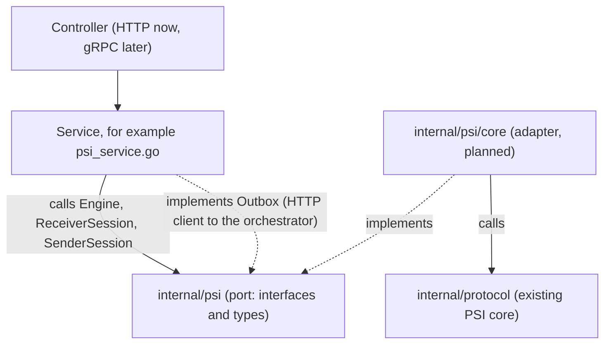
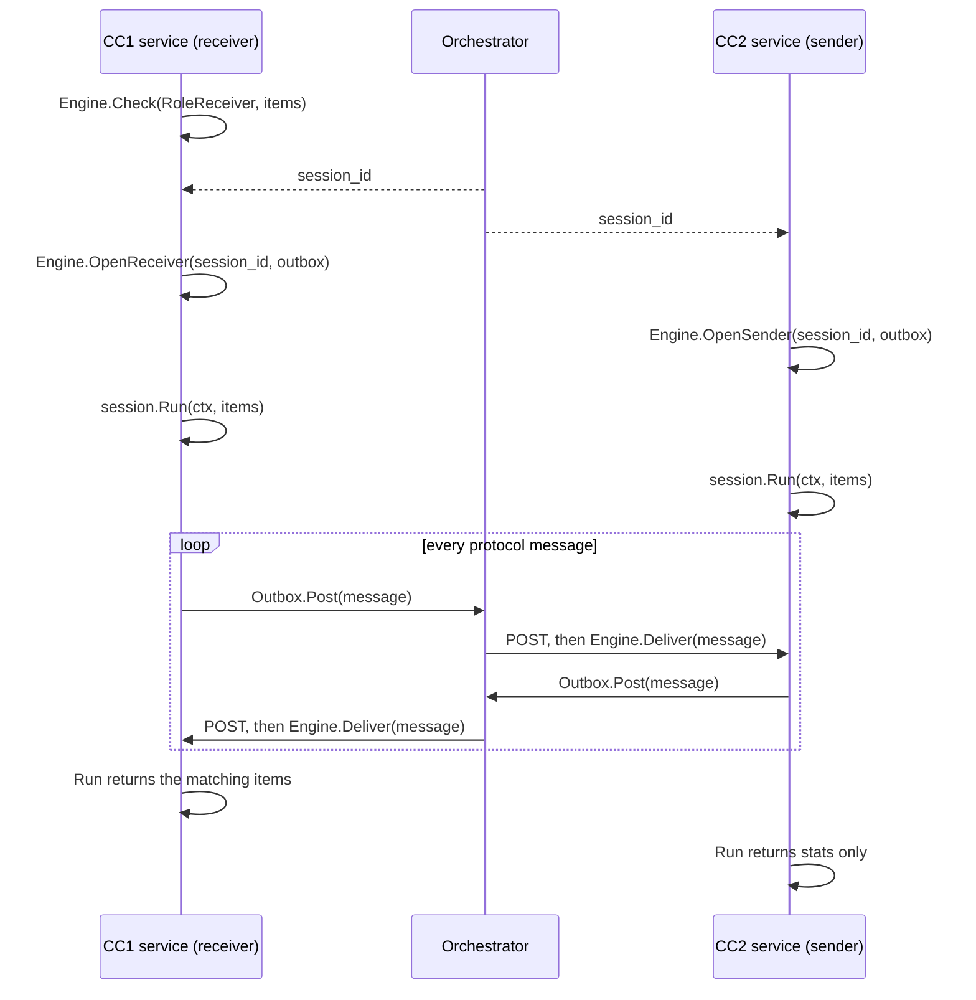

# internal/psi: the PSI port layer

This folder is the only part of the PSI code that business services should import. It describes
*what* a service can ask for (run a PSI session, get the result) without saying *how* the PSI is
computed. The decision behind it is recorded in
[ADR-0009](../../docs/decisions/0009-psi-port-layer.md).

Status: this package contains interfaces and types only. The first implementation, the adapter
`internal/psi/core` over the existing PSI core (`internal/protocol`), is planned and not written
yet.

## In one minute

- `internal/psi` is the **port**: a set of Go interfaces and types, the contract between services
  and any PSI implementation.
- `internal/psi/core` will be the **adapter**: it implements those interfaces by calling the
  existing PSI core in `internal/protocol`.
- Services depend only on the port. To use another PSI implementation later, write another
  adapter; the services do not change.

## The layers



Read the arrows like this:

- The service calls the interfaces of the port. It never sees the adapter or the core.
- The adapter implements those interfaces and calls the core.
- The service also implements one interface of the port, `Outbox`, because the PSI needs a way
  to send messages out and only the service knows how to reach the orchestrator.

The same idea in a more familiar shape:

| Usual app | PSI |
|---|---|
| `UserService` | your service, for example `psi_service.go` |
| `UserRepository` (interface) | `internal/psi` (port) |
| `PostgresUserRepository` (implementation) | `internal/psi/core` (adapter) |

## Files in this folder

| File | What it holds |
|---|---|
| `psi.go` | The interfaces `Engine`, `ReceiverSession`, `SenderSession` and `Outbox`; the `Message` struct; `Role`; `ValidSessionID` and the size limits |
| `errors.go` | The error values a service checks with `errors.Is`, and the `Error` type |
| `result.go` | What `Run` returns: `ReceiverResult`, `SenderResult`, `Stats` |
| `doc.go` | The package documentation (`go doc ./internal/psi`) |
| `psi_test.go` | Tests for the types, and a test that this package imports only the standard library |

Go imports a package, not a file: `import "github.com/XSpring/minipsi/internal/psi"` gives a
service everything listed above.

## What a service uses

| Name | Kind | Who implements it | What it is for |
|---|---|---|---|
| `Engine` | interface | the adapter | `Check` the items, `OpenReceiver` or `OpenSender` a session, `Deliver` an inbound message |
| `ReceiverSession`, `SenderSession` | interface | the adapter | `Run` the session once and get the result; `Close` it |
| `Outbox` | interface | the service | `Post` one outbound message to the orchestrator |
| `Message` | struct | - | one protocol message: `session_id`, `seq`, `kind`, `payload` (JSON) |
| `ReceiverResult`, `SenderResult`, `Stats` | struct | - | the result of `Run` |
| `ErrTimeout`, `ErrBusy`, ... and `Error` | errors | - | what went wrong, and whether to retry |

## How a session runs

The two parties (CC1 and CC2) never talk to each other directly. Every message goes through the
orchestrator (ORC) over plain HTTP: the ORC POSTs inbound messages to a CC, and the CC POSTs its
outbound messages to the ORC.



Steps for one party:

1. `Engine.Check(role, items)`: reject bad input before asking the ORC for a session.
2. Get a `session_id` from the ORC.
3. `Engine.OpenReceiver(id, outbox)` or `Engine.OpenSender(id, outbox)`, as soon as the ID is
   known. From now on, messages from the peer are kept until `Run` starts.
4. `session.Run(ctx, items)`: blocks until the session ends. Call it promptly, because the
   peer is already waiting. Cancel `ctx` to stop it.
5. `session.Close()`: always, for example with `defer`. If `Run` was never called, `Close` also
   tells the peer to stop waiting.

Meanwhile, the HTTP handler that receives the ORC's POSTs passes each message unchanged to
`Engine.Deliver`.

Example:

```go
type MatchService struct {
	engine psi.Engine // given by main; the service does not know which implementation it is
	orc    psi.Outbox // HTTP client that POSTs to the orchestrator
}

func (s *MatchService) RunReceiver(ctx context.Context, sessionID string, items [][]byte) ([][]byte, error) {
	if err := s.engine.Check(psi.RoleReceiver, items); err != nil {
		return nil, err
	}
	sess, err := s.engine.OpenReceiver(sessionID, s.orc)
	if err != nil {
		return nil, err
	}
	defer sess.Close()
	res, err := sess.Run(ctx, items)
	if err != nil {
		return nil, err // for example errors.Is(err, psi.ErrTimeout)
	}
	return res.Matches, nil
}

// OnMessage is called by the HTTP handler for every message the orchestrator pushes.
func (s *MatchService) OnMessage(ctx context.Context, m *psi.Message) error {
	return s.engine.Deliver(ctx, m)
}
```

## Handling errors

Errors come in two groups.

**Session failures**, returned by `Check` and `Run` as an `*psi.Error`. Check them with
`errors.Is`:

| Error | Meaning |
|---|---|
| `ErrInput` | the local items were rejected (too many, too large, a hash collision) |
| `ErrMismatch` | the two parties use different parameters |
| `ErrProtocol` | the peer broke the protocol |
| `ErrPeerAborted` | the peer stopped the session; `Error.Code` says why |
| `ErrTimeout` | a peer message did not arrive in time |
| `ErrDelivery` | messages could not be posted to the orchestrator |
| `ErrCanceled` | the context was cancelled or the session was closed |
| `ErrInternal` | a local failure of the engine |

**Registry and message errors**, returned by `OpenReceiver`, `OpenSender` and `Deliver`. They
tell the caller, usually the ORC through the HTTP response, whether to send the same message
again:

| Error | Retry? | Meaning |
|---|---|---|
| `ErrUnknownSession` | yes | the session is not open yet |
| `ErrOutOfOrder` | yes | the message arrived before an earlier one |
| `ErrBusy` | yes | too many sessions, or the session's queue is full |
| `ErrSessionClosed` | no | the session has ended |
| `ErrMalformed` | no | the message or session ID is invalid; this also ends an open session |
| `ErrSessionExists` | no | the session ID is already in use |

`Deliver` returns nil for an accepted message, and also for an exact duplicate of one, so the
ORC can safely send a message twice.

## Design patterns used

| Pattern | Where | Why |
|---|---|---|
| **Ports and Adapters** (hexagonal architecture) | Port: `internal/psi`. Adapter: `internal/psi/core` (planned). `Outbox` is a port in the other direction: the core calls out, the service implements it. | Services depend on a small, stable contract; the PSI implementation can be replaced without touching them. |
| **Service Layer** | Your service, for example `psi_service.go`, between the controller and `psi.Engine` | Keeps HTTP or gRPC details in the controller and PSI details behind the port. |
| **Dependency Injection** (composition root) | `main` creates the adapter (`core.New`, planned) and passes it to the service as a `psi.Engine`; the service passes its `Outbox` to `OpenReceiver` and `OpenSender`. | Only `main` knows which implementation is used; services and tests can use any `Engine`. |
| **Abstract Factory** | `Engine.OpenReceiver` and `Engine.OpenSender` create `ReceiverSession` and `SenderSession`; the adapter's engine is the concrete factory. | The service never creates a session itself, so it does not depend on the session's concrete type. |
| **Adapter** | `internal/psi/core` (planned): its receiver and sender wrap `protocol.RunReceiver` and `protocol.RunSender`; its connection turns `Outbox.Post` and `Deliver` into the `protocol.Conn` the core expects. | The existing core stays unchanged; only the adapter knows its types. |
| **Facade** | `Engine` and `Run` | They hide the handshake, the core configuration, frame chunking, retries and session bookkeeping behind a few simple calls. |
| **Idempotent Receiver with retry** (messaging) | `Message.Seq`, `Deliver`, `Outbox.Post`, and the retry column above | Messages may be sent more than once; the sequence number keeps them in order and drops exact duplicates. |

## Adding another PSI implementation

1. Create a new folder, for example `internal/psi/otherpsi`.
2. Implement `psi.Engine`, `psi.ReceiverSession` and `psi.SenderSession` there, following the
   contracts written in `psi.go`. The message payload format is yours to choose; services
   never read it.
3. In `main`, create the new engine instead of the old one.

The interfaces in `internal/psi` are the standard to follow. `internal/psi/core` is one
implementation of them and can serve as an example. No service code changes.

## Rules

- This package imports only the Go standard library. A test enforces it, so services cannot
  reach core types through it.
- Never log, report or put into error messages the items given to `Run`, the matching items in
  `ReceiverResult.Matches`, or message payloads. Errors and `Stats` from this package contain
  none of them.
- Forward `Message` values unchanged. Do not read, re-encode or modify `Payload`.
